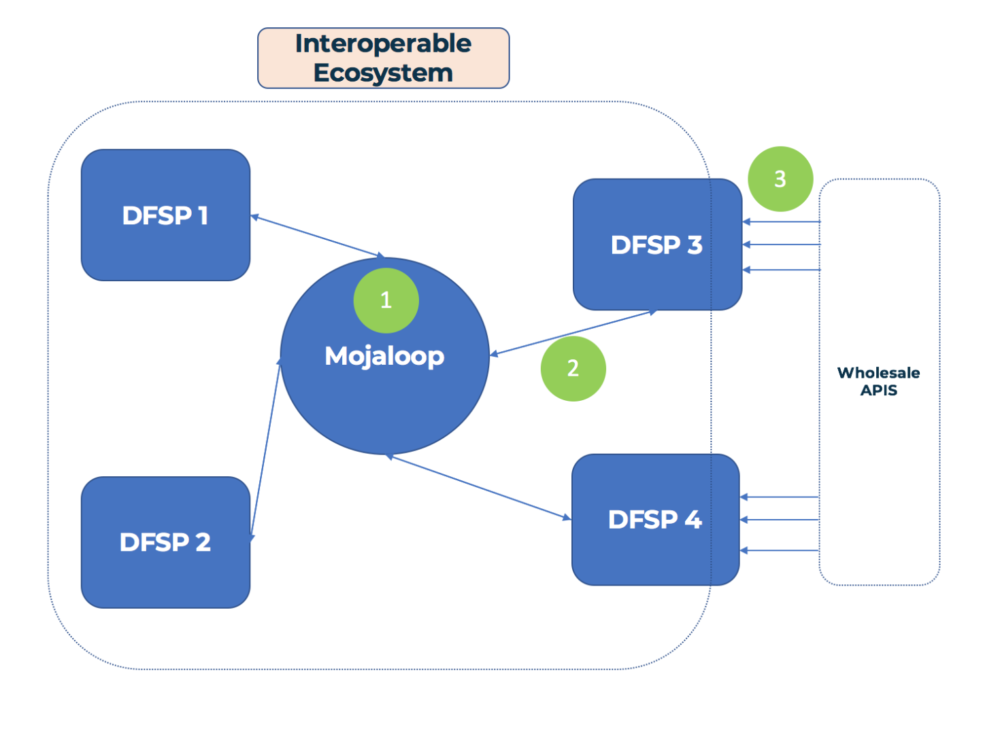

# Discussão sobre o Lab/Workbench do Mojaloop

___Objetivo:__ este documento de discussão procura expor os argumentos e alinhar a comunidade em torno do desenvolvimento de um ambiente educativo de Lab do Mojaloop._

## 1. Objetivos para o convening do PI8:

1. Definir termos e enunciar pressupostos
2. Descrever os esforços existentes e a forma como a Comunidade OSS se alinha com eles (GSMA, MIFOS, ModusBox)
3. Definir utilizadores e casos de utilização, e excluir os utilizadores com que não nos vamos preocupar
4. Recomendações de algumas soluções diferentes para o «problema do Lab»
	- Documentação sobre os casos de negócio e as personas que o Dan desenvolveu 
	- Implementação básica de um Lab Configurer, ajudar as pessoas a construir labs com diferentes funcionalidades
    - Demonstração simples de Mojaloop em folhas de cálculo, para levar as pessoas a utilizar o mojaloop sem Postman
5. Implementação básica e demonstração
6. Colocar questões importantes e discutir os passos seguintes

## 2. Nomenclatura

**1. Ferramentas:**
- 1.1 Um dispositivo utilizado para desempenhar uma função
- 1.2 Ferramentas diferentes para funções diferentes: não se usa uma chave de fendas para pregar um prego.
- 1.3 Num contexto Mojaloop, um exemplo de ferramenta é o Bank Oracle
  - O Bank Oracle é uma ferramenta que se liga ao Account Lookup Service e que pode ser utilizada para permitir que o Mojaloop se ligue a contas bancárias existentes com um IBAN

**2. Workbench:**
- 2.1 Combina diferentes ferramentas num só lugar
- 2.2 Por exemplo, uma plaina, uma serra de mesa e um formão podem compor uma bancada de marcenaria, ao passo que uma serra de metais, uma lima e uma rebarbadora podem compor uma bancada de serralharia
- 2.3 Na linguagem do mojaloop, as ferramentas para testar as chaves JWS do meu DFSP estão numa bancada diferente das ferramentas que demonstram a uma fintech como as api wholesale podem funcionar sobre o Mojaloop

**3. Lab:**
- 3.1 Um lab é um sítio aonde se vai para fazer experiências
- 3.2 Fazemos experiências para aprender e para testar os nossos pressupostos
  - Por exemplo, um DFSP pode montar e executar uma _experiência_ em que envia e recebe cotações utilizando uma API em desenvolvimento
- 3.3 Um único lab combina várias bancadas num só lugar

**4. Simulador:**
- 4.1 Uma ferramenta que simplifica ou abstrai alguma função, para que se possa testar uma coisa de cada vez
- 4.2 Os pilotos treinam com simuladores _antes_ de pilotarem um avião real, perigoso e dispendioso.
- 4.3 Dentro do Mojaloop: um simulador pode simular a interação com algum componente do sistema
  - Substituir um switch inteiro para testar a implementação de um DFSP
  - Simular 2 DFSP para testar o deployment de um switch
  - Um simulador reduz também a necessidade de alguém estar com a pessoa que testa. Assim, um DFSP pode enviar e receber através do switch, sem interação com o operador do Hub.

## 3. Pressupostos

>_Alguns destes poderão ser óbvios, mas vale a pena registá-los aqui de qualquer forma._

- 1\. A Gates Foundation quer incentivar a adoção do Mojaloop a todos os níveis (e não apenas de switches)
- 2\. Não precisamos de um ambiente de lab que sirva as necessidades do deployment de um switch ou de um DFSP em implementação - essas necessidades serão satisfeitas noutro lugar
- 3\. A Comunidade OSS do Mojaloop quer tornar-se atrativa 
  - Isto não significa remover todas as barreiras à entrada, mas avaliar que barreiras deveríamos remover

## 4. Utilizadores

Dividimos os utilizadores em 2 campos: utilizadores primários e utilizadores secundários.

### 4.1 Utilizadores primários
1. DFSP que precisam de se integrar com o Mojaloop (abreviatura: DFSP em implementação)
2. Organizações/pessoas que pretendem aprender sobre o Mojaloop e querem construir e testar funcionalidades ou casos de utilização enquanto DFSP (abreviatura: DFSP em avaliação)
3. Organizações/pessoas que pretendem aprender sobre o Mojaloop e querem construir e testar funcionalidades ou casos de utilização enquanto operador de hub (abreviatura: operadores de hub em avaliação)
4. Reguladores, organizações ou pessoas que pretendem compreender e avaliar o Mojaloop e a forma como este pode afetar o seu serviço atual (abreviatura: avaliadores gerais)

### 4.2 Utilizadores secundários
5. Integradores de sistemas que pretendem oferecer o Mojaloop como serviço, ou partes da integração com o Mojaloop como serviço (integrador de sistemas)
6. Contribuidores individuais (incluindo caçadores de bug bounty?) (contribuidor individual)
7. Fintechs que operam, ou que virão a operar, sobre um switch com Mojaloop (fintech com Mojaloop)
8. Fornecedores de aplicações de terceiros que interagem com as APIs wholesale de dinheiro móvel, vendendo integrações a fintechs e semelhantes (fornecedor de aplicações de terceiros)
9. Defensores da causa financeira, interessados em promover o Mojaloop e outras tecnologias que ajudem a impulsionar a inclusão financeira (defensores da inclusão financeira)

Além de pensar em cada um dos utilizadores acima, é importante perceber a que nível existem estes utilizadores na sua relação com um deployment do mojaloop. Para isso, vamos recorrer ao [_Fintech primer on Mojaloop_](https://medium.com/dfs-lab/what-the-fintech-a-primer-on-mojaloop-50ae1c0ccafb) de Dan Kleinbaum

>_Os 3 níveis de mojaloopice, https://medium.com/dfs-lab/what-the-fintech-a-primer-on-mojaloop-50ae1c0ccafb, por Dan Kleinbaum_

**Nível 1:** executar um switch Mojaloop (por exemplo, operadores de hub)  
**Nível 2:** interagir diretamente com um switch Mojaloop (por exemplo, DFSP, integradores de sistemas)  
**Nível 3:** interagir com um DFSP através de um switch Mojaloop (por exemplo, fintechs)  

## 5. Casos de utilização

__a.__ Testar uma implementação de DFSP compatível com o Mojaloop  
__b.__ Validar pressupostos sobre o Mojaloop  
__c.__ Ver e utilizar uma implementação de referência  
__d.__ Aprender sobre o funcionamento interno do Mojaloop  
__e.__ Aprender sobre os switches com Mojaloop e os casos de utilização associados (tecnologia)
__f.__ Avaliar como o Mojaloop mudará o panorama de negócio das fintechs  
__g.__ Conseguir demonstrar uma proposta de valor para que DFSP/fintechs/etc. utilizem o mojaloop (em vez da tecnologia _x_)

## 6. Matriz de utilizadores/casos de utilização:

Podemos representar os utilizadores e os casos de utilização numa matriz:

|  __Caso de utilização:__                    | a. Testar impl. de DFSP | b. Validar pressupostos | c. Impl. de referência | d. Aprender o interno | e. Aprender sobre a tecnologia | f. Avaliar casos de negócio  | g. Demonstrar o valor do ML |
| :----------------------------------- | :---: | :---: | :---: | :---: | :---: | :---: | :---: |
| __Utilizador:__                            |       |       |       |       |       |       |       |
| __1. DFSP em implementação__             |   X   |       |   X   |       |       |       |       | 
| __2. DFSP em avaliação__              |       |   X   |   X   |       |   X   |   X   |       |
| __3. Operador de hub em avaliação__       |       |       |   X   |       |   X   |   X   |       |
| __4. Avaliador geral__             |       |       |       |       |   X   |   X   |       |
| __5. Integrador de sistemas__            |   X   |   X   |   X   |   X   |       |       |   X   |
| __6. Contribuidor individual__        |       |   X   |   X   |   X   |       |       |       |
| __7. Fintech com Mojaloop__      |       |   X   |       |       |   X   |   X   |   X   |
| __8. Fornecedor de aplicações de terceiros__        |       |       |       |   X   |       |       |   X   |
| __9. Defensores da inclusão financeira__ |       |   X   |       |       |       |   X   |   X   |

## 7. Entradas e saídas dos casos de utilização:

>_Escolher 2 ou 3 utilizadores/casos de utilização diferentes e aprofundar as entradas e as saídas do que poderá ser satisfazer as suas necessidades_
>>_Nota: como em tudo o que é desta natureza, muitos dos utilizadores/casos de utilização e as conclusões associadas são algo fluidos e podem provavelmente ser colocados em caixas diferentes ou totalmente novas. Ainda assim, tentaremos defini-los da melhor forma possível._

### 7.1 Operador de hub em avaliação + DFSP em implementação
Conforme indicado nos nossos pressupostos acima, não nos vamos preocupar aqui com operadores de hub e DFSP em implementação.

### 7.2 DFSP em avaliação

>_Pensamos num DFSP em avaliação como aquele que não faz necessariamente parte de uma implementação de switch atual, mas que é uma parte curiosa em relação ao mojaloop e um candidato potencial a quem evangelizar o mojaloop - sem o objetivo tangível de uma implementação de switch à vista._

**7.2.1 Casos de utilização:**
- 1\. Validar pressupostos sobre o Mojaloop (como funciona, o que faz, o que _não_ faz)
- 2\. Ver e experimentar uma implementação de referência
- 3\. Aprender sobre os hubs com mojaloop e os casos de utilização associados (perspetiva tecnológica)
- 4\. Avaliar como o Mojaloop afetará o seu negócio no futuro

**7.2.2 Exemplos das nossas personas de utilizador:**
- 1\. Carbon - permitir levantamentos e remessas OTC através da sua rede de agentes
- 2\. Ssnapp - permitir pagamentos com vários pagadores/beneficiários e pontos de recompensa através do mojaloop
- 3\. Oneload - simplificar o onboarding para que outros DFSPs utilizem a rede de agentes da OneLoad
- 4\. Juvo - ligar-se a um switch Mojaloop para um mercado de scoring de crédito e de empréstimos

**7.2.3 Saídas: (como pode a Comunidade OSS do Mojaloop servir melhor estes intervenientes?)**
- 1\. ajudar no onboarding no ecossistema mojaloop
- 2\. ajudar a compreender a tecnologia, onde funciona bem e as potenciais armadilhas/desvantagens
- 3\. minimizar o investimento necessário para pôr as coisas a funcionar, para que se possam concentrar na construção de protótipos de casos de utilização
- 4\. levá-los de pouco ou nenhum conhecimento do Mojaloop -> à demonstração de protótipos reais

**7.2.4 Entradas: (quais são as coisas que temos de fazer para alcançar estes objetivos)**
- 1\. Documentação melhorada do mojaloop, específica para esta função.
  - 1.1 Pensar e desenhar a documentação e o fluxo de onboarding especificamente para os *DFSP em avaliação*
  - 1.2 A documentação deveria ser acessível a um gestor de produto, etc., com poucos conhecimentos técnicos
- 2\. Análise técnica aprofundada da tecnologia por trás do mojaloop, porquê e como funciona (talvez possamos reaproveitar o demonstrador js num percurso interativo por uma transação de ponta a ponta)
- 3\. Guias melhorados para pôr a funcionar em 2-3 grandes fornecedores de kubernetes, scripts de autosserviço e de instalação 
- 4\. Helm charts para 1-2 simuladores/labs que possam ser criados a par de um switch, com definições pré-configuradas e opinativas

### 7.3 Fintech com Mojaloop

>_Uma fintech com Mojaloop é uma fintech que opera, ou pretende operar, sobre um switch mojaloop. Haverá certamente sobreposição entre fintechs e DFSP nesta classificação, mas vamos concentrar-nos aqui nas fintechs que estão no terceiro nível dos «raios do Mojaloop» acima_

**7.3.1 Casos de utilização:**
- 1\. Validar pressupostos sobre o Mojaloop (como funciona, o que faz, o que _não_ faz)
- 2\. Aprender como o mojaloop se alinha com as APIs wholesale e o que seria preciso para que um DFSP utilizasse essas APIs sobre um switch Mojaloop
- 3\. Aprender sobre os hubs com mojaloop e os casos de utilização associados (perspetiva tecnológica)
- 4\. Avaliar como o Mojaloop afetará o seu negócio no futuro

**7.3.2 Exemplos das nossas personas de utilizador:**
- 1\. EastPay - comparar e procurar bancos/prestadores de pagamentos com base na estrutura aberta de comissões do Mojaloop
- 2\. Jumo - abrir mercados de crédito transparentes e mais justos sobre um switch com Mojaloop?

**7.3.3 Saídas: (como pode a Comunidade OSS do Mojaloop servir melhor estes intervenientes?)**
- 1\. Compreender como o Mojaloop e as APIs wholesale se conjugam (ou não)
- 2\. Permitir que as fintechs interajam com o Mojaloop através de 1 ou 2 APIs bancárias wholesale (por exemplo, a api MM da GSMA)
- 3\. levá-los de pouco ou nenhum conhecimento do Mojaloop -> à demonstração de protótipos reais

**7.3.4 Entradas: (quais são as coisas que temos de fazer para alcançar estes objetivos)**
- 1\. Documentação melhorada do mojaloop, específica para esta função.
- 2\. Documentação ou documento de trabalho sobre a forma como o Mojaloop funcionará com as apis wholesale
- 3\. Ambiente de lab autoinstalado, com um DFSP que exponha algumas apis wholesale com funcionalidade básica, para que as fintechs testem contra ele

## 8. Esforços de Lab/Workbench OSS a par de outros

Há outros na comunidade a trabalhar em algumas das necessidades que descrevemos acima. Como podemos alinhar-nos para: (1) não duplicar esforços (nem pisar os pés uns aos outros) e (2) proporcionar o maior impacto aos utilizadores finais e à comunidade Mojaloop como um todo

Em geral, chegámos a consenso quanto ao seguinte:
- qualquer esforço de Lab OSS deveria estar focado num utilizador final específico
- O nosso foco deveria estar mais para fora nos raios do mojaloop (DFSP, fintechs, fornecedores de aplicações de terceiros)

### 8.1 MIFOS
- 1\. Já foi feito trabalho extenso aqui com o sistema Fineract, que disponibiliza uma solução pronta a usar para DFSP com Mojaloop
- 2\. a trabalhar em implementações de open api
- 3\. A trabalhar na redução das barreiras à entrada para DFSP e fintechs
- 4\. Mifos Innovation Lab: «a locomotiva sobre os carris do Mojaloop»
  - 4.1 Demonstrar sistemas Mojaloop de ponta a ponta com integração de DFSP
  - 4.2 Construir e contribuir com ferramentas OS
- 5\. Já a trabalhar em deployments no mundo real 
- 6\. Veem a necessidade de um «ponto único de entrada no ecossistema Mojaloop»
- 7\. Têm um deployment de Lab existente com Mojaloop, que está a ser atualizado para funcionar com os deployments de helm chart mais recentes

### 8.2 GSMA
- 1\. Têm a api de dinheiro móvel, gostariam de ver uma solução de ponta a ponta com fintechs/DFSP a comunicar através de um switch mojaloop
- 2\. O Lab da GSMA tem um âmbito muito alargado; o Mojaloop é apenas uma peça disto
- 3\. Um dos objetivos principais é a API de dinheiro móvel - defender uma norma predefinida para a integração de terceiros no dinheiro móvel
- 4\. onde se enquadra o Mojaloop?
	- 4.1 É um dos ramos em que o Lab da GSMA irá trabalhar
	- 4.2 Onde pode a GSMA acrescentar mais valor ao Mojaloop?
		- 4.2.1 Servir uma necessidade do mercado para obter o maior impacto
    - 4.2.2 Ver um protótipo de ponta a ponta da API MM a comunicar através de um switch Mojaloop

### 8.3 ModusBox
- 1\. Mais na perspetiva do integrador de sistemas. Já estão a construir um conjunto de ferramentas para facilitar o processo de desenvolvimento e de onboarding de switches e DFSP
- 2\. Disponibilizaram em código aberto o SDK JS do Mojaloop
- 3\. Interessados em mostrar «como funciona o motor», para gerar confiança nos parceiros/clientes de negócio
- 4\. Interessados também (sobretudo no caso da WOCCU) num lab Mojaloop como sítio onde as fintechs aprendam e testem conceitos sobre switches Mojaloop
  - 4.1 Assim que isto estiver ligado, os casos de utilização interessantes começarão a desenvolver-se para além das transferências de A para B
  - 4.2 As IMFs (sobretudo as pequenas e médias) não têm muita capacidade para experimentação ou para desenvolver novos casos de negócio, mas estes casos podem ser impulsionados primeiro a partir das fintechs
- 5\. Como podemos ajudar as organizações com pouca ou nenhuma capacidade técnica a ganhar confiança com o Mojaloop?
  - 5.1 Um ambiente de lab técnico não ajudará muito neste caso
  - 5.2 Podemos demonstrar o Mojaloop através de uma folha de cálculo? Toda a gente compreende folhas de cálculo.

## 9. Questões

- 1\. Muito disto remete para o ciclo de vendas proposto pela Gates Foundation para aumentar a adoção do mojaloop
  - 1.1 Olhando apenas para os resumos técnicos do hackathon, há alguns intervenientes __grandes__ (Famoco, Ethiopay, GrameenPhone) que poderiam realmente pegar no mojaloop e avançar com ele
  - 1.2 Como se pode ultrapassar o obstáculo inicial para impulsionar a adoção e ajudar estas organizações a adotar o mojaloop e a contribuir de volta para o ecossistema?
  - 1.3 Como é o ponto de entrada na indústria para os operadores de hub?

- 2\. Para os DFSPs em avaliação, como é a sua afetação de recursos/risco?
  - 2.1 Se acharem que o Mojaloop é uma opção viável para um produto futuro, que tipo de investimento de tempo e de recursos farão nele?
  - 2.2 Quais são as suas alternativas? (Isto será caso a caso)

- 3\. Será um certo grau de gatekeeping técnico uma coisa boa ou má? (Esta é uma questão mais filosófica)
  - 3.1 Se não tornarmos demasiado fácil pôr tudo a funcionar, garantimos que apenas as partes interessadas e determinadas utilizam o mojaloop, o que gera, por autosseleção, uma comunidade melhor (mais ou menos)
  - 3.2 Mas isto exclui muitas pessoas que não dominam kubernetes, docker, etc., mas que podem ter bastante experiência em serviços financeiros, etc.

- 4\. Problema do ovo e da galinha(?) entre DFSP e operadores de hub. Vai de DFSP -> operadores de hub ou ao contrário?

## 10. Recomendações

- 1\. Encontrar um utilizador-alvo para o qual, ou com o qual, possamos construir um lab
  - 1.1 talvez uma das equipas mais sérias do hackathon?
- 2\. Abordar e colmatar as lacunas da documentação: partindo de uma perspetiva específica por função (ou seja, DFSP, fintech, operador de hub)
- 3\. Demonstração de Mojaloop em folha de cálculo
- 4\. Construir um protótipo de lab de autosserviço
  - 4.1 Conjunto opinativo de helm charts cujo deployment possa ser feito a par de um switch geral
  - 4.2 Recolher feedback da comunidade e ver onde e como as pessoas o estão a utilizar
