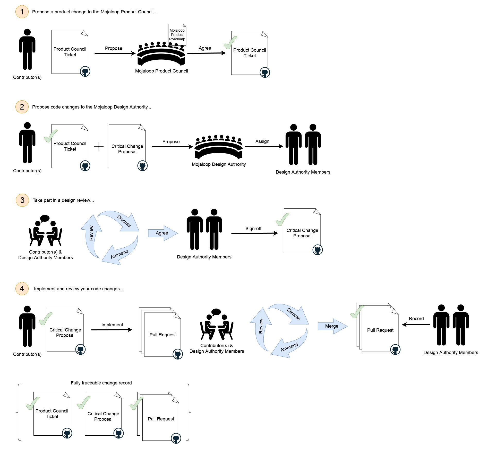

# Processo de alteração crítica

_**No Mojaloop, o «processo de alteração crítica» é semelhante ao «processo de alteração consequencial», mas com supervisão
adicional e um requisito de aprovação formal, dado o elevado risco deste tipo de alterações no nosso ambiente de funcionamento.**_

Para as alterações abrangidas pela [definição de alteração crítica](./design-review.md#alteracoes-criticas), deve ser
seguido o processo seguinte:

1. Proponha uma alteração de produto ao Product Council do Mojaloop:
    1. Crie uma 'Product Change Proposal' no repositório do projeto 'product-council'
       do GitHub, [aqui](https://github.com/mojaloop/product-council-project/issues).
        1. Preencha o modelo da forma mais completa possível para garantir uma resposta rápida.
    2. Envie uma mensagem no canal [#product-council](https://mojaloop.slack.com/archives/C01FF8AQUAK) do Slack a pedir
       uma revisão da proposta.
    3. O Product Council discutirá a proposta com o proponente para perceber onde se enquadra no roadmap de produto
       do Mojaloop.
2. Proponha alterações de código à Design Authority do Mojaloop:
    1. Crie uma issue 'Critical Change Proposal' no repositório 'design-authority-project'
       do GitHub, [aqui](https://github.com/mojaloop/design-authority-project/issues).
        1. Preencha o modelo da forma mais completa possível para garantir uma resposta rápida.
    2. Envie uma mensagem no canal [#design-authority](https://mojaloop.slack.com/archives/CARJFMH3Q) do Slack a pedir
       uma revisão da proposta.
    3. A Design Authority atribuirá dois ou mais membros para trabalhar com o proponente na proposta.
3. Participe numa revisão de design:
    1. Os membros da Design Authority atribuídos orientarão o proponente ao longo de um processo iterativo de revisão de design.
    2. Concluído o processo de revisão de design, os membros da Design Authority atribuídos aprovarão formalmente o
       design para que a implementação possa começar
    3. Depois de o design ter sido formalmente aprovado, é possível avançar com a alteração.
4. Implemente e reveja as alterações de código:
    1. Crie e trabalhe em itens de trabalho do github/zenhub no
       [processo do workstream](./product-engineering-process.md#workstreams-do-mojaloop) conforme necessário. Não deixe de
       referenciar o ticket do Product Council e o ticket da proposta de alteração crítica nas descrições dos itens, para permitir
       a rastreabilidade futura.
    2. Quando estiver tudo pronto para fazer pull requests num ou mais repositórios de código, contacte os membros da Design Authority
       atribuídos e peça-lhes que iniciem a fase de revisão de código.
    3. Prepare-se para responder a perguntas e fazer ajustes durante esta fase.
    4. Assim que os membros da Design Authority atribuídos aprovarem os pull requests, a funcionalidade está pronta para ser incluída
       no processo oficial de disponibilização de versões do Mojaloop.
    5. Os membros da Design Authority atribuídos registarão formalmente a sua revisão de aprovação dos pull requests.
    6. Quaisquer alterações ao design feitas durante a implementação devem ser registadas no ticket da proposta.

## O que esperar durante o processo de revisão de design

_A Design Authority do Mojaloop tem a responsabilidade de garantir que os riscos são identificados e mitigados de forma adequada e que
as nossas normas estabelecidas para ferramentas, padrões e práticas são respeitadas. Os membros da Design Authority atribuídos
existem para ajudar a alcançar o melhor resultado possível para o proponente e para toda a comunidade Mojaloop._

Os membros da Design Authority atribuídos ajudarão a identificar e mitigar quaisquer riscos que a alteração possa introduzir, bem
como a discutir a forma como o design se alinha com as ferramentas, os padrões e as práticas estabelecidos.

1. Será pedido ao proponente que exponha as razões da alteração proposta e que explique o que pretende alcançar e
   como pretende alcançá-lo.
    1. O proponente deveria poder referir um ticket GitHub existente do Product Council do Mojaloop que mostre que discutiu
       o trabalho com este e que o Product Council concorda com a alteração. Note-se que o Product Council tem a
       responsabilidade de manter um roadmap coerente para a nossa tecnologia e orientará o proponente sobre a forma mais adequada
       de alcançar os seus objetivos de negócio no contexto do Mojaloop. O Product Council pode consultar a Design
       Authority no âmbito deste processo.
    2. O proponente deveria poder explicar como a alteração será implementada, que componentes existentes serão afetados,
       como têm de mudar e o seu design para quaisquer componentes novos. Deveria apresentar, no mínimo:
        1. Diagramas de sequência UML que mostrem cada componente significativo envolvido no(s) caso(s) de utilização e a forma como interagem para
           alcançar o(s) resultado(s) pretendido(s). Deveria certificar-se de que inclui os casos de erro, bem como os comportamentos esperados
           «normais».
        2. Todos os detalhes de quaisquer componentes de terceiros que utilizará na implementação.
        3. Todos os detalhes de quaisquer alterações aos componentes existentes, destacando as diferenças entre os comportamentos atuais
           e os comportamentos alterados e/ou novos pretendidos.
    3. Os membros da Design Authority atribuídos farão provavelmente muitas perguntas para compreender plenamente a
       proposta e o seu contexto.
2. Os membros da Design Authority atribuídos ajudarão a identificar quaisquer outros contribuidores, equipas ou
   partes interessadas potencialmente afetados, para os envolver no processo de revisão. Isto é feito para garantir que os comportamentos a montante e a jusante não
   são afetados negativamente e também para ter em conta quaisquer alterações futuras noutras áreas do sistema. O Mojaloop é um
   sistema grande e é frequentemente útil envolver especialistas de outras áreas para ajudar.
3. O objetivo principal dos membros da Design Authority atribuídos é identificar e mitigar riscos que o proponente possa não ter
   detetado.
    1. Os membros da Design Authority atribuídos podem fazer sugestões para mitigar o risco do design e podem pedir
       alterações específicas para alinhar a proposta com quaisquer restrições estabelecidas do Mojaloop.
