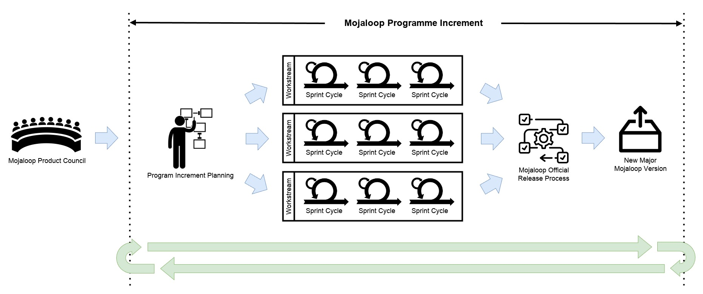
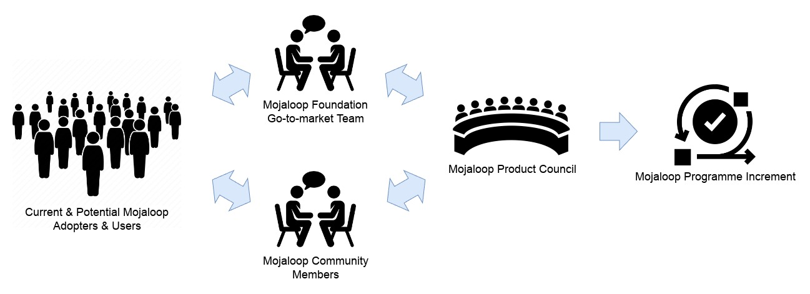
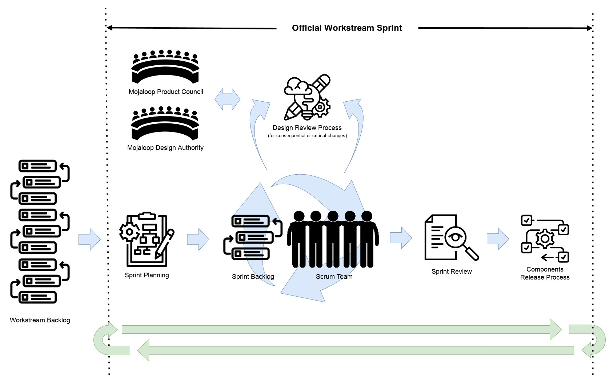

# Processo de engenharia de produto do Mojaloop

## Introdução

O software Mojaloop destina-se a constituir a espinha dorsal de schemes de pagamentos instantâneos inclusivos à escala nacional. Estes schemes são
peças importantes de infraestrutura financeira nacional regulada que viabilizam atividades diárias vitais de
um grande número de pessoas, como a compra de alimentos e de água potável. Os nossos adotantes, os respetivos reguladores e as pessoas
que realizam transações através de schemes Mojaloop exigem e merecem dos nossos produtos um nível extremamente elevado de qualidade, segurança, fiabilidade e
resiliência.

De forma a manter estas qualidades e mitigar os muitos riscos de negócio e técnicos que os nossos adotantes e as respetivas
partes interessadas enfrentam, a Mojaloop Foundation aplica um processo estruturado de engenharia de produto baseado nas melhores
práticas comprovadas do setor para software financeiro regulado, que inclui controlo de alterações e rastreabilidade geridos tecnicamente e orientados
por processos, revisões de design técnico e de código, limiares elevados de testes e vários níveis de
barreiras de garantia de qualidade.

O nosso processo destina-se a ajudar os nossos contribuidores a identificar e mitigar riscos enquanto melhoram os nossos produtos, em
benefício de toda a comunidade Mojaloop.

## Evolução do nosso processo

Desde 2017, quando o projeto Mojaloop escreveu o seu primeiro código, o nosso modelo de processo evoluiu para dar resposta à
transição de uma única equipa de engenharia para vários workstreams com recursos da comunidade, cada um centrado no desenvolvimento
de áreas específicas de um grande conjunto de produtos.

O nosso modelo atual baseia-se no [Scaled Agile Framework](https://scaledagileframework.com/), que utilizamos para permitir que
várias equipas trabalhem da forma mais independente possível para entregar um conjunto coordenado de resultados do roadmap em todo
o nosso espaço de produto.

O nosso modelo é um ciclo de «[incrementos de programa](https://v5.scaledagileframework.com/program-increment/)», cada um com a duração de
aproximadamente quatro meses de calendário. No final de cada incremento, os workstreams apresentam as suas realizações numa
reunião da comunidade, é disponibilizado código novo e começa o planeamento do incremento seguinte.

## Fluxo de requisitos de produto

Os pedidos de funcionalidades e os novos requisitos provêm de várias fontes, por exemplo:

- Adotantes atuais do Mojaloop e participantes de schemes Mojaloop
- Operadores de schemes de pagamento que pretendem beneficiar da tecnologia Mojaloop
- Departamentos governamentais que pretendem implementar schemes de pagamento inclusivos nos seus países
- Especialistas em inclusão financeira
- Membros da comunidade Mojaloop

Estes novos requisitos e pedidos de funcionalidades são recolhidos e analisados pelo Product Council do Mojaloop. Se existir procura
suficiente e disponibilidade evidente para contribuir, estes são integrados no Roadmap de Produto do Mojaloop e atribuídos a um
workstream oficial do Mojaloop. Se não existir um workstream adequado, pode ser criado um novo, com recursos da
comunidade.

Os workstreams têm normalmente um conjunto de objetivos definidos no início de cada incremento de programa do Mojaloop, mas podem ser inseridos pedidos de funcionalidades
de alta prioridade durante um incremento.

Os workstreams entregam os seus resultados num processo controlado que disponibiliza periodicamente versões oficiais do
software Mojaloop. O processo de disponibilização de versões do Mojaloop tende a alinhar-se com os incrementos de programa; as versões principais, que
incluem novas funcionalidades, são normalmente disponibilizadas perto do final de um incremento. As versões secundárias e de correção são disponibilizadas com mais
frequência e podem incluir, por exemplo, funcionalidades de alta prioridade, correções de erros ou correções de segurança.

## Workstreams do Mojaloop

Os workstreams oficiais são as «linhas de produção» da fábrica de software da comunidade Mojaloop; é aqui que acontece a maior parte do
trabalho de desenvolvimento de produto. Normalmente, existem muitos workstreams em curso em paralelo, cada um centrado em
áreas ou funcionalidades específicas da plataforma.

### Modelo de governação e requisitos de funcionamento

Os workstreams do Mojaloop têm um modelo de governação e requisitos de funcionamento claramente definidos para minimizar os riscos para todas as
partes interessadas:

1. Os workstreams devem ter um nome claro e conciso que reflita o seu propósito.
2. Os workstreams devem ter, em permanência, uma pessoa nomeada como líder; em algumas circunstâncias, a posição de líder do workstream
   pode ser partilhada por duas pessoas, se nenhuma delas tiver tempo suficiente para contribuir.
3. Os workstreams devem ter uma pessoa nomeada como elemento de ligação com a Design Authority do Mojaloop. Pode ser a mesma
   pessoa (ou pessoas) que lidera o workstream ou outra pessoa nomeada.
4. Os workstreams devem publicar e manter, no Community Central, uma descrição que explique o seu propósito, objetivos e âmbito para cada
   incremento de programa.
5. Os workstreams devem ter um mínimo de dois contribuidores ativos nomeados.
6. Os workstreams devem realizar um mínimo de uma reunião online por semana.
    1. As reuniões dos workstreams deveriam ser consideradas abertas à observação por outros membros da comunidade.
    2. As reuniões dos workstreams deveriam ser gravadas e as gravações deveriam ser publicadas publicamente.
7. Os workstreams com mais de dois contribuidores ativos deveriam realizar uma reunião online de stand-up ao estilo scrum.
    1. As reuniões de stand-up deveriam ser diárias, a menos que o volume de trabalho seja reduzido, caso em que pode
       ser aceitável uma cadência menos frequente.
8. Os workstreams devem manter um repositório GitHub público com todo o código, documentação e itens de trabalho relacionados.
9. Os workstreams devem cumprir todos os [processos de revisão de design e de código do Mojaloop](./design-review.md) antes, durante
   e depois da conclusão do trabalho.
10. Os workstreams devem obter e utilizar uma hashtag específica no Community Central ao fazer publicações.
11. Os workstreams devem ser revistos pelo Product Council do Mojaloop antes do início de cada incremento de programa.
    1. Os objetivos do workstream devem estar alinhados com o roadmap de produto do Mojaloop.
    2. Os objetivos do workstream devem estar alinhados com a missão da Mojaloop Foundation.

### Critérios e responsabilidades da liderança dos workstreams

A Mojaloop Foundation nomeia líderes que são normalmente voluntários da comunidade com um elevado nível de conhecimentos especializados
ou de experiência relevantes.

Para se qualificarem como (co)líderes de workstream, as pessoas deveriam cumprir os seguintes critérios:

1. Compromisso e capacidade para cumprir todas as responsabilidades de líder de workstream (ver abaixo).
2. Capacidade de organização demonstrável.
3. Capacidade de liderança demonstrável.
4. Capacidade técnica relevante demonstrável.
5. Familiaridade com o ecossistema Mojaloop.
6. Compromisso durante todo o PI.
7. Compromisso com o Código de conduta do Mojaloop e respetivo cumprimento

Os (co)líderes de workstream devem aceitar as seguintes responsabilidades:

1. Ser o principal ponto de contacto para questões.
2. Agendar, realizar, gravar e publicar as gravações e as atas das reuniões do workstream.
3. Facilitar a ligação entre os contribuidores do workstream, os outros workstreams e o resto da comunidade.
4. Criar, publicar no Community Central e manter um documento de carta de equipa do workstream.
5. Comunicar o progresso...
    1. ...regularmente à comunidade, no Community Central, utilizando a hashtag atribuída.
    2. ...ao Product Manager/Product Council.
6. Garantir que todos os itens de trabalho cumprem todos os [processos de revisão de design e de código do Mojaloop](./design-review.md) antes, durante
   e depois da conclusão do trabalho.
7. Garantir que todo o trabalho cumpre as normas de qualidade do Mojaloop, como o estilo, a cobertura de testes e a documentação.
8. Garantir que todo o trabalho é acompanhado no GitHub/Zenhub e que os prazos e o progresso são atualizados.
9. Garantir que todos os resultados técnicos são testados pela equipa nuclear antes da integração no processo oficial de disponibilização de versões. Para
   workstreams não técnicos, os resultados deveriam ser revistos pelo Product Director da Mojaloop Foundation.
10. Facilitar a construção de novas funcionalidades e escrever código conforme necessário.
11. Fazer a triagem/revisão das contribuições e das issues e responder aos utilizadores.
12. Registar relatórios de erros / correções e resolver conflitos no workstream.
13. Gerir proativamente a dívida técnica e melhorar o código existente, cumprindo
    todos os [processos de revisão de design e de código do Mojaloop](./design-review.md).
14. Garantir que a documentação cumpre as normas exigidas.
15. Orientar a direção estratégica do workstream em colaboração com o Product Director da Mojaloop Foundation e com o Product
    Council.
16. Definir objetivos SMART no início de cada PI.

### Definir o trabalho

Os workstreams devem definir e registar publicamente, através de issues do github/zenhub, o trabalho que planeiam realizar e o
progresso que fazem durante a implementação:

1. Os itens de trabalho devem ser registados no GitHub como issues do projeto; a utilização do zenhub não é obrigatória, mas é fortemente incentivada.
    1. Cada workstream tem o seu próprio projeto GitHub e espaço de trabalho zenhub para gerir os itens de trabalho.
2. Os itens de trabalho, também conhecidos como «user stories», deveriam ser definidos
   no estilo «As a... I want to... So That...»
   do [desenvolvimento orientado pelo comportamento](https://www.agilealliance.org/glossary/user-story-template/).
3. Os itens de trabalho deveriam incluir critérios de aceitação detalhados, definidos no estilo «given, when,
   then» do [desenvolvimento orientado pelo comportamento](https://www.agilealliance.org/glossary/given-when-then/).
4. Os itens de trabalho devem ser dimensionados de forma a que a duração prevista de qualquer item ou subitem não exceda um único sprint de duas semanas.
5. Os itens de trabalho devem cumprir todos os [processos de revisão de design e de código do Mojaloop](./design-review.md) antes, durante e
   depois da conclusão do trabalho. Quando for necessária uma revisão de design, deveriam ser utilizados tickets «spike» para acompanhar o processo de design
   antes de serem criados os tickets dos itens de trabalho.
    1. Toda a documentação de design exigida deve ser aprovada pela Design Authority do Mojaloop antes do início do trabalho.

Está disponível aqui um modelo de ticket para github/zenhub: [github-work-item-template.docx](github-work-item-template.docx)

### Realizar o trabalho

Por predefinição, os workstreams do Mojaloop deveriam seguir um modelo de processo semelhante ao [scrum](https://www.scrum.org/resources/what-scrum-module),
com uma cadência de sprints de duas semanas. Dados os exigentes requisitos de gestão do risco dos ambientes regulatórios dos nossos utilizadores
e as melhores práticas comprovadas para software financeiro, o nosso processo diário difere de algumas
metodologias ágeis típicas, na medida em que aplicamos funções de supervisão obrigatórias e mecanismos de controlo de alterações mais rigorosos,
mais típicos de organizações técnicas de maior dimensão que constroem e operam infraestruturas críticas.

Os workstreams têm flexibilidade para ajustar os métodos de trabalho às suas circunstâncias particulares, dentro de limites
sensatos e adequados à nossa missão e ao nosso domínio regulatório. A Mojaloop Foundation fornece orientação aos workstreams
para garantir que se mantêm dentro das normas de funcionamento exigidas.

Os workstreams deveriam realizar regularmente as atividades agendadas de standup, refinamento do backlog, planeamento do sprint, revisão do sprint e
retrospetiva.

É obrigatório que cada workstream defina e mantenha um documento de «carta de equipa» para comunicar de forma clara e inequívoca
as formas de trabalho acordadas a todos os contribuidores.

Está disponível para transferência um modelo de carta de equipa de workstream
aqui: [mojaloop-workstream-team-charter-template.pptx](../../../community/contributing/assets/mojaloop-workstream-team-charter-template.pptx)

### Obter apoio

Quando as coisas não correm como planeado e não é possível encontrar uma solução entre os contribuidores do workstream, a Mojaloop Foundation
disponibiliza mecanismos de apoio. Contacte o Director of Community da Mojaloop Foundation, que ajudará a encontrar uma
solução.

## Workstreams não oficiais e contribuições externas

Quando não existe um workstream adequado e o apoio não é suficiente para justificar a criação de um novo
workstream oficial, os contribuidores podem decidir trabalhar em funcionalidades ou alterações fora dos processos da comunidade. Nestas
circunstâncias,
o nosso [processo de doação externa](../standards/guide.md#adocao-de-contribuicoes-de-codigo-aberto-no-mojaloop) deve ser seguido
antes de o código, a documentação ou outros artefactos poderem ser adotados pela Mojaloop Foundation.

Note-se que todo o trabalho realizado fora dos processos oficiais dos workstreams do Mojaloop está sujeito ao
nosso [processo de doação externa](../standards/guide.md#adocao-de-contribuicoes-de-codigo-aberto-no-mojaloop). Isto destina-se a
garantir um nível adequado de revisão rigorosa, de forma a assegurar que as nossas normas são cumpridas antes da inclusão em qualquer versão oficial
do Mojaloop.
