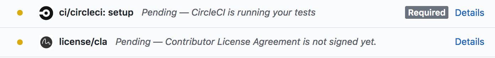
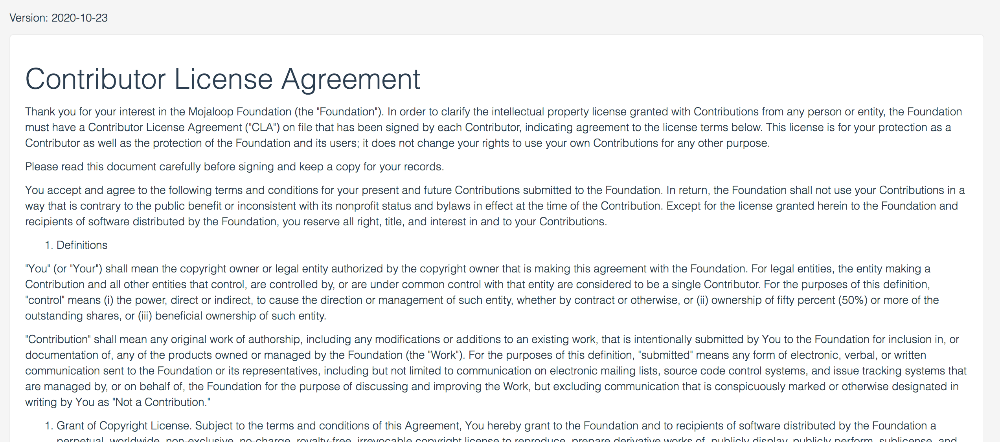
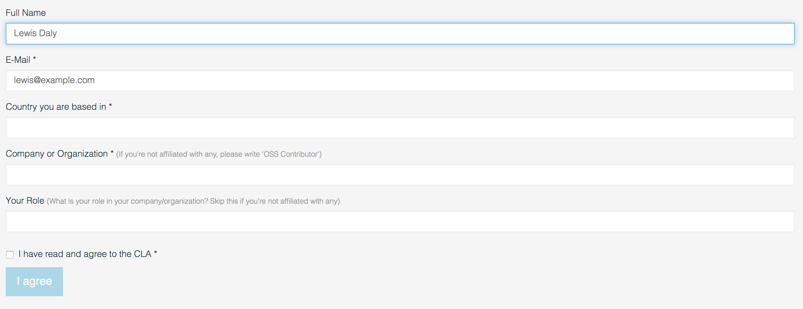
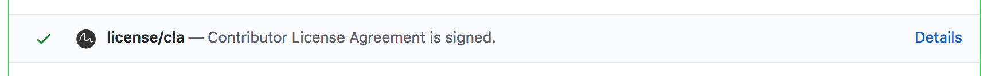
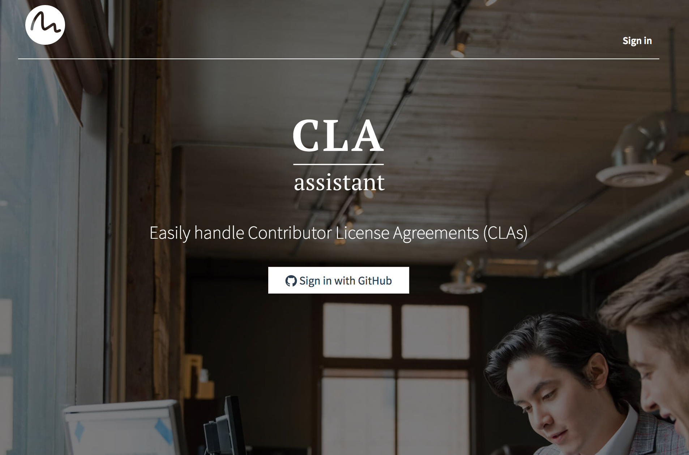
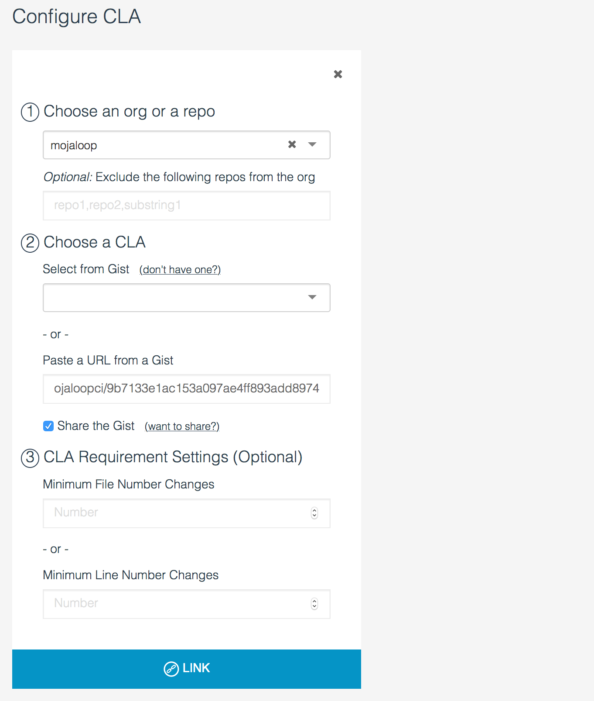

# Assinar o CLA

O Mojaloop tem um [Acordo de Licença de Contribuidor (Contributor License Agreement, CLA)](https://github.com/mojaloop/mojaloop/blob/master/CONTRIBUTOR_LICENSE_AGREEMENT.md) que clarifica os direitos de propriedade intelectual das contribuições de pessoas ou entidades.

Para garantir que todos os programadores assinaram o CLA, utilizamos o [CLA Assistant](https://cla-assistant.io/), uma ferramenta de código aberto bem mantida que verifica se um contribuidor assinou o CLA antes de permitir o merge de um pull request.

## Como assinar o CLA

1. Abra um pull request em qualquer repositório do Mojaloop
2. Quando o pull request executa as verificações padrão, é possível ver que a verificação `license/cla` foi executada e pede aos utilizadores que assinem o CLA:



3. Clique em 'Details' para ser encaminhado para a ferramenta CLA Assistant, onde é possível ler o CLA, preencher alguns dados pessoais e assiná-lo.


</br>



4. Depois de clicar em "I agree", volte ao pull request e verifique que a verificação do CLA Assistant foi aprovada.




### Assinar em nome de uma empresa

A secção 3 do [CLA do Mojaloop](https://github.com/mojaloop/mojaloop/blob/master/CONTRIBUTOR_LICENSE_AGREEMENT.md) abrange tanto as contribuições de pessoas singulares como as contribuições feitas por pessoas em nome do seu empregador. Quem contribui para a Comunidade Mojaloop em nome do seu empregador deve introduzir o nome do empregador no campo "Company or Organization". Caso contrário, é possível escrever "OSS Contributor" e deixar o campo "role" em branco.


## Administrar a ferramenta CLA

A ferramenta CLA é fácil de instalar; qualquer administrador GitHub pode ligá-la à organização Mojaloop.

1. Crie um novo Gist do GitHub e introduza o texto do CLA num novo ficheiro.
> Uma vez que o GitHub não permite que os Gists pertençam a organizações, [o nosso gist](https://gist.github.com/mojaloopci/9b7133e1ac153a097ae4ff893add8974) pertence ao utilizador 'mojaloopci'.

2. Aceda ao [CLA Assistant](https://cla-assistant.io/) e clique em "Sign in with GitHub"



3. É possível adicionar um CLA a um Repo ou a uma Organization. Selecione "Mojaloop" e, em seguida, selecione o gist acabado de criar



4. Clique em "Link" e está feito!


### Pedir informação adicional:

> Referência: [request-more-information-from-the-cla-signer](https://github.com/cla-assistant/cla-assistant#request-more-information-from-the-cla-signer)

Também é possível adicionar um ficheiro `metadata` ao gist do CLA, para construir um formulário personalizado para a ferramenta CLA:

```json
{
    "name": {
        "title": "Full Name",
        "type": "string",
        "githubKey": "name"
    },
    "email": {
        "title": "E-Mail",
        "type": "string",
        "githubKey": "email",
        "required": true
    },
    "country": {
        "title": "Country you are based in",
        "type": "string",
        "required": true
    },
    "company": {
        "title": "Company or Organization",
        "description": "If you're not affiliated with any, please write 'OSS Contributor'",
        "type": "string",
        "required": true
    },
    "role": {
        "title": "Your Role",
        "description": "What is your role in your company/organization? Skip this if you're not affiliated with any",
        "type": "string",
        "required": false
    },
    "agreement": {
        "title": "I have read and agree to the CLA",
        "type": "boolean",
        "required": true
    }
}
```

Produz o seguinte formulário:


