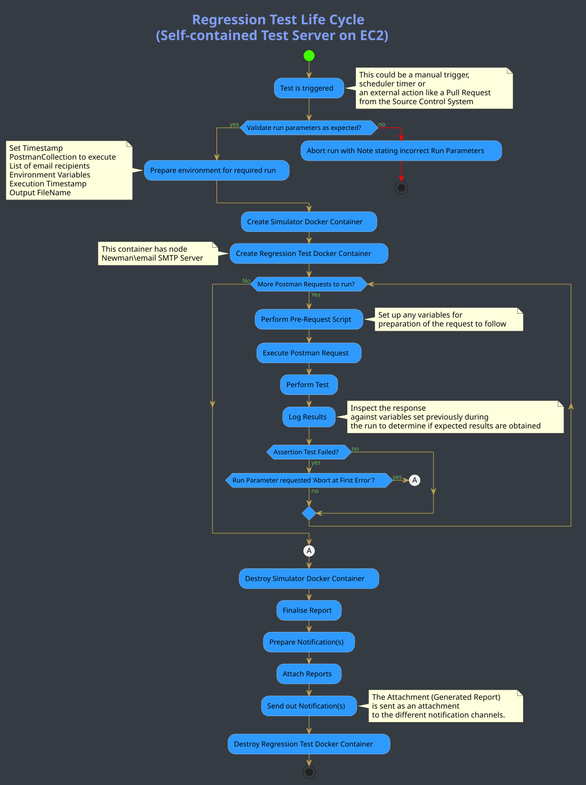

# QA e testes de regressão no Mojaloop
Uma visão geral da framework de testes montada no Mojaloop

Conteúdos:
1. [Requisitos de regressão](#topicos-de-regressao)
2. [Testes do desenvolvedor](#testes-do-desenvolvedor)
3. [Testes com Postman e Newman](#testes-com-postman-e-newman)
4. [Executar o teste de regressão](#executar-o-teste-de-regressao)
5. [Fluxo do processo de um teste agendado típico](#fluxo-do-processo-de-um-teste-agendado-tipico)
6. [Comandos do Newman](#comandos-do-newman)

## Tópicos de regressão
 Para que um sistema em deployment seja robusto, um dos últimos pontos de verificação é determinar se o ambiente em que está em deployment se encontra num estado saudável e se toda a funcionalidade exposta funciona exatamente como pretendido.

 Antes disso, porém, há um número considerável de disciplinas que é necessário instituir para assegurar o máximo controlo.

 Para ilustrar como o projeto Mojaloop alcança este objetivo, vamos mostrar-lhe os vários pontos de verificação instituídos.

### Testes do desenvolvedor
 Observando cada componente e módulo, dentro do código, encontrará uma pasta com o nome "*test*" que contém três tipos de testes.
 + Em primeiro lugar, o *coverage test*, que alerta para a existência de código inalcançável ou redundante
 + Testes unitários, que determinam se a funcionalidade pretendida funciona conforme esperado
 + Testes de integração, que não testam a funcionalidade ponta a ponta, mas a interação imediatamente vizinha
 + Verificações automatizadas de normas de código, implementadas através de pacotes que fazem parte do código

 Estes testes são executados correndo as instruções da linha de comandos, pelo desenvolvedor, durante o processo de codificação. Além disso, os testes são executados automaticamente sempre que é feito um *check-in* e emitido um Pull-Request no Github para que o código seja integrado no projeto.

 O procedimento descrito acima situa-se fora do âmbito dos testes de Quality Assurance (QA) e de regressão, que este documento aborda.

 Depois de um desenvolvedor ter escrito nova funcionalidade ou ampliado funcionalidade existente, e por ter de passar pelos testes rigorosos acima, pode assumir-se que a funcionalidade em questão está a executar como pretendido. Como se garante então que esta nova porção de código não afeta negativamente o projeto ou o produto como um todo?

 Quando o código passou tudo o que ficou dito acima e é colocado em deployment como parte dos processos de CI/CD implementados pelo nosso workflow, o(s) novo(s) componente(s) são aceites nos vários hosts, implementações na cloud ou on-premise. Estes hosts vão desde plataformas de desenvolvimento até ambientes de produção.

### Testes com Postman e Newman
 Em paralelo com o processo de deployment está a manutenção e conservação da framework de testes de coleções [Postman](https://github.com/mojaloop/postman.git "Postman"). Quando é feito um novo release, como parte do workflow, são publicadas Release Notes que listam toda a funcionalidade nova e/ou melhorada implementada como parte do release. Estas notas são utilizadas pela equipa de QA para ampliar e melhorar as coleções Postman existentes, nas quais são escritos testes por trás dos scripts de request/response para testar tanto cenários positivos como negativos face ao comportamento pretendido. Estes testes são depois corridos da seguinte forma:
 + Manualmente, para determinar se os testes cobrem todos os aspetos e ângulos da funcionalidade, os positivos para afirmar o comportamento pretendido e os testes negativos para determinar se os fluxos alternativos corretos funcionam como pretendido quando algo inesperado corre mal
 + Agendados — como parte do regime de regressão, para fazer exatamente o mesmo que a intenção manual, mas de forma totalmente automatizada (com o *Newman Package*), com relatórios e logs produzidos para destacar qualquer comportamento não pretendido e também para avisar quando um comportamento conhecido mudou em relação a uma execução anterior.

Para facilitar os testes automatizados e agendados de uma coleção Postman, existem vários métodos que se podem seguir, e o que foi implementado para uso do Mojaloop é explicado mais adiante neste documento.

Existe um repositório completo que contém todos os scripts, procedimentos de configuração e tudo o que é necessário para montar uma [framework de QA e testes de regressão](https://github.com/mojaloop/ml-qa-regression-testing.git "QA and Regression Testing Framework") automatizada. Esta framework permite visar qualquer coleção Postman, especificando o Ambiente pretendido contra o qual executar, bem como uma lista separada por vírgulas de destinatários de email para receberem o relatório gerado. Esta framework é utilizada diariamente pelo Mojaloop e existe numa instância EC2 na AWS, alojando os componentes necessários como Node, Docker, Servidor de Email e Newman, bem como vários Bash Scripts e Templates para utilização pela framework, de modo a correr automaticamente todos os dias as coleções pretendidas. Utilizar este guia permitirá a qualquer pessoa montar a sua própria Framework.

#### Coleções do Postman

Existe um conjunto de coleções Postman em utilização nos diferentes processos:

Para o Mojaloop Simulator:

+ [MojaloopHub_Setup](https://github.com/mojaloop/postman/blob/master/MojaloopHub_Setup.postman_collection.json) : Esta coleção tem de ser executada uma vez após um novo deployment, normalmente pelo Release Manager. Configura um hub Mojaloop vazio, incluindo elementos como a moeda do Hub e as contas de liquidação.
+ [MojaloopSims_Onboarding](https://github.com/mojaloop/postman/blob/master/MojaloopSims_Onboarding.postman_collection.json) : O MojaloopSims_Onboarding configura os simuladores de DFSP e define elementos como os urls dos endpoints, para que o hub Mojaloop saiba para onde enviar os callbacks dos pedidos.
+ [Golden_Path_Mojaloop](https://github.com/mojaloop/postman/blob/master/Golden_Path_Mojaloop.postman_collection.json) : A coleção Golden_Path_Mojaloop é um pacote de testes de regressão ponta a ponta que faz um teste completo de toda a funcionalidade em deployment. Este teste pode ser corrido manualmente, mas foi na verdade concebido para ser corrido do início ao fim, de forma automatizada, uma vez que os valores das respostas vão sendo passados de um pedido para o seguinte. (A equipa core usa este conjunto para validar vários releases e deployments)
    + Notas: Em alguns casos, é necessário um atraso de `250ms` - `500ms` se for executado através do Test Runner da UI do Postman. Isto garantirá que os testes têm tempo suficiente para validar os pedidos face ao simulador. No entanto, nem sempre é necessário.
+ [Bulk_API_Transfers_MojaSims](https://github.com/mojaloop/postman/blob/master/Bulk_API_Transfers_MojaSims.postman_collection.json) : Esta coleção pode ser usada para testar a funcionalidade de transferências em massa que visa o Mojaloop Simulator.

Para o Legacy Simulator (incentiva-se o uso do Mojaloop Simulator, dado que este não será suportado a partir do PI-12 (outubro de 2020) ):

+ [ML_OSS_Setup_LegacySim](https://github.com/mojaloop/postman/blob/master/ML_OSS_Setup_LegacySim.postman_collection.json) : Esta coleção tem de ser executada uma vez após um novo deployment (se este usar o Legacy Simulator), normalmente pelo Release Manager. Configura o hub Mojaloop, incluindo elementos como a moeda do Hub e as contas de liquidação, juntamente com o(s) Legacy Simulator(es) como FSP(s).
+ [ML_OSS_Golden_Path_LegacySim](https://github.com/mojaloop/postman/blob/master/ML_OSS_Golden_Path_LegacySim.postman_collection.json) : A coleção Golden_Path_Mojaloop é um pacote de testes de regressão ponta a ponta que faz um teste completo de toda a funcionalidade em deployment. Este teste pode ser corrido manualmente, mas foi na verdade concebido para ser corrido do início ao fim, de forma automatizada, uma vez que os valores das respostas vão sendo passados de um pedido para o seguinte. (A equipa core usa este conjunto para validar vários releases e deployments)
    + Notas: Em alguns casos, é necessário um atraso de `250ms` - `500ms` se for executado através do Test Runner da UI do Postman. Isto garantirá que os testes têm tempo suficiente para validar os pedidos face ao simulador. No entanto, nem sempre é necessário.
+ [Bulk API Transfers.postman_collection](https://github.com/mojaloop/postman/blob/master/Bulk%20API%20Transfers.postman_collection.json) : Esta coleção pode ser usada para testar a funcionalidade de transferências em massa que visa o Legacy Simulator.
    
#### Configuração do ambiente

Precisará de personalizar o seguinte ficheiro de configuração de ambiente para corresponder ao seu ambiente de deployment:
+ [Configuração de ambiente local](https://github.com/mojaloop/postman/blob/master/environments/Mojaloop-Local.postman_environment.json)

_Dicas:_ 
- _As configurações de host serão as alterações mais provavelmente necessárias para corresponder ao seu ambiente. Por exemplo `HOST_CENTRAL_LEDGER: http://central-ledger.local`_
- _Consulte os hosts de ingress que foram configurados no seu `values.yaml` como parte do seu deployment com Helm._

### Executar o teste de regressão
Para a framework de QA e testes de regressão do Mojaloop especificamente, o teste de regressão do Postman pode ser executado entrando na instância EC2 por SSH, para o que necessita do ficheiro PEM, e correndo depois um ou mais scripts.

Seguindo os requisitos e instruções detalhados em [framework de QA e testes de regressão](https://github.com/mojaloop/ml-qa-regression-testing.git "QA and Regression Testing Framework"), todos poderão criar a sua própria Framework e obter acesso à sua instância para executar testes contra qualquer coleção Postman, visando qualquer Ambiente sobre o qual tenham controlo.

##### Passos para executar o script através da UI do Postman
+ Importe a coleção pretendida para a sua UI do Postman. Pode transferir a coleção a partir do repositório ou, em alternativa, usar o link `RAW` e importá-la diretamente através da opção **import link**.
+ Importe a configuração de ambiente para a sua UI do Postman através da configuração Environmental Config. Note que terá de transferir a configuração de ambiente para a sua máquina e personalizá-la para o seu ambiente.
+ Garanta que pré-carregou todos os dados de teste pré-requisito antes de executar transações (party, quotes, transfers), conforme a coleção de exemplo [OSS-New-Deployment-FSP-Setup](https://github.com/mojaloop/postman/blob/master/OSS-New-Deployment-FSP-Setup.postman_collection.json):
  + Contas do Hub
  + Onboarding de FSP
  + Acrescentar quaisquer dados de teste ao Simulador (se aplicável)
  + Onboarding do Oracle
+ Os casos de teste `p2p_money_transfer` da coleção [Golden_Path](https://github.com/mojaloop/postman/blob/master/Golden_Path.postman_collection.json) são um bom ponto de partida.

##### Passos para executar o script bash que corre o teste Newman / Postman via CLI
+ Para correr um teste por este método, terá de estar na posse do ficheiro PEM do servidor no qual a framework de QA e regressão do Mojaloop foi colocada em deployment, numa instância EC2 na Amazon Cloud.

+ Entre por SSH na instância EC2 específica e, ao correr o script, este correrá por sua vez os comandos através de um contentor Docker instanciado.

+ Notará que, ao usar esta abordagem, em que são necessários como parâmetros de entrada tanto os URLs da coleção Postman como o do ficheiro de ambiente (juntamente com uma lista de destinatários de email delimitada por vírgulas para o relatório), tem total liberdade para executar qualquer coleção Postman que escolha.

+ Além disso, por existir um ficheiro de ambiente, os serviços Mojaloop específicos visados podem estar em qualquer servidor. Isto significa que pode executar qualquer teste Postman contra qualquer instalação Mojaloop em qualquer servidor à sua escolha.

+ A instância EC2 a partir da qual executamos estes testes contém meramente todas as ferramentas e processos necessários para executar o teste pretendido e não aloja, enquanto tal, quaisquer serviços Mojaloop.

```
./testMojaloop.sh <postman-collection-URL> <environment-URL> <comma-separated-email-recipient-list>
```

## Fluxo do processo de um teste agendado típico




## Comandos do Newman
A secção seguinte é uma referência, obtida do próprio site do Newman Package, que destaca os diferentes comandos que podem ser utilizados para ter acesso ao ambiente Postman especificando alguns comandos através da CLI.
```
Example:
+ newman run <postman-collection-URL> -e <postmanEnvironment.json> -n <number-of-iterations>1 --<boolean-for exit-at-first-error>

Usage: run <collection> [options]

  URL or path to a Postman Collection.

    Options:

    -e, --environment <path>        Specify a URL or Path to a Postman Environment.
    -g, --globals <path>            Specify a URL or Path to a file containing Postman Globals.
    --folder <path>                 Specify folder to run from a collection. Can be specified multiple times to run multiple folders (default: )
    -r, --reporters [reporters]     Specify the reporters to use for this run. (default: cli)
    -n, --iteration-count <n>       Define the number of iterations to run.
    -d, --iteration-data <path>     Specify a data file to use for iterations (either json or csv).
    --export-environment <path>     Exports the environment to a file after completing the run.
    --export-globals <path>         Specify an output file to dump Globals before exiting.
    --export-collection <path>      Specify an output file to save the executed collection
    --postman-api-key <apiKey>      API Key used to load the resources from the Postman API.
    --delay-request [n]             Specify the extent of delay between requests (milliseconds) (default: 0)
    --bail [modifiers]              Specify whether or not to gracefully stop a collection run on encountering an errorand whether to end the run with an error based on the optional modifier.
    -x , --suppress-exit-code       Specify whether or not to override the default exit code for the current run.
    --silent                        Prevents newman from showing output to CLI.
    --disable-unicode               Forces unicode compliant symbols to be replaced by their plain text equivalents
    --global-var <value>            Allows the specification of global variables via the command line, in a key=value format (default: )
    --color <value>                 Enable/Disable colored output. (auto|on|off) (default: auto)
    --timeout [n]                   Specify a timeout for collection run (in milliseconds) (default: 0)
    --timeout-request [n]           Specify a timeout for requests (in milliseconds). (default: 0)
    --timeout-script [n]            Specify a timeout for script (in milliseconds). (default: 0)
    --ignore-redirects              If present, Newman will not follow HTTP Redirects.
    -k, --insecure                  Disables SSL validations.
    --ssl-client-cert <path>        Specify the path to the Client SSL certificate. Supports .cert and .pfx files.
    --ssl-client-key <path>         Specify the path to the Client SSL key (not needed for .pfx files)
    --ssl-client-passphrase <path>  Specify the Client SSL passphrase (optional, needed for passphrase protected keys).
    -h, --help                      output usage information
```
