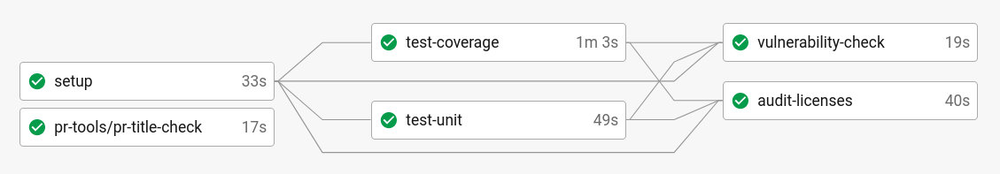
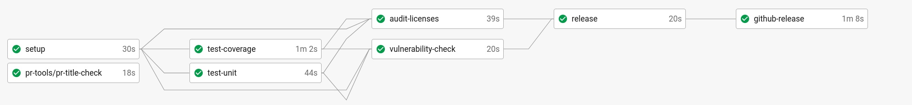
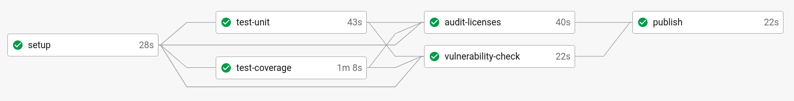
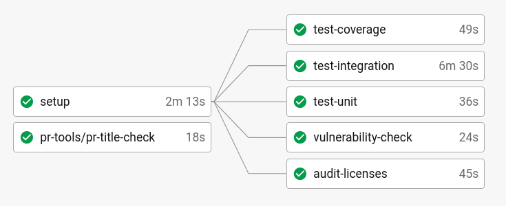
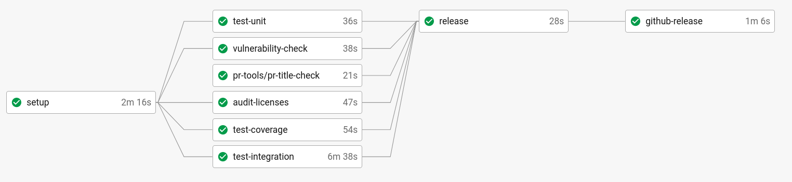
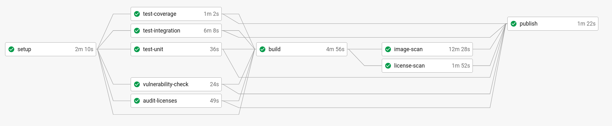

# Pipelines de CI/CD

A Comunidade Mojaloop utiliza o [CircleCI](https://circleci.com/) para construir, testar e fazer o deployment 
automático do nosso software. Este documento descreve como usamos CI/CD no Mojaloop, as diferentes verificações que efetuamos sobre o 
software e como distribuímos o software.

Em termos gerais, existem 2 tipos de workflow que utilizamos, dependendo do tipo de projeto:
- Biblioteca: construir o projeto node -> testar -> publicar no [npm](https://www.npmjs.com/search?q=%40mojaloop)
- Serviço: construir a imagem docker -> testar -> publicar no [Docker Hub](https://hub.docker.com/u/mojaloop)

Além disso, mantemos também um conjunto de [Helm Charts do Mojaloop](http://docs.mojaloop.io/helm/), que são 
construídos a partir do [mojaloop/helm](https://github.com/mojaloop/helm)

## Bibliotecas

> Para um bom exemplo deste padrão de CI/CD, consulte [central-services-shared](https://github.com/mojaloop/central-services-shared/blob/master/.circleci/config.yml)

### Fluxo de pull request (PR):

O fluxo de PR corre nos pull requests e, durante o [processo de revisão de PR](https://github.com/mojaloop/documentation/blob/master/contributors-guide/standards/creating-new-features.md#creating-new-features), estas verificações têm de ser satisfeitas
para que o código possa ser integrado.

| Passo | Descrição | Mais informação |
| ---  | ----------- | --------- |
| pr-title-check  | Verifica se o título do PR está conforme à especificação conventional commits | Definido num orb do CircleCI aqui: [mojaloop/ci-config](https://github.com/mojaloop/ci-config) |
| test-coverage   | Corre os testes unitários e verifica se a cobertura do código está acima do limite especificado. | Normalmente é 90% |
| test-unit       | Corre os testes unitários. Falha se algum teste unitário falhar. | |
| vulnerability-check | Corre a ferramenta `npm audit` para procurar vulnerabilidades nas dependências | O `npm audit` está cheio de falsos positivos, ou de problemas de segurança que não se aplicam ao nosso código. Usamos o `npm-audit-resolver` para nos dar flexibilidade quanto às vulnerabilidades que podem ser ignoradas, por exemplo `devDependencies` |
| audit-licenses | Corre o `license-scanner-tool` do mojaloop e falha se alguma licença encontrada não corresponder a uma allowlist especificada no `license-scanner-tool` | [repositório license-scanner-tool](https://github.com/mojaloop/license-scanner-tool) |

### Fluxo de master e release:

Este pipeline de CI/CD corre no branch master/main:

| Passo | Descrição | Mais informação |
| ---  | ----------- | --------- |
| pr-title-check  | Ver acima | |
| test-coverage   | Ver acima | |
| test-unit       | Ver acima | |
| vulnerability-check | Ver acima | |
| audit-licenses | Ver acima | |
| release | Corre um release que cria uma tag git e faz push da tag git | |
| github-release | Adiciona os metadados do release (por exemplo, o changelog) ao github, envia um alerta de slack para #announcements | |

### Fluxo de tag:

Depois de uma tag git ser enviada para o repositório, esta aciona um workflow que termina 
com a publicação no `npm`. É importante notar que as verificações são todas corridas novamente, para garantir
que nada mudou (por exemplo, dependências) entre o main/master e o próprio
artefacto que é publicado no `npm`.

| Passo | Descrição | Mais informação |
| ---  | ----------- | --------- |
| pr-title-check  | Ver acima | |
| test-coverage   | Ver acima | |
| test-unit       | Ver acima | |
| vulnerability-check | Ver acima | |
| audit-licenses | Ver acima | |
| publish | Publica a versão mais recente da biblioteca com base na tag git | |

## Serviços

> Para um bom exemplo deste padrão de CI/CD, consulte [central-ledger](https://github.com/mojaloop/central-ledger/blob/master/.circleci/config.yml)

### Fluxo de pull request (PR):

O fluxo de PR corre nos pull requests e, durante o processo de revisão de PR, estas verificações têm de ser satisfeitas
para que o código possa ser integrado.

| Passo | Descrição | Mais informação |
| ---  | ----------- | --------- |
| pr-title-check      | Verifica se o título do PR está conforme à especificação conventional commits | Definido num orb do CircleCI aqui: [mojaloop/ci-config](https://github.com/mojaloop/ci-config) |
| test-coverage       | Corre os testes unitários e verifica se a cobertura do código está acima do limite especificado. | Normalmente é 90% |
| test-unit           | Corre os testes unitários. Falha se algum teste unitário falhar. | |
| test-integration    | Corre os testes de integração. Normalmente construindo uma imagem docker localmente | |
| vulnerability-check | Corre a ferramenta `npm audit` para procurar vulnerabilidades nas dependências | O `npm audit` está cheio de falsos positivos, ou de problemas de segurança que não se aplicam ao nosso código. Usamos o `npm-audit-resolver` para nos dar flexibilidade quanto às vulnerabilidades que podem ser ignoradas, por exemplo `devDependencies` |
| audit-licenses | Corre o `license-scanner-tool` do mojaloop e falha se alguma licença encontrada não corresponder a uma allowlist especificada no `license-scanner-tool` | [repositório license-scanner-tool](https://github.com/mojaloop/license-scanner-tool) |

### Fluxo de master e release:

Este pipeline de CI/CD corre no branch master/main:

| Passo | Descrição | Mais informação |
| ---  | ----------- | --------- |
| pr-title-check  | Ver acima | |
| test-coverage   | Ver acima | |
| test-unit       | Ver acima | |
| test-integration | Ver acima | |
| vulnerability-check | Ver acima | |
| audit-licenses | Ver acima | |
| release | Corre um release que cria uma tag git e faz push da tag git | |
| github-release | Adiciona os metadados do release (por exemplo, o changelog) ao github, envia um alerta de slack para #announcements | |

### Fluxo de tag:

Depois de uma tag git ser enviada para o repositório, esta aciona um workflow que termina 
com a publicação de uma imagem docker no Docker Hub. É importante notar que as verificações são todas corridas novamente,
e são feitas análises adicionais à imagem docker antes de a imagem ser enviada.

| Passo | Descrição | Mais informação |
| ---  | ----------- | --------- |
| pr-title-check      | Ver acima | |
| test-coverage       | Ver acima | |
| test-unit           | Ver acima | |
| vulnerability-check | Ver acima | |
| audit-licenses      | Ver acima | |
| build               | Constrói a imagem docker | |
| image-scan          | Corre o `anchore/analyze_local_image` para analisar a imagem | Consulte o CircleCI Orb [anchore-engine](https://circleci.com/developer/orbs/orb/anchore/anchore-engine) para mais informação. |
| license-scan        | Corre o `license-scanner-tool` do mojaloop sobre as licenças contidas na imagem docker | |
| publish | Publica a versão mais recente da biblioteca com base na tag git | |
