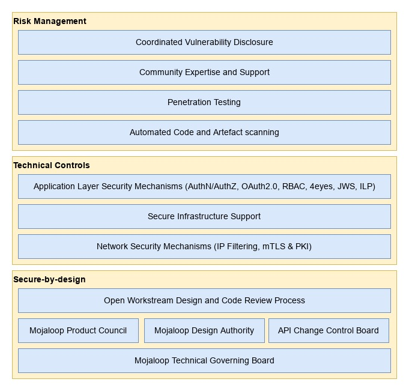
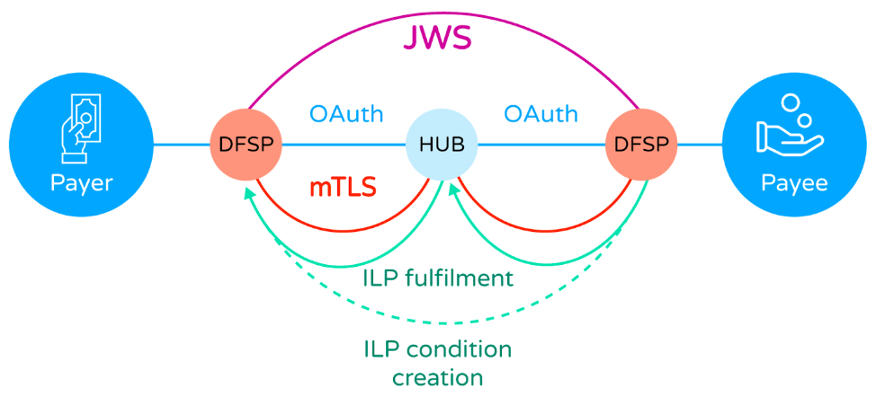

## Arquitetura de cibersegurança do Mojaloop

## Introdução

O Mojaloop adota abordagens de cibersegurança tanto secure-by-design como baseadas no risco, o que significa que o software open-source disponibilizado pela Mojaloop Foundation foi concebido para ser seguro na sua base e é continuamente avaliado face a possíveis riscos por vários processos.

Além das iniciativas de cibersegurança geridas pela Mojaloop Foundation, a comunidade Mojaloop mais ampla inclui especialistas em cibersegurança capazes de prestar consultoria e serviços que reforcem ainda mais as capacidades dos próprios adotantes.

Figura 1 - Camadas da arquitetura de cibersegurança do Mojaloop

_Note que, embora a Mojaloop Foundation e a comunidade Mojaloop procurem disponibilizar software que seja seguro por conceção e que possa ser operado de forma segura, os adotantes assumem a responsabilidade última de garantir a segurança das suas operações. Tendo isto em mente, a Mojaloop Foundation recomenda vivamente que os adotantes recorram a especialistas em cibersegurança, para garantir que as melhores práticas de cibersegurança são seguidas e que todas as normas e regulamentos relevantes e aplicáveis são cumpridos._

## Secure-By-Design

### Processos de revisão de desenho

A Mojaloop Foundation e a comunidade gerem e operam vários processos de revisão de desenho atentos à segurança, que contribuem para as abordagens secure-by-design e de gestão do risco.

1. O Mojaloop Technical Governing Board determina os objetivos técnicos de cibersegurança de alto nível para o projeto Mojaloop, que são implementados por outros órgãos e processos da comunidade.
2. A comunidade Mojaloop opera uma design authority, que é um grupo gerido de especialistas eleitos da indústria que se reúnem semanalmente para revisão dos aspetos técnicos do software da plataforma, incluindo, entre outros, a cibersegurança.
3. A comunidade Mojaloop opera um API change control board, que é um grupo gerido de especialistas eleitos da indústria que se reúnem semanalmente para revisão dos aspetos do software da plataforma relacionados com as APIs internas e externas. Este grupo tem a responsabilidade específica de garantir que todas as APIs do Mojaloop são secure-by-design e suportam as mais recentes e melhores normas da indústria para a segurança dos deployments da plataforma Mojaloop.
4. A comunidade Mojaloop opera um product council, que é um grupo gerido de especialistas eleitos da indústria que se reúnem semanalmente para revisão dos desenhos das funcionalidades do produto. Este grupo contribui para a arquitetura global de cibersegurança do(s) produto(s) Mojaloop, revendo requisitos existentes e criando novos requisitos e especificações para a plataforma Mojaloop e a sua segurança.
5. As normas da comunidade Mojaloop exigem revisões do desenho das funcionalidades e do código por membros da comunidade e da fundação que sejam especialistas nessas áreas do sistema, antes de alterações de código ou código novo serem aceites dos contribuidores em releases oficiais.

## Controlos técnicos

A plataforma Mojaloop emprega várias camadas técnicas de segurança, detalhadas nas secções seguintes, que contribuem para uma plataforma globalmente segura para a realização de transações financeiras.

1. A nível do transporte de rede, é empregado X.509 Mutually Authenticated Transport Layer Security (mTLS) (são fornecidas orientações de melhores práticas para conjuntos de cifras e algoritmos de hash adequados) para proteger as ligações entre os participantes do scheme e o hub Mojaloop. Este mecanismo, combinado com processos de gestão de certificados e chaves conformes às melhores práticas, impede a interceção e a manipulação nas ligações de rede do scheme. O Mojaloop fornece diretrizes de melhores práticas para operações de PKI: [https://docs.mojaloop.io/api/fspiop/pki-best-practices.html](https://docs.mojaloop.io/api/fspiop/pki-best-practices.html).
2. As Json Web Signatures (JWS) são utilizadas na camada de mensagens da aplicação para garantir mensagens com evidência de manipulação e o não repúdio. Todos os participantes do scheme dispõem dos meios para saber se uma mensagem recebida foi manipulada durante a transmissão. Os participantes do scheme podem também ter confiança na identidade do originador da mensagem. Os serviços Mojaloop conseguem usar esta mesma validação de assinatura para garantir que as mensagens não foram manipuladas antes do processamento no hub.
3. O Mojaloop utiliza o [protocolo InterLedger](https://docs.mojaloop.io/api/fspiop/v1.1/api-definition.html#interledger-payment-request) (também conhecido como ILP) durante as fases de cotação e de transferência, como mecanismo criptográfico de chave-fecho, que usa criptografia assimétrica para impedir a manipulação dos termos de transferência acordados.
4. O Mojaloop impõe a idempotência dos pedidos e controlos de transição de estado das transações, que ajudam a mitigar ataques do tipo replay.
5. A plataforma Mojaloop inclui uma camada de API gateway, que facilita a "filtragem de endereços IP", a gestão de identidade e acessos OAuth2.0 e os controlos de acesso baseados em papéis, que oferecem proteção adicional contra ataques de infiltração.
6. As interfaces de utilizador internas e externas, por exemplo para os participantes e para os utilizadores das operações do hub (técnicos / de negócio), são protegidas com mecanismos OAuth2.0 e Role Based Access Control (RBAC), em combinação com processos maker-checker aplicáveis (também conhecidos como 4eyes).
7. O Mojaloop suporta um modelo de Fraud and Risk Management Service (FRMS) a nível de todo o scheme (partilhado entre os Financial service providers (FSPs) e o Switch / Hub Mojaloop).

Figura 2 - Arquitetura de cibersegurança transacional do scheme Mojaloop

## Gestão do risco

### Testes de segurança

#### Análise automatizada de vulnerabilidades

O Mojaloop emprega vários mecanismos técnicos para conduzir a avaliação automatizada de vulnerabilidades em todos os repositórios de código-fonte da plataforma Mojaloop. Estes mecanismos analisam as dependências do código e as imagens de contentor em busca de vulnerabilidades conhecidas (provenientes de várias bases de dados de vulnerabilidades, padrão da indústria e continuamente atualizadas), periodicamente e antes de alterações ou adições de código serem aceites nos branches principais. Isto reduz a probabilidade de uma vulnerabilidade conhecida numa dependência do Mojaloop chegar a um release oficial.

#### Testes de penetração

Membros da comunidade Mojaloop conduzem periodicamente testes de penetração sobre os seus deployments, utilizando frameworks comuns de teste de segurança, e partilham os resultados com a Mojaloop Foundation ao abrigo de um processo de divulgação coordenada de vulnerabilidades, mediante o qual qualquer risco recém-identificado pode ser mitigado por workstreams técnicos e/ou pelos adotantes antes de as vulnerabilidades poderem ser abusadas por terceiros.

#### Conhecimento especializado e apoio da comunidade

A comunidade Mojaloop, seguindo os princípios e processos detalhados neste documento, disponibiliza uma plataforma de software que incorpora numerosas funcionalidades e capacidades de cibersegurança. No entanto, para alcançar as melhores operações seguras possíveis, exige-se que os adotantes da tecnologia Mojaloop façam o deployment e operem o software de forma segura. Esta é frequentemente uma tarefa difícil e intimidante, com muitas normas e regulamentos aplicáveis a cumprir. A comunidade Mojaloop inclui organizações com conhecimento e experiência aprofundados nestas matérias, que podem ser contratadas para prestar assistência.

## Divulgação coordenada de vulnerabilidades

A Mojaloop Foundation opera um processo de divulgação coordenada de vulnerabilidades. Este processo é um modelo de divulgação de vulnerabilidades no qual uma vulnerabilidade ou um problema é divulgado ao público apenas depois de as partes responsáveis terem disposto de tempo suficiente para corrigir ou remediar a vulnerabilidade ou o problema.

Este método é recomendado por muitos governos e organizações internacionais respeitadas como o processo preferencial para a gestão de vulnerabilidades de software, pois oferece proteções contra a exploração por terceiros dos problemas descobertos, para além das proporcionadas por modelos alternativos.

## Controlos organizacionais

Além dos controlos técnicos de cibersegurança descritos noutros pontos, o Mojaloop fornece um conjunto de ferramentas para apoiar controlos organizacionais, refletindo a realidade de que, embora os ataques de hacking e a fraude perpetrada por agentes externos gerem a maior cobertura mediática, os ataques mais bem-sucedidos em termos do valor total de dinheiro defraudado são feitos internamente pelo próprio pessoal de um serviço financeiro.

Além das ferramentas fornecidas como parte do Mojaloop, há um conjunto de recomendações que podem ser feitas relativamente aos processos de negócio adotados por um operador de hub e que se relacionam com a operação do serviço.

### Pontos de controlo

O Mojaloop permite ao operador do hub definir pontos de controlo, nos quais as ações de um funcionário estão sujeitas a limitações impostas pelo próprio hub. Isto é sustentado pela capacidade de gestão de identidade e acessos do Mojaloop, que implementa um modelo Role-Based Access Control (RBAC). Cada ação de um funcionário no hub só é permitida se o funcionário detiver um privilégio específico; o proprietário do hub define um conjunto de papéis, cada um dos quais é um conjunto de privilégios. É criada uma conta de funcionário e atribuído um papel (tal como financial officer, administrador, operador, etc.), que depois controla as funções que pode executar.

O RBAC é então complementado com controlos maker/checker. Funções sensíveis (tais como movimentos de fundos) podem ser definidas (“made”) por um operador, mas só serão executadas quando autorizadas (“checked”) por, por exemplo, um operador financeiro.

Todas as ações dos funcionários são registadas, num log de auditoria que não pode ser manipulado. Isto permite aos auditores forenses ver toda a atividade e, se necessário, “seguir o dinheiro” quando surge um problema devido a, por exemplo, conluio entre funcionários/gestão de topo.

### Controlos de negócio

A operação de um Hub Mojaloop é um serviço financeiro, e a segurança do serviço deve ser tratada da mesma forma que qualquer outro serviço financeiro, tal como o de um banco ou de um switch internacional de pagamentos. Os controlos de negócio são a primeira linha de defesa e limitam a superfície de ataque antes mesmo de os Pontos de controlo estarem acessíveis.

Os controlos de negócio devem incluir o seguinte:

* A cibersegurança pode ser comprometida por pessoal malicioso. Os operadores de hub devem conduzir verificações de antecedentes adequadas ao recrutar pessoal, incluindo verificações de registos policiais ou criminais e verificações de referências de crédito para identificar endividamento excessivo (vulnerabilidade a suborno por atacantes externos).
* Atenção rigorosa à segurança física das instalações do operador do hub (onde o acesso ao Hub Mojaloop é realizado — o acesso remoto, isto é, trabalhar a partir de casa, **nunca** deve ser permitido), incluindo:
    * Existe apenas uma entrada, estritamente controlada, nas instalações do operador do hub.
    * As outras entradas estão protegidas e as saídas de emergência têm alarmes.
    * Todas as salas estão protegidas com fechaduras biométricas, exigem registo de entrada **e** de saída para controlar o tailgating, e o acesso é restrito com base na função desempenhada.
    * O pessoal em funções de contacto com clientes ou no departamento financeiro não deve ser autorizado a ter os seus telemóveis consigo nas instalações; os telefones devem ser guardados em armários metálicos (gaiolas de Faraday) durante o horário de trabalho.
    * Videovigilância e gravação 24 horas de todas as áreas (as câmaras têm de estar voltadas para longe dos ecrãs que possam mostrar informação sensível).
    * Verificar e registar cuidadosamente a identidade dos visitantes.
    * Não permitir que os visitantes tragam qualquer equipamento eletrónico para as áreas operacionais.
        * **Apenas** em áreas não operacionais podem ser permitidos telemóveis e portáteis. No entanto, os números de série dos portáteis devem ser registados, e os prestadores devem **verificar que os visitantes saem com o mesmo equipamento que trouxeram**. Trocar portáteis é o método mais rápido de roubar dados.
    * Garantir que os visitantes são acompanhados por um membro do pessoal, responsável pela sua conduta.
    * Manter-se continuamente atento à atividade dos visitantes:
        * Não deixar os visitantes circular sem acompanhamento.
        * Não deixar os visitantes inserir pens USB ou outros dispositivos em portáteis, impressoras, etc. da empresa.

Note que este é apenas um subconjunto dos controlos que esperaríamos para proteger as operações de um operador de Hub. Um potencial operador de Hub deve procurar aconselhamento especializado antes de lançar um serviço.
