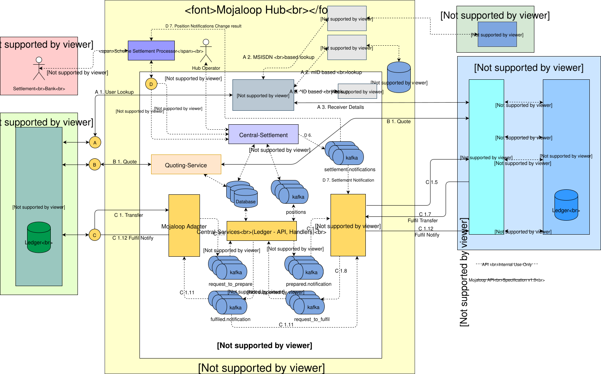

# Mojaloop Visão geral técnica

## Mojaloop Serviços

A ideia fundamental subjacente ao Mojaloop é que precisamos de interligar vários Prestadores de Serviços Financeiros Digitais (DFSPs) numa rede competitiva e interoperável, a fim de maximizar as oportunidades para que as pessoas em situação de pobreza tenham acesso a serviços financeiros com comissões reduzidas ou nulas. Não pretendemos que um único poder monopolista controle todos os pagamentos num país, nem um sistema que exclua novos intervenientes. Também não é benéfico que existam demasiadas sub-redes isoladas. Os diagramas seguintes mostram as Mojaloop interligações entre os DFSPs e o Mojaloop Hub (exemplo de implementação do esquema) para uma transferência Peer-to-Peer (P2P):

O Mojaloop aborda estas questões de várias formas fundamentais:
* Um conjunto de serviços centrais proporciona um hub através do qual o dinheiro pode circular de um DFSP para outro. Isto é semelhante à forma como o dinheiro circula através de um banco central ou de uma câmara de compensação nos países desenvolvidos. Para além de uma razão geral, os serviços centrais podem proporcionar a verificação de identidade, a gestão de fraudes e a aplicação das regras do scheme.
* Um conjunto padrão de interfaces que um «DFSP» pode implementar para se ligar ao sistema, bem como código de exemplo que demonstra como utilizar o sistema. Um «DFSP» que pretenda ligar-se pode adaptar o nosso código de exemplo ou implementar as interfaces padrão no seu próprio software. O objetivo é que seja o mais simples possível para um «DFSP» ligar-se à rede interoperável.
* Implementações completas e funcionais de código aberto de ambos os lados das interfaces — um exemplo de «DFSP» capaz de enviar e ser destinatário de pagamentos e o cliente que um «DFSP» existente poderia hospedar para se ligar à rede.

O hub Mojaloop é o principal recipiente e referência que utilizamos para descrever o ecossistema Mojaloop, que se divide nos seguintes domínios:
* Mojaloop Serviços de Código Aberto - Núcleo Mojaloop Software de Código Aberto (OSS) que tem sido permitido pela Fundação Bill & Melinda Gates em parceria com a Comunidade de Código Aberto.
* Hub Mojaloop — A implementação de referência geral Mojaloop (e personalizável) para os operadores do hub baseia-se na solução de OSS acima referida.