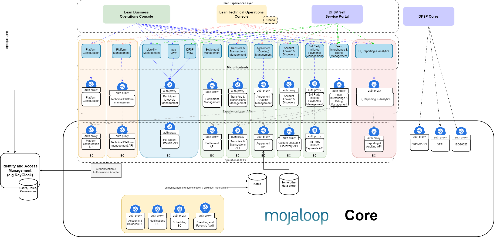

# Introdução

Junte-se à colaboração para a criação de um conjunto de processos empresariais essenciais que permitam um **«início rápido»**, que sejam fáceis de personalizar, que contribuam para o código aberto e que sigam as melhores práticas. 

O Framework de Operações Empresariais tem como objetivo ajudar os operadores do hub a criar e deployar portais de processos empresariais que apoiem os seus processos empresariais, tal como definido em [Mojaloop documentação empresarial](https://docs.mojaloop.io/mojaloop-business-docs/). O Framework de Operações Empresariais apoia a colaboração da comunidade na criação de uma experiência do utilizador (UX) para um Mojaloop operador do hub que inclua APIs robustas, siga as melhores práticas e seja segura desde a sua conceção. O objetivo é apoiar ainda mais a adoção e aumentar o valor de utilização imediata da Mojaloop solução.

A interface de utilizador (IU) resultante não pretende ser exaustiva, mas sim demonstrar uma experiência web exemplar que seja fácil de alargar e personalizar. Por conseguinte, é importante que sejam permitidos o Controlo de Acesso Baseado em Funções (RBAC), em interface com sistemas padrão de Gestão de Identidades e Acessos (IAM), o controlo de segurança ao nível da API, os micro-front-ends e os fluxos de trabalho do tipo «maker-checker». A arquitetura UX segue um padrão de pacote pré-compilado com um «API» de suporte, que pode ser deployed numa Rede de Distribuição de Conteúdos (CDN). 

O presente documento apresenta uma descrição mais pormenorizada do projeto, incluindo aspetos de segurança, tecnologias utilizadas e padrões de arquitetura.

The framework:
1. Implementa uma integração/implementação de RBAC e IAM de acordo com as melhores práticas.
2. Inclui um plano de deployment para integrar a solução de RBAC e IAM na versão Mojaloop.
3. Inclui um plano de deployment para o portal da interface do utilizador, de modo a que este possa ser deployado numa rede CDN.
4. Utiliza micro-front-ends criados a partir de diferentes repositórios para dissociar os esforços da comunidade e facilitar a extensão e as personalizações.
5. Fornece um registo de auditoria de todas as atividades realizadas.

São necessários três níveis ou graus de controlo na configuração das melhores práticas de segurança:
1. Acesso diário às interfaces de utilizador do IAM, onde os utilizadores são criados, suspensos e às quais lhes são atribuídas as respetivas funções.
2. Mapeamentos de funções para permissões, que podem ser editados através de um pedido de alteração de configuração.
3. Restrições ao acesso «API» com base nas permissões disponíveis para um sujeito (um utilizador ou API cliente) através das suas funções.

## Esforço da comunidade – lista de tarefas

A entrega inicial deste framework inclui uma secção vertical reduzida para demonstrar a implementação funcional de ponta a ponta da mesma. Embora esta função, que é entregue em primeiro lugar, tenha um propósito importante, não constitui o objetivo final deste projeto. O objetivo é disponibilizar um framework para a qual outras iniciativas da comunidade possam contribuir. Apresenta-se a seguir a lista atual de tarefas pendentes relativas ao suporte a API processos de backend/micro-front-ends que se pretende adicionar a este framework por meio de Mojaloop iniciativa de implementação da comunidade:

| Categoria | Descrição | Esforço da comunidade em prol da causa |
| --- | --- | --- |
| **Configuração da plataforma** | Processo para configurar a plataforma de modo a que esta aplique o scheme e as regras do mesmo. | - |
| **Gestão da plataforma** | Controlos técnicos de gestão operacional da plataforma. | Atualmente, isto é realizado com o Kibana Application Performance Monitoring (APM) e o Elasticsearch. Não há, de momento, planos para migrar para um framework. |
| **Gestão da liquidez** | Apoio aos processos de gestão da liquidez. | Portal Financeiro V2 - ainda não faz parte do framework. |
| **Gestão do ciclo de vida dos participantes   (vista do hub)** | Gerir o onboarding e as transições de estado dos participantes. | Portal Financeiro V2 - ainda não faz parte do framework. |
| **Gestão do ciclo de vida dos participantes   (DFSP visualização)** | Permitir que os DFSPs gerem o seu estado e a sua interação com o hub. | - |
| **Gestão de liquidações** | Interface de gestão para a liquidação. | DFSP relatórios de reconciliação - Os relatórios do projeto de digitalização das instituições de microfinanças (IMF) de Mianmar (MMD) estão a ser incorporados no framework (acessíveis através de um API).  Liquidação líquida diferida multilateral - O Portal Financeiro V2 ainda não está disponível no framework. |
| **Gestão de transferências e transações** | Visão das operações comerciais de todas as transações no hub. | Portal Financeiro V2 — está a ser convertido num framework com melhorias. Permite o acompanhamento de uma transferência de ponta a ponta. |
| **Gestão de contratos (cotações)** | - | - |
| **Pesquisa de contas e gestão da descoberta** | - | - |
| **Gestão de pagamentos iniciados por terceiros** | - | - |
| **Gestão de comissões (de intercâmbio e de faturação)** | - | - |
| **Relatórios e análises** | - | - |

## Arquitetura de referência

O workstream da arquitetura de referência concebeu — através de um processo colaborativo — a arquitetura da futura/próxima versão Mojaloop. O Framework de Operações Empresariais está a ser concebido para funcionar na versão Mojaloop existente (núcleo v1.0). O Framework de Operações Empresariais deve, no entanto, ser compatível com a arquitetura de referência e, sempre que possível, facilitar a transição para o projeto da arquitetura de referência.

Os seguintes elementos do projeto do framework de Operações Empresariais estão a contribuir diretamente para a construção de uma arquitetura de referência:
1. **Contexto delimitado de segurança**
A implementação do RBAC nesta workstream utilizou algumas das ideias de conceção e separações definidas no contexto delimitado de segurança da arquitetura de referência. Não implementou nenhuma das interfaces necessárias para que esta possa ser considerada uma implementação do contexto delimitado de segurança.
2. **Contexto delimitado de relatórios**
Parte do contexto delimitado de relatórios está a ser desenvolvida nesta workstream.

A divisão do front-end em micro-front-ends que podem ser desenvolvidos, testados e releaseados de forma independente; capacitando as equipas que criam soluções dentro de cada contexto delimitado a desenvolver de forma independente a funcionalidade API e a interface de utilizador correspondente. As personalizações e extensões para cada contexto delimitado também são facilmente permitidas com este modelo.

Apresentamos aqui uma visão geral de como as APIs operacionais, as APIs de experiência e os micro-front-ends podem ser combinados para formar os componentes que constituem o framework de Operações Empresariais.

 

## IaC 4.xx

A próxima versão do projeto «Infraestrutura como Código» prevê a utilização de um conjunto de ferramentas diferente daquele que está atualmente em uso na Comunidade «Mojaloop»; ou seja, o WSO2, com o seu Identity Server como Gestor de Chaves (IS-KM), e as implementações do HAproxy serão substituídas pelas ferramentas Keycloak, Ambassador e Envoy. Este projeto é compatível com a próxima versão do IaC.