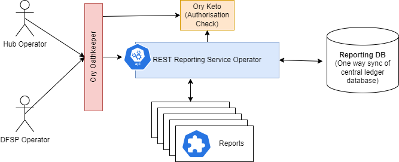

# Guia do Desenvolvedor de Relatórios
Este é um guia para programadores sobre a criação e implementação de relatórios para o serviço de relatórios REST, que faz parte do deployment no hub.

## Arquitetura

[Aqui,](https://github.com/mojaloop/reporting) é o repositório do operador do serviço de relatórios.
O operador do serviço de comunicação de dados foi concebido para ser acedido quer por um operador do hub, quer por um operador «DFSP».
O acesso ao relatório é controlado através da integração RBAC que faz parte do framework de operações empresariais. O Ory Oathkeeper protege o ponto de acesso API do serviço de relatórios, e o Keto é verificado pelo operador do serviço de relatórios para uma autorização mais detalhada e específica para cada relatório.
Os dados do relatório são obtidos a partir da base de dados do SQL Reporting, que, neste momento, constitui uma sincronização unidirecional com a base de dados da razão geral central.
Cada relatório é instalado no sistema como um recurso personalizado do Kubernetes, que consiste num ficheiro .yaml com um formato específico, aplicado ao cluster do Kubernetes. [Aqui](https://github.com/mojaloop/reporting-k8s-templates) encontra-se o repositório dos modelos de relatório de código aberto. A definição do recurso personalizado para um relatório está disponível [aqui](https://github.com/mojaloop/reporting-k8s-templates/blob/master/crds/reporting-crd.yaml), onde é descrito o formato do recurso personalizado.

## RBAC
O acesso aos relatórios é controlado através do RBAC durante o deployment do serviço através da configuração padrão de IaC.
Isto significa que, para aceder a um relatório, um utilizador terá de ter a autorização correta atribuída. Tal é conseguido através da atribuição de funções ao utilizador e da atribuição de acesso de participante.

A primeira verificação de autorização é efetuada pelo Ory Oathkeeper, que possui uma regra que associa o 
```
reportingApi
```
autorização para aceder ao endpoint API do serviço de relatórios.

A verificação de autorização seguinte é efetuada pelo operador do serviço de relatórios. É verificada a autorização para aceder ao relatório em questão. A autorização verificada é definida no recurso personalizado. Esta autorização é opcional; caso contrário, será utilizado o nome (metadados) do relatório, tal como definido no recurso personalizado. 
### Exigência de permissão «DFSP»
Se o relatório se destinar a um participante específico de «DFSP», é importante utilizar o parâmetro «dfspId». Este parâmetro verifica, em primeiro lugar, a autorização do participante antes de executar e gerar o relatório.
Ou seja,
``` yaml
 params:
      - name: dfspId
        required: true
```
### Executar o relatório
Primeiro, terá de iniciar sessão. A forma mais fácil de o fazer é iniciar sessão no Portal Financeiro. Desta forma, são criados os tokens de autorização e autenticação que o relatório utiliza posteriormente.
Eis um exemplo de como aceder ao relatório diretamente após o início de sessão. 
```
https://bofportal.YourEnvironment.YourDomain.com/proxy/reports/MyReportPath?ReportParamter=25
```

### formatos de saída dos relatórios
O relatório permite vários formatos de saída. Para switchar entre estes, utilize o parâmetro «format» na consulta REST.
1. Ficheiro do Excel 
```
&format=xlsx
```
2. Valores separados por vírgulas
```
&format=csv
```
3. Formato de aula JSON
```
&format=json
```
4. Formato HTML para navegador (este é o formato de saída predefinido)
```
&format=html
```

## Kubernetes. Recurso personalizado
Todos os aspetos de um relatório são controlados através do ficheiro de recursos personalizado «mojaloopreport». A definição desse ficheiro é a seguinte.

### Definição de recurso personalizado
``` yml
kind: CustomResourceDefinition
apiVersion: apiextensions.k8s.io/v1
metadata:
  name: mojaloopreports.mojaloop.io
spec:
  group: mojaloop.io
  scope: Namespaced
  names:
    plural: mojaloopreports
    singular: mojaloopreport
    shortNames:
      - mlreport
    kind: MojaloopReport
    listKind: MojaloopReportList
  versions:
    - name: v1
      served: true
      storage: true
      schema:
        openAPIV3Schema:
          description: MojaloopReport is the Schema for MojaloopReport API
          type: object
          properties:
            apiVersion:
              description: >-
                APIVersion defines the versioned schema of this representation
                of an object. Servers should convert recognized schemas to the
                latest internal value, and may reject unrecognized values. More
                info:
                https://git.k8s.io/community/contributors/devel/sig-architecture/api-conventions.md#resources
              type: string
            kind:
              description: >-
                Kind is a string value representing the REST resource this
                object represents. Servers may infer this from the endpoint the
                client submits requests to. Cannot be updated. In CamelCase.
                More info:
                https://git.k8s.io/community/contributors/devel/sig-architecture/api-conventions.md#types-kinds
              type: string
            metadata:
              type: object
            spec:
              description: MojaloopReport.spec describes the desired state of my resource
              type: object
              required:
                - endpoint
                - queries
                - template
              properties:
                permission:
                  description: Permission to be needed to access this report. This is optional. If unspecified, the name of the resource will be considered as permission.
                  type: string
                endpoint:
                  description: Reporting endpoint
                  type: object
                  required:
                    - path
                  properties:
                    path:
                      description: Report URL path
                      type: string
                    params:
                      description: Report query params
                      type: array
                      items:
                        description: Query param
                        type: object
                        required:
                          - name
                        properties:
                          name:
                            description: Query param name
                            type: string
                          required:
                            description: Make query param required
                            type: boolean
                          default:
                            description: Default query param value
                            type: string
                queries:
                  description: The list of queries used in ejs reporting template
                  type: array
                  items:
                    description: permission ID.
                    type: object
                    required:
                      - name
                      - query
                    properties:
                      name:
                        description: Variable name that the query result will be assigned to
                        type: string
                      query:
                        description: SQL query
                        type: string
                template:
                  description: ejs reporting template
                  type: string

            status:
              description: The status of this MojaloopReport resource, set by the operator.
              type: object
              properties:
                state:
                  description: The state of the report.
                  type: string
      additionalPrinterColumns:
        - name: endpoint
          type: string
          description: Reporting endpoint
          jsonPath: .spec.endpoint.path
  conversion:
    strategy: None
```
Podem ser encontrados [aqui](https://github.com/mojaloop/reporting-k8s-templates/tree/master/templates) exemplos de relatórios que estão em conformidade com este recurso personalizado.
Tenha em atenção que estes ficheiros YAML também contêm **diretivas Helm**, indicadas por chaves duplas. 
```
{{ some helm directive / function }}
```
Caso pretenda aplicar manualmente estes ficheiros no Kubernetes, será necessário removê-los ou substituí-los.

### Kubectl
Pode utilizar o seguinte comando para aplicar um recurso personalizado de relatório a uma instância do Kubernetes.
  ```
  kubectl apply -f resources/examples/participant_list.yaml
  ```

Vamos abordar alguns dos pormenores do recurso personalizado.

### Controlar a forma como o relatório é chamado
A primeira parte da especificação do relatório define a forma como o relatório é chamado.
Ou seja,
``` yaml
spec:
  permission: report-dfsp-settlement-detail
  endpoint:
    path: /dfspSettlementDetail
    params:
      - name: settlementId
        required: true
      - name: fspid
        required: true
```
- **autorização**: é aqui que se define a etiqueta de autorização RBAC para este relatório
- **caminho** este é o caminho do endpoint para este relatório
- **params**: aqui são definidos os parâmetros do relatório e é especificado se são parâmetros obrigatórios ou não.

### Controlar a origem dos dados do relatório
``` yaml
queries:
    - name: dfspInfo
      query: |
        SELECT participantId, name FROM participant WHERE name = :fspid AND name != 'Hub'
    - name: report
      query: |
        SELECT
                pCPayer.participantId as payerFspid,
```
Na secção de consultas, é possível definir um número ilimitado de consultas que são executadas na base de dados de relatórios e carregadas em classes JSON com nome específico.
Os parâmetros de entrada podem ser utilizados nas consultas, colocando dois pontos à frente do nome do parâmetro. Por exemplo:
```
:paramname
```
### Controle o aspeto dos relatórios
A parte do modelo do ficheiro de recursos personalizados contém um script EJS que é utilizado para gerar o relatório.
Estes scripts parecem código HTML com formatação, mas contêm código dentro de blocos de script
``` ejs
<% ejs script %>
```
Os scripts EJS são bastante versáteis e podem ser utilizados para alterar o texto de um nome, definir funções de formatação ou criar loops que percorrem os dados.

## Criação do seu ambiente de desenvolvimento
*(Instalação deste serviço localmente para facilitar o desenvolvimento.)*
Atualmente, a única forma de validar o desenho do relatório consiste em aplicar o relatório ao Kubernetes em que o serviço de relatórios se encontra a ser executado. O serviço de relatórios irá, inicialmente, validar o relatório e, em seguida, ativar o endpoint. O relatório pode ser executado e verificado para se confirmar se cumpre os requisitos.

Este documento fornece instruções para a implementação deste serviço a nível local, para que um programador possa testar os seus projetos antes de instalar o relatório num ambiente
Uma vez que o serviço de relatórios segue o padrão do operador K8S, é necessário deployar um mini-Kubernetes cluster na nossa máquina e deployar o serviço de relatórios juntamente com alguns serviços dependentes.

### Pré-requisitos
- Certifique-se de que tem os seguintes programas instalados
  - git
  - docker
  - minikube
  - kubectl
  - leme
  - mysql-client

### Instalar o K8S
- Inicie o cluster minikube K8S com o seguinte comando
  ```
  minikube start --driver=docker --kubernetes-version=v1.21.5
  ```

### Clone o repositório
- Descarregue o repositório
  ```
  git clone https://github.com/mojaloop/reporting.git
  cd reporting
  ```

### Deploy o gráfico do Helm
- Instale o Helm Chart utilizando os seguintes comandos
  ```
  helm dep up ./resources/test-integration/
  helm install test1 ./resources/test-integration/ --set reporting-legacy-api.image.tag=v11.0.0
  ```
- Aguarde até que todos os serviços estejam operacionais
  Pode monitorizar o estado dos pods ou utilizar os seguintes comandos para aguardar que os serviços sejam iniciados
  ```
  kubectl -n default rollout status deployment test1-reporting-legacy-api
  kubectl -n default rollout status statefulset mysql
  ```

### Restaurar a cópia de segurança da base de dados MySQL
- Redirecionar as portas do serviço MySQL
  ```
  kubectl port-forward -n default service/mysql 3306:3306
  ```
- Insira dados de exemplo na base de dados. Pode alterar o nome da base de dados e o nome do ficheiro no comando seguinte, de acordo com as suas necessidades.
  ```
  mysql -h127.0.0.1 -P3306 -uuser -ppassword default < ./resources/examples/participants_db_dump.sql
  ```

### Carregar modelo de relatório
- Adicionar o recurso personalizado utilizando o seguinte comando
  ```
  kubectl apply -f resources/examples/participant_list.yaml
  ```

### Obtenha o relatório
- Redirecionar as portas do serviço de relatórios
  ```
  kubectl port-forward -n default service/test1-reporting-legacy-api 8080:80
  ```
- Para aceder ao relatório, abra o seguinte link URL no navegador
  ```
  http://localhost/participant-list
  ```

### Limpeza
- Limpeza
  ```
  kubectl delete -f resources/examples/participant_list.yaml
  helm uninstall test1
  minikube stop
  ```

## Deploying to a production environment
Existem várias formas de deployar um recurso personalizado de relatório num ambiente. O método que foi escolhido e integrado na oferta de IaC envolve a utilização de um gráfico Helm. (Isto está em consonância com outros componentes «Mojaloop».)

A IaC permite o deployment de relatórios tanto em ambiente público como privado. O processo é idêntico, exceto pelo facto de o repositório ser privado e estar alojado no sistema de controlo de código-fonte da organização.
A um nível geral, o processo é o seguinte:
1. Criar um ramo e submeter as alterações ao repositório a partir do qual o relatório é deployed.
2. Criar um pedido de integração e fundir as alterações no ramo «master» do repositório.
3. Criar uma nova release no repositório. (Dependendo da configuração, isto normalmente aciona um mecanismo CICD que compila e publica o pacote Helm.)
4. Atualize a IaC para deployar a nova versão de release do Helm para os relatórios.
5. Execute o pipeline adequado para realizar o deployment.

