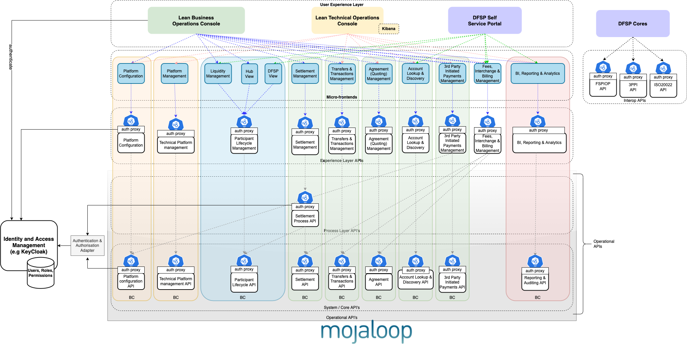
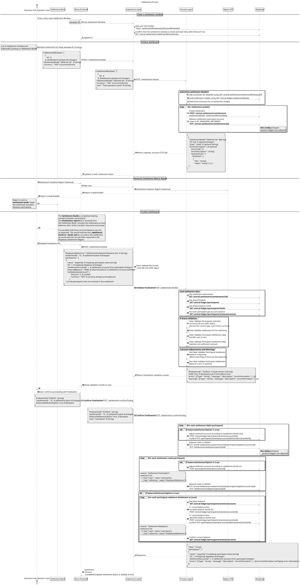
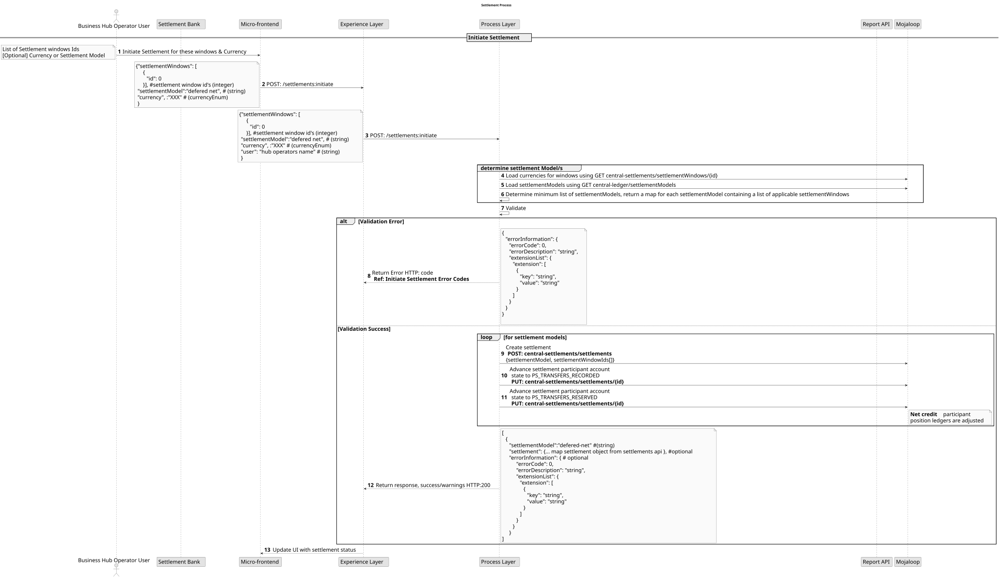
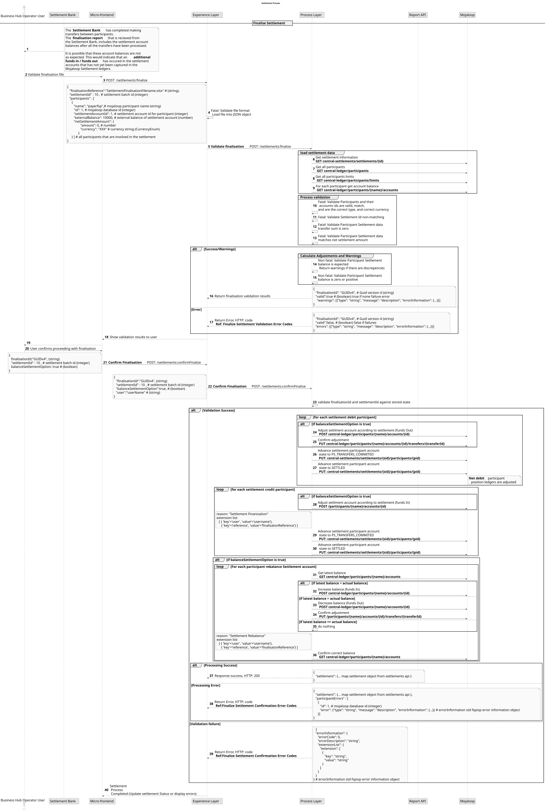

# Implementação operacional da liquidação

## Introdução

O objetivo deste projeto é proporcionar uma solução que interligue as funções dos processos empresariais com as operações centrais de liquidação no switch.

Este projeto constitui um exemplo de implementação de um sistema de liquidação Mojaloop
para um caso de uso específico e não pretende ser exaustivo nem abranger todos os cenários. O presente guia descreve o projeto a alto nível e explica o raciocínio subjacente à conceção para um caso de uso específico escolhido. ```
Embora exista uma versão deste projeto já implementada e operacional, nem tudo o que consta deste documento de projeto foi implementado. 
Trata-se de um exemplo de projeto de implementação de liquidação. A utilidade deste projeto e deste documento de projeto reside, portanto, em:
- servir de demonstração;
- servir como versão inicial para facilitar um «Início Rápido»;
- servir de projeto inicial, no qual possam ser feitas melhorias antes da adoção;
- servir de ponto de partida para aprofundar conceitos discutidos neste projeto que possam ter de ser abordados noutro projeto.

## Operações de liquidação de títulos

Esta é a funcionalidade de liquidação existente fornecida pelo componente de suporte [Central-Settlement](https://github.com/mojaloop/central-settlement) Mojaloop Core. É possível encontrar informações detalhadas na [Mojaloop Documentação de Visão Geral Técnica](https://github.com/mojaloop/documentation/tree/master/legacy/mojaloop-technical-overview/central-settlements).

As operações do Core-Settlement permitem as seguintes funcionalidades:

- Criar um relatório da matriz de liquidação com base numa lista de janelas de liquidação
- Processar os confirmes de liquidação para um relatório de matriz de liquidação já existente
- Gerir janelas de liquidação (ou seja, Criar, Fechar, etc.)
- Consultas relativas a relatórios da matriz de liquidação, janelas de liquidação, etc.

A definição «OpenAPI» está disponível no [repositório da especificação do Mojaloop](https://github.com/mojaloop/mojaloop-specification/tree/master/settlement-api).


## Arquitetura de alto nível



### Camada de experiência

A camada de experiência de liquidação é um «API» sem estado que expõe os dados para serem consumidos pelo público-alvo a que se destinam. Atualmente, a sua principal função consiste em adicionar as informações do utilizador pesquisadas ao «API», que é inserido nos cabeçalhos do pedido pelo proxy ORY Oathkeeper. Prevê-se que esta função venha a assumir maior importância à medida que o produto for evoluindo.

### Camada de processo

As APIs de processo proporcionam uma forma de combinar dados e orquestrar várias APIs do sistema para um objetivo empresarial específico. O mojaloop central-settlement e o central-ledger API estão a ser utilizados por este processo API.

O Processo de Liquidação API deve estar em conformidade com as [Mojaloop normas de nomenclatura](https://docs.google.com/document/d/1AZbX0UjraytFty0IWOHpyR6z35bh0-MCFG1vGKId_5M/edit?usp=sharing), pelo que será utilizado o seguinte nome: `settlement-process-svc`.

## Processo empresarial de liquidação de alto nível

Trata-se de um processo que se baseia nas operações centrais de liquidação existentes para coordenar as seguintes funcionalidades:

1. **Fechar uma janela de liquidação**
A janela de liquidação atual pode ser encerrada manualmente, mesmo que existam transferências associadas à mesma. O operador do hub pode selecionar a janela aberta no momento e, em seguida, optar por encerrá-la.
1. **Início do processo de liquidação**
A «Iniciação da liquidação» é utilizada pelo operador do hub para criar um lote de liquidação que controla e orienta o processo de liquidação.
Para dar início ao processo de liquidação, o operador do hub seleciona:
   - um conjunto de janelas de liquidação
   - e, opcionalmente, uma moeda de liquidação ou um modelo de liquidação. (Caso seja indicada uma moeda de liquidação, esta é utilizada para determinar o modelo de liquidação.)
As razões gerais de posição dos participantes com saldo credor são ajustadas durante o processo de início da liquidação.
**Nota:** É importante criar o objeto de liquidação em lote de forma a que a liquidação seja concluída e finalizada.
1. É gerado um **relatório de início de liquidação**, que é utilizado para comunicar ao banco de liquidação os requisitos da liquidação.
1. **Finalização da liquidação e reequilíbrio da conta de liquidação**
Este processo deve ocorrer após o banco de liquidação ter aplicado as alterações à liquidação. Nesta etapa, o:
   - O processo de liquidação está concluído e o relatório de finalização da liquidação do banco de liquidação foi destinado ao destinatário.
   - os participantes com saldo devedor líquido na liquidação têm as suas razões gerais ajustadas.
   - Os livros de contabilidade de liquidação são ajustados para todos os participantes, de modo a corresponderem ao montante da transferência para a liquidação.
   - As razões gerais de liquidação são comparadas com os saldos reais das contas de liquidação e são efetuados ajustamentos para garantir que estão em conformidade.

### Função de reequilíbrio — não constitui uma boa prática
É de salientar que a função de reequilíbrio definida no processo de finalização da liquidação acima referido não constitui a abordagem preferida nem a melhor prática. 
Esta abordagem foi escolhida devido aos requisitos regulamentares e às limitações dos mecanismos disponíveis para a implementação da liquidação entre os participantes, ou seja, foi concebida para funcionar com as soluções financeiras já existentes. O reequilíbrio apresenta bastantes desvantagens, não é considerado uma boa prática e deve ser evitado, sempre que possível. 
Essas desvantagens são:
1. Um reequilíbrio fora de sequência conduz a resultados incorretos. Por conseguinte, esta vulnerabilidade requer um processo empresarial e o apoio da gestão para ser implementada.
1. A reconciliação da Conta de Liquidação «Mojaloop» com a conta bancária de liquidação é difícil e complicada. Isto deve-se ao facto de o reequilíbrio poder não refletir diretamente a atividade na conta bancária de liquidação. Os montantes das transferências estão ligados ao momento em que a ação de reequilíbrio é aplicada e ao momento em que os relatórios e extratos são gerados.

**Soluções recomendadas**
Existem inúmeras outras abordagens para implementar a liquidação que seguem as melhores práticas. Por favor, consulte um dos especialistas da comunidade Mojaloop, caso pretenda explorar esta questão. Caso os seus requisitos apresentem limitações semelhantes e a criação de um novo mecanismo não seja uma opção, existe um ajuste relativamente menor que pode ser efetuado para melhorar esta solução e que deve ser considerado.
Substituir o mecanismo de reequilíbrio pela importação de um extrato das transações da conta bancária de liquidação eliminaria os problemas de temporização e de reconciliação acima mencionados.

## Diagrama de sequência detalhado


Existem alguns processos no diagrama de sequência que merecem ser aprofundados.

### Determinação do modelo de liquidação

É necessário determinar, em primeiro lugar, quais as moedas envolvidas na liquidação e, em seguida, definir a lista adequada de modelos de liquidação que devem ser aplicados. Será criada uma liquidação para cada um desses modelos de liquidação.

### Validação dos dados relativos à conclusão da liquidação

Os dados apresentados no âmbito da finalização da liquidação requerem um número significativo de validações.
Algumas validações verificam a integridade dos dados e, caso não sejam aprovadas, impedem a continuação do processo. Outras validações não impedem a continuação do processo, mas apresentam avisos que devem ser comunicados ao operador.
A continuação do processo só é possível depois de o operador ter aceitado os avisos confirmados, com os respetivos efeitos, e ter indicado as opções selecionadas quanto à forma como o processo deve ser aplicado.
É por esta razão que a validação dos dados constitui uma etapa necessária e deve ser tida em conta ao aceitar e prosseguir com o processo.

### Casos de uso da finalização da liquidação
**Cenários de validação**

| Descrição da validação                                                                            | Comportamento esperado                                                                             |
|---------------------------------------------------------------------------------------------------|------------------------------------------------------------------------------------------------|
| O ID da liquidação selecionado não corresponde ao ID da liquidação do relatório                                        | Interromper a finalização devido a um erro                                                                  |
| A soma das transferências no relatório é diferente de zero                                                        | Interromper a finalização devido a um erro                                                                  |
| O montante da transferência não corresponde ao montante líquido da liquidação                                              | Interromper a finalização devido a um erro                                                                  |
| O saldo não foi alterado em função do montante da transferência                                             | Continuar --> Ajustar o saldo da conta de liquidação para harmonizar                                        |
| O saldo indicado no relatório não é um valor positivo                                            | Continuar --> Definir o saldo de liquidação como zero; definir NCD = 0; desativar a conta POSITION do participante |
| Contas em liquidação que não constam do relatório                                                      | Interromper a finalização devido a um erro                                                                  |
| Contas incluídas no relatório que não constam na liquidação                                                      | Interromper a finalização devido a um erro                                                                  |
| Os identificadores dos participantes não coincidem — o ID do participante, o ID da conta e o nome do participante têm de coincidir | Interromper a finalização devido a um erro                                                                  |
| O tipo de conta deve ser POSIÇÃO                                                                   | Interromper a finalização devido a um erro                                                                  |
| O novo montante do saldo não é válido para esta moeda                                                         | Interromper a finalização devido a um erro                                                                  |
| O montante da transferência não é válido para esta moeda                                                            | Interromper a finalização devido a um erro                                                                  |
| O ID da conta não existe no switch                                                               | Interromper a finalização devido a um erro                                                                  |
| Tentou concluir uma liquidação que tinha sido interrompida                                                       | Interromper a finalização devido a um erro                                                                  |
| Erro ao processar o ajustamento relativo ao participante                                                       | Continuar com os outros participantes — notificar o utilizador do erro                                        |
| Erro ao tentar definir o estado de liquidação como PS_TRANSFERS_RECORDED                                 | Continuar com os outros participantes — notificar o utilizador do erro                                        |
| Erro ao tentar definir o estado de liquidação como PS_TRANSFERS_RESERVED                                 | Continuar com os outros participantes — notificar o utilizador do erro                                        |
| Erro ao tentar definir o estado de liquidação como PS_TRANSFERS_COMMITTED                                | Continuar com os outros participantes — notificar o utilizador do erro                                        |
| Erros ao tentar efetuar o acerto de contas                                                              | Continuar com os outros participantes — notificar o utilizador do erro                                        |
| Erro ao tentar definir o NDC                                                                       | Continuar com os outros participantes — notificar o utilizador do erro                                        |
| Erro ao tentar processar entradas/saídas de fundos                                                          | Continuar com os outros participantes — notificar o utilizador do erro                                        |
| Saldo inalterado após o processamento das entradas e saídas de fundos                                                   | Continuar com os outros participantes — notificar o utilizador do erro                                        |
| Saldo resultante incorreto após o processamento de entradas e saídas de fundos                                         | Continuar com os outros participantes — notificar o utilizador do erro                                        |
| Não foi possível registar o estado da conta do participante na liquidação                                             | Continuar com os outros participantes — notificar o utilizador do erro                                        |

### Informações de auditoria na versão atual Mojaloop

O processo que está a ser executado é registado no campo «motivo da liquidação» e, por conseguinte, está disponível nos relatórios de auditoria.
Além disso, o utilizador e as referências são registados nas listas de extensão. Estes também podem ser consultados nos relatórios de auditoria.

### RBAC

A fim de tirar pleno partido dos controlos RBAC, os quatro processos acima referidos serão implementados como combinações separadas de endpoint API e método HTTP. O objetivo é permitir que sejam associadas permissões diferentes a cada processo.

## Suporte a várias moedas

A execução da liquidação multimoeda é determinada por dois fatores:

1. Como são elaborados os modelos de liquidação?
  Os modelos de liquidação podem ser associados a uma moeda ou permanecer não associados, sendo aplicáveis a todas as moedas.
1. Como é que se dão início às liquidações?
  A liquidação pode ser iniciada, opcionalmente, com uma moeda ou, opcionalmente, com um modelo de liquidação.

Uma vez que não é fácil separar um processo de liquidação depois de este ter sido iniciado, é preferível decidir como a liquidação deve ser aplicada e, em seguida, conceber o sistema em conformidade.

---
**NOTA**
Estamos a utilizar um modelo de liquidação líquida diferida multilateral com uma única moeda e a recorrer a moedas de teste para realizar testes regulares ao desempenho da plataforma. Preferiríamos que todas as liquidações das moedas de teste fossem criadas separadamente da moeda real. Preferiríamos não ter de selecionar uma moeda ou um modelo de liquidação ao iniciar uma liquidação.
Isto pode ser conseguido através da criação de modelos de liquidação separados, ou seja, um para cada moeda de teste e um para a moeda real.
A ação predefinida ao iniciar a liquidação com transações em ambas as moedas consistiria no início de liquidações separadas. (A função de determinação do modelo de liquidação identificaria ambos os modelos de liquidação.)
___


## Casos de erro 
### Iniciar a liquidação

**Diagrama de sequência detalhado do processo de liquidação**



**Códigos de erro na iniciação da liquidação**

| Descrição do erro                                                      | Código de erro  |  Código HTTP       | Categoria                                                  |
|------------------------------------------------------------------------|-------------|------------------|-----------------------------------------------------------|
| Não foi encontrado o ID da liquidação                                                | 3100        | 400              |  Erro na validação do pedido                                 |
| Moeda inválida                                                     | 3100        | 400              |  Erro na validação do pedido                                 |
| Não foi encontrado o «SettlementModel»                                              | 3100        | 400              |  Erro na validação do pedido                                 |
| Não é possível criar uma liquidação                                          | 2000        | 500              |  Erro interno do servidor                                    |
| Não foi possível atualizar o estado da liquidação                                    | 2000        | 500              |  Erro interno do servidor                                    |
| Erro técnico durante a comunicação com Mojaloop serviços             | 1000        | 500              |  Erro técnico                                          |


### Concluir a liquidação

**Diagrama de sequência detalhado do processo de finalização da liquidação**



**Códigos de erro na validação da liquidação final**

| Descrição do erro                                                      | Código de erro  |  Código HTTP       | Categoria                                                  |
|------------------------------------------------------------------------|-------------|------------------|-----------------------------------------------------------|
| Não foi encontrado o ID da liquidação                                                | 3100        | 400              |  Erro na validação do pedido                                 |
| Não foram encontrados os IDs dos participantes                                              | 3000        | 400              |  Erro na validação do pedido                                 |
| Não foram encontrados os IDs das contas dos participantes                                      | 3000        | 400              |  Erro na validação do pedido                                 |
| Erro técnico durante a comunicação com Mojaloop serviços             | 1000        | 500              |  Erro técnico                                          |
| O ID da liquidação selecionado não corresponde ao ID da liquidação do relatório             | 3100        | 500              |  Erro na validação do processo                                 |
| Os IDs dos participantes no relatório não correspondem aos IDs dos participantes na liquidação   | 3000        | 500              |  Erro na validação do processo                                 |
| Contas no relatório que não correspondem às contas na liquidação    | 3000        | 500              |  Erro na validação do processo                                 |
| A soma das transferências no relatório é diferente de zero                             | 3100        | 500              |  Erro na validação do processo                                 |
| O montante da transferência não corresponde ao montante líquido da liquidação                   | 3100        | 500              |  Erro na validação do processo                                 |
| O novo montante do saldo não é válido para esta moeda                              | 3100        | 500              |  Erro na validação do processo                                 |
| O montante da transferência não é válido para esta moeda                                 | 3100        | 500              |  Erro na validação do processo                                 |
| A liquidação encontra-se no estado «ABORTADA» ou inválida                              | 3100        | 500              |  Erro na validação do processo                                 |
| O montante da transferência não é válido para esta moeda                                 | 3100        | 500              |  Erro na validação do processo                                 |

**Códigos de erro na confirmação da finalização da liquidação**

| Descrição do erro                                                      | Código de erro  |  Código HTTP       | Categoria                                                  |
|------------------------------------------------------------------------|-------------|------------------|-----------------------------------------------------------|
| Não foi encontrado o ID de finalização                                              | 3100        | 400              |  Erro na validação do pedido                                 |
| Não foi encontrado o ID da liquidação                                                | 3100        | 400              |  Erro na validação do pedido                                 |
| Erro técnico durante a comunicação com Mojaloop serviços             | 1000        | 500              |  Erro técnico                                          |
| Erro durante a entrada/saída de fundos                                               | 2001        | 500              |  Erro interno do servidor                                    |
| Não foi possível atualizar o estado da liquidação                                    | 2001        | 500              |  Erro interno do servidor                                    |
| Saldos que não coincidem após a liquidação                                 | 2001        | 500              |  Erro interno do servidor                                    |
| Os saldos não coincidem após o reequilíbrio                               | 2001        | 500              |  Erro interno do servidor                                    |
