# FSP Interoperabilidade API a.C.

O Contexto Delimitado «FSP Interoperabilidade API» proporciona acesso às operações e recursos internos que o «Mojaloop Ecossistema» disponibiliza a um determinado participante. Este Contexto Delimitado é responsável por fornecer a um Participante interfaces através das quais este pode realizar e executar tarefas no Mojaloop. É também responsável por fornecer feedback ao Participante relativamente a diferentes notificações e mensagens do sistema que um participante deve esperar receber.

## Visão geral das funcionalidades

O IOP FSP API interage com diversos contextos delimitados e, por isso, apresenta-se aqui uma visão simplificada; para mais informações sobre os eventos e as ligações que o IOP FSP API fornece e consome, consulte as Mojaloop Interfaces Comuns [^1]. Os contextos delimitados que estão integrados com o IOP FSP API são:

-   Contexto Delimitado de Pesquisa e Descoberta de Contas [^14]
-   Contexto delimitado de notificações e alertas [^27]
-   Contexto delimitado da gestão do ciclo de vida dos participantes [^26]
-   Contexto Delimitado de Citação/Acordo [^19]
-   Transferências no Contexto Delimitado [^22]
-   Contexto Delimitado pela Liquidação [^21]

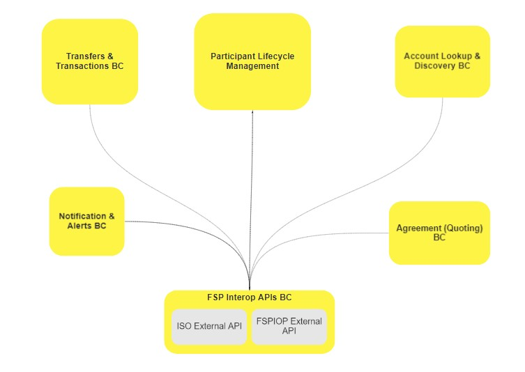

> FSP Interoperabilidade API Visão geral funcional

## Termos

Termos com um significado específico e geralmente aceite no Contexto Delimitado em que são utilizados.

| Termo        | Descrição                                                                                                                                                      |
| ----------- | ---------------------------------------------------------------------------------------------------------------------------------------------------------------- |
| **(D) FSP**      | Prestador de serviços financeiros (digitais)                                                                                                                             |
| **Participante** | Prestador de serviços financeiros (FSP) que se registou no ecossistema Mojaloop. Permitindo que o referido FSP possa efetuar transações com outros participantes                 |
| **FSP IOP API** | Interface de Programação de Aplicações para a Interoperabilidade de Prestadores de Serviços Financeiros, o API que proporciona acesso às funções e funcionalidades do Mojaloop Ecosystem. |
| **Pagador**       | O pagador dos fundos eletrónicos numa transação de pagamento.                                                                                                          |
| **Pagador FSP**   | Prestador de serviços financeiros do pagador.                                                                                                                              |
| **Beneficiário**       | O destinatário dos fundos eletrónicos numa transação de pagamento.                                                                                                      |
| **Beneficiário FSP**   | Prestador de serviços financeiros do beneficiário.                                                                                                                              |

## Casos de uso

### Nota

As definições dos casos de uso estipuladas na Especificação de Interoperabilidade Open API para FSP [^2] não foram alteradas e, por conseguinte, a Arquitetura de Referência foi concebida de forma a alterar apenas a orquestração em segundo plano dos serviços internos Mojaloop e dos Contextos Delimitados.

### Notificações BC - Enviar notificação

#### Descrição

As notificações dizem respeito a TODOS os casos de uso abaixo, em resposta a pedidos recebidos sob várias formas. Enquanto o FSP IOP API estiver ocupado a processar um pedido recebido, poderá ser necessário enviar um pedido ao DFSP solicitante ou a quaisquer outros DFSPs relevantes. O IOP FSP API irá, em seguida, consultar o Contexto Delimitado de Gestão do Ciclo de Vida do Participante [^26] para obter os URIs de callback do participante em questão, para quem a notificação deve ser enviada. O IOP FSP API enviará, então, o pedido de notificação para o Contexto Delimitado de Notificações e Alertas [^27].

#### Fluxograma

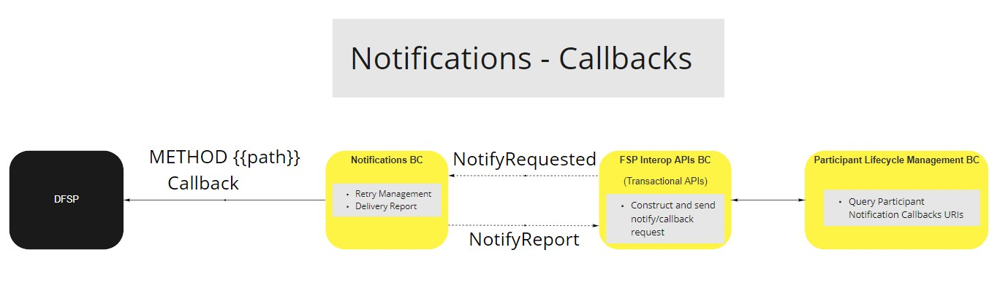

>

## Critérios de pesquisa e identificação de contas

### Colaborador de eventos/participantes

#### Descrição

Realizar a transferência dos participantes e/ou das partes com base no pedido POST Participant [^5] (POST /participants/{Type}/{ID}). O IOP FSP API envia então um pedido ao BC de Pesquisa e Descoberta de Contas [^14], que processará o pedido e responderá com um evento de sucesso. O IOP FSP API envia então uma resposta PUT de notificação ao participante [^15] (PUT /participants/{Type}/{ID}).

#### Diagrama de fluxo

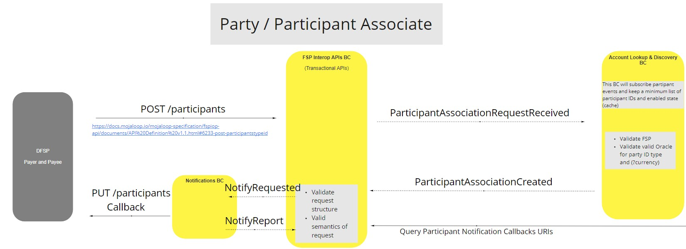

>

### Exclusão de uma parte/participante

#### Descrição

Desassociar participante(s) e/ou partes com base no pedido DELETE Participant [^6] (DELETE /participants/{Type}/{ID}). O IOP FSP API envia o pedido ao BC Account Lookup & Discovery [^14] para desassociar a parte. A resposta de sucesso é então recebida pelo IOP FSP API, que, por sua vez, responde ao autor da chamada enviando uma resposta PUT de notificação ao participante [^15] (PUT /participants/{Type}/{ID}).

#### Diagrama de fluxo

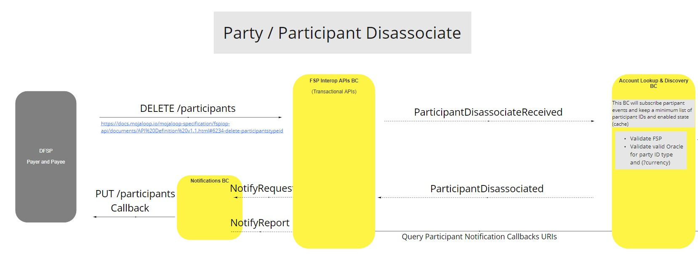

>

### Obter participante

#### Descrição

Recuperar informações sobre o participante com base no pedido GET Participant [^7] (GET /participants/{Type}/{ID}), que fornece o ID e a estrutura. O IOP FSP API envia o pedido ao BC Account Lookup & Discovery [^14] para determinar se o participante pretendido existe. O IOP FSP, API, responde então ao requerente com uma resposta PUT Participante [^15] (PUT /participants/{Type}/{ID}).

#### Diagrama de fluxo

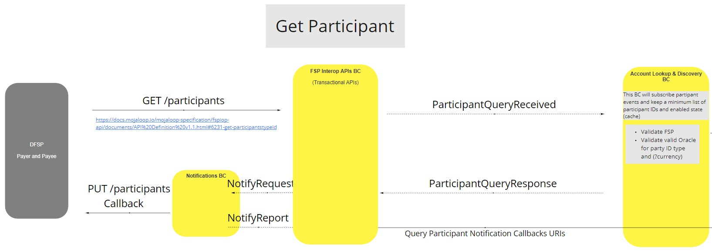

>

### Vá à festa

#### Descrição

Recuperar informações sobre a parte com base no ID transmitido com o pedido GET Party [^8] (GET /parties/{Type}/{ID}). O IOP FSP API envia então um pedido ao BC de Pesquisa e Descoberta de Contas [^14] para determinar o destino FSP para o qual deve reencaminhar o pedido GET. O destino FSP responde então com uma solicitação PUT parties. A informação é, em seguida, enviada ao BC de Pesquisa e Descoberta de Contas para ser armazenada em cache antes de a resposta PUT Party [^17] (PUT /parties/{Type}/{ID}) ser enviada ao remetente original da solicitação GET.

#### Diagrama de fluxo

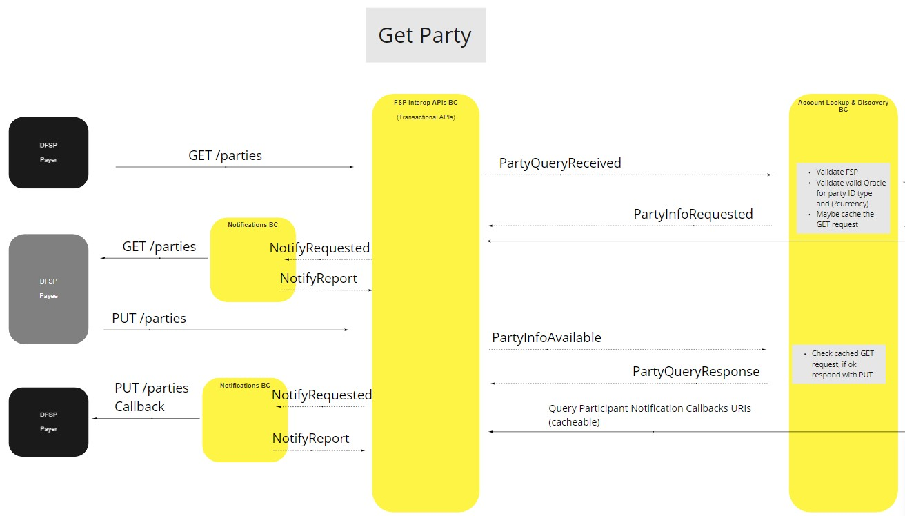

>

## Acordo (Cotação) BC

### Calcular cotação - Cenário ideal

#### Descrição

Quando uma cotação é enviada através do pedido POST Quote [^3] (POST /quotes), o IOP FSP API envia o pedido ao BC de Cotação/Acordo [^19] para validar a cotação. O IOP FSP API enviará então a solicitação POST Cotação ao Beneficiário FSP, que, por sua vez, responde com uma resposta PUT Cotação [^18] (PUT /quotes/{ID}) e as informações relevantes atualizadas. O IOP FSP API envia uma cotação aceita ao BC de Cotação/Acordo [^19] para armazenar as informações da cotação. O IOP FSP API encaminhará então a solicitação PUT de cotação para o Pagador FSP e considerará a cotação bem-sucedida.

#### Diagrama de fluxo

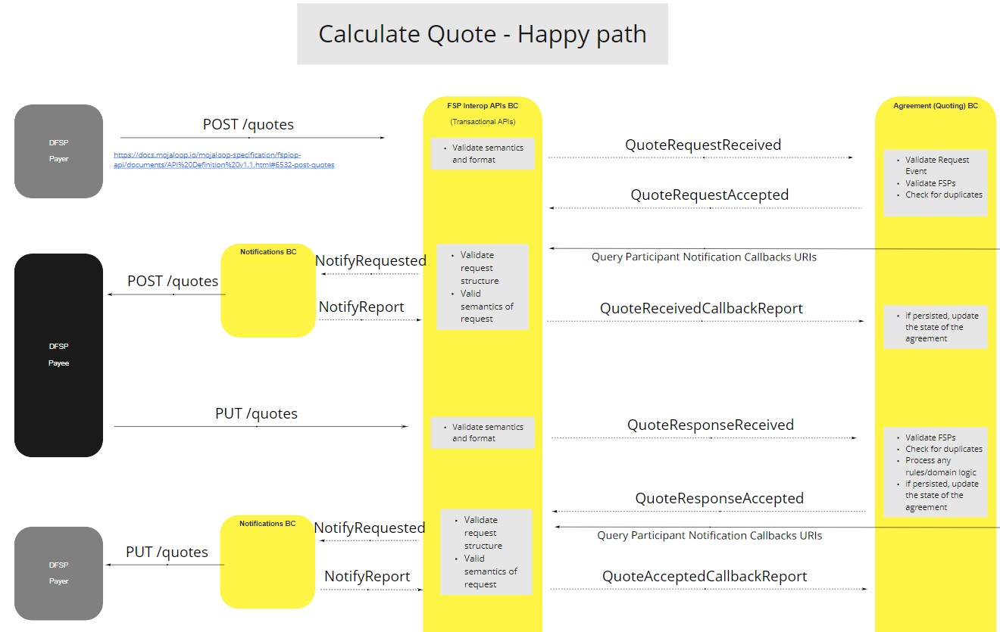

>

### Obter cotação - Happy Path

#### Descrição

Isto permite que um FSP obtenha informações sobre uma cotação existente. O pedido GET Quote [^4] (GET /quotes/{ID}) é enviado ao FSP IOP API, que consulta o BC de Cotação/Acordo [^19] para obter as cotações existentes. Quando a cotação é recuperada, a informação é devolvida ao solicitante (FSP) através do envio da resposta PUT Cotação [^18] (PUT /quotes/{ID}).

#### Diagrama de fluxo

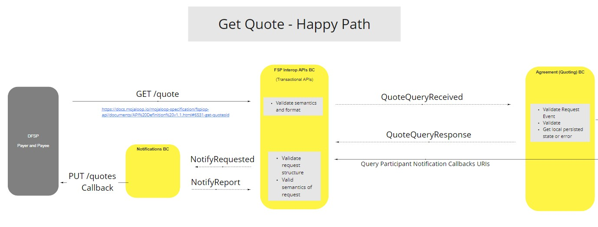

>

### Calcular Cotação - Pedido de Cotação Inválido

#### Descrição

Quando é recebida uma solicitação de cotação POST [^3] (POST /quotes), o IOP FSP API envia a solicitação ao BC de Cotação/Acordo [^19] para processamento. Caso a cotação não seja validada, o BC de Cotação/Acordo [^19] responde com uma resposta de erro, que o IOP FSP API notifica ao solicitante FSP através da resposta PUT de erro de cotação [^20] (PUT /quotes/{ID}/error).

#### Diagrama de fluxo

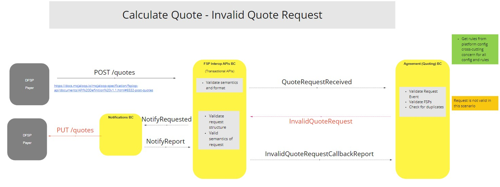

>

### Calcular Cotação - FSPs inválidos

#### Descrição

Quando é enviada uma solicitação POST de cotação [^3] (POST /quotes), mas o IOP FSPAPI encaminha a solicitação ao BC de Cotação/Acordo [^19] para processamento e este não consegue determinar que ambos os participantes são FSPs válidos, é então enviada uma resposta de erro ao IOP FSPAPI. O IOP FSP API notifica então o solicitante FSP através da resposta de erro PUT de cotação [^20] (PUT /quotes/{ID}/error).

#### Diagrama de fluxo

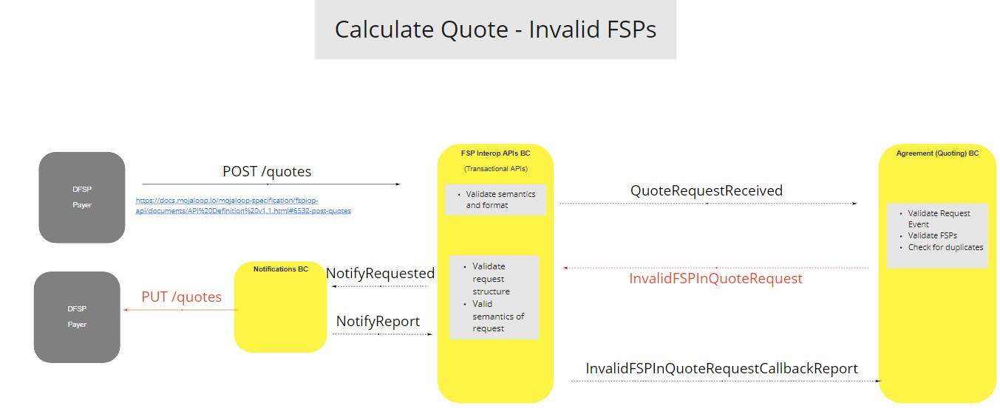

>

### Calcular Cotação - Foram detetadas regras de scheme inválidas no pedido

#### Descrição

Quando o Pagador FSP envia um pedido POST de cotação [^3] (POST /quotes), o IOP FSP API encaminha o pedido para o BC de Cotação/Acordo [^19] para processamento e, caso a cotação não cumpra as regras do scheme definido, é então enviada uma resposta de erro ao IOP FSP API. O IOP FSP API notifica então o pagador FSP através da resposta PUT de erro de cotação [^20] (PUT /quotes/{ID}/error)

#### Diagrama de fluxo

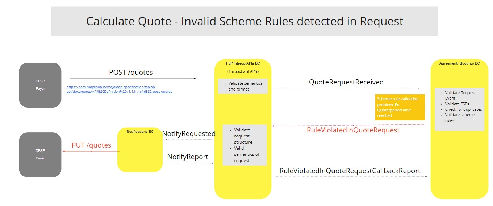

>

### Calcular Cotação - Foram detetadas regras de scheme inválidas na resposta

#### Descrição

Quando o Pagador FSP envia um pedido POST de cotação [^3] (POST /quotes), o IOP FSP API encaminha o pedido para o BC de Cotação/Acordo [^19] para processamento, tendo o mesmo sido processado com sucesso na fase inicial. O IOP FSP API envia uma solicitação POST de cotação ao Beneficiário FSP. O Beneficiário FSP deve responder com uma cotação aceite, enviando uma solicitação PUT de cotação [^18] (PUT /quotes/{ID}). A resposta é enviada ao BC de Cotação/Acordo [^19] para processamento e validação adicionais. Quando o Contexto Delimitado deteta que a cotação não cumpre as regras do scheme definido, é então enviada uma resposta de erro para o IOP FSP [API]. O IOP FSP API notifica então tanto o Pagador FSP como o Beneficiário FSP através da resposta PUT de erro de cotação [^20] (PUT /quotes/{ID}/error).

#### Diagrama de fluxo 

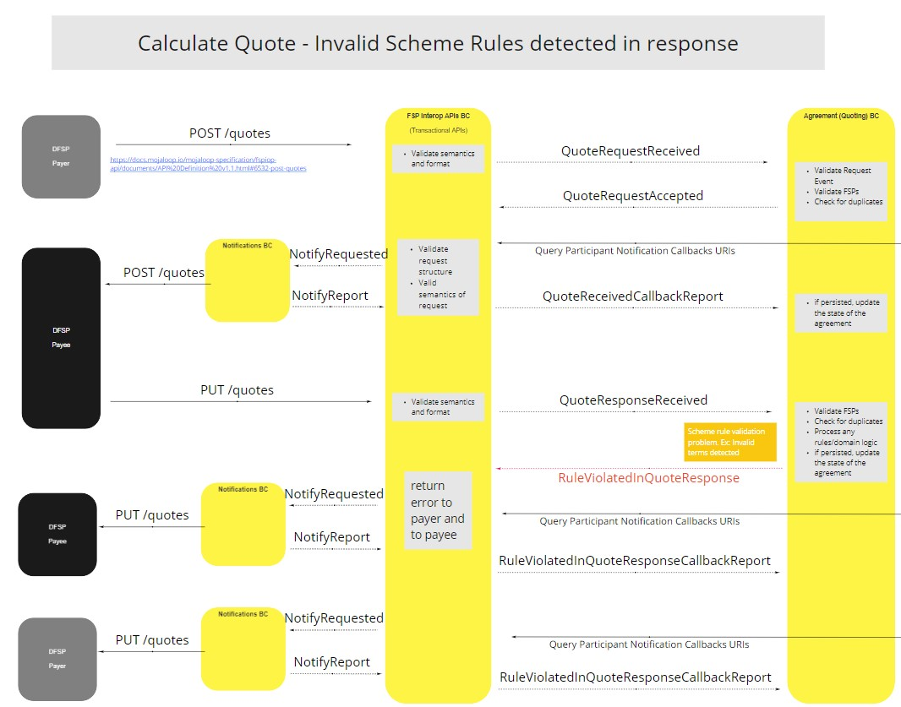

> Acordo BC - Calcular Cotação - Foram detetadas regras de esquema inválidas na resposta

## Transferências BC

### Efetuar transferência (Modo Universal)

#### Descrição

O pagador FSP envia um pedido POST de transferências [^9] (POST /transfers) para o IOP FSP API. O IOP FSP API envia, em seguida, um evento para o Contexto Delimitado de Liquidações [^21]. O IOP FSP API aguarda um evento do Contexto Delimitado de Transferências [^22], para indicar que a transferência foi preparada, a fim de enviar uma solicitação POST ao Beneficiário FSP. O Beneficiário FSP responde então com um pedido PUT de Transferências [^23] (PUT /transfers/{ID}) (transferState = committed) ao FSP IOP API, que, por sua vez, confirma a execução da transferência. A transferência PUT é então enviada ao Pagador FSP.

#### Diagrama de fluxo

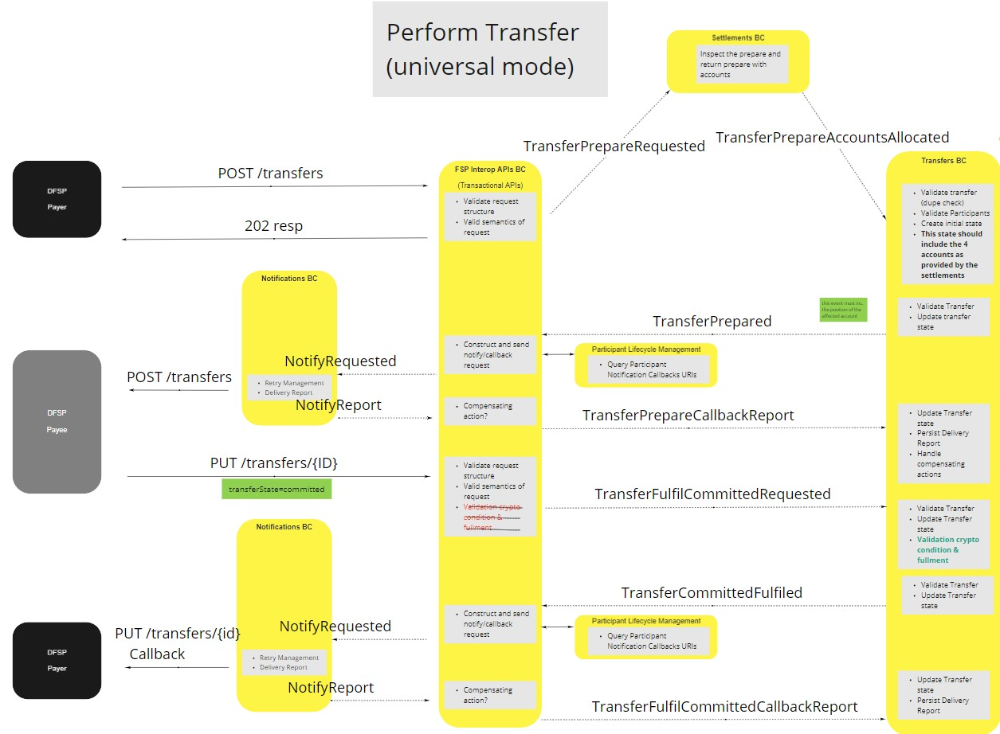

>

### Efetuar transferência com confirmação do beneficiário

#### Descrição

O Pagador FSP envia um pedido POST de transferências [^9] (POST /transfers) para o IOP FSP API. O IOP FSP API envia, em seguida, um evento para o Contexto Delimitado de Liquidações [^21]. O IOP FSP API aguarda um evento do Contexto Delimitado de Transferências [^22], para indicar que a transferência foi preparada, a fim de enviar uma solicitação POST ao Beneficiário FSP. O Beneficiário FSP responde então com um pedido PUT de Transferências [^23] (PUT /transfers/{ID}) (transferState = reserved) ao FSP IOP API, que, por sua vez, reserva a execução da transferência. A transferência PUT é então enviada ao Pagador FSP. O Beneficiário FSP é então o destinatário do pedido PATCH Transfers [^24] (PATCH /transfers/{ID}) para notificar a alteração do estado da transferência.

#### Diagrama de fluxo

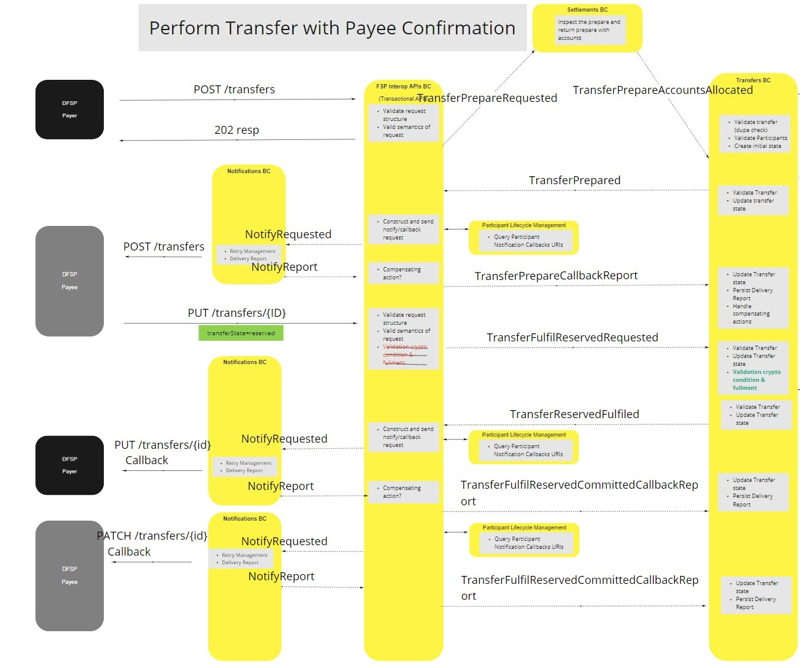

>

### Consulta: Obter transferência

#### Descrição

Obtém as informações da transferência com base no ID da transferência utilizado no pedido GET de transferência [^11] (GET /transfers/{ID}) e é o destinatário do pedido PUT de transferências [^23] (PUT /transfers/{ID}) para obter as informações relevantes sobre a transferência.

#### Diagrama de fluxo

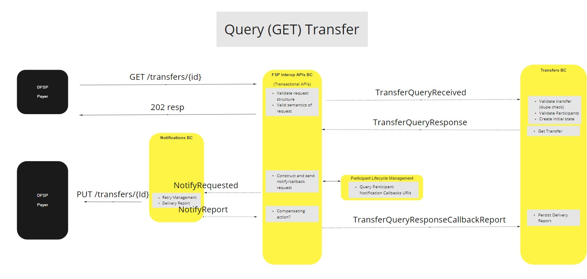

>

### Efetuar transferência - Duplicar lançamento (reenviar)

#### Descrição

O pedido POST de transferências [^9] (POST /transfers) já foi processado e é devolvido um relatório de estado ao pagador FSP, mediante a receção de um pedido PUT de transferências [^23] (PUT /transfers/{ID}).

#### Diagrama de fluxo

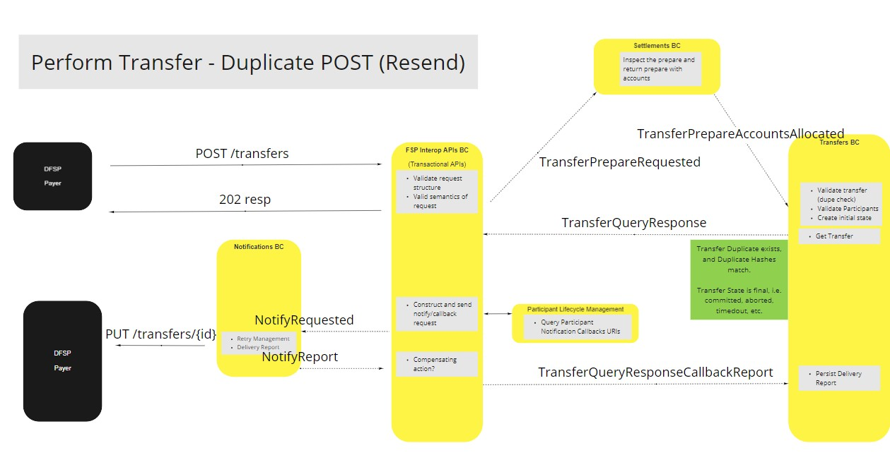

> Transferências BC - Efetuar transferência - Lançamento duplicado (reenviar)

### Efetuar transferência - Publicação duplicada (Ignorar)

#### Descrição

O pedido de transferências POST [^9] (POST /transfers) já foi processado, mas não é necessária nem solicitada qualquer resposta.

#### Diagrama de fluxo

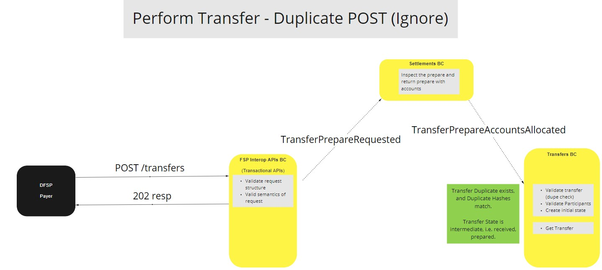

>

### Efetuar transferência — O beneficiário n.º DFSP rejeita a transferência

#### Descrição

O Pagador FSP envia um pedido POST de transferências [^9] (POST /transfers) para o IOP FSP API. A API prepara então a transferência e, em seguida, encaminha o pedido POST para o Beneficiário FSP. O Beneficiário FSP recusa então a transferência, enviando um pedido PUT de erro de transferência [^25] (PUT /transfers/{ID}/error) para o IOP FSP API. O IOP FSP API notifica então o Contexto Delimitado de Transferências [^22] de que a transferência foi rejeitada e envia um pedido PUT de erro de transferência [^25] (PUT /transfers/{ID}/error) ao Pagador FSP.

#### Diagrama de fluxo

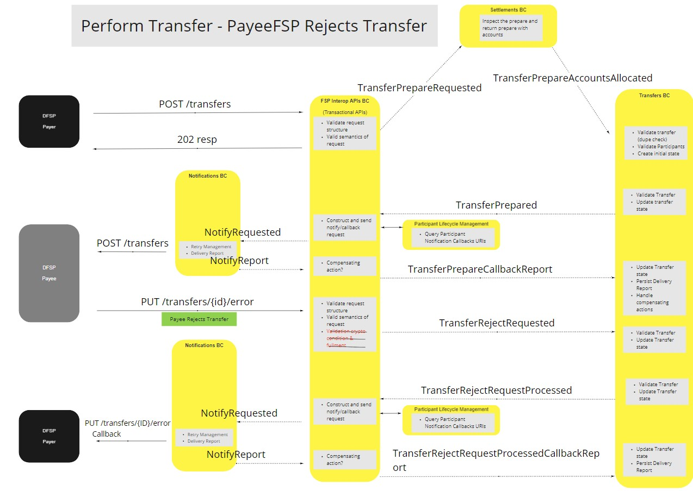

>

### Executar transferência - Tempo limite (Preparação)

#### Descrição

O pedido de transferências POST [^9] (POST /transfers) é rejeitado porque a transferência atingiu o tempo limite [^13] enquanto os fundos estavam a ser preparados. O IOP FSP API envia um pedido de erro de transferência PUT [^25] (PUT /transfers/{ID}/error) ao pagador FSP para notificá-lo do erro.

#### Diagrama de fluxo

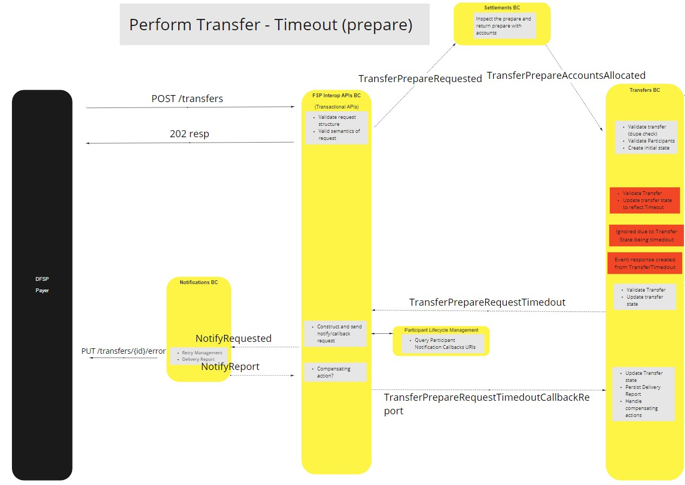

>

### Executar transferência - Tempo limite (pré-confirmada)

#### Descrição

O Pagador FSP envia um pedido POST de transferências [^9] (POST /transfers) para o IOP FSP API. O IOP FSP API envia, em seguida, um evento para o Contexto Delimitado de Liquidações [^21]. O IOP FSP API aguarda um evento do Contexto Delimitado de Transferências [^22], para indicar que a transferência foi preparada, a fim de enviar uma solicitação POST ao Beneficiário FSP. O Beneficiário FSP responde então com um pedido PUT de Transferências [^23] (PUT /transfers/{ID}) (transferState = committed) ao FSP IOP API, que, por sua vez, confirma a execução da transferência. A transferência atinge o tempo limite [^13] enquanto/antes de os fundos serem confirmados, o que faz com que a transferência seja rejeitada. O IOP FSP API notifica então tanto o FSP do pagador como o do beneficiário com uma solicitação PUT de erro de transferência [^25] (PUT /transfers/{ID}/error).

#### Diagrama de fluxo

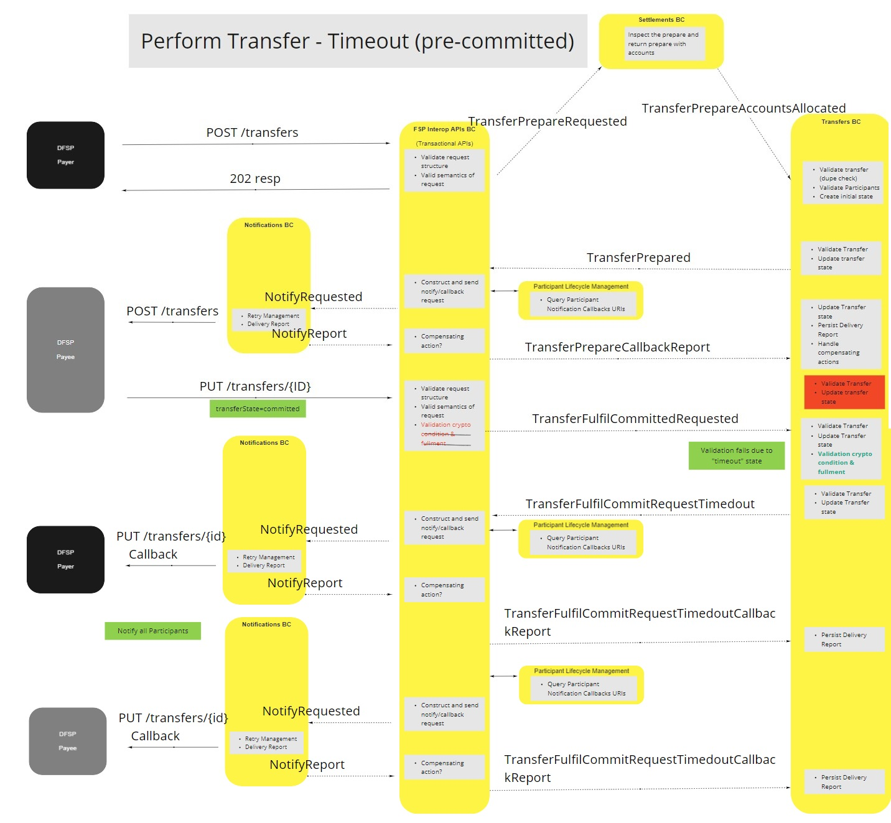

>

### Executar transferência - Tempo limite (após a confirmação)

#### Descrição

O Pagador FSP envia um pedido POST de transferências [^9] (POST /transfers) para o IOP FSP API. O IOP FSP API envia, em seguida, um evento para o Contexto Delimitado de Liquidações [^21]. O IOP FSP API aguarda um evento do Contexto Delimitado de Transferências [^22], para indicar que a transferência foi preparada, a fim de enviar uma solicitação POST ao Beneficiário FSP. O Beneficiário FSP responde então com um pedido PUT de Transferências [^23] (PUT /transfers/{ID}) (transferState = committed) ao FSP IOP API, que, por sua vez, confirma a execução da transferência. A transferência expira [^13] após a confirmação dos fundos, o que faz com que a transferência seja rejeitada.

#### Diagrama de fluxo

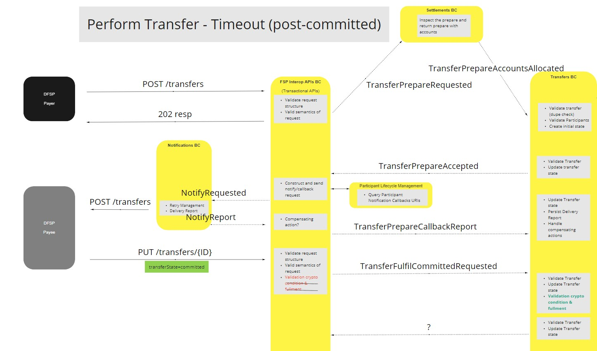

>

### Efetuar transferência - Duplicar lançamento (sem correspondências)

#### Descrição

O pedido de transferências POST [^9] (POST /transfers) já foi processado e é devolvido um relatório de estado ao pagador FSP, mediante a receção de um pedido de erro de transferência PUT [^25] (PUT /transfers/{ID}/error).

#### Diagrama de fluxo

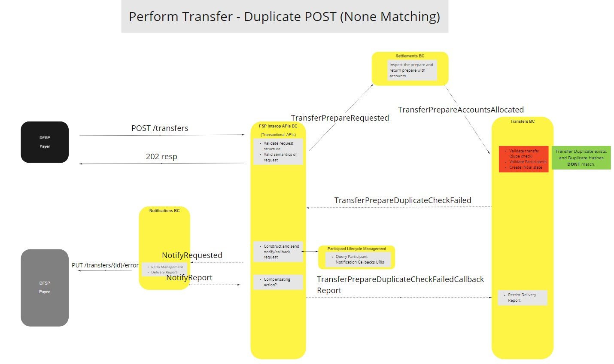

>

### Efetuar transferência - Pagador FSP: liquidez insuficiente

#### Descrição

O pagador FSP envia um pedido POST de transferências [^9] (POST /transfers) para o IOP FSP API. O IOP FSP API envia, em seguida, um evento para o Contexto Delimitado de Liquidações [^21]. O IOP FSP API aguarda um evento do Contexto Delimitado de Transferências [^22], para indicar que a transferência foi preparada, mas recebe uma falha na verificação de liquidez relativa ao Pagador FSP. O OIP FSP API envia então um pedido PUT [^25] de erro de transferências ao Pagador FSP para o notificar do erro.

#### Diagrama de fluxo

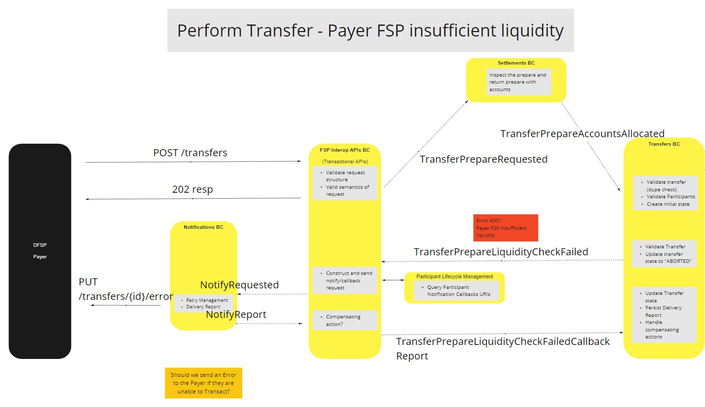

>

### Executar transferência - Transferência: Preparar rejeitados

#### Descrição

O Pagador FSP envia um pedido POST de transferências [^9] (POST /transfers) para o IOP FSP API. A API prepara então a transferência e, em seguida, encaminha o pedido POST para o Beneficiário FSP. O Beneficiário FSP recusa então a transferência, enviando um pedido PUT de erro de transferência [^25] (PUT /transfers/{ID}/error) para o IOP FSP API. O IOP FSP API notifica então o Contexto Delimitado de Transferências [^22] de que a transferência foi rejeitada e envia um pedido PUT de erro de transferência [^25] (PUT /transfers/{ID}/error) ao Pagador FSP.

#### Diagrama de fluxo

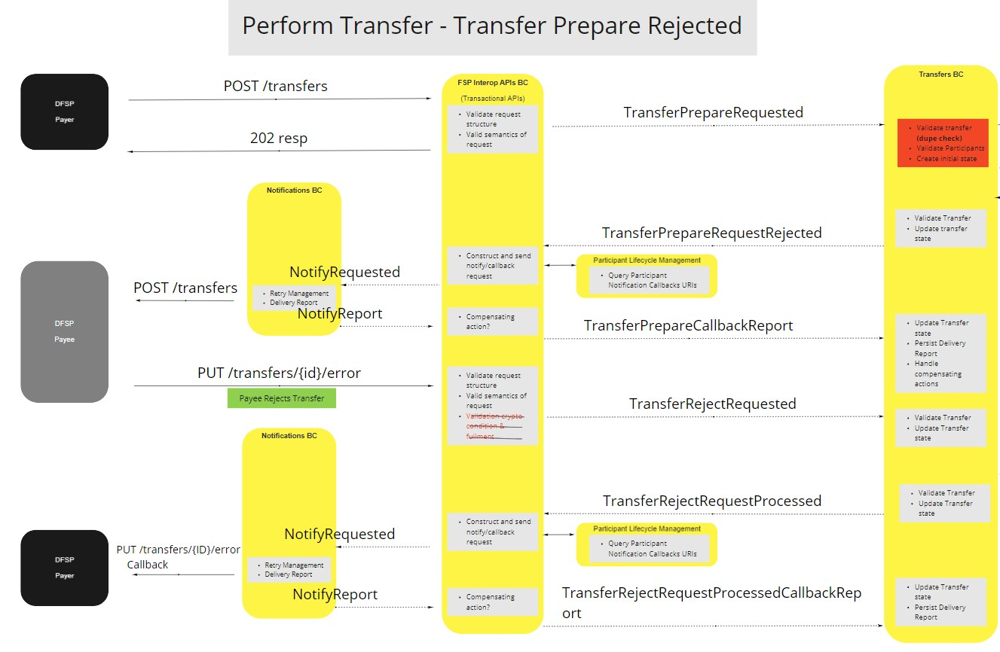

>

### Executar transferência - Falha na validação da preparação da transferência (participante pagador inválido)

#### Descrição

O Pagador FSP envia um pedido POST de transferências [^9] (POST /transfers) para o IOP FSP API. O Contexto Delimitado de Transferências [^22] notifica o IOP FSP API de que o Pagador FSP é inválido. Dependendo do motivo pelo qual o Pagador FSP é inválido, o FSP IOP API enviará um pedido PUT de erro de transferência [^25] (PUT /transfers/{ID}/error) ao Pagador FSP.

#### Diagrama de fluxo

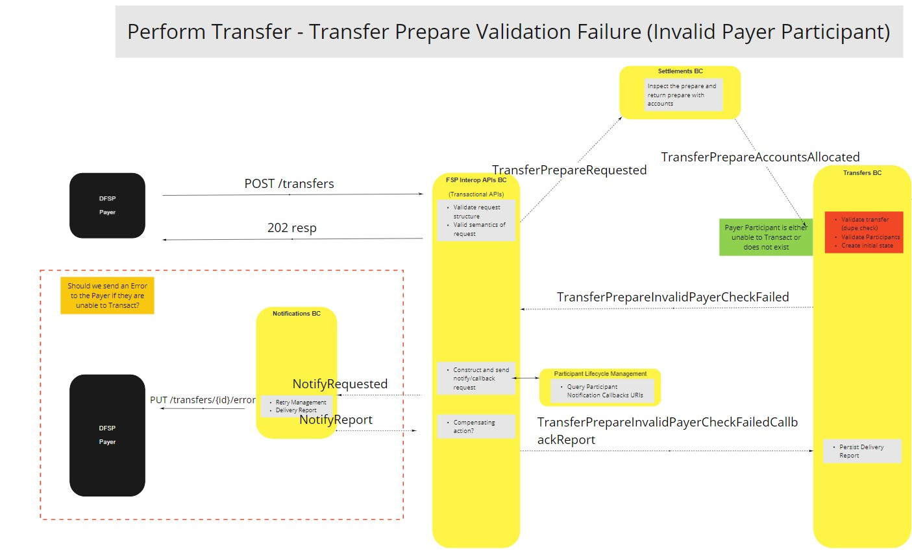

>

### Executar transferência - Falha na validação da preparação da transferência (participante beneficiário inválido)

#### Descrição

O Pagador FSP envia um pedido POST de transferências [^9] (POST /transfers) para o IOP FSP API. O Contexto Delimitado de Transferências [^22] notifica o IOP FSP API de que o Beneficiário FSP é inválido. O IOP FSP API enviará um pedido PUT de erro de transferência [^25] (PUT /transfers/{ID}/error) ao pagador FSP para o notificar da falha.

#### Diagrama de fluxo

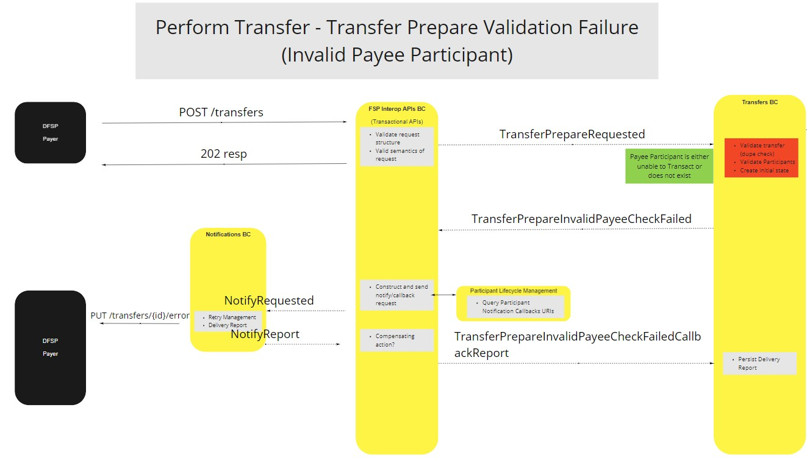

>

## Notas

### Validação da estrutura com base em eventos internos

Muitos casos de uso estipulam que a estrutura e a semântica do pedido devem ser validadas aquando da receção de um evento proveniente de um Contexto Delimitado interno. Isto não ocorre caso a caso, mas constitui sim um requisito a cumprir durante a fase de construção da Arquitetura de Referência. O que pretendemos transmitir ao demonstrar isto é que, internamente, todos os eventos e recursos disponíveis devem ser padronizados e verificados.

[^1]: [Mojaloop
Lista de Interfaces Comuns](../../commonInterfaces.md)
[^2]: [Open API
para FSP
Documentação](https://docs.mojaloop.io/mojaloop-specification/)
[^3]: [Publicar Cotação - Definição](https://docs.mojaloop.io/mojaloop-specification/fspiop-api/documents/API%20Definition%20v1.1.html#6532-post-quotes)
[^4]: [Obter Cotação - Definição](https://docs.mojaloop.io/mojaloop-specification/fspiop-api/documents/API%20Definition%20v1.1.html#6531-get-quotesid)
[^5]: [Publicar Participante - Definição](https://docs.mojaloop.io/mojaloop-specification/fspiop-api/documents/API%20Definition%20v1.1.html#6233-post-participantstypeid)
[^6]: [Delete Participant - Definição](https://docs.mojaloop.io/mojaloop-specification/fspiop-api/documents/API%20Definition%20v1.1.html#6234-delete-participantstypeid)
[^7]: [Get Participante - Definição](https://docs.mojaloop.io/mojaloop-specification/fspiop-api/documents/API%20Definition%20v1.1.html#6231-get-participantstypeid)
[^8]: [Get Parties - Definição](https://docs.mojaloop.io/mojaloop-specification/fspiop-api/documents/API%20Definition%20v1.1.html#6331-get-partiestypeid)
[^9]: [Post Transferências - Definição](https://docs.mojaloop.io/mojaloop-specification/fspiop-api/documents/API%20Definition%20v1.1.html#6732-post-transfers)
[^10]: [Commit Notification - Definição](https://docs.mojaloop.io/mojaloop-specification/fspiop-api/documents/API%20Definition%20v1.1.html#6726-commit-notification)
[^11]: [Obter Transferências - Definição](https://docs.mojaloop.io/mojaloop-specification/fspiop-api/documents/API%20Definition%20v1.1.html#6731-get-transfersid)
[^12]: [Irrevogabilidade da Transação - Definição](https://docs.mojaloop.io/mojaloop-specification/fspiop-api/documents/API%20Definition%20v1.1.#6722-transaction-irrevocability)
[^13]: [Limite de Tempo e Caducidade das Transferências - Definição](https://docs.mojaloop.io/mojaloop-specification/fspiop-api/documents/API%20Definition%20v1.1.html#6724-timeout-and-expiry)
[^14]: [Contexto Delimitado de Pesquisa e Descoberta de ContasContext](../accountLookupAndDiscovery/index.md)
[^15]: [Inserir Participante - Definição](https://docs.mojaloop.io/mojaloop-specification/fspiop-api/documents/API%20Definition%20v1.1.html#6242-put-participantsid)
[^17]: [Inserir Parte - Definição](https://docs.mojaloop.io/mojaloop-specification/fspiop-api/documents/API%20Definition%20v1.1.html#6341-put-partiestypeid)
[^18]: [Inserir Cotação - Definição](https://docs.mojaloop.io/mojaloop-specification/fspiop-api/documents/API%20Definition%20v1.1.html#6541-put-quotesid)
[^19]: [Contexto Delimitado de Cotação\Acordo](../quotingAgreement/index.md)
[^20]: [Erro na inserção de cotação - Definition](https://docs.mojmojaloop.io/mojaloop-specification/fspiop-api/documents/API%20Definition%20v1.1.html#6551-put-quotesiderror)
[^21]: [Contexto delimitado de liquidações Context](../settlements/index.md)
[^22]: [Contexto delimitado de transferências Context](../transfers/index.md)
[^23]: [Put Transfers - Definição](https://docs.mojaloop.io/mojaloop-specification/fspiop-api/documents/API%20Definition%20v1.1.html#6741-put-transfersid)
[^24]: [Patch Transfers - Definição](https://docs.mojaloop.io/mojaloop-specification/fspiop-api/documents/API%20Definition%20v1.1.html#6733-patch-transfersid)
[^25]: [Put Transfers Error - Definição](https://docs.mojaloop.io/mojaloop-specification/fspiop-api/documents/API%20Definition%20v1.1.html#6751-put-transfersiderror)
[^26]: [Participant Lifecycle Management Bounded Context](../participantLifecycleManagement/index.md)
[^27]: [Notification and Alerts Bounded Context](../notificationsAndAlerts/index.md)
