# Gestão do ciclo de vida dos participantes BC

A principal preocupação do Contexto Delimitado do Ciclo de Vida do Participante diz respeito a tudo o que se relaciona com a gestão de um Participante no Ambiente «Mojaloop». Ao definirmos o Contexto Delimitado da Gestão do Ciclo de Vida do Participante, há alguns conceitos-chave que devem ser claramente definidos.

#### Processo «Criador-Verificador»
O Processo «Criador-Verificador» estabelece a verificação por 6 pares de olhos e garante que nenhuma ação de gravação ocorra sem ser validada por alguém com as permissões adequadas. Estas permissões são definidas pelo Contexto Delimitado de Gestão do Ciclo de Vida dos Participantes, mas são configuráveis e atribuíveis conforme necessário pelas Regras do Scheme. Recomenda-se que os utilizadores/funções que são destinatários das permissões de criador não sejam destinatários das permissões de verificador e que estas últimas sejam atribuídas a utilizadores/funções diferentes. Continuará a ser possível atribuir ambas as responsabilidades aos mesmos utilizadores/funções, mas tal anula a segurança proporcionada pelo processo «criador-verificador», que era permitido pelo sistema.

#### Estados participantes
A gestão do estado dos participantes permite aos operadores administrativos controlar as permissões de um determinado participante com base no seu estado. Durante a fase de configuração da plataforma, o Contexto Delimitado de Gestão do Ciclo de Vida dos Participantes prevê que os estados dos participantes sejam definidos e configurados com funções e/ou permissões. Os estados dos participantes podem, em seguida, ser atribuídos a um determinado participante através do processo de Gestão do Estado dos Participantes.

## Termos

Termos com um significado específico e geralmente aceite no Contexto Delimitado em que são utilizados.

| Termo        | Descrição  |
| ----------- | ------------ |
| **Participante** | Prestadores de serviços financeiros que se registem no ecossistema «Mojaloop». Permitindo que o referido «FSP» possa efetuar transações com outros participantes |
| **Criador**       | Representante responsável pela criação de estruturas de dados através da utilização de pedidos.   |
| **Checker**     | Representante responsável pela aprovação e aceitação dos dados cuja criação tenha sido solicitada. |

## Visão geral das funcionalidades

Consulte a página sobre interfaces comuns para saber como estas interações ocorrem. [^1]

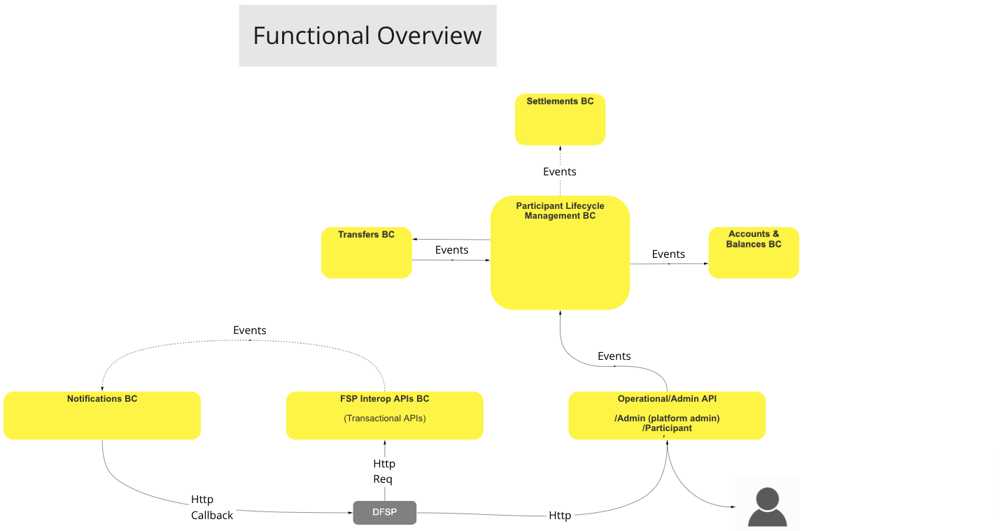
>Diagrama do fluxo de trabalho do BC: Visão geral funcional

## Casos de uso

### Criar participante (registo em uma única etapa)

#### Descrição

O fluxo de trabalho disponibilizado por esta UC permite que o BC utilize um processo através do qual crie um participante no ecossistema «Mojaloop», o que normalmente requer todas as informações relativas ao participante e as contas iniciais necessárias.

#### Diagrama de fluxo

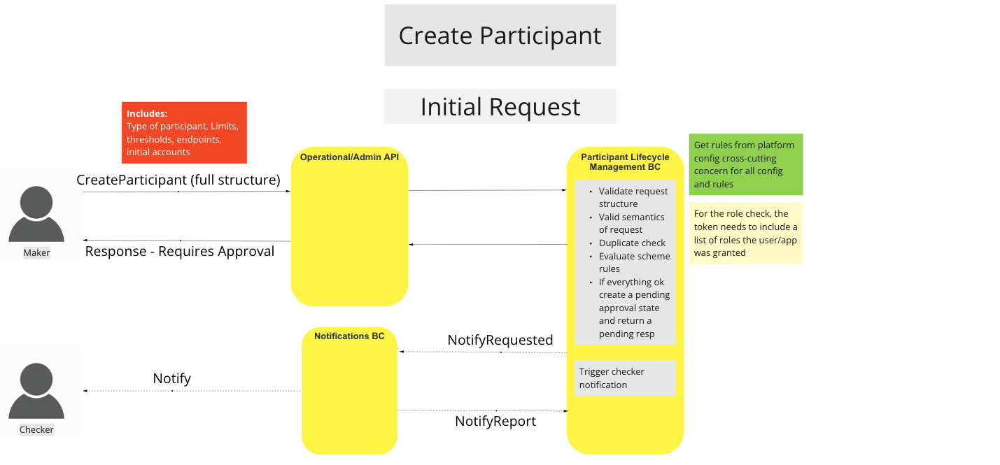
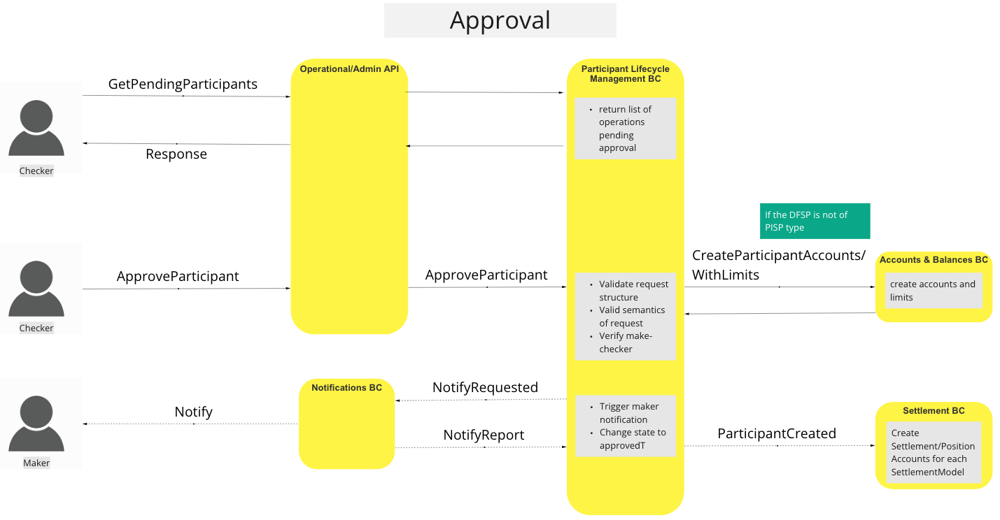
>Diagrama de fluxo de trabalho da UC: Criar participante

### Gerir fundos

#### Descrição

O fluxo de trabalho proporcionado por esta UC permite que a BC recorra a um processo através do qual pode levantar ou depositar fundos na(s) conta(s) do participante.

#### Diagrama de fluxo

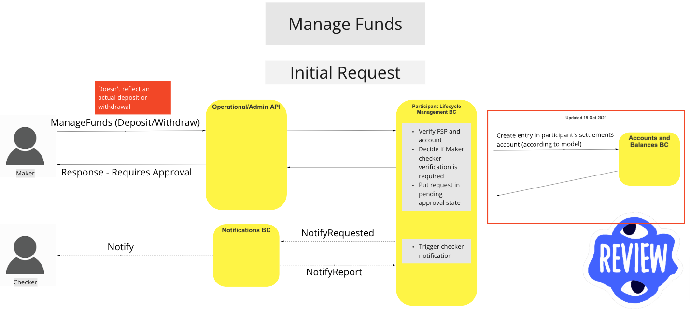
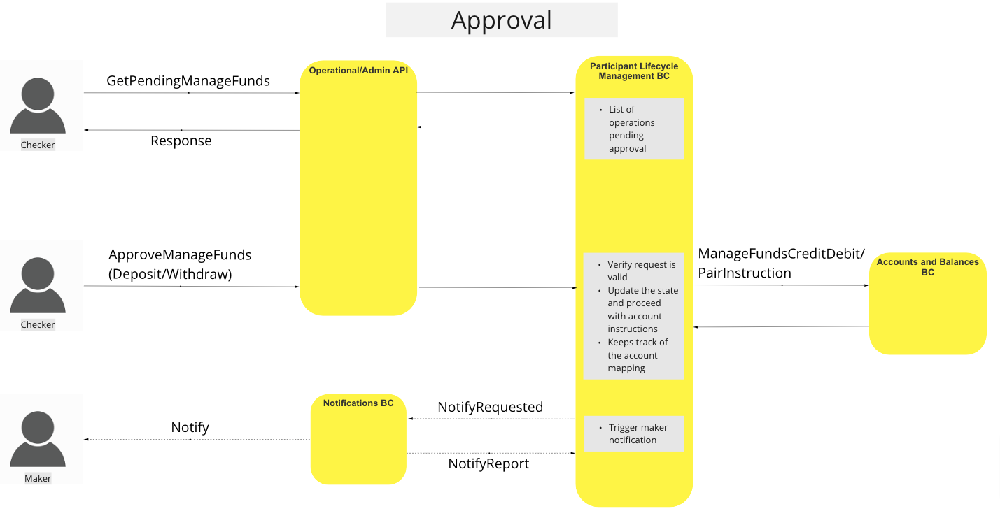
>Diagrama de fluxo de trabalho da UC: Gestão de fundos

### Atualizar endpoints

#### Descrição

O fluxo de trabalho disponibilizado por esta UC permite que o BC utilize um processo para atualizar o endpoint de um determinado participante. Quando o pedido for aprovado, o endpoint será contactado através de um caminho de manutenção de ligação, a fim de garantir a conectividade.

#### Diagrama de fluxo

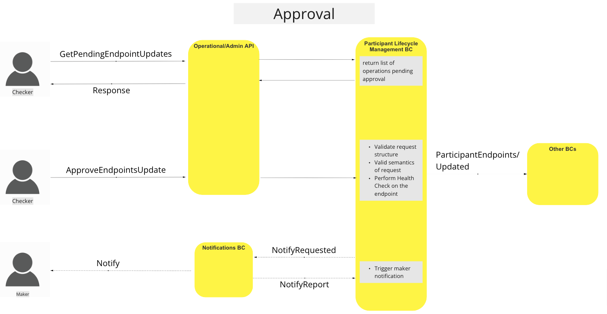
>Diagrama de fluxo de trabalho da UC: Atualizar endpoints

### Atualizar o estado do participante

#### Descrição

O fluxo de trabalho proporcionado por esta UC permite que o BC recorra a um processo através do qual pode alterar o estatuto de um determinado participante, a fim de aplicar diferentes funções/regras do scheme a esse participante.

#### Diagrama de fluxo

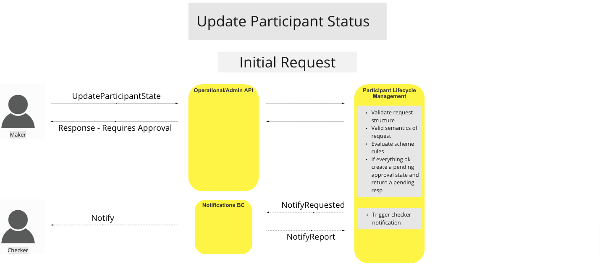
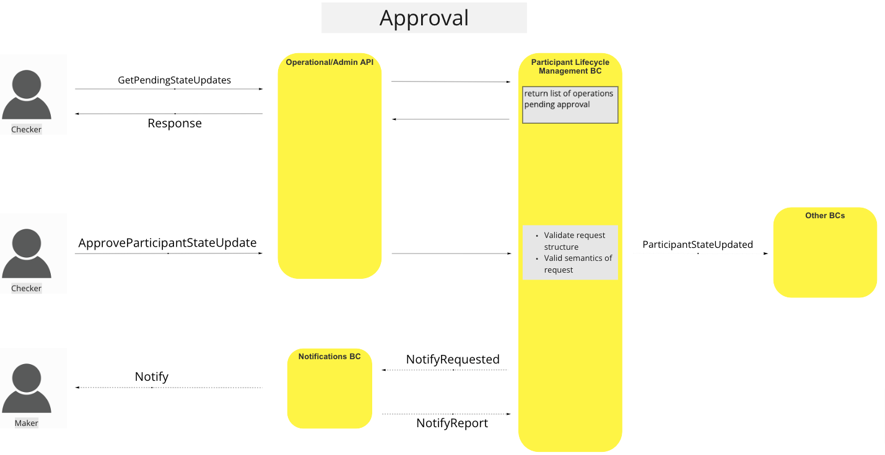
>Diagrama de fluxo de trabalho da UC: Atualizar o estado do participante

### Obter participante

#### Descrição

O fluxo de trabalho proporcionado por esta UC permite que o BC recorra a um processo através do qual possa obter informações sobre um determinado participante.

#### Diagrama de fluxo

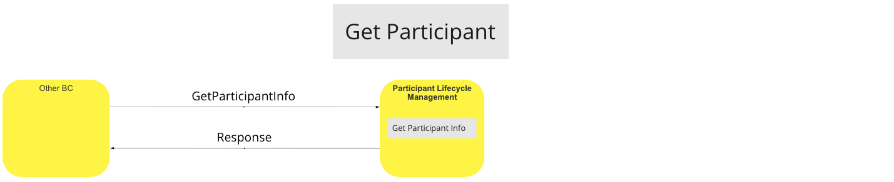
>Diagrama de fluxo de trabalho da UC: Obter participante

### Adicionar contas de participantes

#### Descrição

O fluxo de trabalho proporcionado por esta UC permite que o BC utilize um processo através do qual possa controlar diferentes aspetos das contas dos participantes, desde a criação de uma conta até à ativação/desativação e atualização dos limites e avisos de limiares de uma conta.

- Adicionar conta de participante
- Atualizar o estado da conta do participante (ativar/desativar)
- Atualizar os limites de liquidez e os limiares de aviso

#### Diagrama de fluxo

<!-- Warning Note to Developers & Editors!!: The following two images are being rendered to the Accounts & Balances BC. -->

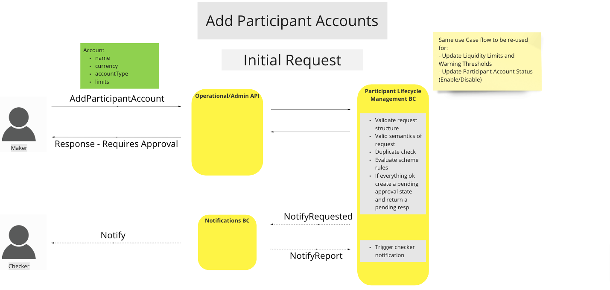
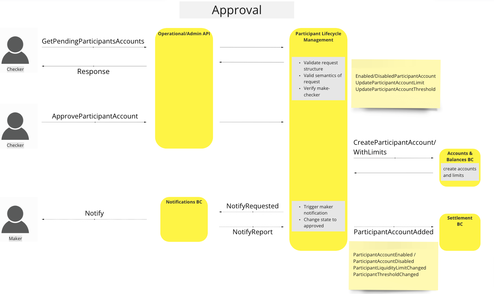
>Diagrama de fluxo de trabalho da UC: Adicionar contas de participantes

### Reserva de Cobertura de Liquidez

#### Descrição

O fluxo de trabalho proporcionado por esta UC permite que a BC implemente um processo através do qual reserve cobertura de liquidez para um participante e notifique a BC de Contas e Saldos sobre a atualização.

#### Diagrama de fluxo

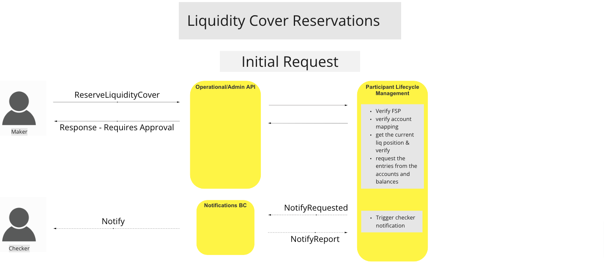
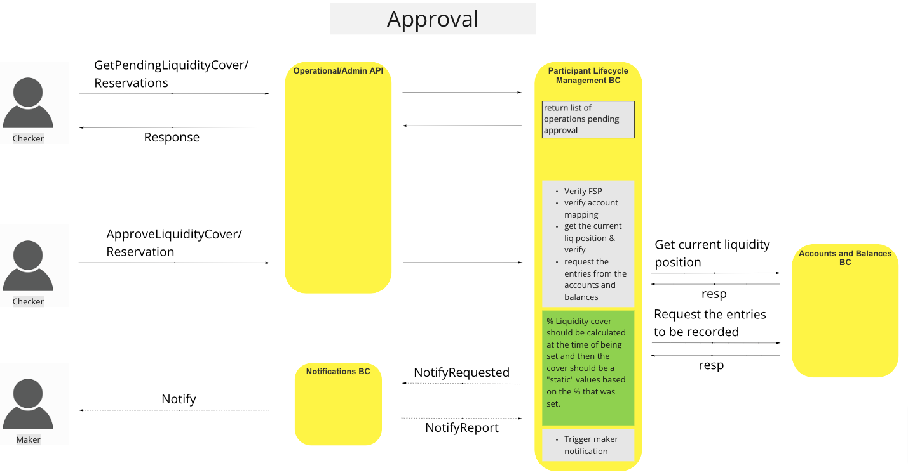
>Diagrama de fluxo de trabalho da UC: Reserva de cobertura de liquidez

### Limiar de liquidez excedido

#### Descrição

O fluxo de trabalho proporcionado por esta UC permite que o BC recorra a um processo através do qual notifica o participante de que foi atingido um limiar de liquidez pré-definido e que poderá ser necessário tomar medidas.

#### Diagrama de fluxo

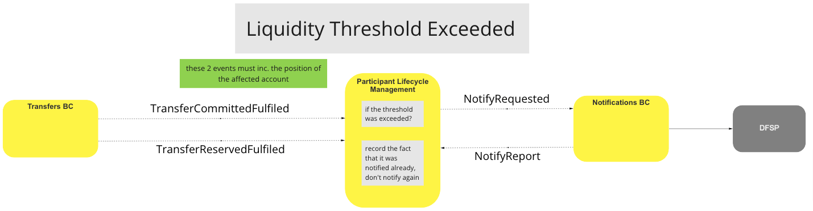
>Diagrama de fluxo de trabalho da UC: Limite de liquidez excedido

### Limite de liquidez excedido

#### Descrição

O fluxo de trabalho proporcionado por esta UC permite que o BC recorra a um processo através do qual notifica o participante quando este atinge o limite de liquidez pré-definido de uma conta.

#### Diagrama de fluxo

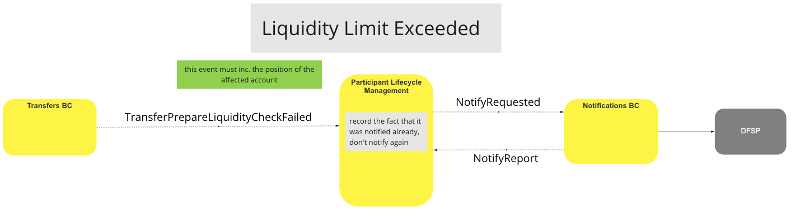
>Diagrama de fluxo de trabalho da UC: Limite de liquidez excedido

### Limiar de liquidez e redefinição do limite

#### Descrição

O fluxo de trabalho proporcionado por esta UC permite que o BC recorra a um processo através do qual se redefina o limite de liquidez ou as verificações de notificação de limiar, quando tiverem sido executadas transferências bem-sucedidas e a posição da conta do participante se encontrar num estado positivo.

#### Diagrama de fluxo

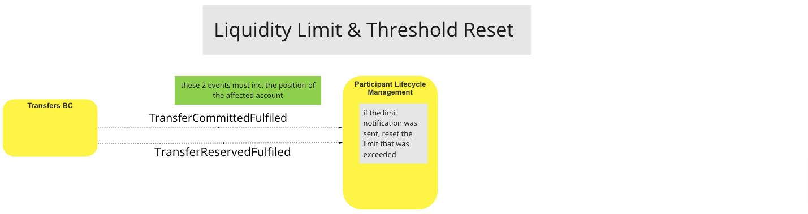
>Diagrama de fluxo de trabalho da UC: Limiar de liquidez e redefinição do limite

### Consulta sobre a cobertura de liquidez

#### Descrição

O fluxo de trabalho proporcionado por esta UC permite que o BC recorra a um processo através do qual pode consultar a liquidez atual da conta de um participante, juntamente com operações de leitura adicionais relacionadas com a liquidez desse participante.

#### Diagrama de fluxo

<!-- Warning Note to Developers & Editors!!: The following two images are being rendered to the Accounts & Balances BC. -->

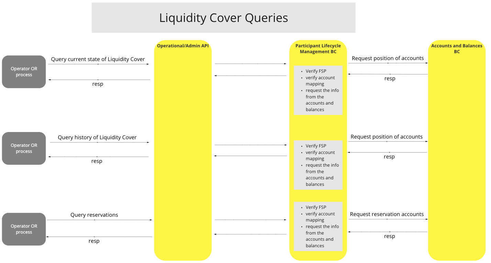
>Diagrama de fluxo de trabalho da UC: Consultas relativas à cobertura de liquidez

## Modelo canónico

-   Participante
    -   id
    -   participanteAlias
    -   endpointURL
    -   estado
    -   Contas[]
        -   ID da conta
        -   tipo de conta da razão geral
        -   moeda da conta
        -   isActive
        -   warningThreshold
        -   limite
            -   tipo
            -   valor

## Considerações finais

**Contas dos participantes:** Os participantes só podem ter uma conta por cada moeda permitida.
**Caso de uso «Atualizar posição»:** Foi alterado para o caso de uso «Gerir fundos»
**Operações Maker/Checker:** O número de tentativas não tem qualquer efeito na forma como processamos/reprocessamos os pedidos.

<!-- Footnotes themselves at the bottom. -->

## Notas

[^1]: Interfaces comuns: [Mojaloop Lista de interfaces comuns](../../boundedContexts/commonInterfaces.md)
