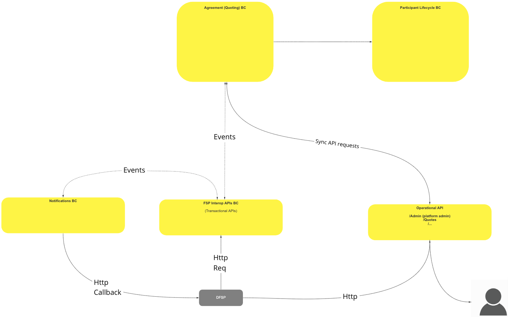
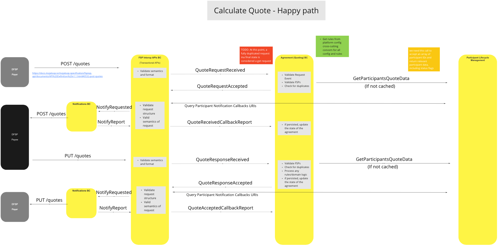
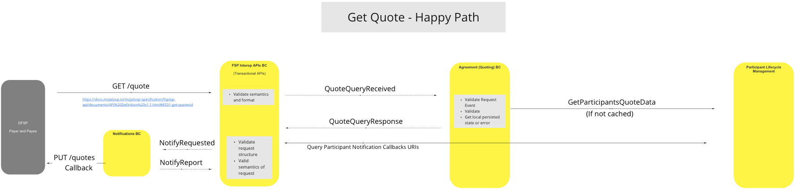
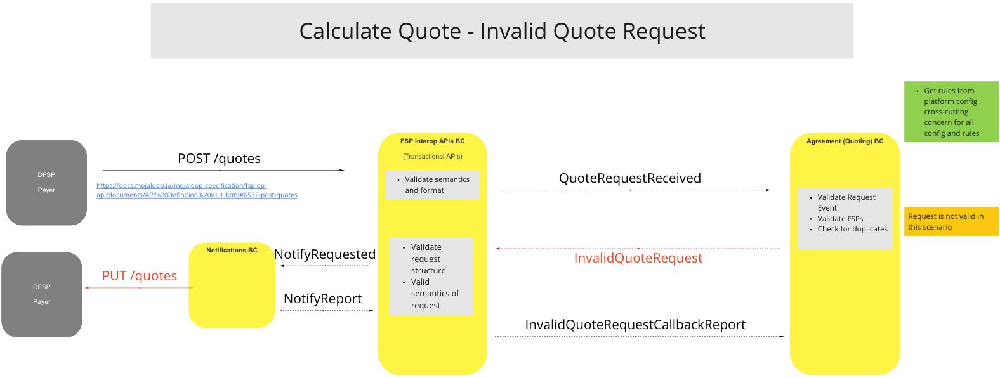
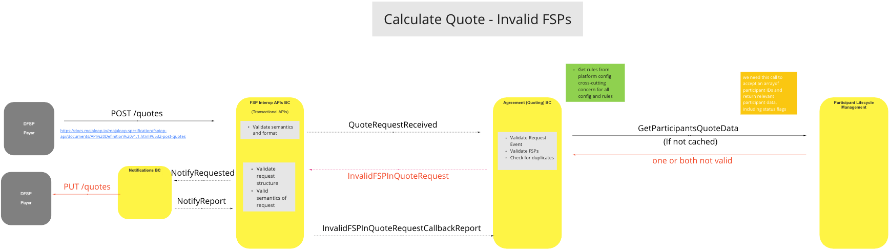
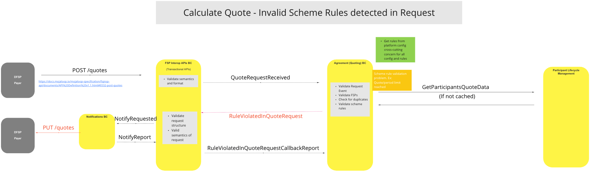
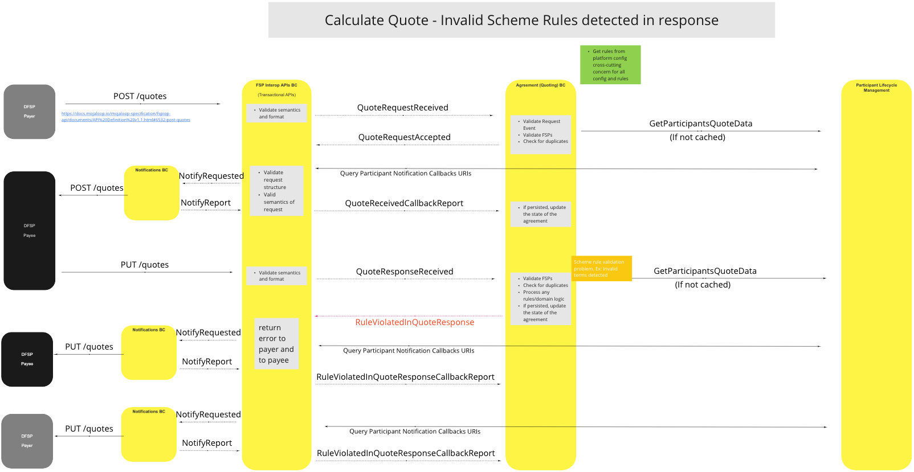

# Cotações/Acordos BC

O Contexto Delimitado «Orçamentos e Acordos» fornece aos participantes cotações para a realização de transferências e regista as respostas de aceitação ou rejeição dos participantes.

## Termos

Os termos seguintes são utilizados neste BC, também conhecido como domínio.

| Termo | Descrição |
|---|---|
| **(D) FSP** | Prestador de serviços financeiros (digitais) |
| **Participante** | Prestador de serviços financeiros |

## Visão geral das funcionalidades

## Casos de uso

### Calcular cotação - Cenário ideal

#### Descrição

Este processo obtém um conjunto de dados relevantes relativos aos Participantes, incluindo indicadores de estado, calcula o custo da transferência, incluindo as comissões, e fornece essa informação ao(s) Participante(s).  Além disso, permite o armazenamento dos pedidos e respostas dos Participantes (ou seja, aceitação ou rejeição da cotação).

#### Diagrama de fluxo

### Obter cotação - Happy Path

#### Descrição

Processo para obter e fornecer os detalhes de uma cotação existente ao(s) participante(s), mediante pedido.

#### Diagrama de fluxo

### Calcular Cotação - Pedido de Cotação Inválido

#### Descrição

Processo que permite ao sistema invalidar pedidos de cotação, através da monitorização e resposta a eventos de pedido inválidos, FSPs ou pedidos duplicados.

#### Diagrama de fluxo

### Calcular Cotação - FSPs inválidos

#### Descrição

Processo que permite ao sistema invalidar FSP pedidos de cotação nos quais FSP dos dados não correspondem à cotação original, quer para um, quer para ambos os participantes.

#### Diagrama de fluxo

### Calcular Cotação - Foram detetadas regras inválidas do scheme no pedido

#### Descrição

Processo que permite ao sistema invalidar pedidos de cotação nos casos em que as Regras do Scheme sejam violadas por um ou mais participantes, por exemplo, quando for atingido o limite do período de cotação.

#### Diagrama de fluxo

### Calcular Cotação - Foram detetadas regras de scheme inválidas na resposta

#### Descrição

Processo que permite ao sistema invalidar respostas a cotações nos casos em que as Regras do Scheme sejam violadas por um ou mais participantes, por exemplo, quando forem detetados termos inválidos.

#### Diagrama de fluxo

## Modelo de Citação Canónica

O modelo canónico armazena os seguintes detalhes das cotações no BC «Cotações e Acordos»:

- ID da cotação
- ID da transação
- Participantes
  - payerId
  - payeeId
- Pagador
  - Participante
    - participantId
    - tipo de função (por exemplo, pagador)
  - Montante solicitado (montante inicial)
    - Valor (número)
    - Moeda (código ISO da moeda)
  - Montante a enviar (incluindo comissões, etc.)
    - Valor (número)
    - Moeda (código ISO da moeda)
- Beneficiário(s) (um ou mais — todos devem ser adicionados ao «Montante a enviar»)
  - '#'
    - Participante
      - participantId
      - roleType (Indique a razão pela qual este «beneficiário» está a receber este montante, ou seja: comissão, destinatário, etc.)
      - razão
      - Montante a receber
        - valor (número)
        - moeda (código ISO da moeda)
- Extensões

## Considerações finais

- Não foram observados problemas graves no projeto global do BC e da Arquitetura de Referência.
- Precisamos de compreender melhor/esclarecer o padrão «GET» via «POST»:
  - Um evento «GET» deve ser um simples «GET» RESTful, ou o sistema tem de permitir o «GET» proveniente de publicações duplicadas?
  - Somos obrigados a responder a pedidos «GET» que incluam FSP detalhes numa data posterior?

<!--## Notes -->

<!-- Footnotes themselves at the bottom. -->
[^1]: Common Interfaces: [Mojaloop Common Interface List](../../commonInterfaces.md)
