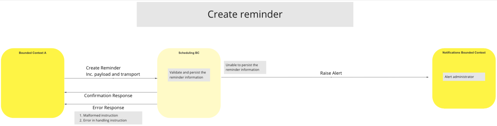
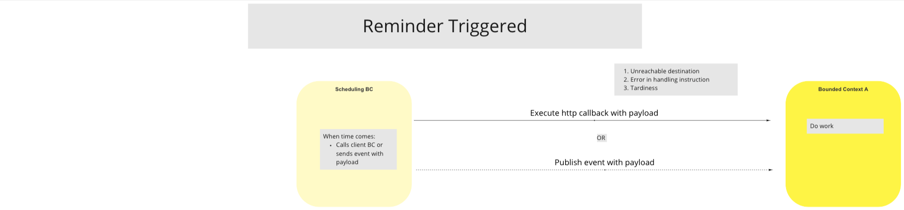
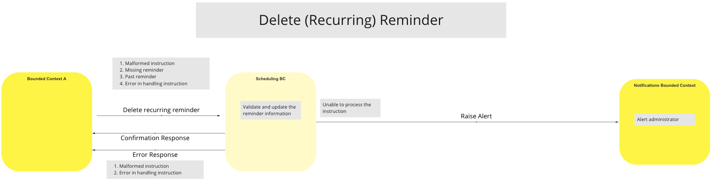

# Agendamento BC

Vários processos e eventos nos BCs da plataforma Mojaloop Switch requerem que as funcionalidades sejam acionadas em momentos específicos ou de acordo com um horário. A fim de permitir a resposta a este requisito em toda a plataforma Switch e evitar a integração de funcionalidades de agendamento em vários BCs, será introduzido e implementado um único BC de Agendamento para a plataforma Switch.

Para agendar um processo ou evento, um BC Cliente envia um pedido ao BC de Agendamento para criar um lembrete para uma hora específica ou um horário definido. O BC de Agendamento mantém um registo de todos os lembretes que recebe e, à medida que a hora dos lembretes se aproxima, envia uma notificação do lembrete ao BC Cliente correspondente.

Além disso, o BC de Agendamento prestará também serviços ao Switch, de modo a permitir que os BCs de Cliente e os Administradores do Switch gerem os lembretes definidos no BC de Agendamento.

## Termos

Os seguintes termos comuns são utilizados neste BC:

| Termo | Descrição |
|---|---|
| **Cliente BC** | Qualquer outro BC que utilize os Serviços de Agendamento do BC |

## Casos de uso

<!--***Note:*** *An "Update Reminder" UC has not been provided. The recommended course of action to follow is to Delete and Create a new Reminder.*
-->
The status of the UCs for the Scheduling BC is as follows:

| UCs disponíveis |  |  | UCs planeadas |  |
| --- | :-- | --- | --- | :-- |
| **Caso de uso** | **Descrição** | | **Caso de uso** | **Descrição** |
| **Criar lembrete** | O cliente BC solicita que seja criado um lembrete | | **Consulta relativa a um lembrete ao cliente** | O cliente BC consulta os seus próprios lembretes |
| **Lembrete de eliminação** | O cliente BC solicita que um lembrete seja eliminado | | **Consulta relativa a um lembrete administrativo** | O administrador da plataforma consulta todos os lembretes |
| **Alerta de lembrete** | O Scheduling BC executa o gatilho de lembrete quando chegar a hora | | |
| **Lembrete sobre a atualização** | *Não fornecido.  Solução recomendada: apagar e criar um novo lembrete* | | |  |  |

<!---The following UCs are planned for inclusion in the Scheduling BC -

| Caso de uso | Descrição |
| --- | :-- |
| Consulta sobre lembrete ao cliente | O cliente BC consulta os seus próprios lembretes |
| Consulta sobre lembrete administrativo | O administrador da plataforma consulta todos os lembretes |
| Acionador de lembrete | O Scheduling BC executa o gatilho de lembrete quando chegar a hora |
--->
### Create Reminder

#### Descrição
O fluxo de trabalho proporcionado por esta UC permite que o switch processe os pedidos autorizados do Cliente BC para criar lembretes.

#### Diagrama de fluxo

>
### Lembrete acionado

#### Descrição
O fluxo de trabalho proporcionado por esta UC permite que o switch processe lembretes enviados pelo BC de Agendamento para um BC de Cliente, com vista à execução de uma tarefa ou apenas a título de lembrete.

#### Diagrama de fluxo

>
### Eliminar lembrete (recorrente)

#### Descrição
O fluxo de trabalho proporcionado por esta UC permite que o switch processe mensagens enviadas por BCs de Cliente autorizados ao BC de Agendamento para eliminar um Lembrete. Caso o BC de Agendamento não consiga processar a instrução, este envia uma mensagem de Alerta ao BC de Notificações.

#### Diagrama de fluxo

>

<!-- Footnotes themselves at the bottom. -->
## Notes

#### Criar lembrete - Dados obrigatórios

O pedido «Criar lembrete» deve incluir os seguintes dados:

| Dados | Descrição |
| --- | ---- |
| **Identificador** | nome/id |
| **Definição de Cron** | recorrente?, intervalo de tempo? |
| **Transporte de gatilhos** | HTTP. Callback/Evento; Callback URL ou Tópico do Evento |
| **Payload especial** | indeterminado para o BC de programação |
| **Condições de recuperação** | repetir, reprogramar, interromper, desistir |
| **Alertas** | notificação, registo de exceções |
| **Ações** | registo de processos de BC automatizáveis/programáveis |

#### Programação BC - Requisitos

O BC de Programação deve cumprir os seguintes requisitos:

* Os lembretes devem ser acionados apenas uma vez

* O BC deve manter um registo dos lembretes acionados

* O BC deve registar as ações de criação, leitura e eliminação

    * As atualizações serão facilitadas através das ações «Eliminar/Criar», conforme indicado na lista [Casos de Uso – UCs disponíveis UCs](#use-cases)]

* Lotes de tarefas

* Oferecer várias opções de interface (gRPC, REST, HTTP, etc.)

* Os lembretes devem ser acionados através de um callback HTTP, e não através de uma chamada gRPC, nem para um tópico específico

* Não deve ter qualquer capacidade de processar lógica externa ao próprio BC de Programação

* Utilize apenas carimbos de data e hora UTC baseados no Linux, a fim de evitar problemas de sincronização

***Nota:*** *Parte-se do princípio de que o sistema subjacente manterá a hora exata.*

#### Planificação BC - Necessidades pendentes

Os requisitos de acesso ao BC de Programação ainda têm de ser definidos.

#### Agendamento BC - Exceções

* Instruções incorretas
    * Data/hora inválida, incluindo horas no passado
    * BC ou comando inválido
* Falha na execução (detetada através de uma chamada de retorno)
* Autorização insuficiente para que o Cliente BC realize a operação CRD
* Falha no processamento/execução do lembrete

#### Perguntas

Foram levantadas várias questões durante as sessões de trabalho sobre a arquitetura de referência e, uma vez que se considerou que algumas delas poderiam ser úteis para outros participantes, incluímo-las a seguir:

* Após o início da tarefa agendada, o BC de Agendamento continua a ser responsável pelo acompanhamento do seu progresso?

    * Resposta: Não. Quando o lembrete chega ao seu prazo, este é comunicado ao BC do Cliente através do método previsto e, a partir daí, a responsabilidade do BC de agendamento relativamente ao lembrete volta a ser atribuída ao BC do Cliente.

* É o Cliente BC ou a pessoa que agendou um Lembrete que é indicado como «Utilizador» pelo BC de Agendamento? Por outras palavras, de quem é o ID que consta no registo de auditoria do processo?

    * Resposta: Isso deverá ser determinado pelo Cliente BC, com base na sua reação ao receber o lembrete.