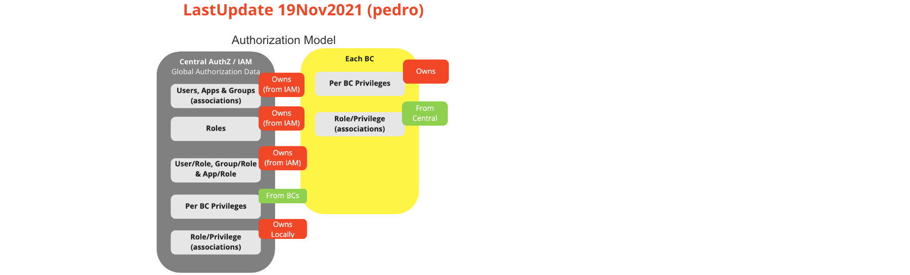
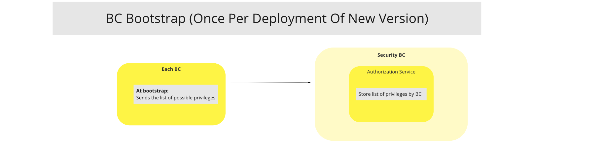
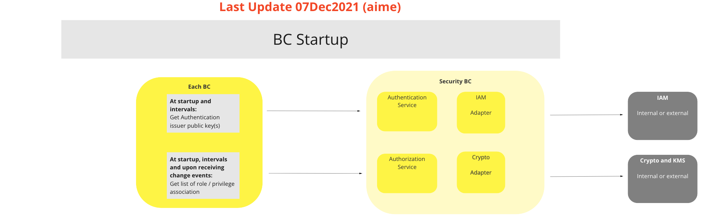
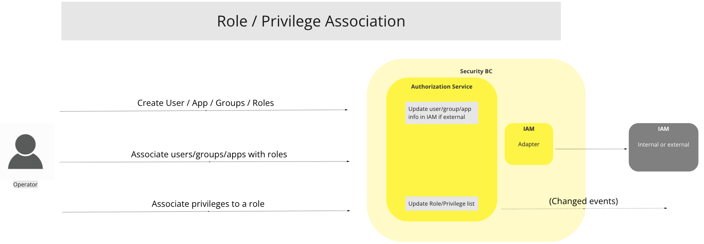
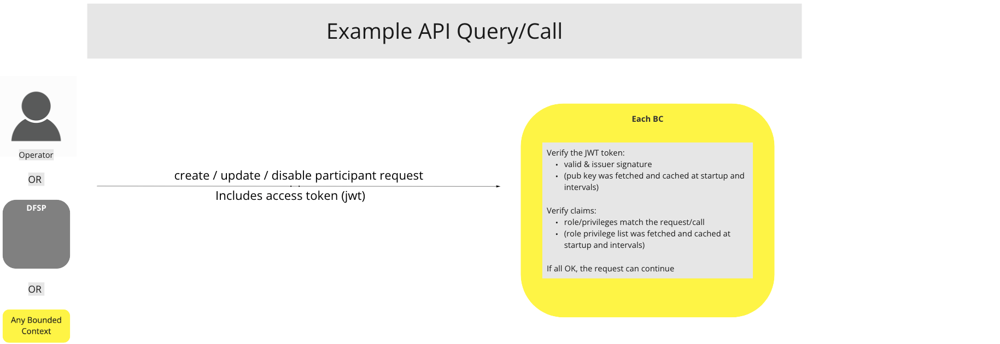

# Segurança BC

## Visão geral

O protocolo baseia-se em pedidos e respostas, e o protocolo de transporte utilizado é o Protocolo Seguro de Transferência de Hipertexto (HTTPS). Todos os serviços utilizam os métodos POST e GET HTTP. Tanto o corpo do pedido como o da resposta estão codificados em texto com formatação JSON.

## Termos

Termos com um significado específico e geralmente aceite no âmbito do Contexto Delimitado de Segurança.

| Módulo | Descrição |
|---|---|
| **Prestadores de serviços de criptomoedas** | Adaptador que prestará serviços criptográficos e serviços de gestão de chaves |
| **IAM** | Gestão de Identidade e Acesso. Adaptador que prestará serviços de gestão de utilizadores, menus, perfis, funções e permissões.  |
| **AuthN** | Módulo de autenticação. Requer o nome de utilizador e a palavra-passe e devolve um token JWT  |
| **AuthZ** | Módulo de autorização. Requer JWT e um certificado (chave pública). Verifica JWT FUNÇÕES e a assinatura  |
| **JWT** | JSON. Token Web. É devolvido após uma autenticação bem-sucedida do utilizador. Contém os dados do utilizador, as FUNÇÕES e a assinatura.   |
| **KMS** | Sistema de Gestão de Chaves. Gere o ciclo de vida das chaves criptográficas (definição, criação e retirada). Faz parte do subsistema Crypto |

## Casos de uso

### Início de sessão de utilizador/operador do BC (Autenticação)

#### Descrição

A função de início de sessão requer que o ID do utilizador e uma chave secreta sejam transmitidos no corpo da solicitação HTTP. A resposta contém um token assinado com valor JWT. A assinatura é gerada pelo subsistema Crypto. O início de sessão é efetuado pelos serviços de autorização ou pelo IAM.

#### Diagrama de fluxo

_Apr22_1829.png)
> Diagrama de fluxo de trabalho da UC: Início de sessão do utilizador/operador BC (AuthN)

### Modelo de Autorização BC (AuthZ)

#### Descrição

O IAM irá fornecer associações entre utilizadores/grupos, funções e privilégios. Cada BC terá também uma lista de funções relacionadas. Quando uma função ou microsserviço API
é chamado, a assinatura JWT é verificada utilizando a chave pública e a função indicada em JWT é comparada com a função associada ao BC. Se a verificação da assinatura e da função forem bem-sucedidas, a função ou microsserviço API é executado.

#### Diagrama de fluxo

> Diagrama de fluxo de trabalho da UC: Modelo de autorização BC (AuthZ)

### BC Bootstrap

#### Descrição

Na fase de inicialização, o BC enviará a lista de privilégios possíveis. Isto é feito uma vez por cada deployment de uma nova versão.

#### Diagrama de fluxo

> Diagrama de fluxo de trabalho da UC: BC Bootstrap

### BC Startup

#### Descrição

No arranque, o BC solicitará as chaves públicas do emissor de autenticação aos subsistemas Crypto/KMS do BC de Segurança e a lista de funções/privilégios ao subsistema IAM do BC de Segurança. Uma função de verificação de assinaturas da biblioteca de criptografia local verificará a assinatura JWT, e as funções indicadas em JWT serão comparadas com a lista local de funções obtida do serviço central de autorização.

##### Diagrama de fluxo

> Diagrama de fluxo de trabalho da UC: Inicialização do BC

### Associação entre funções e privilégios

#### Descrição

As funções estão associadas a uma série de privilégios.

#### Diagrama de fluxo

> Diagrama de fluxo de trabalho da UC: Associação de funções e privilégios

### Exemplo de consulta / chamada

#### Descrição

A autorização do cliente deve ser efetuada através de um token de acesso. O cliente deve, em primeiro lugar, solicitar ao Serviço de Autorização a criação de um token de acesso para o utilizador que solicita o acesso à interface. O utilizador é autenticado no Serviço de Autorização. O token de acesso criado é, em seguida, utilizado para a autorização na interface.
Para utilizar o token de acesso, o cliente deve definir o cabeçalho «AuthorizationHTTP» como «Bearer [access_token]» em cada pedido enviado à interface.

#### Diagrama de fluxo

> Diagrama de fluxo de trabalho da UC: Exemplo n.ºAPI: Consulta/Chamada

<!-- Footnotes themselves at the bottom. -->
<!--## Notes

[^1]: Interfaces comuns: [Mojaloop
Lista de interfaces comuns](../../commonInterfaces.md)
-->