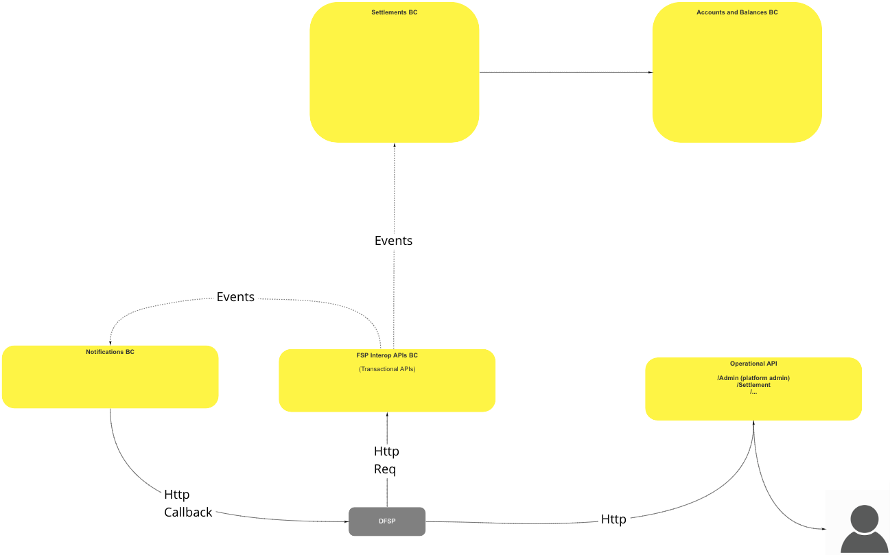
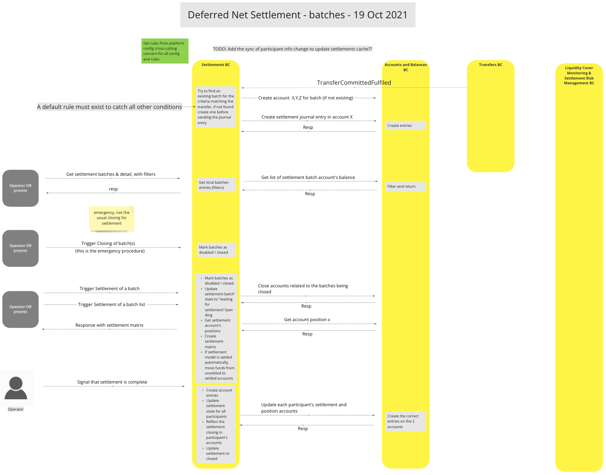
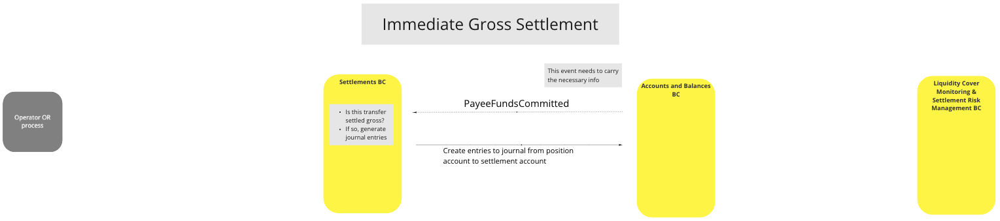
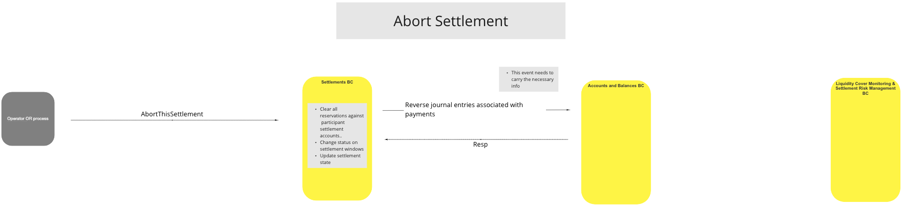
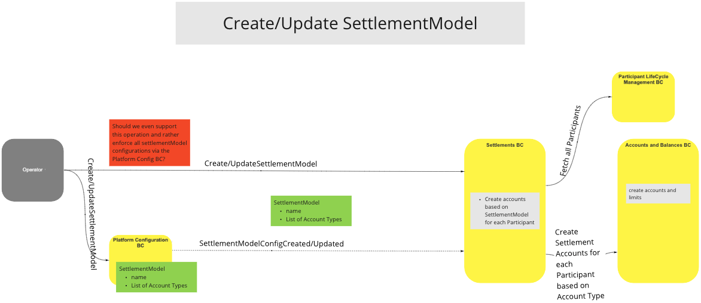
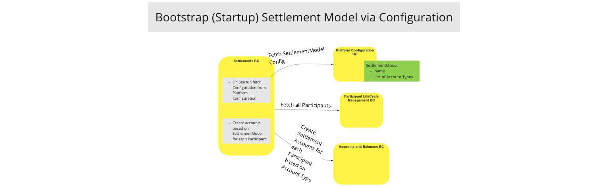
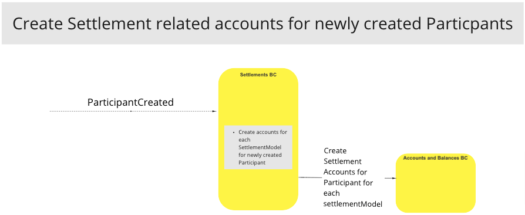

# Povoações na Colúmbia Britânica

O BC de Liquidações é essencial para a liquidação das transferências dos Participantes, quer se utilize o método de Liquidação Líquida Diferida, quer o de Liquidação Bruta Imediata. É responsável pela criação de janelas de liquidação, pela identificação e deployment do método de liquidação necessário (DNS/IGS), pela liquidação, encerramento e atualização de lotes, bem como pelo registo de todos os depósitos e levantamentos nas contas da razão geral apropriadas no BC «Contas e Saldos».

## Termos

Os termos seguintes são utilizados neste BC, também conhecido como domínio.

| Termo     | Descrição  |
| -------- | ------------ |
| **DNS** | Liquidação líquida diferida |
| **IGS/RTGS** | Liquidação Bruta Imediata/Liquidação Bruta em Tempo Real |
| **Operador** | Pessoa ou sistema que emite instruções/pedidos |
| **Participante** | FSP/PISP ou FSP Clientes |
| **Conta** | Conta da razão geral (Crédito/Débito) |

## Visão geral das funcionalidades

>

## Casos de uso

### Liquidação Líquida Diferida (DNS)

#### Descrição
Método de diferimento de pagamentos que permite a liquidação em vários lotes, de acordo com um calendário pré-determinado.  Isto é útil em ambientes que envolvem vários participantes numa transação que exija uma abordagem de liquidação com base no saldo de pagamentos em dívida.

#### Diagrama de fluxo

>Diagrama de fluxo de trabalho da UC: Liquidação líquida diferida - 19/10/2021

### Liquidação Bruta Imediata (IGS)

#### Descrição
Método que permite a liquidação imediata de lotes.  Isto é útil em ambientes de PME, onde, frequentemente, é desejável que os prazos de pagamento sejam rápidos, a fim de maximizar a sua liquidez.  O IGS é também conhecido como Sistema de Liquidação Bruta em Tempo Real (RTGS)

#### Diagrama de fluxo

>Diagrama de fluxo de trabalho da UC: Liquidação bruta imediata

### Liquidação do acordo

#### Descrição
Método que permite à BC de Liquidação interromper uma liquidação, conforme necessário, revertendo as contas de liquidação dos participantes, atualizando o estado de liquidação das janelas de liquidação e atualizando o estado da liquidação.

#### Diagrama de fluxo

>

### Criar/Atualizar o modelo de liquidação (DNS/IGS)

#### Descrição
Método que permite ao BC de Liquidação criar ou atualizar o método de liquidação para um lote de liquidação com base no tipo de conta do participante. Útil nos casos em que são necessários métodos de liquidação mistos.

#### Diagrama de fluxo

>

### Modelo de liquidação inicial (arranque) através da configuração

#### Descrição
Método que configura o Método de Liquidação (DNS/IGS) com base na configuração de arranque do sistema. Útil nos casos em que todos os Modelos de Liquidação são idênticos, como, por exemplo, todos DNS ou todos IGS.

#### Diagrama de fluxo

>Diagrama de fluxo de trabalho da UC: Modelo de liquidação inicial (arranque) através da configuração

### Criar contas relacionadas com a liquidação para os participantes recém-criados

#### Descrição
O sistema cria contas de liquidação para novos participantes, a fim de permitir que as transferências de fundos sejam geridas pelo Switch. Isto permite que o Switch exerça uma gestão de ponta a ponta de todas as transferências, independentemente do método de liquidação.

#### Diagrama de fluxo

>

<!-- Footnotes themselves at the bottom. -->
<!-- ## Notes -->

[^1]: Interfaces comuns: [Mojaloop Lista de interfaces comuns](../../commonInterfaces.md)
