# Terceiros, aAPI a.C.

O Terceiro Contexto Delimitado (BC) «API a.C.» foi implementado com a Arquitetura de Referência «Mojaloop 2.0» para permitir que Operadores de Terceiros «PISP» (normalmente aplicações) interajam com a plataforma. Tenha em atenção que, salvo indicação em contrário, todas as referências a BC dizem respeito aos vários «Mojaloop» componentes ou Contextos Delimitados (BCs).

## Termos

Os seguintes termos comuns são utilizados no presente BC:

| Termo | Descrição  |
| ---- | ------------ |
| **PISP** | Prestador de serviços de iniciação de pagamentos (por exemplo, PayPal, Apple Pay, Google Pay, etc.) |
| **DFSP** | Prestador de serviços financeiros digitais (por exemplo, banco, operador de serviços de pagamentos móveis) |
| **Utilizador** | Cliente DFSP/PISP (conforme indicado) |

## Casos de uso

**Nota:** Os nossos casos de uso abrangem dois cenários específicos:

| Cenários | Descrição |
| --------- | ----------- |
| [Ligação](#linking-scenarios) | PISP Atividades de limpeza e manutenção |
| [Transferência](#transfer-scenarios) | PISP Atividades de início da transferência |

## Cenários de ligação

### PISP Obter DFSPs permitidos

#### Descrição

O fluxo de trabalho proporcionado por esta UC permite que o Switch processe pedidos autorizados do Utilizador n.º PISP para obter uma lista de DFSP titulares de conta permitidos pelo sistema.

#### Diagrama de fluxo

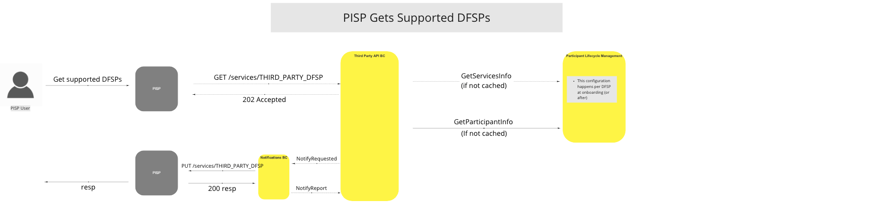
>Diagrama de fluxo de trabalho da UC: PISP Obtenha os DFSPs permitidos

### PISP Obtém a lista de contas para um DFSP + Identificador

#### Descrição

O fluxo de trabalho proporcionado por esta UC permite que o Switch trate de situações em que utilizadores PISP autorizados pretendam consultar os dados da conta do titular DFSP, utilizando o identificador do titular DFSP para o efeito. Normalmente, o identificador está incorporado numa aplicação ou num processo originário de um PISP.

#### Diagrama de fluxo

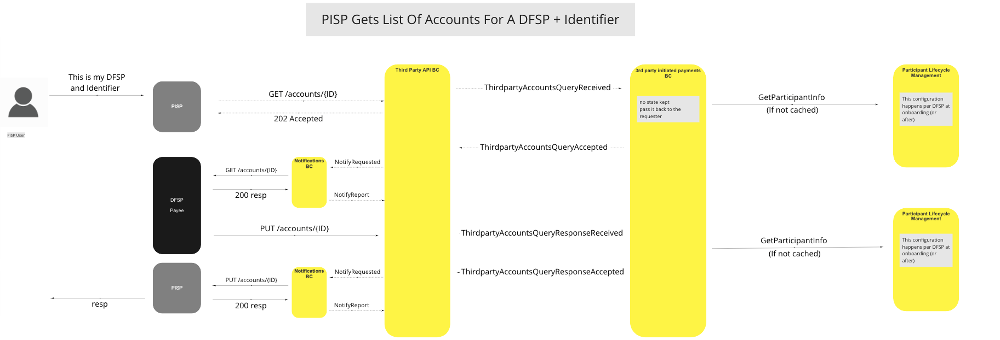
>Diagrama de fluxo de trabalho da UC: PISP Obter a lista de contas para um DFSP + Identificador

### PISP Pedido de consentimento

#### Descrição

O fluxo de trabalho proporcionado por esta UC permite que o Switch trate de situações em que um Utilizador PISP autorizado notifique o seu Titular de Conta DFSP da sua intenção de associar uma ou mais das suas contas a um PISP através de um Pedido de Consentimento. O pedido é processado através de um processo fora de banda [Emitir Consent](#dfsp-issue-consent) após a receção de uma resposta a um pedido de confirmação de autorização.  O resultado deste processo é o estabelecimento de uma relação de confiança entre o PISP Utilizador, o PISP e o DFSP Titular da Conta.  O switch atualiza os dados das contas dos participantes em conformidade.

#### Diagrama de fluxo

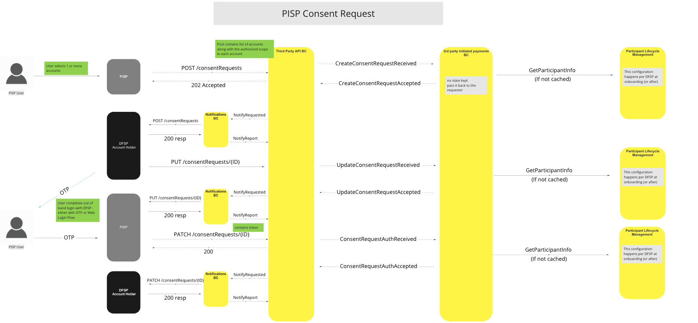
>Diagrama de fluxo de trabalho da UC: Pedido de consentimento n.º PISP

### DFSP. Emissão de consentimento

#### Descrição

O fluxo de trabalho proporcionado por esta UC permite que o Switch trate de situações em que um Titular de Conta DFSP responde a um Pedido de Consentimento recebido de um Utilizador PISP autorizado e autenticado. O Titular de Conta DFSP emite um pedido ao PISP, através do Switch, para que o Utilizador PISP crie uma Credencial de identificação no seu dispositivo.  Após a receção da credencial de identificação, verificada pelo Titular da Conta DFSP emissor, tanto os registos da Conta do Switch como os do Titular da Conta DFSP são atualizados com a Credencial do Utilizador PISP e as contas associadas, e o Utilizador PISP é notificado de que a(s) sua(s) Conta(s) do Titular da Conta DFSP foi(foram) associada(s) com sucesso ao seu perfil PISP.

***Nota:*** *A Questão de Consentimento surge em resposta a um Pedido de Consentimento apresentado por um Utilizador PISP autorizado para associar uma ou mais das suas Contas de Titular de Conta DFSP ao seu perfil PISP, seguindo o fluxo de trabalho indicado no [PISP Pedido de Consentimento](#pisp-consent-request) UC acima*

#### Diagrama de fluxo

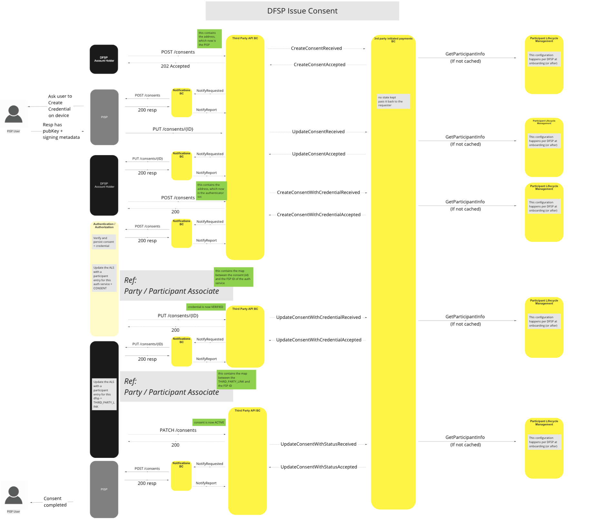
>Diagrama de fluxo da UC - DFSP. Consentimento para a emissão

### Desvincular contas: Autenticação hospedada no hub

#### Descrição

O fluxo de trabalho proporcionado por esta UC permite que o Switch processe um pedido autorizado do Titular da Conta PISP/DFSP para revogar o consentimento relativo à ligação de uma Conta do Titular da Conta DFSP ao seu Perfil PISP, ao qual o Switch dá seguimento atualizando o Serviço de Pesquisa de Contas do sistema para desassociar a PISP Associação de Participante/DFSP conta, e notificando tanto o DFSP Titular da Conta (que remove a entrada do participante do ALS e a ligação do seu sistema), como o PISP Anfitrião, que envia uma notificação de execução ao Utilizador.

#### Diagrama de fluxo

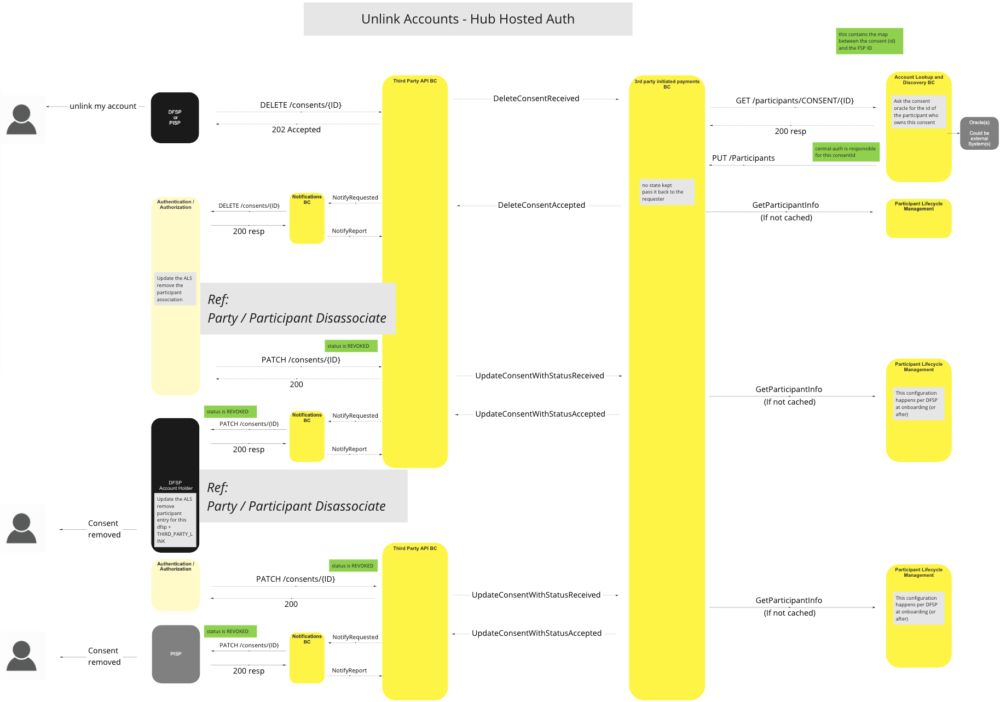
>Diagrama de fluxo de trabalho da UC: Desvincular contas - Autenticação hospedada no hub

### Ligar contas - Falha na deteção da conta

#### Descrição

O fluxo de trabalho proporcionado por esta UC permite que o Switch trate de situações em que um Utilizador PISP autorizado inicie um pedido para associar uma Conta DFSP ao seu Perfil PISP utilizando um par DFSP/Identifier inválido não reconhecido pelo DFSP. O DFSP envia uma mensagem de erro ao switch, que notifica o PISP adequado, e o destinatário recebe uma mensagem a indicar que deve tentar outro par DFSP/Indentifier.

#### Diagrama de fluxo

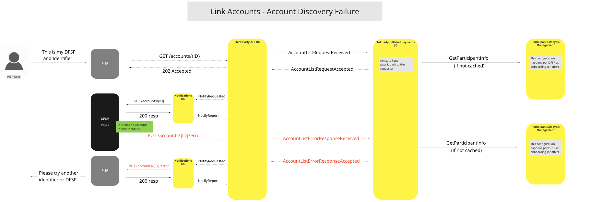
>Diagrama de fluxo de trabalho da UC: Vincular contas - Falha na deteção de contas

### Associar contas - DFSP rejeitou o pedido de consentimento

#### Descrição

O fluxo de trabalho proporcionado por esta UC permite que o Switch trate corretamente as situações em que um Utilizador PISP autorizado solicita que uma ou mais contas sejam associadas ao seu Perfil PISP pelo Titular da Conta DFSP.  Caso o DFSP Titular da Conta recuse o consentimento para que a vinculação prossiga, por qualquer motivo — por exemplo, se uma conta selecionada não for permitida a vinculação —, este enviará uma mensagem ao switch indicando uma condição de erro.  O switch notifica o PISP responsável e o PISP destinatário e recebe uma mensagem, na aplicação ou por outro meio, para repetir o seu pedido, uma vez que o pedido anterior de vinculação de conta falhou.

#### Diagrama de fluxo

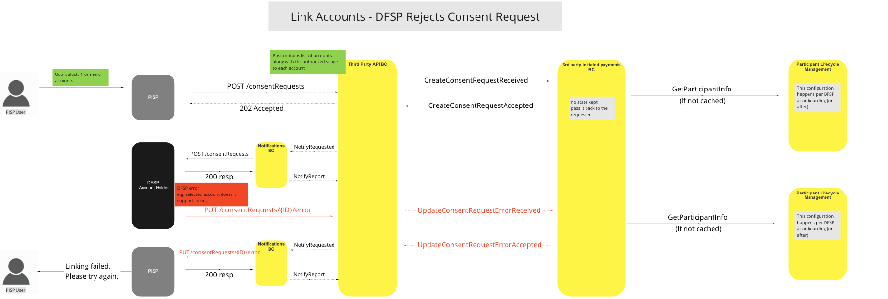
>Diagrama de fluxo de trabalho da UC: Vincular contas - DFSP rejeita o pedido de consentimento

### Erro no registo das credenciais

#### Descrição

O fluxo de trabalho proporcionado por esta UC permite que o Switch trate de situações em que um Titular de Conta DFSP apresenta ao PISP um pedido para que um (PISP) Utilizador crie uma credencial incorporada no dispositivo, a fim de confirmar um Pedido de Consentimento, e em que a credencial, quando enviada ao DFSP, inclui um desafio assinado inválido ou metadados assinados que são rejeitados.  Nesta situação, o DFSP comunica a condição de erro ao switch, que, por sua vez, notifica o PISP adequado, o qual, por sua vez, notifica o (PISP) Utilizador de que a credencial de consentimento foi rejeitada.

#### Diagrama de fluxo

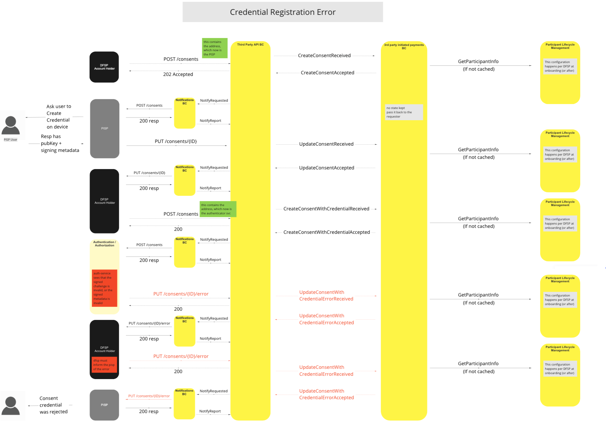
>Diagrama de fluxo de trabalho da UC: Erro no registo de credenciais

### Desvincular contas - Não foi encontrado consentimento

#### Descrição

O fluxo de trabalho fornecido por esta UC permite que o Switch trate de situações em que um Utilizador PISP autorizado é solicitado a confirmar um pedido de consentimento emitido através do Titular da Conta PISP ou DFSP para desvincular a sua Conta DFSP do seu Perfil PISP. O Switch encaminha a resposta ao pedido de consentimento para o Oracle de Consentimento, para confirmação do ID do Titular do Consentimento.  Nos casos em que o Oracle não consiga confirmar a identificação do Titular do Consentimento, o pedido é rejeitado.  O Utilizador PISP é alertado, através do Titular da Conta DFSP ou do titular do perfil PISP, de que a Conta DFSP que pretendia desvincular do seu perfil PISP não foi encontrada.

#### Diagrama de fluxo

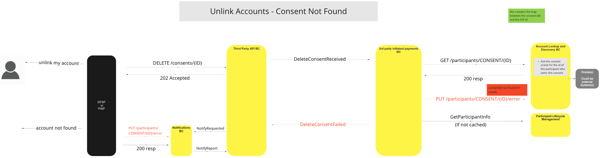
>Diagrama de fluxo de trabalho da UC: Desvincular contas — Consentimento não encontrado

### O DSPF rejeita o token OTP/de autenticação com valor PISP

#### Descrição

O fluxo de trabalho fornecido por esta UC permite que o Switch trate de situações em que um Utilizador PISP autorizado solicite que uma ou mais das suas Contas de Titular de Conta DFSP sejam associadas ao seu Perfil PISP.  O pedido é encaminhado pelo switch para o DFSP Titular da Conta, que emite um fluxo de login via OTP/Web ao PISP Utilizador para efeitos de verificação, o qual é devolvido através do PISP ao switch e, posteriormente, ao DFSP Titular da Conta para consentimento.  Nos casos em que o token de resposta seja alterado ou tenha expirado, o DFSP Titular da Conta emite uma mensagem de condição de erro para o switch e o PISP Utilizador é notificado de que o DFSP pedido de vinculação da conta falhou.

#### Diagrama de fluxo

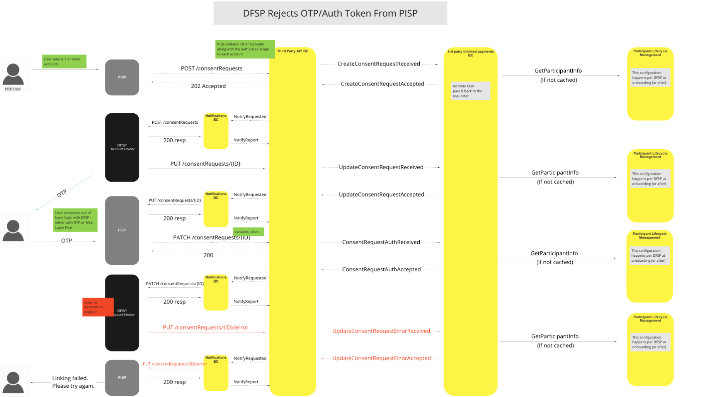
>Diagrama de fluxo de trabalho da UC: DFSP rejeita o token OTP/autenticação de PISP

### Desvincular contas - Falha a jusante

#### Descrição

O fluxo de trabalho proporcionado por esta UC permite que o switch trate de situações em que a confirmação do consentimento para desvincular a conta DFSP de um utilizador PISP autorizado falhe no processo de autenticação/autorização do switch por qualquer motivo, por exemplo: um erro FSPIOP API a jusante.  O erro é comunicado pelo Switch ao DFSP Titular da Conta, que analisará o erro e determinará como responder.  Caso tenha ocorrido um erro, o PISP Utilizador é notificado pelo Switch através do PISP de que o seu pedido para desvincular a sua DFSP Conta falhou.

#### Diagrama de fluxo

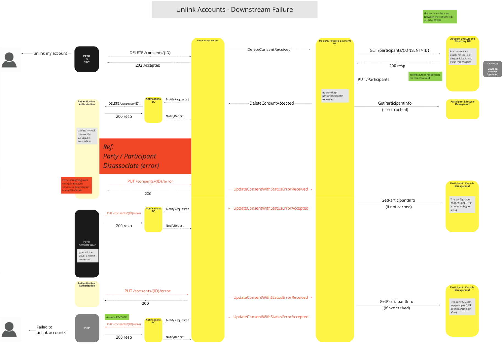
>Diagrama de fluxo de trabalho da UC: Desvincular contas — Falha a jusante

## Cenários de transferência

***Nota:*** *Com o objetivo de tornar esta descrição do fluxo de trabalho mais concisa, o leitor deve ter em conta que o BC «TerceirosAPI» e o BC «Pagamentos Iniciados por Terceiros» funcionam em conjunto para manter as Informações dos Participantes. A interação entre os dois BC não será especificamente referida, mas é a seguinte: sempre que o BC «Terceiro API» atualizar o estado da transação e as informações dos participantes não estiverem armazenadas em cache, o BC «Pagamentos Iniciados por Terceiros» solicitará as informações dos participantes em falta ao BC «Gestão do Ciclo de Vida dos Participantes» e enviá-las-á ao BC «Terceiro API» para inclusão nas informações da transação a serem apresentadas aos sistemas DFSP/PISP/

### Pedido de transação iniciado por terceiros

#### Descrição

O fluxo de trabalho proporcionado por esta UC permite que o Switch autorize os Utilizadores/Aplicações PISP a emitir um pedido a um DFSP para que este execute uma transação em nome de um Titular de Conta, normalmente o Utilizador/Aplicação PISP, a favor de um ou mais destinatários terceiros.  A transação é verificada através de um pedido de confirmação (DFSP) dirigido ao Titular da Conta e concluída após a receção bem-sucedida da confirmação. O switch, de acordo com as instruções (DFSP), gere a transação e atualiza todas as contas em conformidade.

Algumas aplicações sugeridas da Iniciação de Pagamentos por Terceiros (UC) incluem:

 - Pagamentos entre particulares (por exemplo: GPay na Índia)
 - Processos de pagamento online que proporcionam uma experiência do utilizador (UX) fluida (por exemplo: PayPal)
 - Software de compensação de salários

#### Diagrama de fluxo

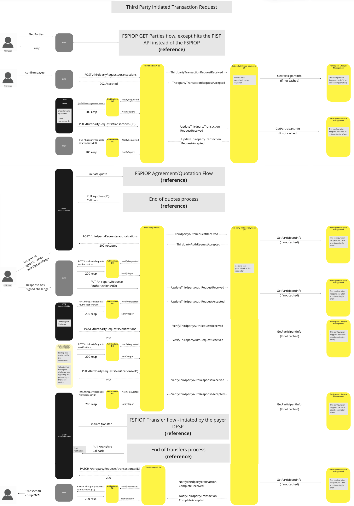
>Diagrama de fluxo de trabalho da UC: Pedido de transação iniciado por terceiros

### PISP Pedido de transação em massa

#### Descrição

O fluxo de trabalho proporcionado por esta UC permite que o Switch autorize os Utilizadores/Aplicações PISP a enviar um pedido a um DFSP para que este execute uma série de transações em massa em nome de um Titular de Conta, normalmente o Utilizador/Aplicação PISP, a favor de um grupo de destinatários terceiros.  A transação é verificada através de um pedido de confirmação DFSP enviado ao Titular da Conta e concluída após a receção bem-sucedida da confirmação. O switch, de acordo com as instruções DFSP, gere a transação e atualiza todas as contas em conformidade.

#### Diagrama de fluxo

>Diagrama de fluxo de trabalho da UC: PISP. Pedido de transação em massa

### Pagar a um PISP - PISP como beneficiário

#### Descrição

O fluxo de trabalho proporcionado por esta UC permite que o switch autorize os utilizadores «DFSP» a iniciar e executar pagamentos a favor de PISPs, na qualidade de beneficiários, através do switch. O fluxo de trabalho permite pagamentos tanto para um único beneficiário como para vários PISP beneficiários.

#### Diagrama de fluxo

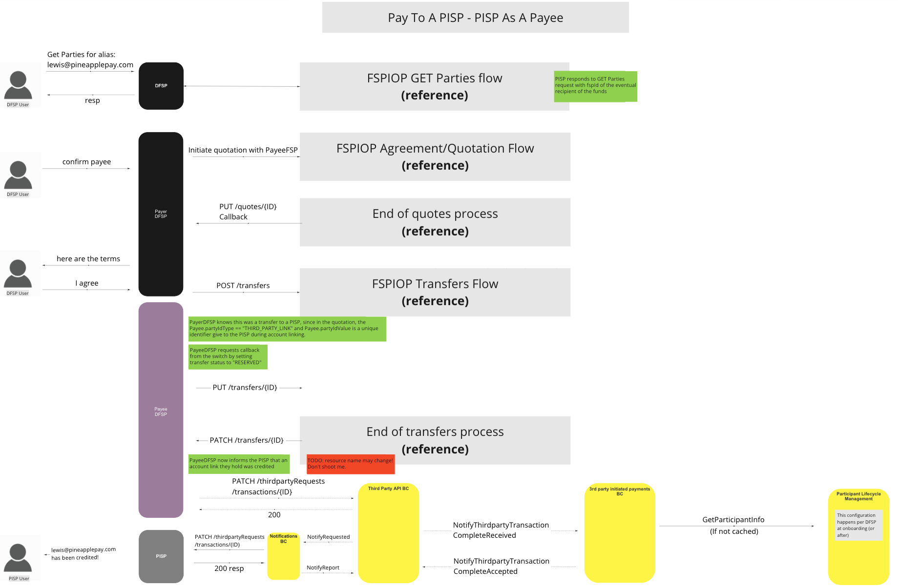
>Diagrama de fluxo de trabalho da UC: Pagamento a um PISP - PISP como beneficiário

### Falha na solicitação de transação com terceiros - Erro na pesquisa da entidade

#### Descrição

O fluxo de trabalho previsto por esta UC permite que o switch trate os casos em que um Utilizador PISP autorizado inicie uma transação utilizando um Identificador de Participante inválido. O switch deteta o erro durante a fase «Get Parties» da preparação da transação e encerra automaticamente o pedido, enviando uma notificação ao Utilizador de origem do pedido a indicar a falha e o motivo.

#### Diagrama de fluxo

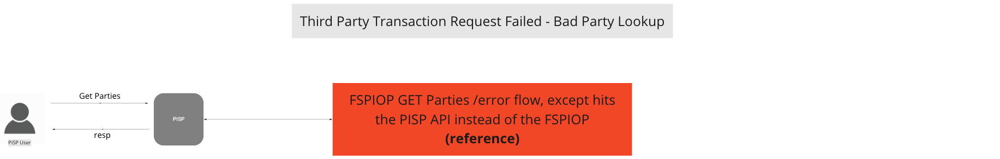
>Diagrama de fluxo de trabalho da UC: Falha na solicitação de transação com terceiros — Erro na pesquisa da entidade

### Falha na solicitação de transação de terceiros - Solicitação de transação inválida

#### Descrição

O fluxo de trabalho proporcionado por esta UC permite que o Switch trate de situações em que um Utilizador PISP autorizado inicie um Pedido de Transação de Terceiros, confirme corretamente os dados do Beneficiário, mas o Beneficiário DFSP não consiga localizar um Acordo válido para a transação.  O switch rejeita o pedido e envia uma notificação ao utilizador que o originou, indicando a falha e as ações de seguimento sugeridas.

#### Diagrama de fluxo

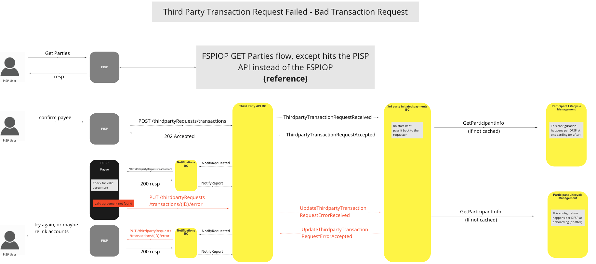
>Diagrama de fluxo de trabalho da UC: Falha na solicitação de transação de terceiros — Solicitação de transação inválida

### Falha na solicitação de transação de terceiros - Falha a jusante FSPIOP

#### Descrição
O fluxo de trabalho proporcionado por esta UC permite que o Switch lide com situações em que um Utilizador PISP autorizado solicita e confirma um pedido de transação que, ao ser encaminhado para o Titular da Conta DFSP, falha por algum motivo durante o processo de cotação. O Switch é alertado para a falha e envia uma notificação ao Utilizador PISP através da sua Aplicação/Processo PISP.

#### Diagrama de fluxo

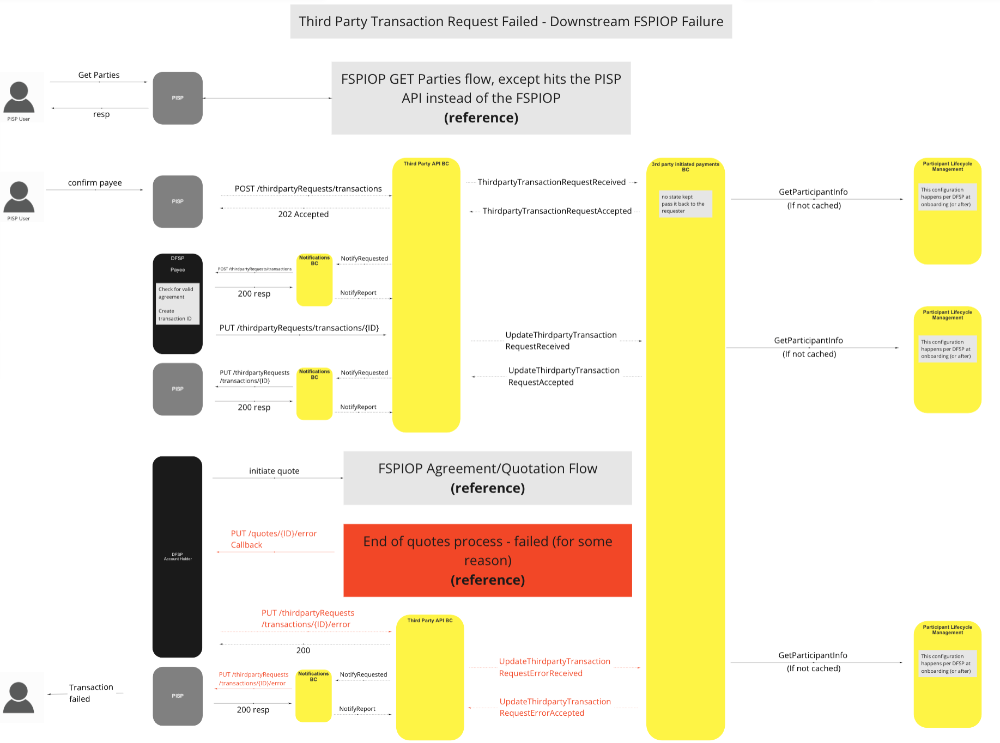
>Diagrama de fluxo de trabalho da UC: Falha no pedido de transação de terceiros — Falha a jusante FSPIOP

### Falha na solicitação de transação de terceiros — a autorização não era válida

#### Descrição

O fluxo de trabalho proporcionado por esta UC permite que o switch trate de situações em que é iniciada uma transação por terceiros, posteriormente autorizada por um PISP Utilizador a pedido do DFSP Titular da Conta, e o switch deteta que a resposta ao DFSP Desafio recebida continha uma assinatura inválida.  O switch pode então verificar que ocorreu o erro e notificar o DFSP. Titular da Conta, que, por sua vez, cancela a transação e notifica o PISP. Utilizador através do switch e do seu PISP. titular do perfil.

#### Diagrama de fluxo

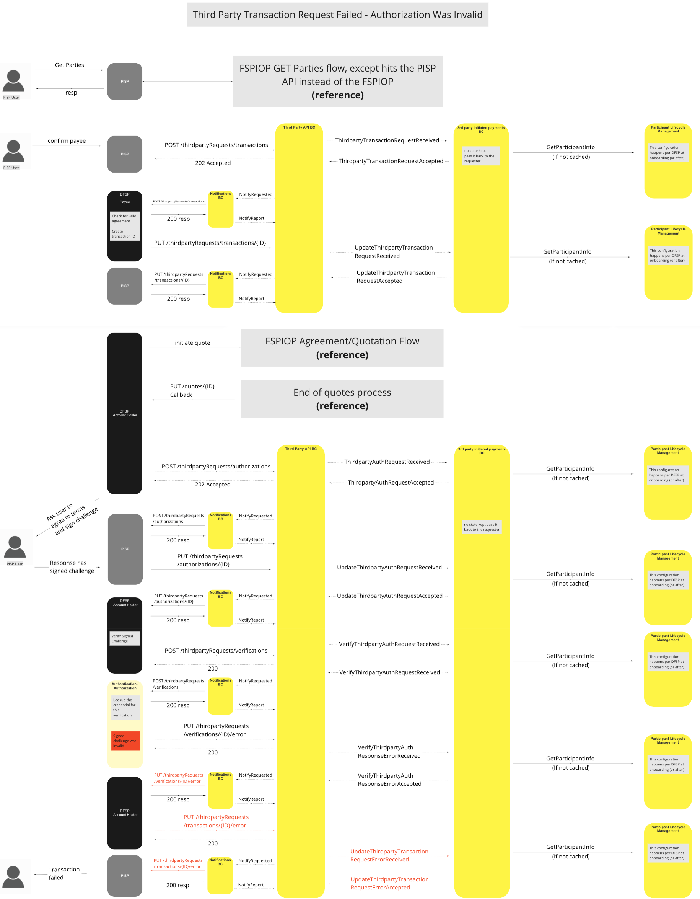
>Diagrama de fluxo de trabalho da UC: Falha na solicitação de transação de terceiros — a autorização não era válida

### Pedido de transação de terceiros rejeitado pelo utilizador

#### Descrição

O fluxo de trabalho proporcionado por esta UC permite que o Switch trate de situações em que um Utilizador PISP inicia e confirma uma transação através do seu PISP, mas depois se recusa a concluí-la após receber a aceitação da cotação e o pedido de assinatura do Titular da Conta DFSP.  Assim que a transação for recusada, o «PISP» notifica o «DFSP» Titular da Conta através do switch, que procede ao cancelamento da transação e envia uma notificação de confirmação de cancelamento da transação ao «PISP» de origem.

#### Diagrama de fluxo

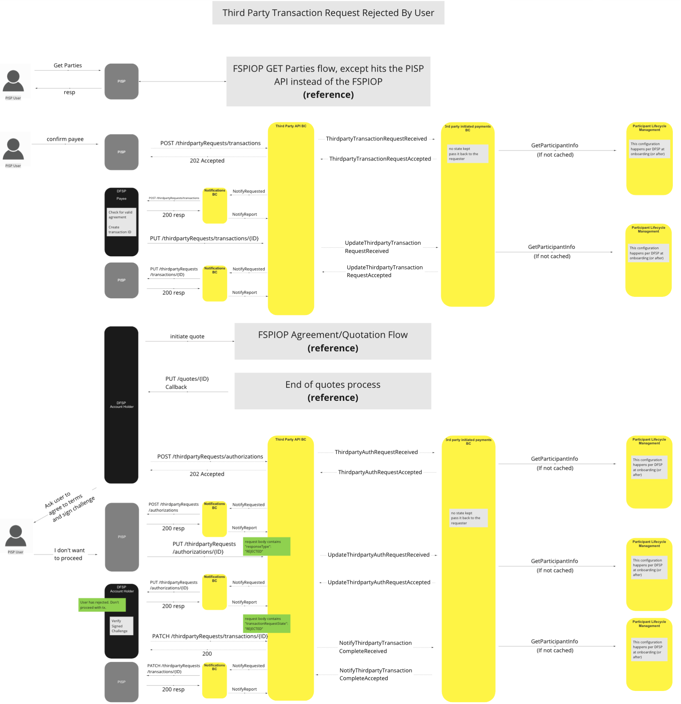
>Diagrama de fluxo de trabalho da UC: Pedido de transação de terceiros rejeitado pelo utilizador

### Falha na solicitação de transação de terceiros - tempo de espera DFSP

#### Descrição

O fluxo de trabalho proporcionado por esta UC permite que o switch trate de situações em que um Utilizador PISP inicia e confirma uma transação através do seu PISP, mas depois não responde ao pedido de aceitação da cotação e à solicitação de assinatura do Titular da Conta DFSP dentro de um período de tempo limite pré-determinado.  Assim que o tempo limite for excedido, o «PISP» notifica o «DFSP» Titular da Conta, através do switch, de que a resposta necessária não foi recebida, e o «DFSP» cancela a transação, enviando uma notificação ao «PISP» Utilizador a informá-lo de que o seu pedido de transação falhou.

#### Diagrama de fluxo

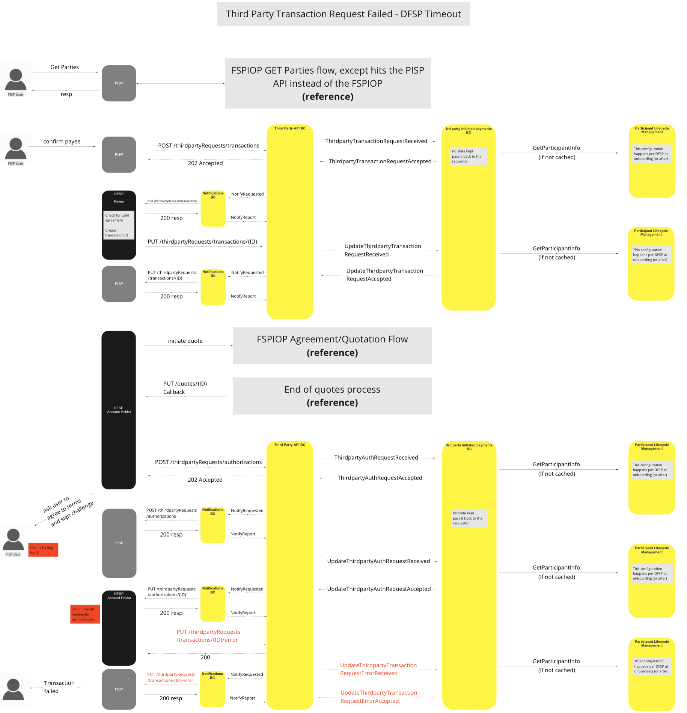
>Diagrama de fluxo de trabalho da UC: Falha na solicitação de transação de terceiros — Tempo de espera DFSP

<!-- Footnotes themselves at the bottom. -->
<!--## Notes

[^1]: Interfaces comuns: [Mojaloop
Lista de interfaces comuns](../../commonInterfaces.md)
-->