# Transferências BC

O Centro de Operações de Transferências (Transfers BC) é responsável pela coordenação dos pedidos de transferência. Trabalha em conjunto com vários outros Centros de Operações (BCs), nomeadamente os Centros de Liquidações, de Programação, de Gestão do Ciclo de Vida dos Participantes, de Contas e Saldos e o FSPIOP.

## Termos

Os termos seguintes são utilizados neste BC, também conhecido como domínio.

| Termo | Descrição |
|---|---|
| **Contas** | Refere-se às contas utilizadas em todas as operações de transferência. São utilizadas para registar posições de crédito e débito, quer de forma temporária, no caso das contas destinadas a fins de transferência, quer de forma permanente, no caso das atualizações finais de transferência nas contas dos participantes. |
| **Participante/Ator** | Refere-se normalmente a DFSP partes (pagador/beneficiário) que utilizam Mojaloop. |
| **IGS** | Método de liquidação de transferências — Liquidação Bruta Imediata. Este processo é normalmente utilizado em ambientes de elevado volume, como o retalho, e é aplicado a contas individuais e partilhadas. Em ambientes de contas partilhadas, o sistema tem a capacidade de atualizar os saldos dos participantes, atualizando o valor proporcional da participação de cada participante no total dos fundos disponíveis na conta |
| **DNS** | Método de liquidação de transferências — Liquidação Líquida Diferida. Este processo é frequentemente utilizado em ambientes em que um grupo de participantes realiza uma única transferência que requer a liquidação a todos os participantes. Um exemplo típico poderá incluir um cenário em que as matérias-primas são vendidas pelo Participante A ao Participante B para a fabricação de um produto acabado, o qual é posteriormente vendido pelo Participante B de volta ao Participante A. O switch calcula o valor proporcional a que cada participante da transação tem direito e liquida esse montante quando a janela de liquidação encerra. |

## Visão geral das funcionalidades - Transferências - Em massa

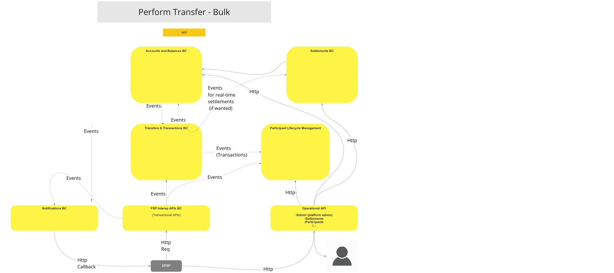
>Diagrama de fluxo de trabalho da UC: Visão geral funcional - Transferências - Em massa

## Casos de uso

### Efetuar transferência (modo universal)

#### Descrição

O fluxo de trabalho proporcionado por esta UC permite que o BC efetue uma transferência utilizando um método que exclui a intervenção do interveniente.

#### Diagrama de fluxo

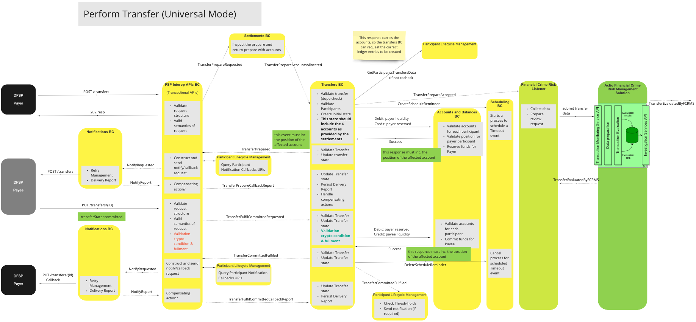
>Diagrama de fluxo de trabalho da UC: Efetuar transferência (modo universal)

### Efetuar transferência com confirmação do beneficiário

#### Descrição

O fluxo de trabalho proporcionado por esta UC permite que o BC efetue uma transferência através de um método que inclui a intervenção de um interveniente.

#### Diagrama de fluxo

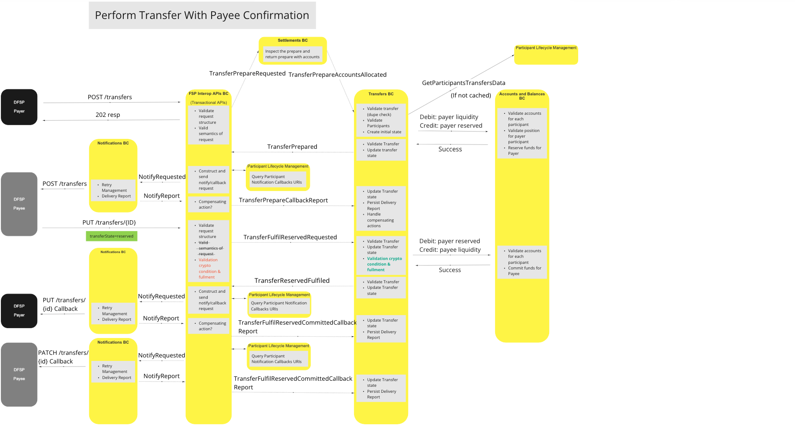
>Diagrama de fluxo de trabalho da UC: Efetuar transferência com confirmação do beneficiário

### Transferência de consulta (GET)

#### Descrição

O fluxo de trabalho proporcionado por esta UC permite ao BC implementar um método através do qual é possível efetuar uma consulta ao relatório de situação de um participante.

#### Diagrama de fluxo

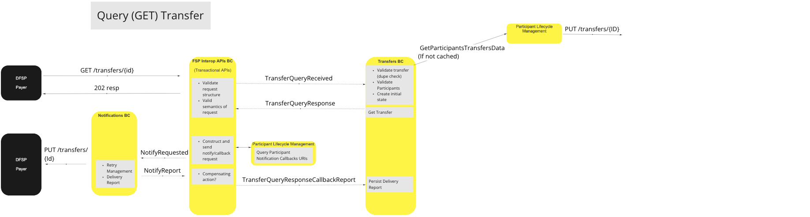
>Diagrama de fluxo da UC: Transferência de consulta (GET)

### Efetuar transferência - Duplicar POST (Reenviar)

#### Descrição

O fluxo de trabalho proporcionado por esta UC permite ao BC implementar um método através do qual se concretiza um pedido de transferência duplicada.

#### Diagrama de fluxo

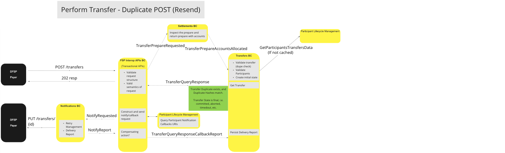
>Diagrama de fluxo de trabalho da UC: Efetuar transferência - Duplicar POST (reenviar)

### Efetuar transferência - POST duplicado (Ignorar)

#### Descrição

O fluxo de trabalho proporcionado por esta UC permite ao BC implementar um método através do qual se pode ignorar um pedido de transferência duplicado.

#### Diagrama de fluxo

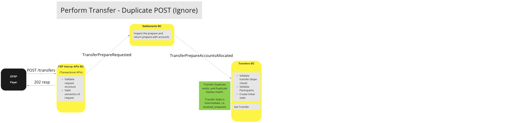
>Diagrama de fluxo de trabalho da UC: Efetuar transferência - Duplicar POST (Ignorar)

## Variações dos casos de uso fora do percurso ideal

### Efetuar transferência - O FSP do beneficiário rejeita a transferência

#### Descrição

O fluxo de trabalho proporcionado por esta UC permite ao BC implementar um procedimento através do qual um pedido de transferência rejeitado pelo beneficiário é cancelado.

#### Diagrama de fluxo

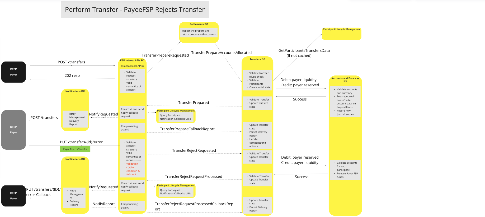
>Diagrama de fluxo de trabalho da UC: Efetuar transferência — O PayeeFSP rejeita a transferência

### Executar transferência - Tempo limite (Preparação)

#### Descrição

O fluxo de trabalho proporcionado por esta UC permite que o BC aplique um método para encerrar um pedido de «Transferência Prepare» sempre que seja excedido um limite de tempo de espera.

#### Diagrama de fluxo

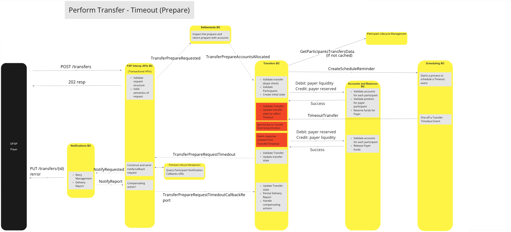
>Diagrama de fluxo de trabalho da UC: Efetuar transferência - Tempo limite (Preparação)

### Executar transferência - Tempo limite (pré-confirmada)

#### Descrição

O fluxo de trabalho proporcionado por esta UC permite que o BC implemente um método para cancelar um pedido de transferência pré-confirmada, caso seja excedido um limite de tempo de espera.

#### Diagrama de fluxo

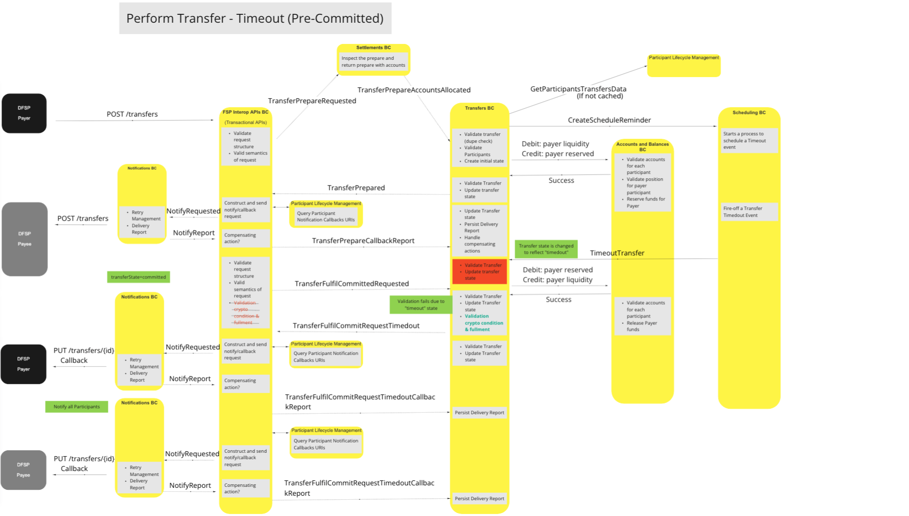
>Diagrama de fluxo de trabalho da UC: Efetuar transferência - Tempo limite (pré-confirmado)

### Executar transferência - Tempo limite (após a confirmação)

#### Descrição

O fluxo de trabalho proporcionado por esta UC permite que o BC implemente um método para cancelar um pedido de transferência pós-confirmação, caso seja excedido o tempo limite.

#### Diagrama de fluxo

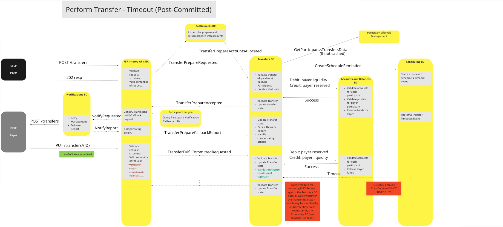
>Diagrama de fluxo de trabalho da UC: Efetuar transferência - Tempo limite (após a confirmação)

### Efetuar transferência - Duplicar POST (sem correspondências)

#### Descrição

O fluxo de trabalho proporcionado por esta UC permite que o BC implemente um método para cancelar um pedido de transferência de duplicados não correspondentes, nos casos em que seja excedido o tempo limite.

#### Diagrama de fluxo

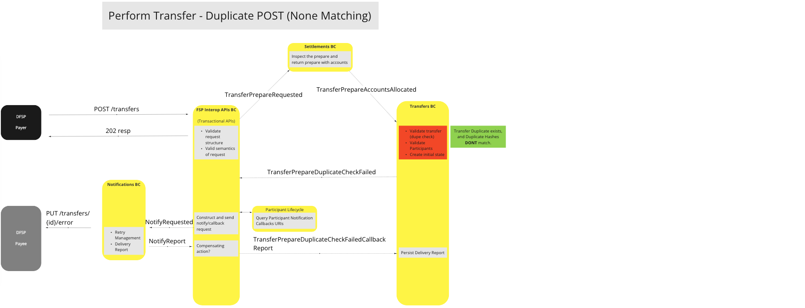
>Diagrama de fluxo de trabalho da UC: Efetuar transferência - Duplicar POST (sem correspondências)

### Efetuar transferência - Pagador FSP: liquidez insuficiente

#### Descrição

O fluxo de trabalho proporcionado por esta UC permite ao BC implementar um método para anular um pedido de transferência que tenha falhado devido à falta de liquidez suficiente por parte do pagador para cobrir integralmente a transação.

#### Diagrama de fluxo

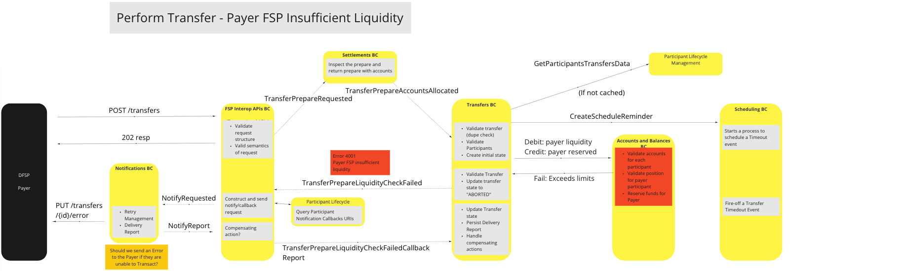
>Diagrama de fluxo de trabalho da UC: Efetuar transferência — Pagador FSP: liquidez insuficiente

### Executar transferência - Falha na validação da preparação da transferência (participante pagador inválido)

#### Descrição

O fluxo de trabalho disponibilizado por esta UC permite ao BC implementar um método para cancelar um pedido de «Transfer Prepare» nos casos em que a validação da transação falhe devido a um pagador inválido ou inexistente.

#### Diagrama de fluxo

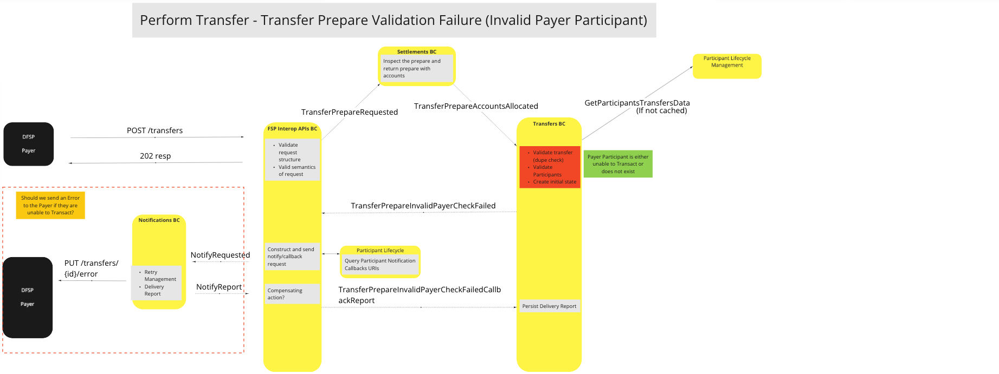
>Diagrama de fluxo de trabalho da UC: Executar transferência - Falha na validação da preparação da transferência (participante do pagador inválido)

### Executar transferência - Falha na validação da preparação da transferência (participante beneficiário inválido)

#### Descrição

O fluxo de trabalho proporcionado por esta UC permite ao BC implementar um método para cancelar um pedido de «Transfer Prepare» nos casos em que a validação da transação falhe devido a um beneficiário inválido ou inexistente.

#### Diagrama de fluxo

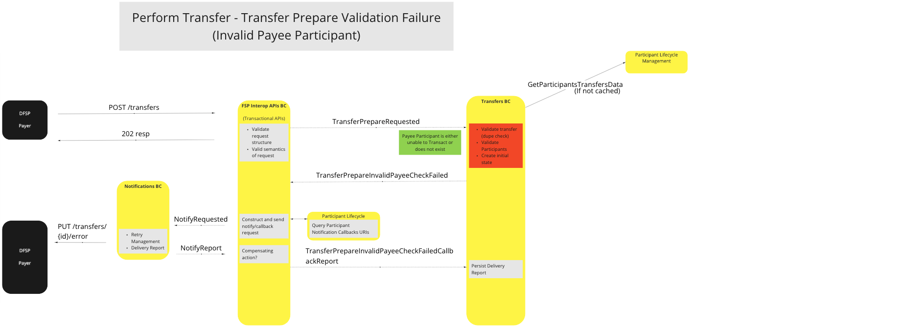
>Diagrama de fluxo de trabalho da UC: Executar transferência - Falha na validação da preparação da transferência (participante beneficiário inválido)

### Transferência de consulta (GET) — Falha na validação (participante pagador inválido)

#### Descrição

O fluxo de trabalho proporcionado por esta UC permite ao BC implementar um método para encerrar uma consulta sobre o estado de uma transferência, nos casos em que a validação falhe devido a um pagador inválido ou inexistente.

<!--#### Flow Diagram

> Diagrama UC a confirmar -->

### Transferência de consulta (GET) — Falha na validação (participante beneficiário inválido)

#### Descrição

O fluxo de trabalho proporcionado por esta UC permite ao BC implementar um método para encerrar uma consulta sobre o estado de uma transferência, nos casos em que a validação falhe devido a um beneficiário inválido ou inexistente.

<!--#### Flow Diagram

 
> Diagrama UC a confirmar -->

### Transferência de consulta (GET) — Falha na validação (identificador da transferência não encontrado)

#### Descrição

O fluxo de trabalho proporcionado por esta UC permite ao BC implementar um método para encerrar uma consulta sobre o estado de uma transferência, nos casos em que a validação falhe devido à impossibilidade de localizar um token de identificação da transferência.

<!--#### Flow Diagram

 
> Diagrama UC a confirmar -->

## Modelo canónico

O Mojaloop utiliza dois modelos canónicos para gerir as transferências de fundos: um para transferências não em massa e outro para transferências em massa.

### Modelo Canónico Padrão

* Transferência
  * transferId
  * transferType
  * quoteld (opcional)
  * settlementModelId
  * Participantes
    * Pagador
      * participantId
      * Contas
        * Débito
          * accountId
          * tipo de conta
          * moeda
        * Crédito
          * accountId
          * tipo de conta
          * moeda
    * Beneficiário
      * ParticipantId
      * Contas
        * Débito
          * accountId
          * tipo de conta
          * moeda
        * Crédito
          * accountId
          * tipo de conta
          * moeda
  * Montante (Montante para a transferência)
    * valor (número)
    * moeda (código ISO da moeda)
  * data de validade (ISO dateTime)
  * ilpPacket
  * Extensões

### Modelo canónico global

* Transferências
  * bulkId
  * bulkQuoteId
  * Transferências[]
    * Transferência* (ver acima)

## Considerações finais

* Não deve ser permitido que o pagador FSP interrompa unilateralmente uma transferência por expiração do prazo (independentemente do seu prazo de validade), devendo, em vez disso, respeitar as decisões do switch relativas à expiração do prazo.
* A validação das condições criptográficas e do seu cumprimento seria gerida pelo Transfers BC, uma vez que se trata de uma componente fundamental do processo de «transferência» (ou seja: a função não é específica da linguagem FSPIOP)
* O BC de Transferências aplicará o mesmo padrão de validação que o BC de Cotações e Partes para validar os participantes, a fim de determinar a capacidade de uma Conta para efetuar transações ou se um participante está definido como mutuamente exclusivo.
* O Transfers BC é a única «fonte de verdade» para todas as transferências, sendo, por conseguinte, responsável por manter o(s) estado(s) das transferências.
* A desativação de participantes que já se encontrem no estado «preparado» não deverá impedir o processamento das transferências em curso; no entanto, as novas instruções de transferência recebidas pelo Transfers BC através dos eventos «TransferPrepareAccountAllocated» deverão ser recusadas.

<!-- Footnotes themselves at the bottom. -->
<!--## Notes -->

[^1]: Interfaces comuns: [Mojaloop Lista de interfaces comuns](../../commonInterfaces.md)
