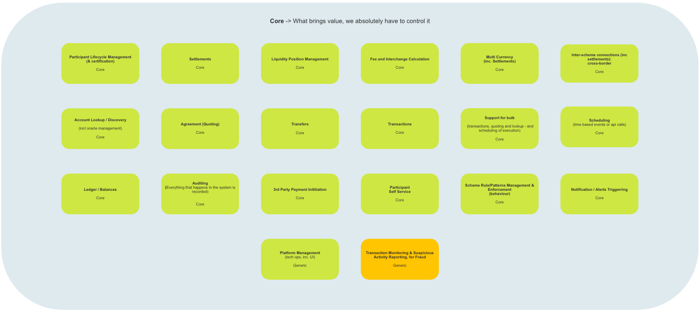
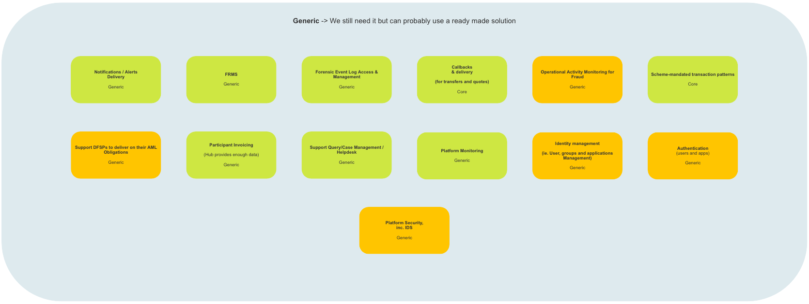
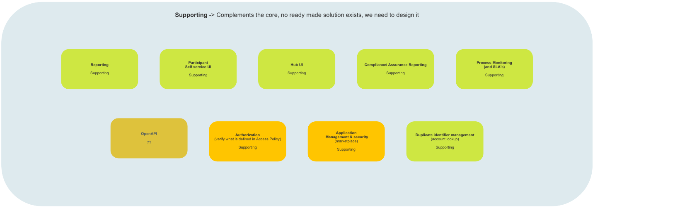
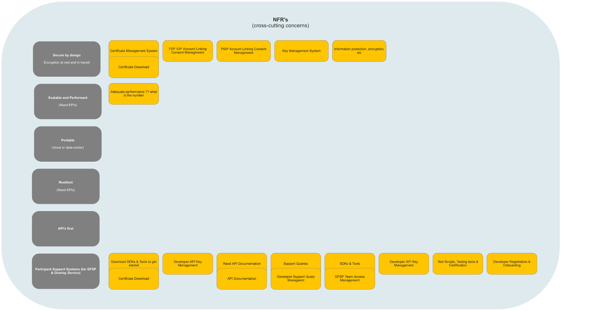
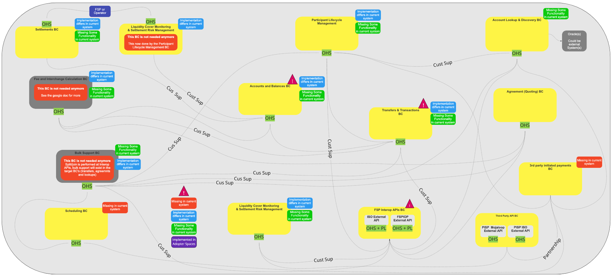

# Mojaloop Visão geral da arquitetura de referência

## Espaço do problema (_Identificação e mapeamento do espaço do problema_)

Conforme referido na visão geral da arquitetura DDD, o Espaço de Problemas contém uma série de contentores orientados para a solução, identificados pela equipa de arquitetos de sistemas, que estão a ser utilizados para categorizar subdomínios onde foram identificados problemas (melhorias).

### Problemas fundamentais

#### Descrição

Foram identificados vários problemas centrais (melhorias) por parte de (Negócios/Desenvolvedores/Negócios e Desenvolvedores). A fim de implementar as melhorias, as equipas de desenvolvimento «internas» serão encarregadas de desenvolver as soluções necessárias.  Normalmente, os subdomínios assim identificados geram um valor significativo para o sistema «Mojaloop», pelo que se tem o cuidado de garantir que os serviços por eles prestados não sejam comprometidos.  Entre os exemplos de subdomínios de problemas centrais incluem-se: Gestão do Ciclo de Vida dos Participantes, Liquidações e Programação.

#### Mapa de alto nível

> Arquitetura de Referência (Mojaloop): Problemas Fundamentais

### Problemas gerais

#### Descrição

Foram identificados vários problemas genéricos (melhorias) por parte de (a área de negócios/os programadores/tanto a área de negócios como os programadores).  Para implementar as melhorias, serão adotadas soluções prontas a utilizar que não requerem qualquer personalização adicional. Estas exigirão integração com o Mojaloop. Exemplos de subdomínios de problemas genéricos incluem a Autenticação, o FRMS e a Monitorização da Plataforma.

#### Mapa de alto nível

> Arquitetura de Referência (Mojaloop): Problemas Genéricos

### Problemas de suporte

#### Descrição

Foram identificados vários problemas de apoio (melhorias) por parte de (a área de negócios/os programadores/tanto a área de negócios como os programadores).  Para implementar as melhorias, serão adotadas soluções prontas a utilizar; no entanto, para as integrar plenamente no sistema «Mojaloop» e dar resposta aos problemas identificados (melhorias), será necessária uma personalização adicional para cada uma das soluções integradas.  Entre os exemplos de subdomínios de problemas de suporte incluem-se a gestão de políticas de acesso, a elaboração de relatórios e a autorização (verificação do conteúdo das políticas de acesso).

#### Mapa de alto nível

> Arquitetura de Referência (Mojaloop): Problemas de suporte

### Requisitos não funcionais

#### Descrição

Foram identificados vários requisitos não funcionais por parte de (a empresa/os programadores/tanto a empresa como os programadores). Embora não acrescentem valor direto ao Mojaloop, são necessários para dar resposta a uma série de problemas relacionados com a atividade empresarial (melhorias).  Entre os exemplos de requisitos não funcionais inclui-se a segurança que não ocupa um subdomínio próprio. Todos os subdomínios do sistema terão de incluir elementos de código relativos à segurança para cumprir este requisito; em alternativa, será implementado um serviço central de gestão de segurança que inclua perfis de segurança criados e geridos centralmente para cada subdomínio do sistema, os quais serão descarregados ao aderirem ao domínio ou no momento da inicialização e/ou que lhes serão enviados a partir do serviço central sempre que ocorrerem atualizações.

#### Mapa de alto nível

> Arquitetura de Referência (Mojaloop): Requisitos Não Funcionais

### Novo e não classificado (fora do domínio)

#### Descrição

Foram identificados vários problemas novos e não classificados (não pertencentes a nenhum domínio), tanto pela área de Negócios como pelos programadores. Assim que a área de Negócios e os arquitetos de sistemas tiverem identificado a solução necessária para resolver o problema, este será classificado num dos contentores de problemas e tratado de acordo com os respetivos processos.

#### Mapa de alto nível

> Arquitetura de Referência (Mojaloop): Problemas novos e não classificados

## Espaço de Soluções (_Descrição de alto nível e mapa contextual_)

#### Descrição

O Espaço de Soluções definido pela arquitetura DDD centra-se na forma como os problemas empresariais (melhorias) identificados no Espaço de Problemas irão ser resolvidos.  Consequentemente, contém necessariamente mais informação e pormenores técnicos do que o Espaço de Problemas.  Inclui elementos como a Linguagem Ubíqua, os Contextos Delimitados e as Preocupações Transversais.

#### Mapa de alto nível

> Arquitetura de Referência (Mojaloop): Espaço de Soluções

### Língua Ubíqua

#### Descrição

Um desafio com que a maioria das equipas se depara é manter uma compreensão clara de termos que podem não ser exclusivos de um determinado domínio. Um exemplo clássico de um termo não exclusivo é «conta»: este termo pode referir-se a um conjunto de contas financeiras, ao perfil de uma entidade ou a um nome de utilizador.

Conforme referido na visão geral, a Linguagem Ubíqua é utilizada para ajudar a eliminar a confusão e a falta de comunicação entre as equipas empresariais e técnicas que trabalham para resolver um problema empresarial ou um conjunto de problemas empresariais.  Embora seja possível que cada domínio/subdomínio possa conter termos que não sejam únicos, tal como referido acima, num determinado contexto — e, no caso da arquitetura DDD, num «Contexto Delimitado» —, é importante garantir que todos os termos sejam únicos, claramente compreendidos por todos os participantes e corretamente aplicados.

Para obter informações e uma descrição de cada um dos termos linguísticos específicos utilizados no Domínio Mojaloop, consulte o [Glossário](../glossary/README.md) anexo ao presente documento.

### Contextos delimitados

Foram identificados e implementados os seguintes Contextos Delimitados na versão Mojaloop:

> Esta é uma descrição de alto nível de cada um dos Contextos Delimitados que foram identificados e incluídos na Arquitetura de Referência Mojaloop. Segue-se uma visão mais detalhada na secção [Contextos Delimitados](../boundedContexts/index.md) deste documento.

| Contexto Delimitado            | Objetivo                                                                                                                                                                         | Contexto Delimitado                                       | Objetivo                                                                                                                                                    |
| -------------------------- | ------------------------------------------------------------------------------------------------------------------------------------------------------------------------------- | ----------------------------------------------------- | ---------------------------------------------------------------------------------------------------------------------------------------------------------- |
| Povoações                | Efetua liquidações Settlements  Configura modelos de liquidação models  Calcula liquidações                                                                                               | Gestão do ciclo de vida dos participantes                      | Onboarding  Gestão do ciclo de vida dos participantes   Self-service  Interface de utilizador do self-service dos participantes                                |
| Pesquisa e Identificação de Contas | Core  Pesquisa/identificação de contas discovery  Transações em massa transactions  Gestão de identificadores duplicados management  Ligações entre esquemas (incluindo liquidações) transfronteiriças | Contas e saldos                                   | Sistema de registo da atividade financeira e do saldo deDFSP participante                                                                                          |
| Transferências e transações   | Processamento de transferências processing  Verificação de liquidez para cada transferência transfer  Transações em massa transactions  Multimoeda, incluindo transações com vários passos                                              | Acordo (Cotação)                                   | Acordo /citação (base)   Transações em massa   Multimoeda, incluindo transações com vários saltos   A aplicação das regras/padrões do scheme ocorre em cada BC |
| Agendamento                 | Agendamento de eventos baseados no tempo com API chamadas (Core)                                                                                                                                | Notificações e alertas                                | Estado da notificação — tendo em conta a prioridade e o SLA (Núcleo)   Gestão de acionamentos e alertas (Núcleo)   Envio de notificações — tendo em conta a prioridade e o SLA (Genérico)     |
| FSP APIs de interoperabilidade           | ISO Externo API (A granel; API, Ativação de callbacks (apenas transferências, ausente na situação atual)                                                                                            | Pagamentos iniciados por terceiros                        | PISP. Ligação de contas  . Gestão do consentimento  . Iniciação de pagamentos por terceiros (Core)                                                                      |
| Terceiros API            |                                                                                                                                                                                 | PISP Mojaloop Externo API  PISP ISO Externo API |                                                                                                                                                            |

### Questões transversais

Foram identificadas as seguintes questões transversais no Mojaloop:

| Questão transversal BC                 | Objetivo                                                                                                                                                                                                                                                                                                                                                                                                                                   |
| ---------------------------------------- | ----------------------------------------------------------------------------------------------------------------------------------------------------------------------------------------------------------------------------------------------------------------------------------------------------------------------------------------------------------------------------------------------------------------------------------------- |
| AuthZ, AuthN e Gestão de Identidades BC | Gerir todos os aspetos relacionados com a autenticação (AuthN) e a autorização (AuthZ) de utilizadores e do sistema. As soluções previstas enquadram-se nas categorias «Genérica» e «De Apoio»                                                                                                                                                                                                                                                                        |
| BC criptográfico                         | Gerir todos os serviços relacionados com a criptografia, incluindo os sistemas de gestão e armazenamento de chaves e certificados. As soluções previstas enquadram-se na categoria «Genérica».                                                                                                                                                                                                                                                                             |
| Relatórios e Auditoria na Colúmbia Britânica                | Gerir todos os serviços de auditoria e elaboração de relatórios, incluindo relatórios de conformidade e garantia, registo forense de eventos e KMS, acesso e gestão de registos forenses de eventos, monitorização de processos e SLAs, bem como auditoria de sistemas. (Cada BC incluirá capacidade de auditoria. O BC de Relatórios e Auditoria conservará os registos de todos os BCs). As soluções previstas enquadrar-se-ão em todas as categorias do Espaço de Problemas: Essencial, de Apoio e Genérico.     |
| Configuração da Plataforma (Negócios) BC     | Gerir o processo de gestão de regras/padrões do scheme (Nota: a aplicação das regras/padrões do scheme é mantida em cada BC), os padrões de transação exigidos pelo scheme, a gestão de aplicações e a segurança, a gestão de identidades e acessos (incluindo a gestão de utilizadores e equipas), a gestão do consentimento associado às operações comerciais API e a gestão das políticas de acesso. As soluções planeadas enquadrar-se-ão em todas as categorias do Espaço de Problemas: Essencial, de Apoio e Genérico |
| Gestão da Plataforma Técnica BC         | Gerir a monitorização e a gestão da plataforma. As soluções previstas enquadram-se na categoria «Genérica».                                                                                                                                                                                                                                                                                                                                |

<!-- Footnotes themselves at the bottom. -->
<!--### Notes

[^?]: A nota vai aqui — «?» indica uma referência a uma nota de rodapé-->