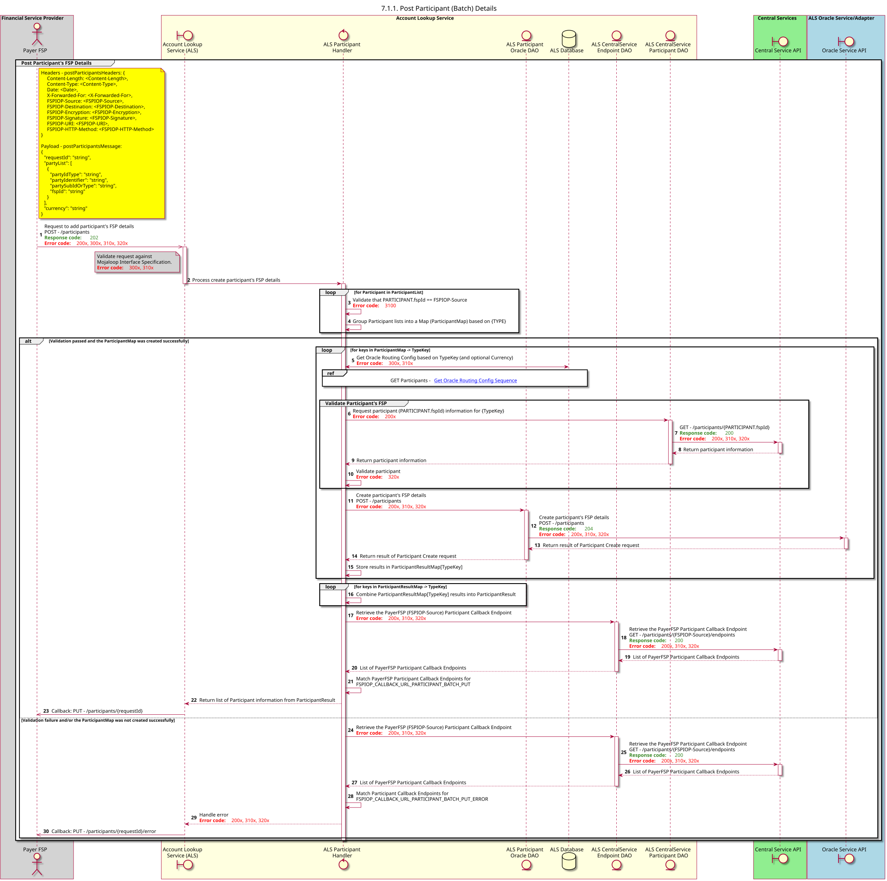

# Diagrama de sequência para os participantes do POST (em lote)

Esquema para a criação de um participante por um «DFSP» através de um pedido em lote.

## Notas
- Esta operação permite pedidos que contenham:
    - Todos os FSP dos participantes correspondem ao FSPIOP-Source7
    - Todos os participantes utilizarão a mesma moeda, de acordo com a chamada «`POST /participants`» no [Mojaloop FSPIOP API](/technical/api/fspiop/v1.1/api-definition.html#post-participants)  
- Os pedidos POST duplicados com o campo TYPE a corresponder e o campo CURRENCY opcional serão considerados uma operação __update__. O registo existente deve ser **substituído** na íntegra. 

## Diagrama de sequência

