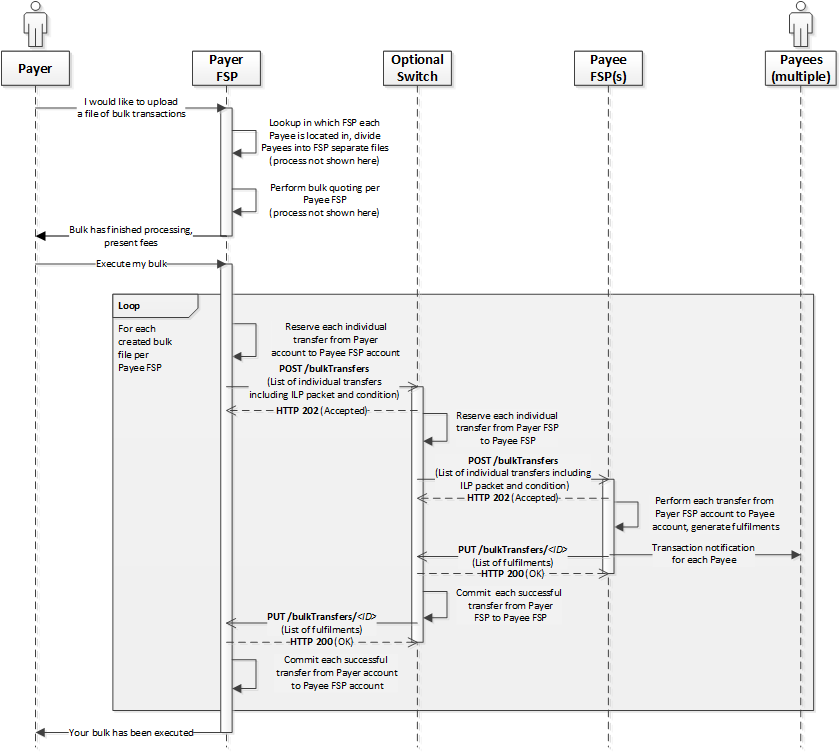
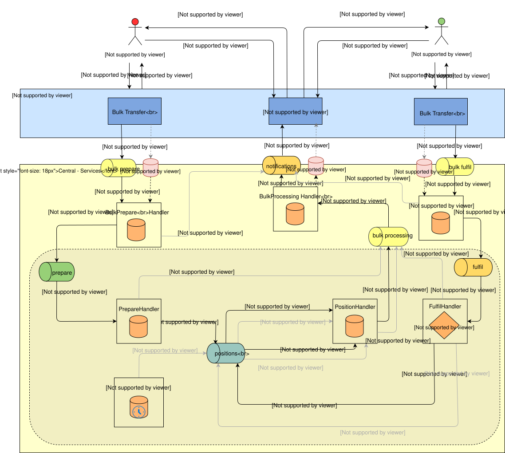

# Conceção de transferências em massa

O cenário «Transferências em massa» é descrito no documento de definição API relativo ao recurso /bulkTransfers. Para mais pormenores, _(consulte a secção `6.10`)_, de acordo com a [Mojaloop Specification](https://github.com/mojaloop/mojaloop-specification/blob/master/API%20Definition%20v1.0.pdf)

1. [Introdução](introduction)
2. [Considerações de conceção](design-considerations)
3. [Etapas envolvidas na arquitetura de alto nível](steps-involved-in-the-high-level-architecture)
4. [Notas](notes)
    1. [Tópicos de discussão](discussion-items)
    2. [Novas tabelas propostas](proposed-new-tables)
    3. [Estados das transferências em massa States](bulk-transfers-states)]
    4. [Notas adicionais](additional-notes)
5. [Topics do roadmap](roadmap-topics)

## 1. Introdução

O processo de Transferências em Massa é abordado na secção 6.10 do documento «API Definição 1.0», ilustrado na Figura 60, cuja imagem se apresenta abaixo.

Os pontos-chave previstos na especificação, na sua versão atual 1.0, são os seguintes:

- A reserva de fundos é efetuada para cada transferência individual do Pagador FSP para o Beneficiário FSP
- Mesmo que uma única transferência individual falhe durante o processo de preparação, todo o lote deve ser rejeitado.

## 2. Considerações relativas à conceção

De acordo com a Figura 60 da especificação, seguem-se algumas implicações fundamentais decorrentes da mesma.

1. O Pagador DFSP efetua, separadamente, pesquisas de utilizadores para cada uma das partes envolvidas no pagamento em massa
2. O Pagador DFSP efetua a emissão de cotações em massa por Beneficiário DFSP
3. Cabe ao Pagador DFSP preparar transferências em massa com base nos FSP dos Beneficiários e enviar um pedido de transferência em massa a um único Beneficiário FSP
4. Este parece ser um processo do tipo «tudo ou nada», em que, mesmo que a reserva de fundos para uma única transferência individual falhe, todo o lote tem de ser rejeitado, uma vez que não pode ser enviado ao beneficiário tal como está, se incluir uma transferência individual para a qual não foi possível reservar fundos.
5. À luz do exposto, a proposta que está a ser apresentada neste momento consiste em permitir que o switch (é necessário atualizar a especificação) envie o pedido POST /bulkTransfers com a lista de transferências individuais para as quais foi possível reservar fundos no switch.
6. O que isto implica é que o Switch agrega as confirmações/falhas do Beneficiário FSP para o lote e envia uma única chamada PUT /bulkTransfers/{ID} ao Pagador FSP, que inclui a lista completa de transferências, incluindo as transferências individuais que falharam tanto no Switch como no Beneficiário FSP
7. Por exemplo: se houver 1 000 transferências individuais numa transferência em massa e se o switch conseguir reservar fundos para 900 dessas transferências individuais, é então enviada uma solicitação de preparação de transferência em massa ao beneficiário DFSP, acompanhada da lista dessas 900 transferências individuais. Assim que o Beneficiário FSP envia o pedido de Execução em Massa para essas 900 transferências — das quais, digamos, 800 podem ser confirmadas e 100 são abortadas —, o Switch processa essas transferências individuais em conformidade e envia o callback PUT (PUT /bulkTransfers/{ID}) ao Pagador FSP, com todas as 1 000 transferências individuais, das quais 800 foram confirmadas e 200 foram abortadas.
8. Haverá implicações em aspetos como a assinatura, a encriptação, o PKI e outros aspetos de segurança que terão de ser abordados.
9. A ordem das transferências individuais também deve ser tida em conta pelo scheme. Um dos objetivos da implementação em mercados emergentes é maximizar o número de transações envolvidas; por isso, um scheme bem concebido pode reordenar as transferências individuais por ordem crescente do valor dos montantes e, em seguida, processá-las. No entanto, esta pode ser uma questão a considerar pelo scheme.
10. No entanto, uma regra recomendada do scheme é que não se permita que os Prestadores de Serviços Financeiros (FSP) dos beneficiários reordenem as transferências individuais num lote, a fim de evitar qualquer parcialidade em relação aos beneficiários.
11. No que diz respeito às liquidações com transferências em massa que envolvam pagamentos do Governo de montantes avultados, é necessário debater a possibilidade de permitir a realização dessas transferências sem regras de liquidez rigorosas.

## 3. Etapas envolvidas na arquitetura de alto nível

A seguir, apresentam-se, em linhas gerais, os passos necessários para as transferências em massa.

1. [1.0, 1.1, 1.2] Um pedido de transferência em massa recebido (POST /bulkTransfers) no bulk-api-adapter é colocado num armazenamento de objetos e é enviada uma notificação com uma referência à mensagem propriamente dita através do tópico do Kafka «bulk-prepare», sendo enviado um código de resposta 202 ao pagador FSP
2. [1.3] O manipulador «Bulk Prepare» processa o pedido e regista o estado como «RECEIVED»

    a. O manipulador «Preparação em massa» valida, em seguida, a operação em massa e altera o estado para «PENDENTE» caso a validação seja bem-sucedida

    b. Uma regra de validação adicional aqui proposta consiste em rejeitar um lote caso existam IDs de transferência duplicados utilizados no próprio lote.

    c. [1.4] Se a validação falhar, o gestor de preparação em massa altera o bulkTransferState para PENDING_INVALID (um estado interno) e envia uma mensagem para o tópico de processamento em massa
        i. O gestor de processamento em massa atualiza então o bulkTransferState para REJECTED e envia uma notificação ao pagador

3. [1.4] [Continuação de 2.a] O manipulador «Bulk Prepare» divide o lote em transferências individuais e coloca cada uma delas no tópico «prepare»

    a. Neste contexto, a cada transferência é atribuído individualmente o «prazo de validade» da própria transferência em massa (bem como outros campos necessários para as transferências individuais)

4. [1.5, 1.6, 1.7] Os manipuladores «Prepare» e «Position» foram refatorados para processar transferências individuais em lote, utilizando indicadores como tipo, ação, estado, etc.

    a. Reserva de fundos --> Esta tarefa é deixada a cargo de cada gestor individual e, posteriormente, o montante total é agregado no Gestor de Processamento em Massa.

5. [1.8] O «Position Handler» gera mensagens correspondentes a transferências individuais que fazem parte de um tópico de processamento «bulk to bulk»
6. [1.9] Para cada mensagem consumida do tópico de processamento em massa, é efetuada uma verificação no manipulador de processamento em massa para determinar se essa é a última transferência individual de um lote para essa fase de processamento.
7. [1.10, 1.11, 1.12] Se se tratar da última transferência, agregue o estado de todas as transferências individuais e

    a. Se todas estiverem no estado «reservado» --> Envie um POST para /bulkTransfers ao Beneficiário (através da criação de uma mensagem no tópico de notificações, que é posteriormente consumida pelo gestor de notificações)

    b. Assim que o pedido de preparação da transferência em massa for enviado ao beneficiário, altere o estado para «ACEITE»

8. Num caso bem-sucedido da fase «Prepare» — quando é recebida a mensagem PUT do Beneficiário FSP para o «bulkFulfil» —, é colocada uma notificação no tópico «bulk fulfil», com uma referência à mensagem «Fulfil» efetiva que se encontra armazenada num armazenamento de objetos.
9. Isto deve ser processado pelo bulkFulfilHandler, que, em seguida, muda de estado para PROCESSING.
10. O «bulk-fulfil-handler» divide o lote em transferências individuais e envia cada uma delas através dos «Fulfil» e «Position Handlers» refatorados, para confirmar/anular cada uma delas com base na mensagem PUT /bulkTransfers/{ID} enviada pelo beneficiário e para confirmar/release fundos no switch
11. O gestor de processamento em massa deve, em seguida, agregar todos os resultados individuais das transferências e alterar o estado de «bulkTransfer» para «COMPLETED» ou «REJECTED», consoante o sucesso ou o fracasso

    a. Se o beneficiário enviar «COMMITED» para apenas uma das transferências individuais, propõe-se que o estado do lote seja alterado para «COMPLETED».

    b. No entanto, no caso do passo 8 ou se o beneficiário enviar «REJECTED» como «bulkTransferState», o estado final no switch deverá ser «REJECTED».

12. Enviar notificações tanto ao Pagador como ao Beneficiário (à semelhança das transferências individuais, embora divergindo da Especificação 1.0). O FSP do Pagador é o destinatário da notificação que inclui uma lista exaustiva das transferências individuais, idêntica à lista presente no pedido de preparação enviado pelo Pagador. O Prestador de Serviços Financeiros do Beneficiário é o destinatário de uma notificação apenas relativamente a um subconjunto de transferências, que lhe foram enviadas pelo switch como pedido de preparação em massa (que puderam ser reservadas no switch).

## 4. Detalhes da implementação

### 4.1 Estados de transferência em massa

A seguir apresentam-se os estados de uma transferência em massa, de acordo com a Especificação MojaloopAPI

1. RECEBIDO
2. EM ANEXO
3. ACEITE
4. TRATAMENTO
5. CONCLUÍDO
6. REJEITADO
7. Estado interno - PENDING_PREPARE (associado a PENDING)
8. Estado interno - PENDING_INVALID (correspondente a PENDING)
9. Estado interno - PENDING_FULFIL (correspondente a PROCESSING)
10. Estado interno - EXPIRING (correspondente a PROCESSING)
11. Estado interno - EXPIRADO (correspondente a CONCLUÍDO)
12. Estado interno - INVALID (correspondente a REJECTED)
13. Podem ser adicionados microestados adicionais para utilização interna no switch

### 4.2 Novos quadros propostos

Apresentam-se abaixo as tabelas propostas no âmbito da conceção das transferências em massa

- bulkTransfer
- alteração de estado de transferência em massa
- bulkTransferError
- verificação de duplicados na transferência em massa
- execução de transferências em massa
- verificação de duplicados no processamento de transferências em massa
- bulkTransferAssociation
- bulkTransferExtension
- bulkTransferState
- estado do processamento em massa

### 4.3 Combinações internas de tipo, ação e estado

#### 1. Transferência em massa que cumpre a validação do esquema [ml-api-adapter -> bulk-prepare-handler]

  1. tipo: preparação em massa
  2. ação: preparação em massa
  3. Estado: bem-sucedido
  4. Resultado: bulkTransferState=RECEIVED, bulkProcessingState=RECEIVED

#### 2. Duplicar [gestor de preparação em massa -> gestor de notificações]

  1. tipo: notificação
  2. ação: bulk-prepare-duplicate
  3. Estado: bem-sucedido
  4. Resultado: bulkTransferState=N/A, bulkProcessingState=N/A

#### 3. Validar a falha na transferência da preparação em massa [bulk-prepare-handler → notification-handler]

  1. tipo: notificação
  2. ação: cancelamento em massa
  3. Estado: erro

#### 4. Para uma transferência «Bulk Prepare» válida (desagregada e enviada como transferências individuais) [bulk-prepare-handler -> prepare-handler]

  1. tipo: preparar
  2. ação: preparação em massa
  3. Estado: bem-sucedido

#### 5. Duplicado de uma transferência individual que faz parte de uma transferência em massa [gestor de preparação → gestor de processamento em massa]

  1. tipo: processamento em massa
  2. ação: preparar-duplicado
  3. Estado: bem-sucedido
  4. Ação prevista: Adicionar uma mensagem de erro a indicar que se trata de uma duplicata
  5. Resultado: bulkTransferState=PENDING_PREPARE/ACCEPTED (dependendo de se tratar ou não da última), bulkProcessingState=RECEIVED_DUPLICATE

#### 6. Para a transferência individual «Prepare», trata-se de uma duplicata válida no gestor «prepare» [prepare-handler → bulk-processing-handler]

  1. tipo: processamento em massa
  2. ação: preparar-duplicado
  3. Estado: erro
  4. Resultado: bulkTransferState=PENDING_PREPARE/ACCEPTED (dependendo de se tratar ou não da última), bulkProcessingState=RECEIVED_DUPLICATE

#### 7. Para um indivíduo válido, prepare a transferência que faz parte de um processamento em massa [prepare-handler -> position-handler]

  1. tipo: posição
  2. ação: preparação em massa
  3. Estado: bem-sucedido

#### 8. Para a transferência individual «Prepare» que faz parte de um lote cuja validação falhou no manipulador de preparação [prepare-handler → bulk-processing-handler]

  1. tipo: processamento em massa
  2. ação: preparação em massa
  3. Estado: erro
  4. Resultado: bulkTransferState=PENDING_PREPARE/ACCEPTED (dependendo de se tratar ou não da última), bulkProcessingState=RECEIVED_INVALID

#### 9. Para um indivíduo válido, prepare uma transferência que faça parte de um processamento em massa [position-handler -> bulk-processing-handler]

  1. tipo: processamento em massa
  2. ação: preparação em massa
  3. Estado: bem-sucedido
  4. Resultado: bulkTransferState=PENDING_PREPARE/ACCEPTED (dependendo de se tratar ou não da última), bulkProcessingState=ACCEPTED

#### 10. Para a transferência individual «Prepare», que faz parte de um processamento em massa cuja validação falhou no gestor de posições [gestor-de-posições → gestor-de-processamento-em-massa]

  1. tipo: processamento em massa
  2. ação: preparação em massa
  3. Estado: erro
  4. Resultado: bulkTransferState=PENDING_PREPARE/ACCEPTED (dependendo de se tratar ou não da última), bulkProcessingState=RECEIVED_INVALID

#### 11. Para uma transferência individual válida (para confirmação) que faça parte de um processamento em massa [gestor de posições -> gestor de processamento em massa]

  1. tipo: processamento em massa
  2. ação: bulk-commit
  3. Estado: bem-sucedido
  4. Resultado: bulkTransferState=PENDING_FULFIL/COMPLETED (dependendo de se tratar ou não da última), bulkProcessingState=COMPLETED

#### 12. Para a mensagem de transferência em massa que passe na validação [ml-api-adapter -> bulk-fulfil-handler]

  1. tipo: processamento em massa
  2. ação: bulk-commit
  3. Estado: bem-sucedido

#### 13. Para uma transferência individual válida que faça parte de um processamento em massa que tenha atingido o tempo limite no gestor de posições [gestor-de-posições → gestor-de-processamento-em-massa]

  1. tipo: processamento em massa
  2. ação: bulk-timeout-reserved
  3. Estado: erro
  4. Resultado: bulkTransferState=PENDING_FULFIL/COMPLETED (dependendo de se tratar ou não da última), bulkProcessingState=FULFIL_INVALID

#### 14. Para uma transferência individual válida (em caso de rejeição) que faça parte de um processamento em massa [gestor de posições -> gestor de processamento em massa]

  1. tipo: processamento em massa
  2. ação: rejeitar
  3. Estado: bem-sucedido
  4. Resultado: bulkTransferState=PENDING_FULFIL/COMPLETED (dependendo de se tratar ou não da última transação), bulkProcessingState=REJECTED

#### 15. Duplicação inválida de uma transferência individual num processamento em massa [fulfil-handler -> bulk-processing-handler]

  1. tipo: processamento em massa
  2. ação: cumprir-duplicado
  3. Estado: erro
  4. Resultado: bulkTransferState=PENDING_FULFIL/COMPLETED (dependendo de se tratar ou não da última), bulkProcessingState=FULFIL_DUPLICATE

#### 16. Validar a duplicação de uma transferência individual num processamento em massa [fulfil-handler -> bulk-processing-handler]

  1. tipo: processamento em massa
  2. ação: cumprir-duplicado
  3. Estado: bem-sucedido
  4. Resultado: bulkTransferState=PENDING_FULFIL/COMPLETED (dependendo de se tratar ou não da última), bulkProcessingState=FULFIL_DUPLICATE

#### 17. Mensagem válida de conclusão de uma transferência individual num processamento em massa [fulfil-handler -> position-handler]

  1. tipo: posição
  2. ação: bulk-commit
  3. Estado: bem-sucedido

#### 18. Para transferências individuais de «Fulfil» que fazem parte de um lote cuja validação falhou no gestor de «fulfil» [fulfil-handler → bulk-processing-handler]

  1. tipo: processamento em massa
  2. ação: bulk-commit
  3. Estado: erro
  4. Resultado: bulkTransferState=PENDING_FULFIL/COMPLETED (dependendo de se tratar ou não da última), bulkProcessingState=FULFIL_INVALID

#### 19. Processar o pedido de transferência que faz parte de um lote que tenha sido validado [bulk-fulfil-handler → fulfil-handler]

  1. tipo: processamento em massa
  2. ação: bulk-commit
  3. Estado: bem-sucedido

#### 20. No que diz respeito às transferências em massa cuja validação falha ao nível do «bulk-fulfil-handler» [bulk-fulfil-handler → notification-handler]

  1. tipo: notificação
  2. ação: cancelamento em massa
  3. Estado: erro

#### 21. Para notificações de transferência em massa para os FSP [bulk-processing-handler -> notification-handler]

  1. tipo: notificação
  2. ação: preparação em massa / confirmação em massa
  3. Estado: bem-sucedido

#### 22. Para notificação de tempo limite [timeout-handler → bulk-processing-handler]

  1. tipo: processamento em massa
  2. ação: bulk-timeout-received
  3. Estado: erro
  4. Resultado: bulkTransferState=COMPLETED (para o último), bulkProcessingState=EXPIRED

#### 23. Para notificação de tempo limite [timeout-handler → position-handler]

  1. tipo: posição
  2. ação: bulk-timeout-reserved
  3. Estado: erro

#### 24. Para notificação de tempo limite após o ajuste de posição [gestor de posição -> gestor de processamento em massa]

  1. tipo: processamento em massa
  2. ação: bulk-timeout-reserved
  3. Estado: erro
  4. Resultado: bulkTransferState=COMPLETED (para o último), bulkProcessingState=EXPIRED

### 4.4 Notas adicionais

1. Documento GET /bulkTransfers para indicar a diferença nas respostas que o pagador-FSP e o beneficiário-FSP recebem relativamente às transferências em massa
2. Utilizou-se um serviço separado: bulk-api-adapter para permitir pontos finais de transferências em massa (o que inclui a persistência, tal como referido acima)

## 5. Tópicos do roadmap

1. Reavaliar a necessidade de permitir a utilização de múltiplos Prestadores de Serviços Financeiros (FSP) como beneficiários, no âmbito de um processamento em massa, bem como as alterações necessárias à especificação.
2. As questões e os ensinamentos retirados da demonstração de viabilidade (PoC) que se encontram documentados são abordados por ordem de prioridade
3. Constate a necessidade de implementar algo semelhante a um recurso de produção em massa (/bulkMake?), no qual o switch aceite um lote completo tal como está e, em seguida, trate das três fases: pesquisa, cotação e transferências.
4. Limitação da velocidade das transferências individuais num processamento em massa?
5. A questão da ordenação em lote — a ordem de processamento no switch e nos Prestadores de Serviços Financeiros (FSP). Recomendação ao scheme no sentido de incorporar uma regra que obrigue todos os FSP a processarem as transações em lote, seguindo a ordem existente, e a não concederem tratamento preferencial. Atualmente, o switch mantém-se neutro no que diz respeito à ordenação, mas a melhor prática consiste em ordenar por ordem crescente de montantes e proceder ao processamento.
6. No que diz respeito às liquidações com transferências em massa que envolvam pagamentos do Governo de montantes avultados, é necessário debater a possibilidade de permitir a realização dessas transferências sem regras de liquidez rigorosas.
7. Implementar GET /bulkTransfers
8. Implementar notificações/registo para todos os cenários negativos em massa
9. Cobertura de código completa nos testes unitários
10. Testes de integração da transferência em massa bem-sucedida (percurso ideal)
11. Testes de regressão, incluindo cenários negativos
