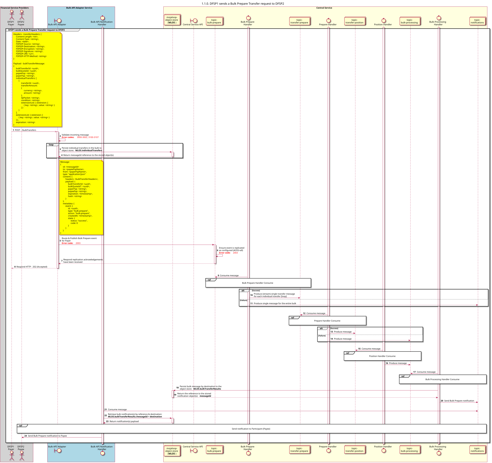

# Preparação em massa de pedidos de transferência [Visão geral] [inclui transferências individuais num processamento em massa]

Diagrama de conceção da sequência para o processo «Preparar Pedido de Transferência».

## Referências no diagrama de sequências

* [Consumo do Gestor de Preparação em Massa (1.1.1)](1.1.1-bulk-prepare-handler-consume.md)
* [Preparar o Handler Consume (1.2.1)](1.2.1-prepare-handler-consume-for-bulk.md)
* [Position Handler Consume (1.3.0)](1.3.0-position-handler-consume-overview.md)
* [Processador de Processamento em Massa Consume (1.4.1)](1.4.1-bulk-processing-handler.md)
* [Enviar notificação ao participante (1.1.4.a)](1.1.4.a-send-notification-to-participant.md)

## Diagrama de sequência

