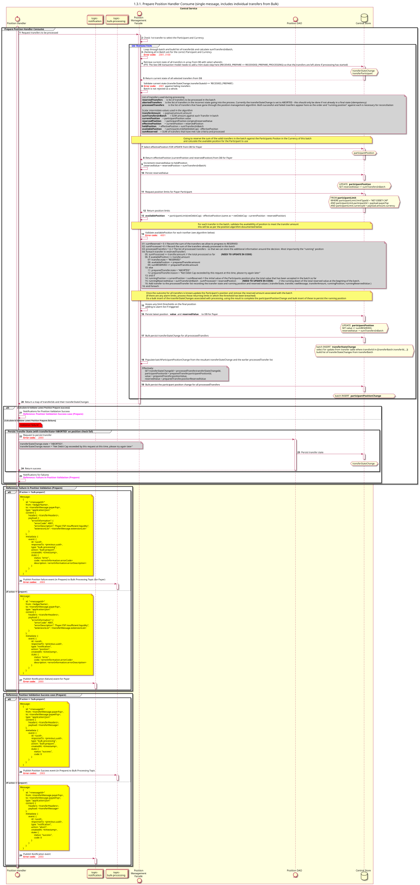

# Preparar o gestor de posições: processar [o que inclui transferências individuais num lote]

Diagrama de conceção da sequência para o processo «Prepare Position Handler Consume»

## Diagrama de sequência

