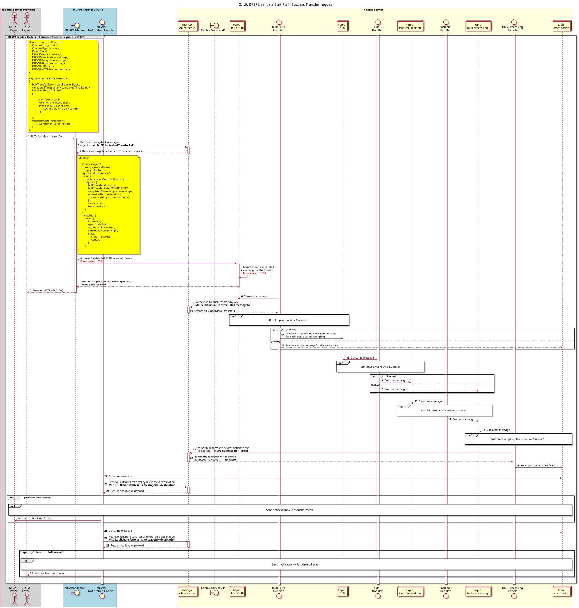

# Visão geral do pedido de transferência de processamento em massa

Diagrama de conceção da sequência para o pedido de transferência de processamento em massa

## Referências no diagrama de sequências

* [Processador de Execução em Lote: Consumo (Sucesso) (2.1.1)](2.1.1-bulk-fulfil-handler-consume.md)
* [Handler de cumprimento: Consumo (Sucesso) (2.2.1)](2.2.1-fulfil-commit-for-bulk.md)
* [Manipulador de Posição: Consumo (Sucesso) (2.3.1)](2.3.1-fulfil-position-handler-consume.md)
* [Processador de Processamento em Massa Consume (1.4.1)](1.4.1-bulk-processing-handler.md)
* [Enviar notificação ao participante (1.1.4.a)](1.1.4.a-send-notification-to-participant.md)

## Diagrama de sequência

