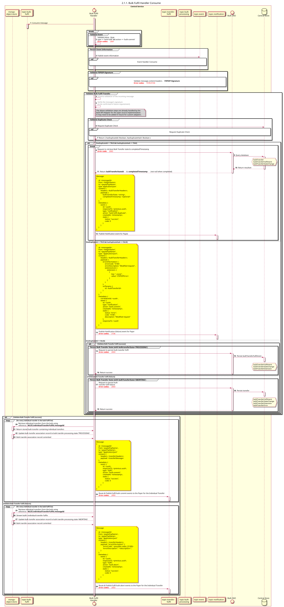

# Processamento em massa, Execução, Consumo

Diagrama de conceção da sequência para o processo «Consumo» do Gestor de Processamento em Massa

## Referências no diagrama de sequências

* [Manipulador de eventos Consume (9.1.0)](../../central-event-processor/9.1.0-event-handler-placeholder.md)
* [validação-da-assinatura-sequencial](../../central-event-processor/signature-validation.md)
* [Enviar notificação ao participante (1.1.4.a)](1.1.4.a-send-notification-to-participant.md)

## Diagrama de sequência

