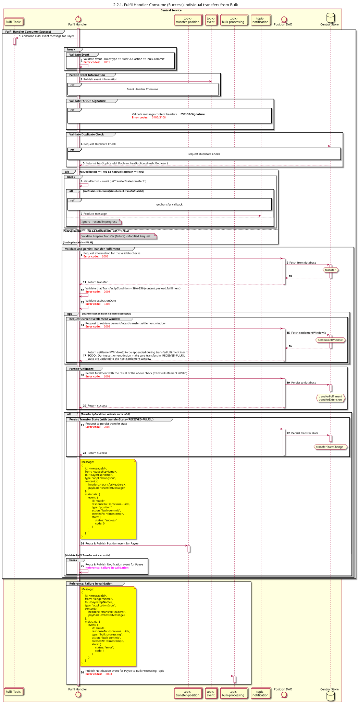

# O beneficiário envia um pedido de transferência em lote — o lote é dividido em transferências individuais

Diagrama de conceção da sequência para a Transferência de Processamento em Massa para a opção «Confirmar»

## Referências no diagrama de sequências

* [Manipulador de eventos Consume (9.1.0)](../../central-event-processor/9.1.0-event-handler-placeholder.md)

## Diagrama de sequência

