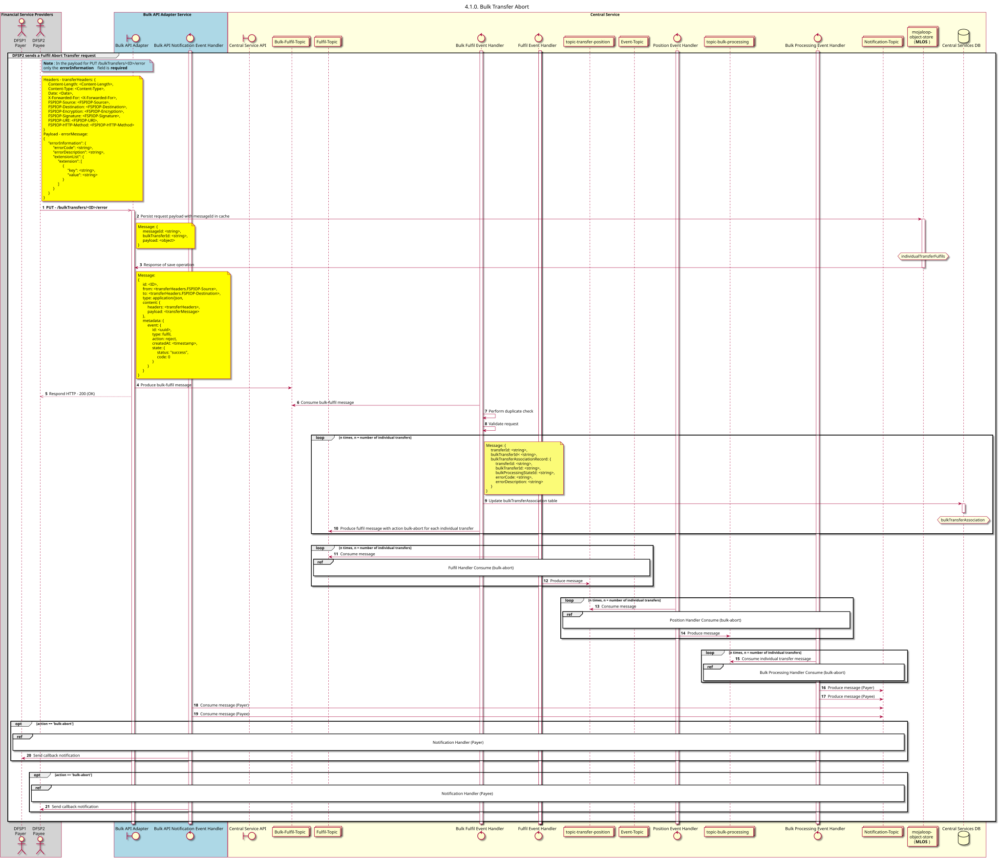

# Visão geral do cancelamento de transferências em massa [inclui transferências individuais numa transferência em massa]

Diagrama de conceção da sequência para o processo de Anulação da Transferência em Massa.

## Diagrama de sequência

