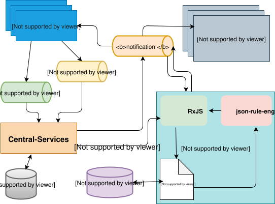

# Serviço do Processador Central de Eventos

O serviço Central Event Processor (CEP) permite monitorizar um conjunto pré-definido/configurado de regras ou padrões de negócio.

Na versão atual, as regras estão definidas para monitorizar três critérios:

  1. A ultrapassagem de um limiar relativo ao limite máximo de débito líquido (que pode ser definido no âmbito do processo de adesão),
  2. Ajustamento do limite — Limite máximo de débito líquido,
  3. Ajustar a posição com base numa liquidação.

O CEP pode, então, ser integrado a um serviço de notificação, para enviar notificações ou alertas. Neste caso, integra-se com o serviço de notificação por e-mail para enviar alertas com base nos critérios acima referidos.

