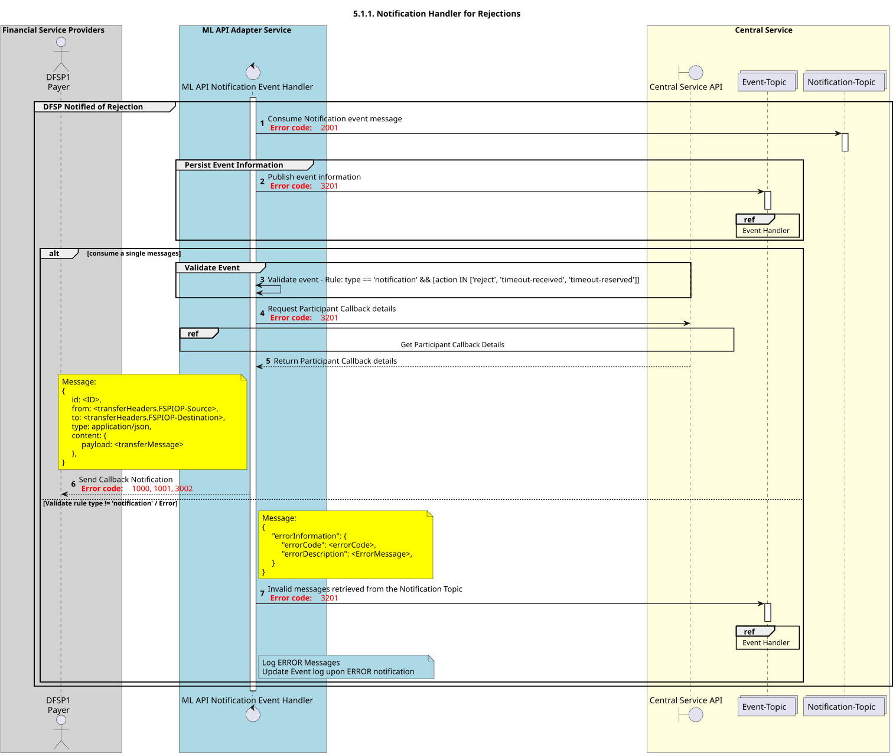

# Gestor de notificações para rejeições

Diagrama de conceção da sequência para o processo «Gestor de Notificações de Rejeições».

## Referências no diagrama de sequências

* [Manipulador de eventos Consume (9.1.0)](9.1.0-event-handler-placeholder.md)
* [Obter detalhes de callback do participante (3.1.0)](../central-ledger/admin-operations/3.1.0-post-participant-callback-details.md)

## Diagrama de sequência

