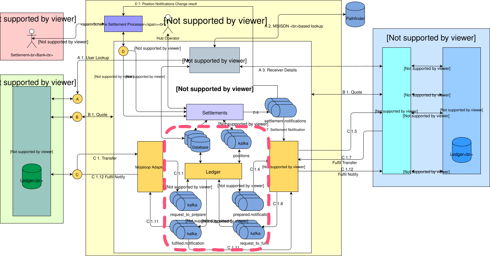
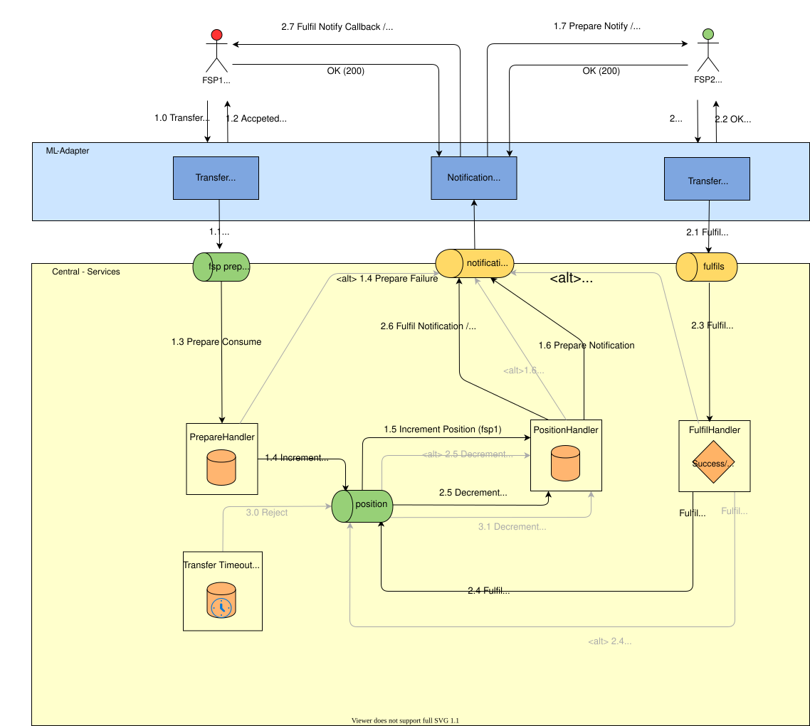
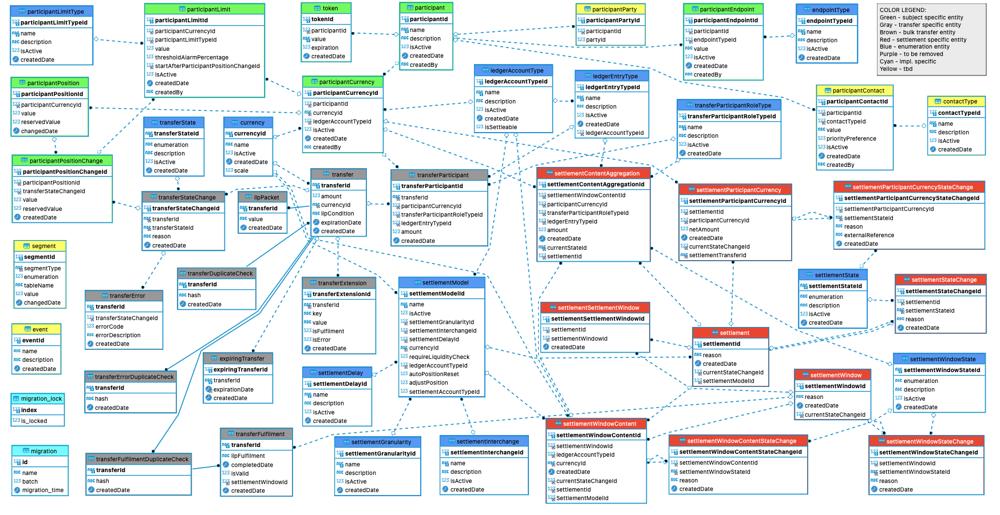

# Serviços do Central Ledger

O Central Ledger consiste numa série de serviços que facilitam a compensação e a liquidação de transferências entre os DFSP, incluindo as seguintes funções:

* Intermediação de mensagens em tempo real para a compensação de fundos
* Manutenção de posições líquidas para uma liquidação líquida diferida
* Atribuição de comissões ao nível do esquema e de comissões de transferência externa

## 1. Conceção do processo do Central Ledger

### 1.1 Visão geral da arquitetura

## 2. Arquitetura de transferências de ponta a ponta

### 2.1 Arquitetura de transferências de ponta a ponta para a v1.1

### 2.2 Arquitetura de transferências de ponta a ponta para a versão 1.0

## 3. Conceção de bases de dados

### Nota

As tabelas a cinzento dizem respeito especificamente ao processo de transferência. As tabelas a azul e a verde são utilizadas para fins de referência durante o processo de transferência.

Resumo das tabelas específicas do processo de transferência;

- `transfer` - armazena dados relacionados com a transferência;
- `transferDuplicateCheck` — utilizado para identificar duplicações durante o processo de pedidos de transferência;
- `transferError` — armazena informações sobre erros de transferência detetados durante o processo de transferência;
- `transferErrorDuplicateCheck` — utilizado para identificar erros de duplicação nos processos de transferência;
- `transferExtensions` - armazena informações sobre os dados da extensão de transferência;
- `transferFulfilment` — armazena dados relativos a transferências que concluíram o processo de preparação da transferência;
- `transferFulfilmentDuplicateCheck` — utilizado para identificar pedidos de execução de transferência duplicados;
- `transferParticipant` - informações sobre os participantes relacionadas com o processo de transferência;
- `transferStateChange` — utilizado para acompanhar as alterações de estado de cada transferência individual, criando um registo de auditoria para um pedido de transferência específico;
- `transferTimeout` - armazena informações sobre transferências que registaram uma exceção de tempo limite durante o processo;
- `ilpPacket` - armazena o pacote ILP para a transferência;

As tabelas restantes no ERD abaixo são tabelas de referência (azuis) ou específicas da liquidação (vermelhas) e estão incluídas como dependências diretas ou indiretas, a fim de ilustrar a relação entre as entidades específicas da transferência e as tabelas de transferência.

A definição do esquema da base de dados do **Central Ledger** [Definição do esquema da base de dados do Central Ledger](../../../../technical/technical/central-ledger/assets/database/central-ledger-ddl-MySQLWorkbench.sql).

## 4. Especificação API

Consulte o **Central Ledger API** na secção [API Specifications](../../../../technical/api/README.md#central-ledger-api).
