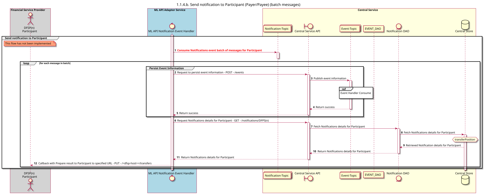

# Enviar notificação ao participante

Diagrama de conceção da sequência para o pedido «Enviar notificação ao participante».

## Referências no diagrama de sequências

* [9.1.0-gestor-de-eventos-consumir](../../central-event-processor/9.1.0-event-handler-placeholder.md)

## Diagrama de sequência

