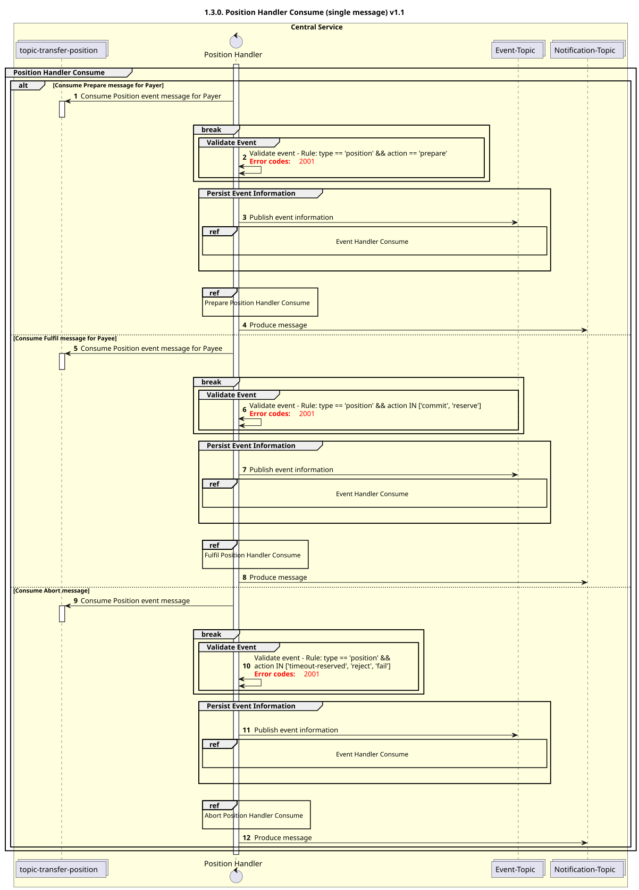

# Manipulador de Posição Consume v1.1

Diagrama de conceção de sequências para o processo «Consume» do «Position Handler».

## Referências no diagrama de sequências

* [Manipulador de eventos Consume (9.1.0)](../../central-event-processor/9.1.0-event-handler-placeholder.md)
* [Preparar o manipulador de posição «Consume» (1.3.1)](1.3.1-prepare-position-handler-consume.md)
* [Fufil Position Handler Consume (1.3.2)](1.3.2-fulfil-position-handler-consume-v1.1.md)
* [Manipulador de Abortação da Posição - Consumo (1.3.3)](1.3.3-abort-position-handler-consume.md)

## Diagrama de sequência

