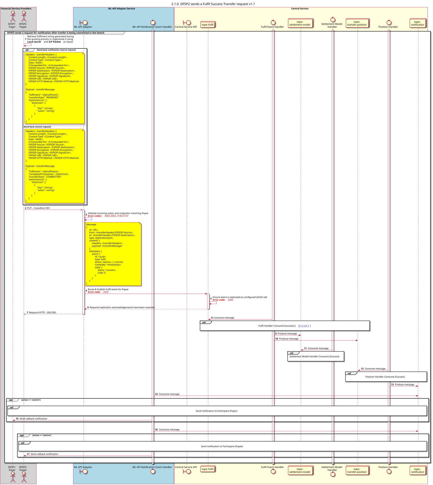

# Execução bem-sucedida do pedido de transferência v1.1

Diagrama de conceção da sequência para o pedido de transferência «Fulfil Success».

## Referências no diagrama de sequências

* [Handler de cumprimento: Consumo (Sucesso) (2.1.1)](2.1.1-fulfil-handler-consume-v1.1.md)
* [Manipulador de Posição - Consumo (Sucesso) (1.3.2)](1.3.2-fulfil-position-handler-consume-v1.1.md)
* [Enviar notificação ao participante (1.1.4.a)](1.1.4.a-send-notification-to-participant-v1.1-v1.1.md)

## Diagrama de sequência

