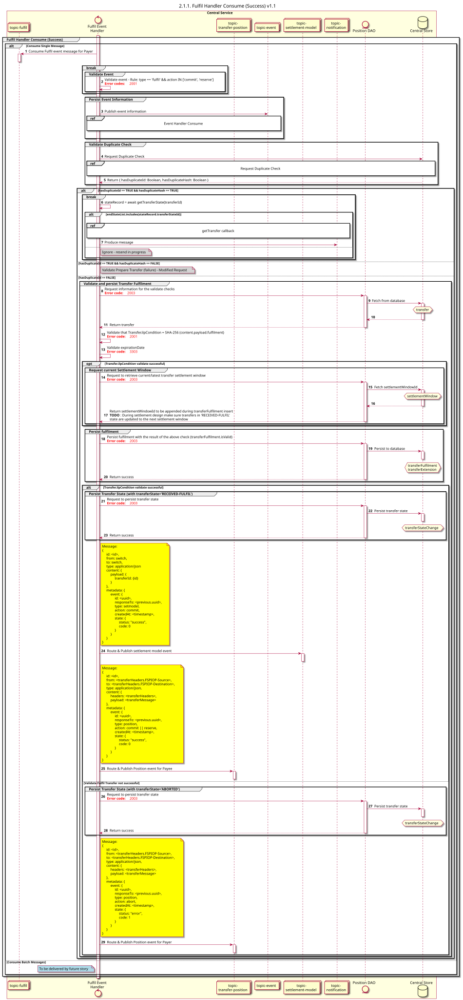

# Handler de Execução e Consumo (Sucesso) v1.1

Diagrama de conceção da sequência para o processo «Fulfil Handler Consume».

## Referências no diagrama de sequências

* [Manipulador de eventos Consume (9.1.0)](../../central-event-processor/9.1.0-event-handler-placeholder.md)
* [validação-da-assinatura-sequencial](../../central-event-processor/signature-validation.md)
* [Enviar notificação ao participante (1.1.4.a)](1.1.4.a-send-notification-to-participant-v1.1.md)

## Diagrama de sequência

