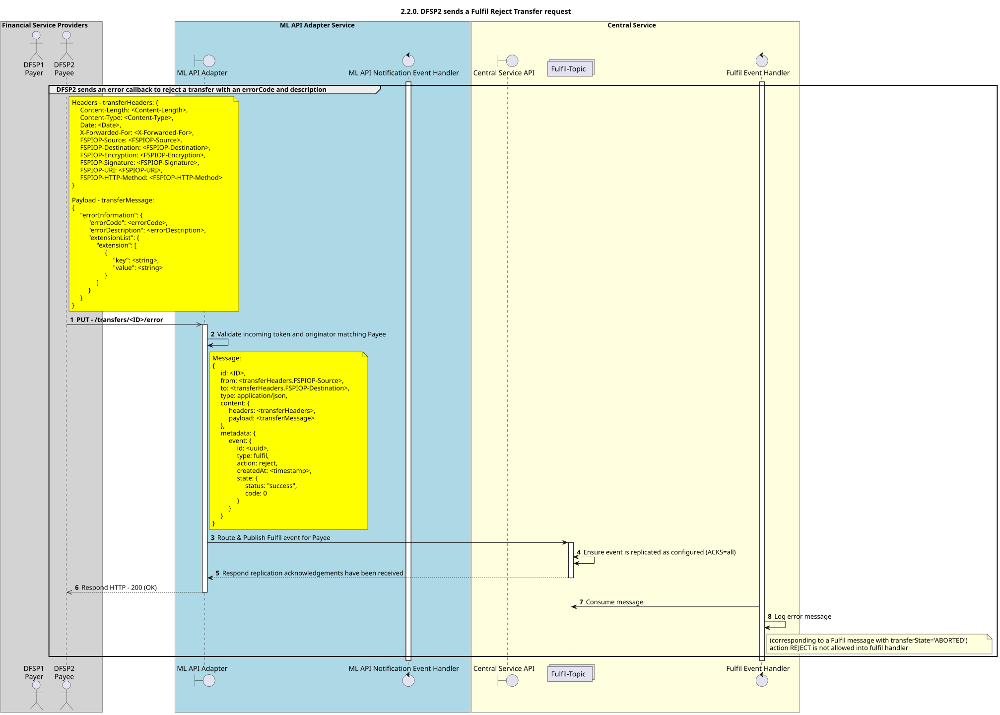

# O beneficiário envia um pedido de cancelamento de transferência (Fulfil Abort Transfer) v1.1

Diagrama de conceção da sequência para o processo «Atendimento, Rejeição e Transferência» da versão 1.1. do API.

## Diagrama de sequência

