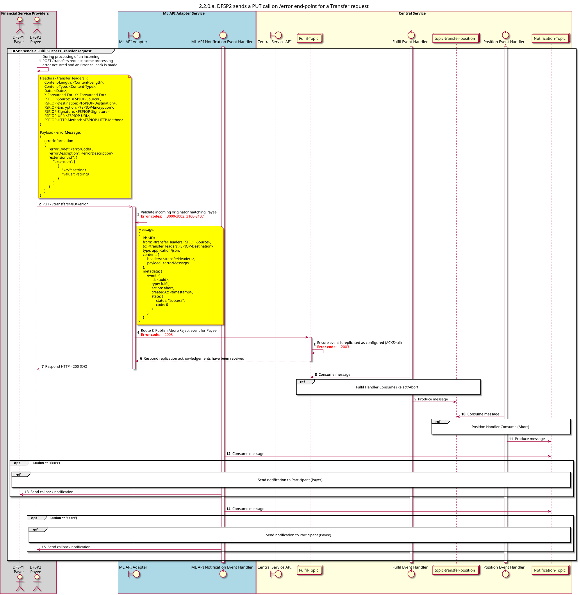

# O beneficiário envia uma chamada PUT para o ponto final /error relativamente a um pedido de transferência

Diagrama de conceção da sequência para o processo de «Atendimento, Rejeição e Transferência».

## Referências no diagrama de sequências

* [Executar o manipulador de consumo (Rejeitar/Interromper) (2.2.1)](2.2.1-fulfil-reject-handler.md)
* [Manipulador de Posição: Consumir (Rejeitar) (1.3.3)](1.3.3-abort-position-handler-consume.md)
* [Enviar notificação ao participante (1.1.4.a)](1.1.4.a-send-notification-to-participant.md)

## Diagrama de sequência

