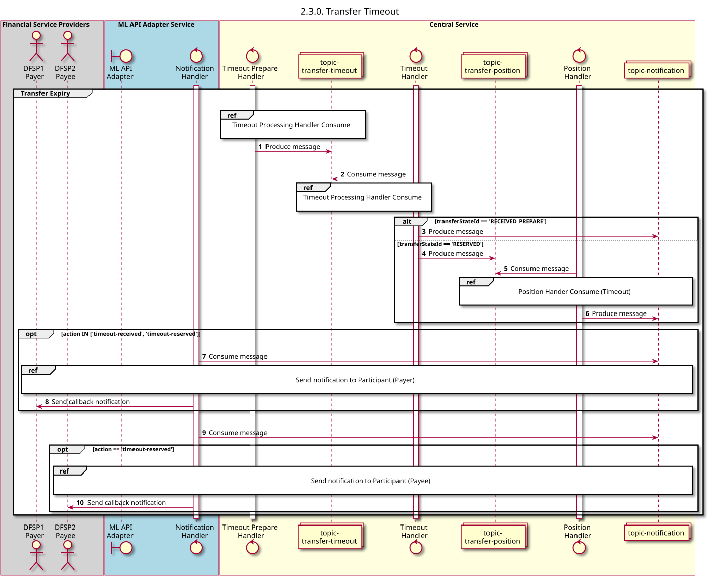

# Tempo limite de transferência

Diagrama de conceção da sequência para o processo «Tempo limite de transferência».

## Referências no diagrama de sequências

* [Manipulador de tempo limite: Consumo (2.3.1)](2.3.1-timeout-handler-consume.md)
* [Manipulador de Posição - Consumo (Tempo de espera) (1.3.3)](1.3.3-abort-position-handler-consume.md)
* [Enviar notificação ao participante (1.1.4.a)](1.1.4.a-send-notification-to-participant.md)

## Diagrama de sequência

