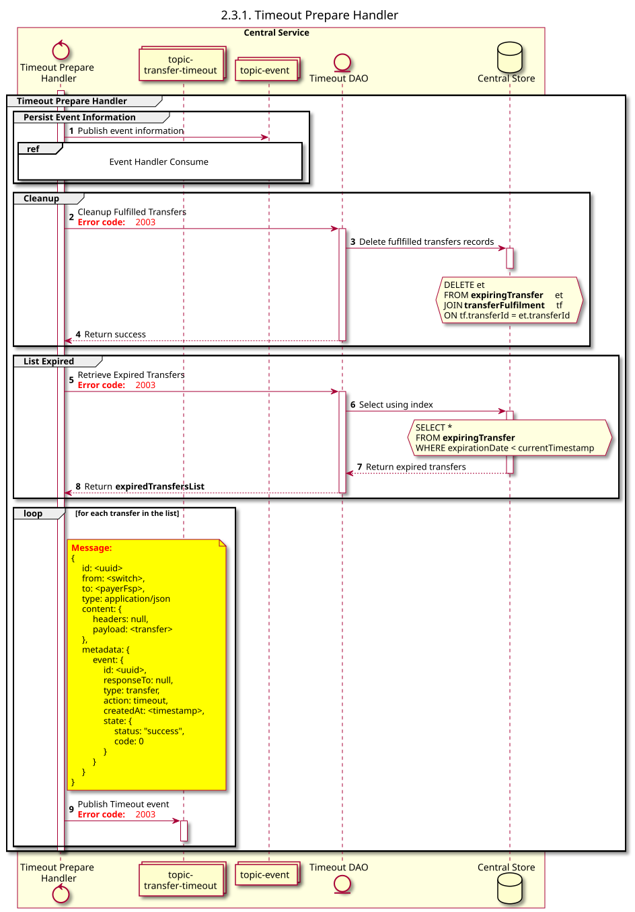

# Manipulador de tempo limite: Consumo

Diagrama de conceção da sequência para o processo «Timeout Handler Consume».

## Referências no diagrama de sequências

* [Manipulador de eventos Consume (9.1.0)](../../central-event-processor/9.1.0-event-handler-placeholder.md)

## Diagrama de sequência

