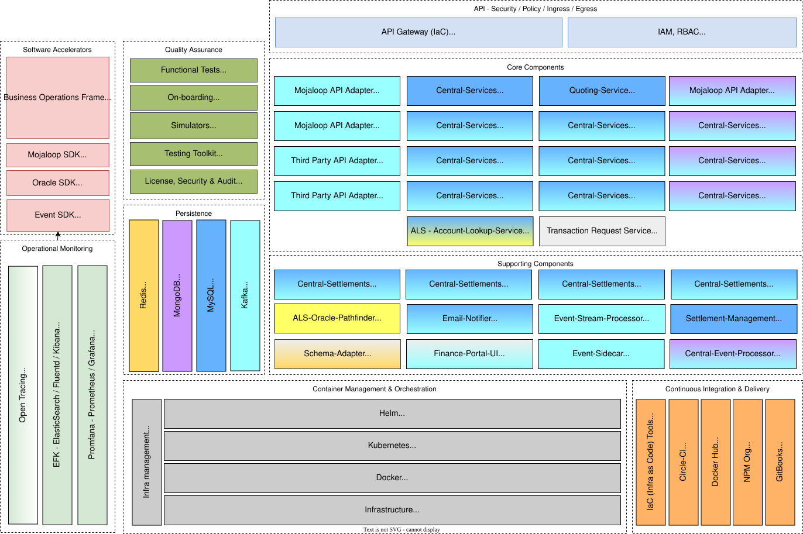

# Mojaloop Hub

Existem vários componentes que constituem o ecossistema Mojaloop. O hub Mojaloop é o principal recipiente e a referência que utilizamos para descrever os componentes centrais Mojaloop.  

O diagrama de componentes que se segue apresenta a composição dos serviços «Mojaloop» e a sua arquitetura de microsserviços:

_Nota: A codificação por cores indica a relação entre o armazenamento de dados e as ligações de transmissão de mensagens/adaptadores. Por exemplo, o `Central-Services` utiliza o `MySQL` como armazenamento de dados e recorre ao `Kafka` para a transmissão de mensagens_

Estes consistem em:

* Os **Mojaloop API Adapters** (**ML-API-Adapter**) fornecem o conjunto padrão de interfaces que um DFSP pode implementar para se ligar ao sistema para a realização de transferências. Um DFSP que pretenda ligar-se pode adaptar o nosso código de exemplo ou implementar as interfaces padrão no seu próprio software. O objetivo é que seja o mais simples possível para um «DFSP» ligar-se à rede interoperável.
* Os **Serviços Centrais** (**CS**) fornecem o conjunto de componentes necessários para transferir fundos de um DFSP para outro através dos Adaptadores Mojaloop API. Este processo é semelhante à forma como os fundos circulam através de um banco central ou de uma câmara de compensação nos países desenvolvidos. Os Serviços Centrais contêm a lógica central do Central Ledger para transferir fundos, mas serão também alargados de modo a proporcionar a gestão de fraudes e a garantir o cumprimento das regras do scheme.
* O **Serviço de Pesquisa de Contas** (**ALS**) disponibiliza um mecanismo para resolver informações de encaminhamento FSP através do Participante API ou para coordenar um pedido de uma Parte com base numa pesquisa interna de Participantes. A pesquisa interna de participantes é gerida por vários adaptadores ou serviços Oracle padrão. Um exemplo de adaptador/serviço Oracle seria a pesquisa de informações sobre participantes no Pathfinder ou num Registo de Comerciantes. Estes adaptadores ou serviços Oracle podem ser facilmente adicionados, dependendo dos requisitos do esquema.
* O **Serviço de Cotação** (**QA**) fornece a cotação, que é o processo que determina quaisquer taxas e comissões necessárias para a realização de uma transação financeira entre dois Prestadores de Serviços Financeiros (FSP). É sempre iniciado pelo Pagador FSP para o Beneficiário FSP, o que significa que a cotação segue o mesmo percurso que uma transação financeira.
* O **Simulador** (**SIM**) simula várias funções DFSP, da seguinte forma:
  * Pontos finais da Oracle para operações CRUD do Oracle Participante que utilizam cache em memória;
  * Critérios de avaliação dos participantes para Oracles que permitem partyIdTypes parametrizados;
  * Pontos finais das partes para os FSPs do pagador e do beneficiário, com as respetivas respostas de callback;
  * Pontos finais de transferência para os prestadores de serviços financeiros (FSP) do pagador e do beneficiário, com as respetivas respostas de callback; e
  * Consultar APIs para verificar transações (pedidos, respostas, callbacks, etc.) com vista a apoiar os testes e a verificação de controlo de qualidade.

Em ambos os lados do hub Mojaloop, encontram-se exemplos de código aberto que demonstram como um DFSP pode enviar e receber pagamentos, bem como o cliente que um DFSP já existente poderia alojar para se ligar à rede.
