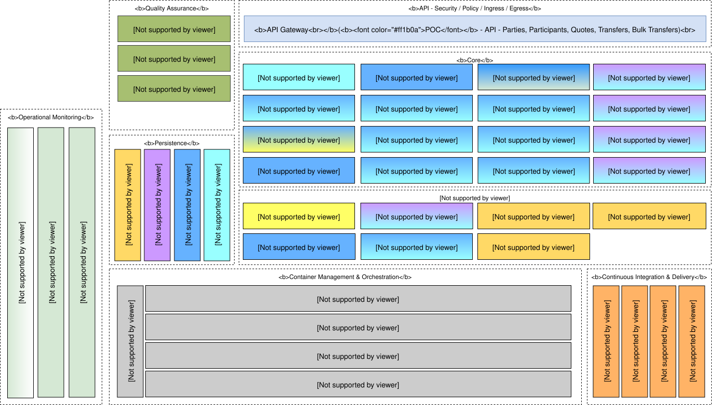

# Mojaloop Componentes antigos do Hub - PI6

O diagrama de componentes que se segue apresenta a composição dos serviços «Mojaloop» e a sua arquitetura de microsserviços para a fase pré-PI6: 

_Nota: A codificação por cores indica a relação entre o armazenamento de dados e as ligações de transmissão de mensagens/adaptadores. Por exemplo, o `Central-Services` utiliza o `MySQL` como armazenamento de dados e recorre ao `Kafka` para a transmissão de mensagens_
