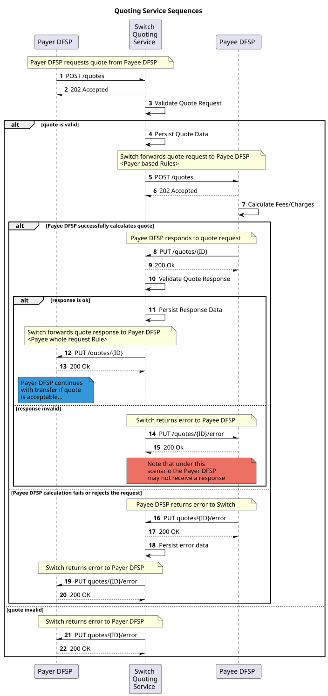

# Visão geral do serviço de cotações
O **Serviço de Cotação** (**QS**) _(ver secção `5.1`), de acordo com a [Mojaloop  {{ $page.frontmatter.version }} Specification](/technical/api/), implementa a fase de cotação dos vários casos de uso.

_Nota: Para além das cotações individuais, o serviço de cotação também permite a emissão de cotações em massa._

## Diagrama de sequência

## Citações individuais

- [GET: recuperar uma cotação pelo identificador](qs-get-quotes.md)
- [POST: cotação](qs-post-quotes.md)

## Cotações para grandes quantidades

- [GET: recuperar uma cotação em massa pelo identificador](qs-get-bulk-quotes.md)
- [PUBLICAÇÃO: pedido de cotação em massa](qs-post-bulk-quotes.md)
