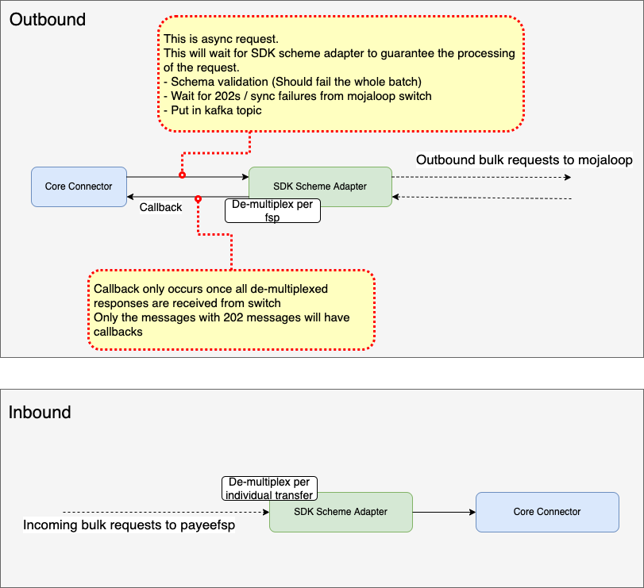
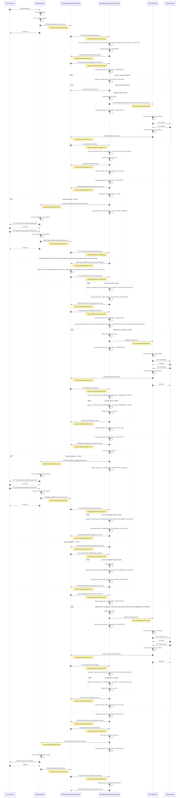
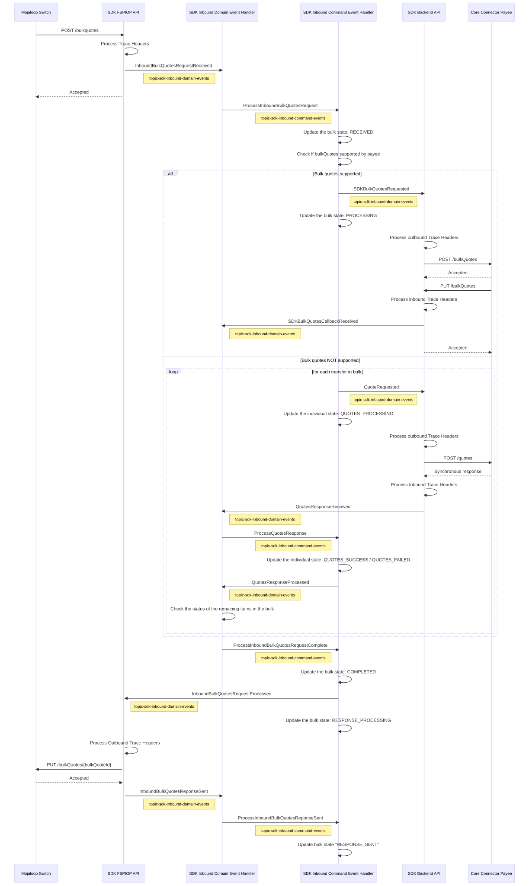
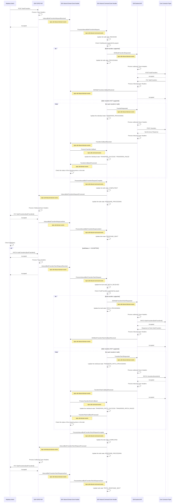

# SDK. Suporte a transferências em massa — Design de DDD e Event Sourcing
## Visão geral do projeto
Este diagrama apresenta uma visão geral do projeto «SDK».



Uma resposta HTTP 202 ao enviar um pedido assíncrono significa que o SDK aceitou o pedido e que este será processado, sendo posteriormente fornecida uma resposta. Devido aos potenciais atrasos prolongados envolvidos no processamento de um grande número de pagamentos em massa de forma assíncrona, foi necessária uma nova abordagem de conceção no SDK para satisfazer as expectativas associadas à resposta 202.

## DDD e a conceção do Event Sourcing
Foi optado por uma abordagem de Event Sourcing e Domain-Driven Design, uma vez que esta satisfaz todos os requisitos de fiabilidade e escalabilidade, ao mesmo tempo que tira partido das bibliotecas e ferramentas que foram desenvolvidas para a arquitetura Mojaloop vNext.

## Adaptador do scheme do Pagador em Massa DFSP
### Diagrama de sequência de Event Sourcing de saída


## Adaptador do esquema SDK do beneficiário DFSP
### Diagrama de sequência de «event sourcing» para cotações em massa recebidas


### Diagrama de sequência de «event sourcing» para transferências em massa de entrada



## Redis Mapeamento de dados da loja para transferência em massa de saída
### 1. Estados (globais e individuais)

#### Comando:
```
HSET <key> <attribute1> <value1>
```
#### Legenda:
```
outboundBulkTransaction_< bulkTransactionId >
```

#### Atributos:
- **bulkTransactionId**: bulkTransactionId
- **bulkHomeTransactionID**: ID da transação imobiliária
- **pedido**: {
  opções: Opções,
  extensionList: Lista de extensões em massa
}
- **individualItem_< transactionId >**: Serializar ({
  id: transactionId
  pedido: {}
  estado: Estado individual
  batchId: `<UUID>`
  partyRequest: {}
  quotesRequest: {}
  transfersRequest: {}
  partyResponse: {}
  quotesResponse: {}
  transfersResponse: {}
  lastError: {}
  acceptParty: bool
  acceptQuotes: bool
})
- **estado**: Estado global
  - RECEBIDO
  - PROCESSAMENTO_DE_DESCOBERTA
- **bulkBatch_< batchId >**: Serializar ({
  id: batchId
  estado: Estado individual
  - PROCESSAMENTO_DE_ACORDOS
  - PROCESSAMENTO_DE_TRANSFERÊNCIAS
  bulkQuoteId: `<UUID>`
  bulkTransferId: `<UUID>` (pode ser o batchId)
})
- **partyLookupTotalCount**: Número total de pedidos de pesquisa de partes
- **partyLookupSuccessCount**: Número total de pedidos de pesquisa de entidades que foram bem-sucedidos
- **partyLookupFailedCount**: Número total de pedidos de pesquisa de partes que falharam
- **bulkQuotesTotalCount**: Número total de pedidos de cotações em massa
- **bulkQuotesSuccessCount**: Número total de pedidos de cotações que foram bem-sucedidos
- **bulkQuotesFailedCount**: Número total de pedidos de cotação que falharam
- **bulkTransfersTotalCount**: Número total de pedidos de transferências em massa
- **bulkTransfersSuccessCount**: Número total de pedidos de transferências em massa que foram bem-sucedidos
- **bulkTransfersFailedCount**: Número total de pedidos de transferências em massa que falharam

::: tip Notas
- Kafka mensagens devem conter o bulkID.
- Para atualizar o estado global, utilize o comando `HSET bulkTransaction_< bulkTransactionId > state < stateValue >`
:::

### 2. Para associar callbacks individuais a itens em lote individuais

#### Comando:
```
HSET outboundBulkCorrelationMap <attribute1> <value1>
```

#### Atributos:
- partyLookup_`<id_type>`_`<id_value>`(_`<subid_type>`): "{ bulkTransactionId: `<bulkTransactionId>`, transactionId: `<transactionId>` }"
- bulkQuotes_`<bulkQuoteId>`: "{ bulkTransactionId: `<bulkTransactionId>`, batchId: `<batchId>` }"
- bulkTransfers_`<bulkTransferId>`: "{ bulkTransactionId: `<bulkTransactionId>`, batchId: `<batchId>`, bulkQuoteId: `<bulkQuoteId>` }"
- bulkHomeTransactionId_`<bulkHomeTransactionId>`: "{ bulkTransactionId: `<bulkTransactionId>` }"

::: tip Notas:
- Podemos utilizar o comando «`HKEYS`» para obter todos os IDs de transferência individuais em bloco, a fim de os processar iterativamente
:::

## Formato de mensagem Redis para transferência em massa de entrada
### 1. Cotações em massa
#### Comando:
```
HSET <key> <attribute1> <value1>
```
#### Legenda:
```
inboundBulkQuotes_< bulkQuotesId >
```

#### Atributos:
- **bulkQuotesId**: bulkQuotesId
- **individualItem_< quotesId >**: Serializar ({
  id: quotesId
  pedido: {}
  estado: Estado individual
  quotesRequest: {}
  quotesResponse: {}
  lastError: {}
})
- **estado**: Estado global
  - RECEBIDO
  - TRATAMENTO
- **bulkQuotesTotalCount**: Número total de pedidos de cotações em massa
- **bulkQuotesSuccessCount**: Número total de pedidos de cotações que foram bem-sucedidos
- **bulkQuotesFailedCount**: Número total de pedidos de cotação que falharam

::: tip Notas
- Kafkas mensagens devem conter o «bulkQuotesId».
- Para atualizar o estado global, utilize o comando `HSET bulkQuotes_< bulkQuotesId > state < stateValue >`
:::

### 2. Transferências em massa
#### Comando:
```
HSET <key> <attribute1> <value1>
```
#### Legenda:
```
inboundBulkTransfer_< bulkTransferId >
```

#### Atributos:
- **bulkTransferId**: bulkTransferId
- **individualItem_< transferId >**: Serializar ({
  id: transferId
  pedido: {}
  estado: Estado individual
  transfersRequest: {}
  transfersResponse: {}
  lastError: {}
})
- **estado**: Estado global
  - RECEBIDO
  - TRATAMENTO
- **bulkTransferTotalCount**: Número total de pedidos de transferências em massa
- **bulkTransferSuccessCount**: Número total de pedidos de transferência que foram bem-sucedidos
- **bulkTransferFailedCount**: Número total de pedidos de transferência que falharam

::: tip Notas
- Kafkas mensagens devem conter o «bulkTransferId».
- Para atualizar o estado global, utilize o comando `HSET bulkTransfer_< bulkTransferId > state < stateValue >`
:::

### 3. Para associar callbacks individuais a itens em lote individuais

#### Comando:
```
HSET inboundBulkCorrelationMap <attribute1> <value1>
```

#### Atributos:
- quotes_`<quoteId>`: "{ bulkQuoteId: `<bulkQuoteId>` }"
- transfers_`<transferId>`: "{ bulkTransferId: `<bulkTransferId>`, bulkQuoteId: `<bulkQuoteId>` }"

::: tip Notas:
- Podemos utilizar o comando «`HKEYS`» para obter todos os IDs de transferência individuais em bloco, a fim de os processar iterativamente
:::
