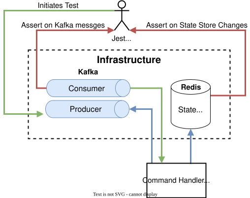
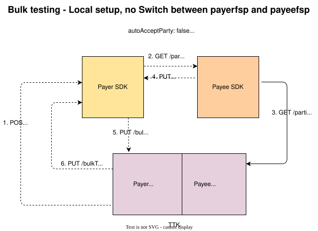

# SDK. Suporte a transferências em massa - Testes
## Estratégia de teste
A qualidade da solução entregue é tão boa quanto a qualidade dos testes e da estratégia de testes adotada. A natureza distribuída desta solução de event sourcing influenciou a estratégia de testes escolhida. Foram criados vários tipos de testes, cada um permitindo a complementação dos outros e concebidos para detetar erros o mais rapidamente possível.

O manipulador de eventos «Command» e o manipulador de eventos de domínio contam, ambos, com testes unitários e testes de integração restritos como base de testes. Os componentes «FSPIOP API» e «backend API» dispõem apenas de testes unitários.
Foi dada grande ênfase aos testes funcionais, que testaram os quatro componentes a funcionar em conjunto, tanto em cenários de percurso normal como em cenários de falha.

### Testes de integração restritos
Estes testes foram escritos a título de brincadeira e verificam, por exemplo, o estado atualizado do armazenamento e os eventos gerados com base num evento de comando.

**Estrutura de testes de integração do gestor de comandos**

### O conjunto de testes funcionais
O teste funcional recorre ao TTK, que simula os back-ends do pagador e do beneficiário DFSP. 

:::tip Nota
Este conjunto de testes verifica tanto o Pagador SDK como o Beneficiário SDK.
:::

:::tip Nota
Estes testes podem ser executados no monorepo local que foi descarregado, são executados no pipeline de CI e estão incluídos no Helm como testes do Helm utilizados para confirmar o deployment.
:::

## Matriz de testes de integração do pagador DFSP

| Casos de teste | C1 | C2 | C3 | C4 | C5 | C6 | C7 | C8 | C9 | C10 | C11 | C12 |
|---|---|---|---|---|---|---|---|---|---|---|---|---|
| INT D-1 |||| x |||||||||
| INT D-2 || x |||||||||||
| INT D-3 || x |||||||||||
| INT D-4 | x ||||||||||||
| INT D-5 ||| x ||||||||||
| INT D-6 ||| x ||||||||||
| INT A-1 |||||| x |||||||
| INT A-2 ||||| x ||||||||
| INT T-1 ||||||||||| x ||
| INT T-2 |||||||||| x |||
| INT T-3 ||||||||| x ||||
| INT T-4 ||||||||||| x ||
| INT T-5 ||||||| x ||||||
| INT T-6 |||||||||||| x |

## Matriz de testes funcionais do pagador DFSP

| Casos de teste | B1 | B2 | B3 | B4 | B5 | F1 | F2 | F3 | F4 | F5 | F6 | F7 | F8 | F9 | D1 | D2 | D3 | D4 | D5 | D6 | D7 | D8 | D9 | D10 | D11 | D12 | D13 | D14 | D15 | D16 | D17 | D18 | D19 | D20 | C1 | C2 | C3 | C4 | C5 | C6 | C7 | C8 | C9 | C10 | C11 | C12 |
|---|---|---|---|---|---|---|---|---|---|---|---|---|---|---|---|---|---|---|---|---|---|---|---|---|---|---|---|---|---|---|---|---|---|---|---|---|---|---|---|---|---|---|---|---|---|---|
| FUNC 1 | x | x | x | x | x | x | x || x | x || x | x || x | x | x | x | x | x | x | x | x | x | x | x | x ||| x | x | x | x | x | x | x | x | x | x | x | x || x | x | x | x 
| FUNC 2 | x | x |||| x || x ||||||| x | x | x | x | x |||||||||||||||| x | x | x |||||||||
| FUNC 3 | x | x |||| x || x ||||||| x | x | x | x | x |||||||||||||||| x | x | x |||||||||
| FUNC 4 | x | x |||| x || x ||||||| x | x | x | x | x |||||||||||||||| x | x | x |||||||||
| FUNC 5 | x | x |||| x || x ||||||| x | x | x | x | x |||||||||||||||| x | x | x |||||||||
| FUNC 6 | x | x |||| x || x ||||||| x | x | x | x | x |||||||||||||||| x | x | x |||||||||
| TC-BQ1 | x | x | x ||| x | x || x || x |||| x | x | x | x | x | x | x | x | x | x ||||||||||| x | x | x | x | x | x ||||| x | x 
| TC-BQ2 | x | x | x ||| x | x || x | x ||||| x | x | x | x | x | x | x | x | x | x ||||||||||| x | x | x | x | x | x ||||| x | x 
| TC-BQ3 | x | x | x ||| x | x || x | x ||||| x | x | x | x | x | x | x | x | x | x | x |||||||||| x | x | x | x | x | x ||||||
| TC-BQ4 | x | x | x ||| x | x || x | x ||||| x | x | x | x | x | x | x | x | x | x | x |||||||||| x | x | x | x | x | x ||||||
| TC-BQ5 | x | x | x ||| x | x || x | x ||||| x | x | x | x | x | x | x | x | x | x | x |||||||||| x | x | x | x | x | x ||||||
| TC-BQ6 | x | x | x ||| x | x || x | x ||||| x | x | x | x | x | x | x | x | x | x | x |||||||||| x | x | x | x | x | x ||||||
| TC-BQ7 | x | x | x ||| x | x || x | x ||||| x | x | x | x | x | x | x | x | x | x | x |||||||||| x | x | x | x | x | x ||||||
| TC-BQ8 | x | x | x ||| x | x || x | x ||||| x | x | x | x | x | x | x | x | x | x | x |||||||||| x | x | x | x | x | x ||||||
| TC-BQ9 | x | x | x ||| x | x || x | x | x |||| x | x | x | x | x | x | x | x | x | x | x |||||||||| x | x | x | x | x | x ||||||
| TC-BQ10 | x | x | x ||| x | x || x || x |||| x | x | x | x | x | x | x | x | x | x ||||||||||| x | x | x | x | x | x ||||| x | x |
| TC-BQ11 | x | x | x ||| x | x || x | x ||||| x | x | x | x | x | x | x | x | x | x | x |||||||||| x | x | x | x | x | x |||||||
| TC-BQ13 | x | x | x ||| x | x || x | x ||||| x | x | x | x | x | x | x | x | x | x | x |||||||||| x | x | x | x | x | x |||||||
| TC-BT1 | x | x | x | x | x | x | x || x | x || x || x | x | x | x | x | x | x | x | x | x | x | x | x | x ||| x | x |||| x | x | x | x | x | x | x || x | x | x | x |
| TC-BT2 | x | x | x | x | x | x | x || x | x || x || x | x | x | x | x | x | x | x | x | x | x | x | x | x ||| x | x |||| x | x | x | x | x | x | x || x | x | x | x |
| TC-BT3 | x | x | x | x | x | x | x || x | x | x | x || x | x | x | x | x | x | x | x | x | x | x | x | x | x ||| x | x |||| x | x | x | x | x | x | x || x | x | x | x |
| TC-BT4 | x | x | x | x | x | x | x || x | x | x | x || x | x | x | x | x | x | x | x | x | x | x | x | x | x ||| x | x |||| x | x | x | x | x | x | x || x | x | x | x |
| TC-BT5 | x | x | x | x | x | x | x || x | x || x || x | x | x | x | x | x | x | x | x | x | x | x | x | x ||| x | x |||| x | x | x | x | x | x | x || x | x | x | x |
| TC-BT6 | x | x | x | x | x | x | x || x | x || x || x | x | x | x | x | x | x | x | x | x | x | x | x | x ||| x | x |||| x | x | x | x | x | x | x || x | x | x | x |
| TC-BT7 | x | x | x | x | x | x | x || x | x || x || x | x | x | x | x | x | x | x | x | x | x | x | x | x ||| x | x |||| x | x | x | x | x | x | x || x | x | x | x |
| TC-BT8 | x | x | x | x | x | x | x || x | x || x || x | x | x | x | x | x | x | x | x | x | x | x | x | x ||| x | x |||| x | x | x | x | x | x | x || x | x | x | x |

## Referência às funcionalidades do pagador DFSP
|#|Funcionalidades de chamadas de saída|Detalhes|
|---|---|---|
|B1|Backend API|POST /bulkTransactions SDKBulkRequest|
|B2|Backend API|Event SDKOutboundBulkAcceptPartyInfoRequested|
|B3|Backend API|PUT /bulkTransactions/{bulkTransactionId} Aceitar Parte|
|B4|Backend API|PUT /bulkTransactions/{bulkTransactionId} Aceitar cotação|
|B5|Backend API|Resultados da chamada PUT /bulkTransactions/{bulkTransactionId}|
|F1|FSPIOP API|GET /parties|
|F2|FSPIOP API|PUT /parties/{Type}/{ID}|
|F3|FSPIOP API|PUT /parties/{Type}/{ID}/error|
|F4|FSPIOP API|POST /bulkQuotes|
|F5|FSPIOP API|PUT /bulkQuotes/{ID}|
|F6|FSPIOP API|PUT /bulkQuotes/{ID}/error|
|F7|FSPIOP API|POST /bulkTransfers|
|F8|FSPIOP API|PUT /bulkTransfers/{ID}|
|F9|FSPIOP API|PUT /bulkTransfers/{ID}/error|
|D1|Manipulador de eventos de domínio|SDKOutboundBulkRequestReceived|
|D2|Manipulador de eventos de domínio|SDKOutboundBulkPartyInfoRequested|
|D3|Manipulador de eventos de domínio|PartyInfoCallbackReceived|
|D4|Manipulador de eventos de domínio|PartyInfoCallbackProcessed|
|D5|Manipulador de eventos de domínio|SDKOutboundBulkPartyInfoRequestProcessed|
|D6|Manipulador de eventos de domínio|SDKOutboundBulkAcceptPartyInfoReceived|
|D7|Manipulador de eventos de domínio|SDKOutboundBulkAutoAcceptPartyInfoRequested|
|D8|Manipulador de eventos de domínio|SDKOutboundBulkAcceptPartyInfoProcessed|
|D9|Manipulador de eventos do domínio|BulkQuotesCallbackReceived|
|D10|Manipulador de eventos de domínio|BulkQuotesCallbackProcessed|
|D11|Manipulador de eventos de domínio|SDKOutboundBulkQuotesRequestProcessed|
|D12|Manipulador de eventos de domínio|SDKOutboundBulkAcceptQuoteReceived|
|D13|Manipulador de eventos de domínio|SDKOutboundBulkAcceptQuoteProcessed|
|D14|Manipulador de eventos de domínio|SDKOutboundBulkAutoAcceptQuoteRequested|
|D15|Manipulador de eventos de domínio|SDKOutboundBulkAutoAcceptQuoteProcessed|
|D16|Manipulador de eventos do domínio|BulkTransfersCallbackReceived|
|D17|Manipulador de eventos do domínio|BulkTransfersCallbackProcessed|
|D18|Manipulador de eventos de domínio|SDKOutboundBulkTransfersRequestProcessed|
|D19|Manipulador de eventos de domínio|SDKOutboundBulkResponseSent|
|D20|Gestor de eventos de domínio|SDKOutboundBulkResponseSentProcessed|
|C1|Manipulador de eventos de comando|ProcessSDKOutboundBulkRequest|
|C2|Manipulador de eventos de comando|ProcessSDKOutboundBulkPartyInfoRequest|
|C3|Manipulador de eventos de comando|ProcessPartyInfoCallback|
|C4|Manipulador de eventos de comando|ProcessSDKOutboundBulkAcceptPartyInfo|
|C5|Manipulador de eventos de comando|ProcessSDKOutboundBulkQuotesRequest|
|C6|Gestor de eventos de comando|ProcessBulkQuotesCallback|
|C7|Manipulador de eventos de comando|ProcessSDKOutboundBulkAcceptQuote|
|C8|Manipulador de eventos de comando|ProcessSDKOutboundBulkAutoAcceptQuote|
|C9|Manipulador de eventos de comando|ProcessSDKOutboundBulkTransfersRequest|
|C10|Manipulador de eventos de comando|ProcessBulkTransfersCallback|
|C11|Manipulador de eventos de comando|PrepareSDKOutboundBulkResponse|
|C12|Manipulador de eventos de comando|ProcessSDKOutboundBulkResponseSent|

## Referência aos casos de teste

| Grupo | # caso de teste | Tipo de teste | Estado | Detalhes |
|--- |--- |--- |--- |--- |
| **Discovery** - Testes de integração do Command Handler |||||
| (process_bulk_accept_party_info.test.ts) | INT D-1 | Integração | Passar | Quando for recebido o evento de comando de entrada «ProcessSDKOutboundBulkAcceptPartyInfo», a lógica deverá percorrer, em ciclo, cada transferência individual da solicitação em massa e atualizar o estado de cada transferência individual para «DISCOVERY_ACCEPTED» ou «DISCOVERY_REJECTED», com base no valor do evento recebido; além disso, deverá atualizar o estado global para «DISCOVERY_ACCEPTANCE_COMPLETED. Além disso, deve ser publicado o evento de saída «SDKOutboundBulkAcceptPartyInfoProcessed» |
| (process_bulk_party_info_request.test.ts) | INT D-2 | Integração | Passar | Dado que ainda não existem informações sobre as partes para nenhuma das transferências individuais. E a pesquisa de partes não for ignorada Quando for recebido o evento de comando de entrada ProcessSDKOutboundBulkPartyInfoRequest, o estado global deverá ser atualizado para DISCOVERY_PROCESSING e o evento Kafka PartyInfoRequested deverá ser publicado para cada transferência individual. Além disso, o estado de cada transferência individual deverá ser atualizado para DISCOVERY_PROCESSING |
| (process_bulk_party_info_request.test.ts) | INT D-3 | Integração | Passar | Existem informações sobre a parte para transferências individuais. E a pesquisa de partes não for ignorada quando for recebido o evento de comando de entrada ProcessSDKOutboundBulkPartyInfoRequest, então o estado global deve ser atualizado para DISCOVERY_PROCESSING. Além disso, o evento de saída PartyInfoRequested não deve ser publicado para cada transferência individual. E o estado de cada transferência individual deve ser atualizado para RECEIVED. |
| (process_bulk_request.test.ts) | INT D-4 | Integração | Passar | Quando for recebido o evento de comando de entrada «ProcessSDKOutboundBulkRequest», deve ser publicado o evento de saída «SDKOutboundBulkPartyInfoRequested» e o estado global deve ser atualizado para «RECEIVED». |
| (process_party_info_callback.test.ts) | INT D-5 | Integração | Passar | Dado que as informações do destinatário não existem e que a pesquisa do destinatário foi bem-sucedida, quando for recebido o evento de comando de entrada «ProcessPartyInfoCallback», o estado das pesquisas individuais bem-sucedidas do destinatário deve ser atualizado para «DISCOVERY_SUCCESS» e os dados no Redis relativos à transferência individual devem ser atualizados com as informações do destinatário recebidas. Além disso, o evento de saída «PartyInfoCallbackProcessed» deve ser publicado; e, caso todas as pesquisas estejam incompletas, o evento de saída «ProcessSDKOutboundBulkPartyInfoRequestProcessed» não deve ser publicado; e também não deve ser publicado o evento de saída «SDKOutboundBulkAutoAcceptPartyInfoRequested/SDKOutboundBulkAutoAcceptPartyInfoRequested» |
| (process_party_info_callback.test.ts) | INT D-6 | Integração | Passar | Dado que as informações do destinatário não existem e que a pesquisa do destinatário foi bem-sucedida, quando for recebido o evento de comando de entrada «ProcessPartyInfoCallback», o estado das pesquisas individuais bem-sucedidas do destinatário deve ser atualizado para «DISCOVERY_SUCCESS» e os dados no Redis relativos à transferência individual devem ser atualizados com as informações do destinatário recebidas. Além disso, o evento de saída «PartyInfoCallbackProcessed» deve ser publicado. E, caso todas as pesquisas estejam concluídas, o evento de saída «ProcessSDKOutboundBulkPartyInfoRequestProcessed» deve ser publicado. E, caso a aceitação automática do destinatário seja falsa, o evento de saída «SDKOutboundBulkAcceptPartyInfoRequested» deve ser publicado. |
| **Acordo** - Testes de integração do gestor de comandos |||||
| (process_bulk_quotes_callback.test.ts) | INT A-1 | Integração | Passar | Dada a BulkTransaction com as opções { synchronous: false, onlyValidateParty: true, skipPartyLookup: false, autoAcceptParty: false, autoAcceptQuote: false } E a callback para o lote de cotações foi bem-sucedida E a callback apresentou uma combinação de respostas bem-sucedidas e falhadas para cotações individuais Quando foi recebido o evento de comando de entrada ProcessBulkQuotesCallback, a lógica deverá atualizar o estado individual do lote para AGREEMENT_COMPLETED ou AGREEMENT_FAILED, e, para cada transferência individual no lote, o estado poderá ser AGREEMENT_SUCCESS ou AGREEMENT_FAILED, conforme o caso. Além disso, os dados individuais das cotações no Redis devem ser atualizados com a resposta. O estado global da BulkTransaction deve ser AGREEMENT_ACCEPTANCE_PENDING. Deve ser publicado o evento de domínio BulkQuotesCallbackProcessed. E o evento de domínio SDKOutboundBulkQuotesRequestProcessed deve ser publicado |
| (process_bulk_quotes_callback.test.ts) | INT A-2 | Integração | Passar | Quando o evento de comando de entrada «ProcessSDKOutboundBulkQuotesRequest» é destinado ao destinatário, a lógica deverá atualizar o estado global para «AGREEMENT_PROCESSING», e criar lotes com base no valor FSP, que se encontrem no estado «DISCOVERY_ACCEPTED» e que tenham a configuração «maxEntryConfigPerBatch» definida; e publicar «BulkQuotesRequested» para cada lote; e atualizar o estado de cada lote para «AGREEMENT_PROCESSING». |
| **Transferências** - Testes de integração do Command Handler |||||
| (prepare_sdk_outbound_bulk_response.test.ts) | INT T-1 | Integração | Passar | Tendo em conta a BulkTransaction com as seguintes opções: { synchronous: false, onlyValidateParty: true, skipPartyLookup: false, autoAcceptParty: false, autoAcceptQuote: false } Quando for recebido o evento de comando de entrada PrepareSDKOutboundBulkResponseCmdEvt, o SDKOutboundBulkResponsePreparedDmEvt deverá ser publicado para cada lote de transferência e o estado global da transação em massa deverá ser atualizado para RESPONSE_PROCESSING |
| (process_bulk_transfers_callback.test.ts) | INT T-2 | Integração | Passar | Dada a BulkTransaction com as opções { synchronous: false, onlyValidateParty: true, skipPartyLookup: false, autoAcceptParty: false, autoAcceptQuote: false } Quando for recebido o evento de comando de entrada ProcessBulkTransfersCallbackCmdEvt, o estado do lote de transferências deverá ser atualizado para TRANSFERS_COMPLETED. Os estados das cotações com falha deverão permanecer em AGREEMENT_FAILED. Além disso, a lógica deverá percorrer, em ciclo, cada transferência individual do lote e atualizar o estado para TRANSFER_SUCCESS ou TRANSFER_FAILED. Além disso, o evento de domínio `BulkTransferProcessedDmEvt` deve ser publicado para cada lote de transferências. Deve ser publicado o evento de domínio `BulkQuotesCallbackProcessed`. Deve ser publicado o evento de domínio `SDKOutboundBulkQuotesRequestProcessed`. Deve ser publicado o evento de domínio `SDKOutboundBulkAutoAcceptQuoteProcessedDmEvt`. E o evento de domínio «BulkTransfersRequestedDmEvt» deve ser publicado; e o evento de domínio «BulkTransfersCallbackProcessed» deve ser publicado; e o evento de domínio «SDKOutboundBulkTransfersRequestProcessed» deve ser publicado |
| (process_bulk_transfers_request.test.ts) | INT T-3 | Integração | Passar | Dada a BulkTransaction com as opções { synchronous: false, onlyValidateParty: true, skipPartyLookup: false, autoAcceptParty: false, autoAcceptQuote: false } E a callback para o lote de cotações foi bem-sucedida E a callback apresentou uma combinação de respostas bem-sucedidas e falhadas para cotações individuais Quando o evento de comando de entrada ProcessSDKOutboundBulkTransfersRequestCmdEvt foi recebido, o estado global da transação em massa deverá ser atualizado para TRANSFERS_PROCESSING E o estado individual do lote deverá ser igual a TRANSFERS_PROCESSING ou TRANSFERS_FAILED, e para cada transferência individual no lote, o estado deve ser AGREEMENT_ACCEPTED ou AGREEMENT_REJECTED, dependendo de acceptQuotes = TRUE/FALSE, e, para cada transferência individual no estado AGREEMENT_FAILED, este não deve ser alterado, E os dados individuais das cotações no Redis devem ser atualizados com a resposta; e o evento de domínio «BulkQuotesCallbackProcessed» deve ser publicado; e o evento de domínio «SDKOutboundBulkQuotesRequestProcessed» deve ser publicado; e o evento de domínio «SDKOutboundBulkAutoAcceptQuoteProcessedDmEvt» deve ser publicado; e o evento de domínio «BulkTransfersRequested»DmEvt deve ser publicado |
| (process_prepare_bulk_response.test.ts) | INT T-4 | Integração | Passar | Quando o evento de comando de entrada «PrepareSDKOutboundBulkResponseCmdEvt» é recebido, deve ser publicado o evento «SDKOutboundBulkResponsePreparedDmEvnt» |
| (process_sdk_outbound_bulk_accept_quote.test.ts) | INT T-5 | Integração | Passar | Dada a BulkTransaction com as opções { synchronous: false, onlyValidateParty: true, skipPartyLookup: false, autoAcceptParty: false, autoAcceptQuote: false } E a callback para o lote de cotações foi bem-sucedida E a callback apresentou uma combinação de respostas bem-sucedidas e falhadas para cotações individuais Quando o evento de comando de entrada ProcessSDKOutboundBulkAcceptQuote foi recebido, o estado global da transação em massa deverá ser atualizado para AGREEMENT_ACCEPTANCE_COMPLETED E o estado individual do lote deverá ser igual a AGREEMENT_COMPLETED ou AGREEMENT_FAILED, e, para cada transferência individual no lote, o estado AGREEMENT_ACCEPTED ou AGREEMENT_REJECTED, dependendo de acceptQuotes = TRUE/FALSE, e os dados individuais da cotação no Redis devem ser atualizados com a resposta; o evento de domínio «BulkQuotesCallbackProcessed» deve ser publicado; o evento de domínio «SDKOutboundBulkQuotesRequestProcessed» deve ser publicado; o evento de domínio «SDKOutboundBulkAutoAcceptQuoteProcessedDmEvt» deve ser publicado; e o evento de domínio «BulkTransfersRequested»DmEvt deve ser publicado |
| (process_sdk_outbound_bulk_response_sent.test.ts)# | INT T-6 | Integração | Passar | Tendo em conta a BulkTransaction com as seguintes opções: { synchronous: false, onlyValidateParty: true, skipPartyLookup: false, autoAcceptParty: false, autoAcceptQuote: false } Quando for recebido o evento de comando de entrada ProcessSDKOutboundBulkResponseSentCmdEvt, e o evento SDKOutboundBulkResponseSentProcessedDmEvt deve ser publicado para cada lote de transferência, e o estado global da transação em massa deve ser atualizado para RESPONSE_SENT |
| **Percurso normal:** (bulk-happy-path.json) |||||
| - 1 transferência com as opções «acceptParty» e «acceptQuote» definidas como «true» |||||
|| TC-BHP1 | Funcional | Passar | 4 transferências para 2 dfsps, com as propriedades «acceptParty» e «acceptQuote» definidas como «true» |
|| TC-BHP2 | Validação | Passar | Transação em massa com um erro de formatação |
| **Erros relacionados com as partes:** (bulk-parties-error-cases.json) |||||
| - 1 transferência no pedido |||||
|| TC-BP1 | Funcional | Passar | O destinatário envia uma mensagem de erro devido à resposta da outra parte |
|| TC-BP2 | Funcional | Passar | Tempo limite do destinatário |
|| TC-BP3 | Funcional | Passar | skipPartyLookup é falso e as informações do destinatário estão presentes no pedido. |
| - 2 transferências no pedido |||||
|| TC-BP4 | Funcional | Passar | O destinatário envia uma resposta de erro relativamente a uma das transferências |
|| TC-BP5 | Funcional | Passar | O destinatário excede o tempo limite ao enviar a resposta para uma das transferências |
|| TC-BP6 | Funcional | Passar | Não recebo qualquer resposta do destinatário relativamente a ambas as transferências |
| **Erros de cotações:** (bulk-quotes-error-cases.json) |||||
| - 2 transferências com o mesmo ID de destinatário FSP |||||
| - «acceptParty» para todas as transferências |||||
|| TC-BQ1 | Funcional | Passar | O erro «fsp» do destinatário faz com que todo o lote seja rejeitado |
|| TC-BQ2 | Funcional | Passar | O destinatário FSP provoca o tempo limite de espera de todo o lote |
|| TC-BQ3 | Funcional | Passar | O destinatário fsp envia apenas uma resposta e ignora a outra |
|| TC-BQ4 | Funcional | Fora do âmbito do MVP | O destinatário fsp envia uma resposta de sucesso e uma resposta de falha (Não implementado - Problema 3015) |
| - acceptParty variável |||||
|| TC-BQ5 | Funcional | Passar | Uma verdadeira, uma falsa |
|| TC-BQ6 | Funcional | Fora do âmbito do MVP | Aceitar «parte» como falso para todas as respostas — Nesse caso, apenas serão apresentados os dados da parte, sem cotação; o estado final será «CONCLUÍDO» (Não implementado — Problema 3015) |
|| TC-BQ7 | Funcional | Fora do âmbito do MVP | O valor «True» é enviado apenas para uma cotação no parâmetro «acceptParty» da chamada PUT /bulkTxn, ignorando a segunda (Não implementado — Problema 3015) |
|| TC-BQ8 | Funcional | Fora do âmbito do MVP | O valor «false» é enviado apenas para uma cotação no método PUT /bulkTxn acceptParty, ignorando a segunda — (Não implementado — Problema 3015) |
| - 2 transferências com IDs de destinatário FSP diferentes - «acceptParty» para todas as transferências |||||
|| TC-BQ9 | Funcional | Passar | Um lote apresenta um erro |
|| TC-BQ10 | Funcional | Passar | Ambos os lotes apresentam erros |
|| TC-BQ11 | Funcional | Passar | Um lote atingiu o tempo limite |
| - 3 transferências, sendo que 2 delas têm um ID de destinatário FSP e a outra tem um ID diferente |||||
|| TC-BQ12 | Funcional | Fora do âmbito do MVP | - O lote com 2 transferências envia apenas 1 resposta de transferência e o outro lote envia a resposta de sucesso (Não implementado — problema 3015) |
|| TC-BQ13 | Funcional | Fora do âmbito do MVP | Erro no switch devido a uma moeda não permitida - (problema - |
| **Erros de transferência:** (bulk-transfer-errors.json) |||||
| - Uma transferência em massa com 2 transferências |||||
| - acceptQuote para todas as transferências |||||
|| TC-BT1 | Funcional | Passar | O destinatário rejeita todo o lote |
|| TC-BT2 | Funcional | Passar | O tempo de espera do destinatário expira para todo o lote |
|| TC-BT3 | Funcional | Fora do âmbito do MVP | O destinatário fsp envia apenas uma resposta e ignora a outra (Não implementado - Problema 3015) |
|| TC-BT4 | Funcional | Falhas intermitentes | O destinatário fsp envia uma resposta de sucesso e uma de falha  - (Problema: 3019) |
| - acceptQuote variável |||||
|| TC-BT5 | Funcional | Fora do âmbito do MVP | Um verdadeiro, um falso - TC2 - Erro 2958 |
|| TC-BT6 | Funcional | Fora do âmbito do MVP | Aceitar cotação - Tudo incorreto (Não implementado - Problema 3015) |
|| TC-BT7 | Funcional | Fora do âmbito do MVP | O valor «True» é enviado apenas para uma transferência no parâmetro «acceptParty» da chamada PUT /bulkTxn, ignorando a segunda — (Não implementado — Problema 3015) |
|| TC-BT8 | Funcional | Fora do âmbito do MVP | O valor «false» é enviado apenas para uma transferência no parâmetro «acceptParty» da requisição PUT /bulkTxn, ignorando a segunda — (Não implementado — Problema 3015) |

