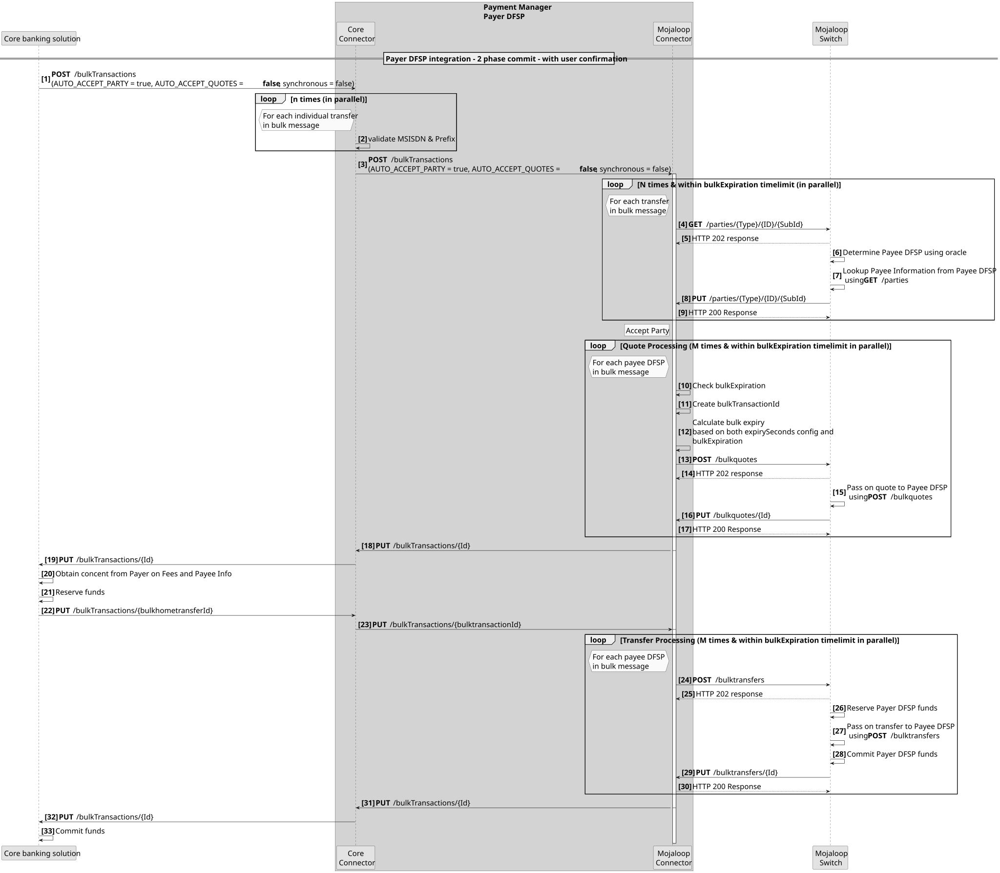
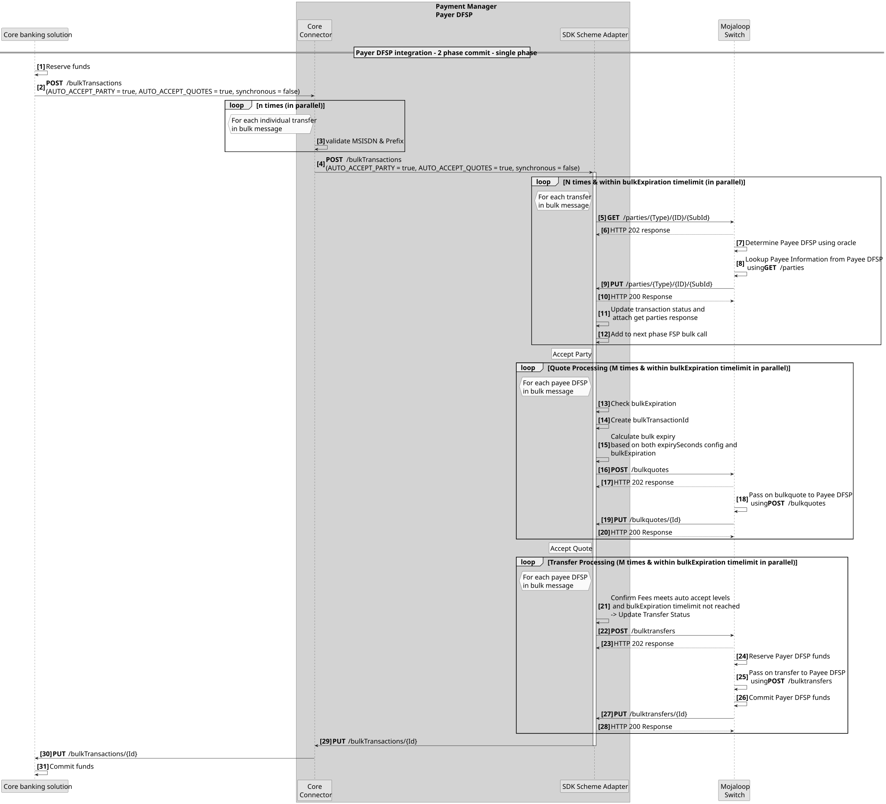
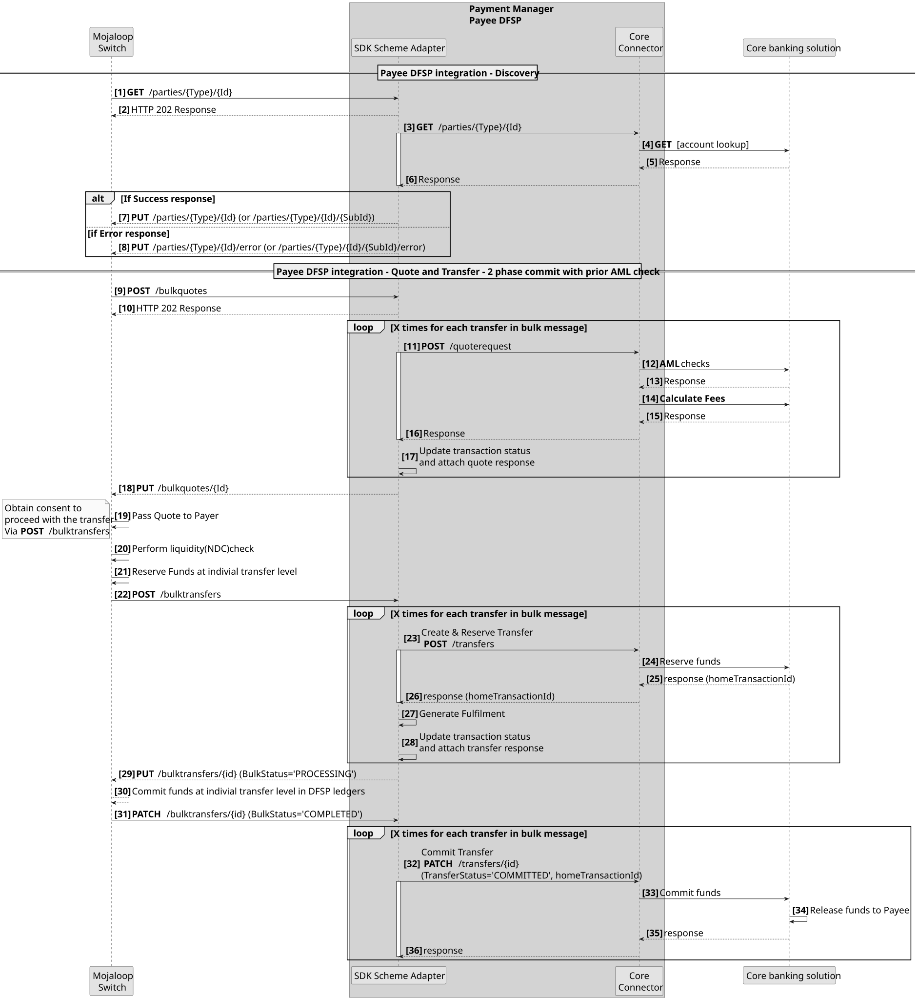
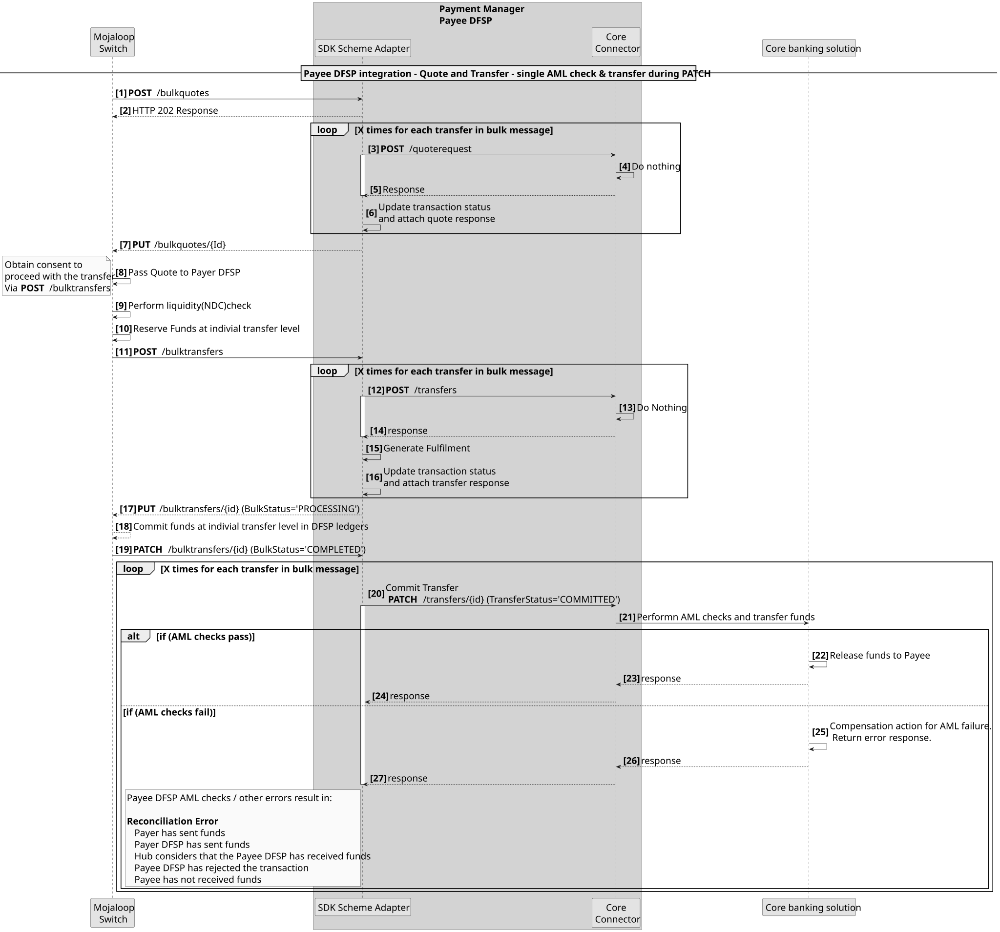

# Integração de sistemas bancários centrais através de transferências em massa
Existem três modelos que podem ser utilizados na criação das integrações do pagador DFSP para transferências em massa.
1. Integração da transferência **em três fases**. Isto está em consonância com as trêsMojaloop fases da transação: Descoberta, Acordo e Transferência.
1. **Integração «Double API»**. Este padrão é descrito em pormenor no diagrama de sequência abaixo. Implica a combinação das fases de Descoberta e Acordo; na primeira fase, os resultados são apresentados ao Pagador para confirmação; em seguida, a fase de Transferência é executada como segunda fase.

1. **Integração «API» Única**. Este padrão é descrito em pormenor no diagrama de sequência abaixo. Aqui, as três fases são combinadas para produzir uma única chamada de transferência síncrona.

::: tip Confirmação em duas fases
Todos os padrões de integração do Payer DFSP permitem uma confirmação em duas fases (fase de reserva e fase de confirmação).
:::

## Requisitos relativos ao beneficiário DFSP
As atualizações do Adaptador do Esquema SDK garantirão que os DFSP que tenham integrado o Mojaloop não tenham de efetuar qualquer alteração para poderem suportar a receção de transferências em massa. Ou seja, o adaptador do esquema SDK receberá mensagens de transferência em massa e convertê-las-á em mensagens de transferência individuais.
Caso um Beneficiário DFSP pretenda tirar partido da mensagem de transferência em massa, a integração para mensagens em massa pode ser implementada sempre que tal se justifique para cada Beneficiário DFSP.

## Modelo de fluxo ideal para a integração de beneficiários

Neste caso, as verificações AML e as comissões são calculadas na fase de acordo, e a fase de transferência é realizada em duas etapas, nomeadamente uma fase de reserva e uma fase de confirmação.

## O fornecedor API permite apenas uma chamada «API»
Se os sistemas bancários centrais permitirem apenas uma única chamada «API» para realizar todas as verificações e fases relacionadas com a transferência. Este é o padrão mais comummente permitido.
### Transferência de chamada na notificação de ligação

Uma falha a qualquer momento após a notificação PATCH **[Passo 19]** resultará num erro de reconciliação. Esta situação pode ser contornada através da implementação de métodos de compensação. Por exemplo, iniciar uma transferência de reembolso caso ocorra um erro após o passo 19.
