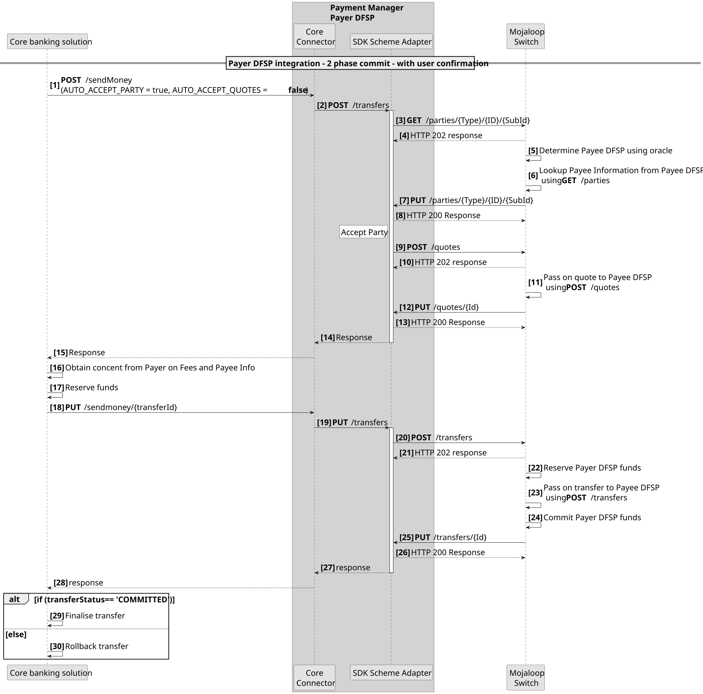
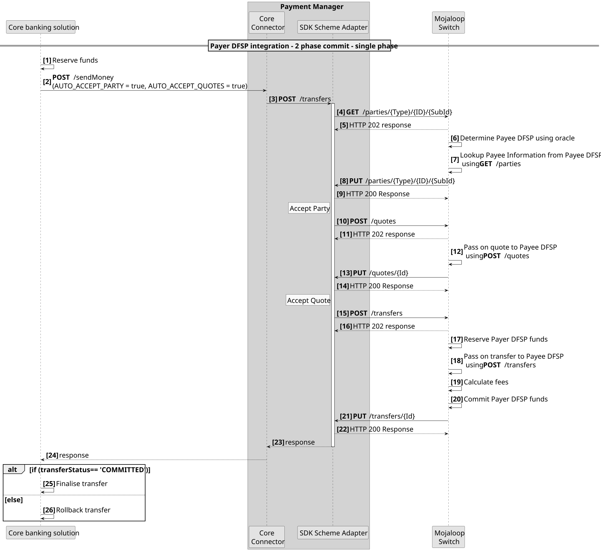
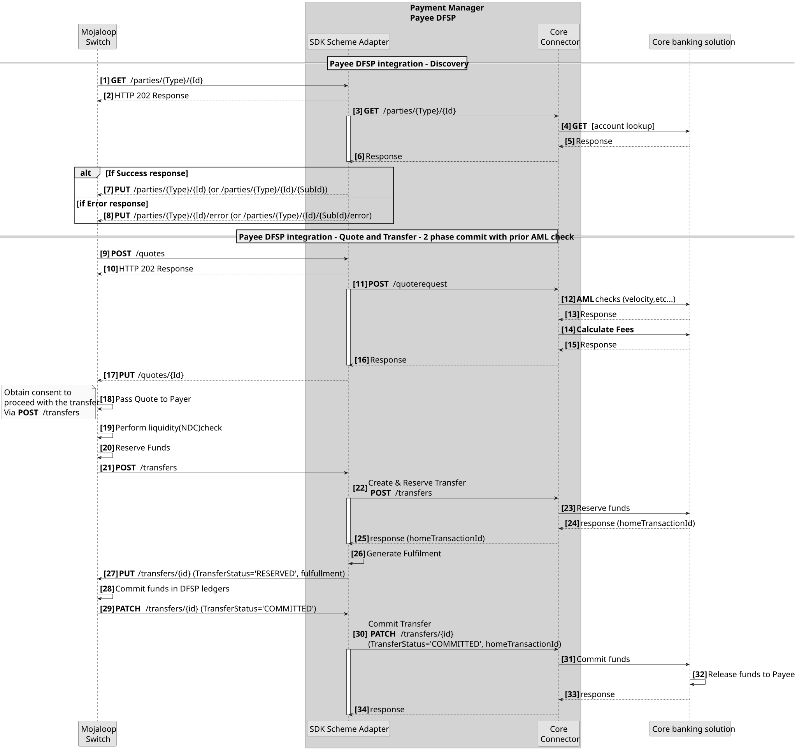
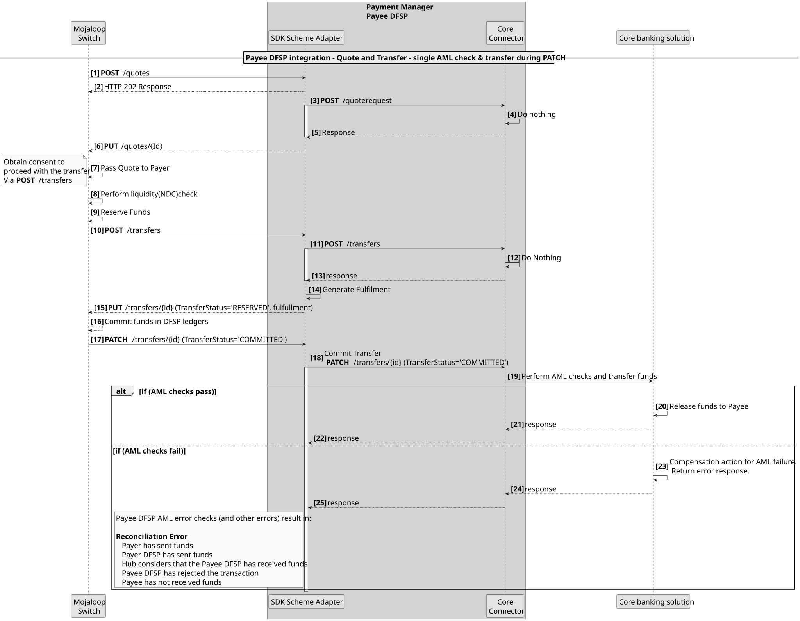
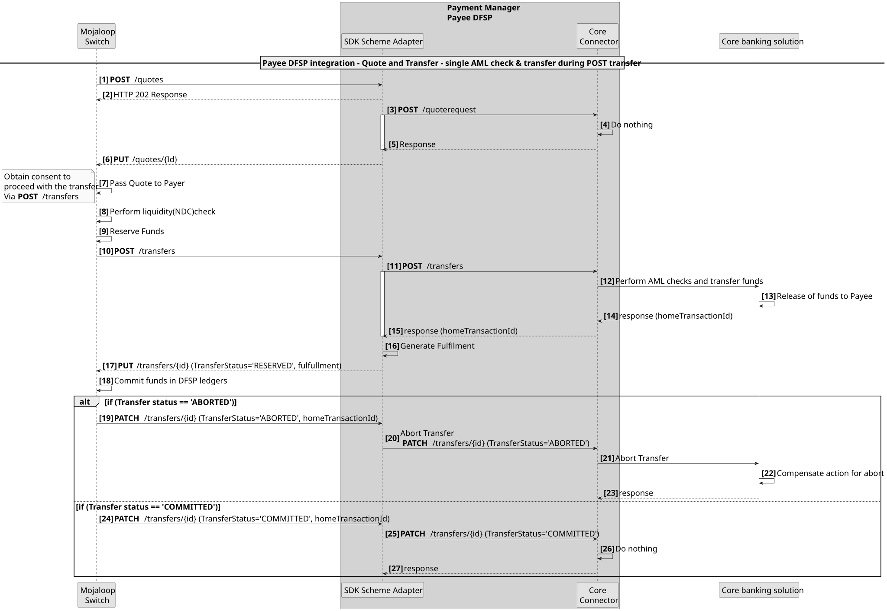

# Integração de sistemas bancários centrais com os padrões «Mojaloop»

A integração de um sistema bancário central num fluxo de transações moderno, em tempo real e baseado no modelo «push» pode apresentar alguns desafios. Estes dependem, em grande medida, das APIs de integração disponibilizadas pelos fornecedores. Este documento aborda como deveria ser uma integração ideal, algumas das limitações típicas observadas nas soluções do fornecedor n.º API, bem como os padrões de fluxo utilizados para superar algumas dessas limitações e uma análise dos riscos envolvidos.

## Padrões de integração do pagador DFSP

Existem três padrões que podem ser utilizados na criação das integrações do Pagador DFSP
1. Integração de transferência **em três fases**. Esta alinha-se com as três fases da transaçãMojaloop. Ou seja: Descoberta, Acordo e Transferência.
1. **Integração dupla API**. Este padrão é descrito em pormenor no diagrama de sequência abaixo. Envolve a combinação das fases de Descoberta e Acordo como primeira fase; os resultados são apresentados ao Pagador para confirmação; seguindo-se a execução da fase de Transferência como segunda fase.

1. **Integração Única API**. Este padrão é descrito em pormenor no diagrama de sequência abaixo. Aqui, as três fases são combinadas para produzir uma única chamada de transferência síncrona.

::: tip Confirmação em duas fases
Todos os padrões de integração do Payer DFSP permitem uma confirmação em duas fases (fase de reserva e fase de confirmação).
:::

## Pagamento ao beneficiário DFSP: modelo de integração ideal
Idealmente, os «API» de um fornecedor deverão fornecer o seguinte.
1. Para poder realizar verificações no âmbito da prevenção do branqueamento de capitais antes da transferência e de forma independente desta.
1. Para poder calcular as comissões de uma transferência antecipadamente e independentemente da mesma.
1. Para poder realizar a transferência em duas fases. Ou seja, uma fase de reserva e, em seguida, uma fase de confirmação.

Se estas estiverem disponíveis no «API» do fornecedor, é possível criar uma integração ideal que reduza os erros de reconciliação quando ocorrem erros inesperados e que apresente o menor risco para o «DFSP».

### Modelo de fluxo ideal para a integração de beneficiários

Neste caso, as verificações AML e as comissões são calculadas na fase de acordo, e a fase de transferência é realizada em duas etapas, nomeadamente uma fase de reserva e uma fase de confirmação.

::: warning Limitação comum
Uma limitação comum no Fornecedor API é o facto de todas estas funções estarem combinadas numa única chamada de fase única API para efetuar uma transferência.
:::

## O fornecedor API permite apenas uma chamada «API»
Caso o Sistema Bancário Central apenas permita uma única chamada «API» para realizar todas as verificações e fases relacionadas com transferências, há dois padrões que devem ser tidos em conta.
1. Transferência de chamada na notificação de ligação

Uma falha a qualquer momento após a notificação PATCH **[Passo 17]** resultará num erro de reconciliação. Esta situação pode ser contornada através da implementação de métodos de compensação. Por exemplo, iniciar uma transferência de reembolso caso ocorra um erro após o passo 17.
1. Transferência de chamada na fase de transferência.

Este procedimento não é, em geral, recomendado, uma vez que normalmente não é possível cancelar uma transferência. Se a transferência for para uma conta interna — por exemplo, para o reembolso de um empréstimo —, então este procedimento torna-se vantajoso.
