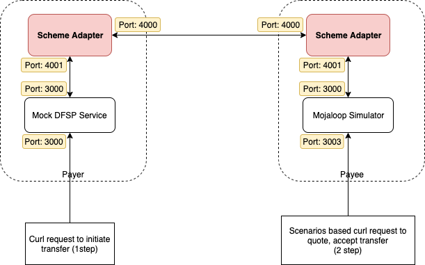
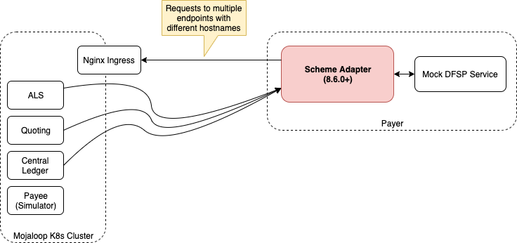
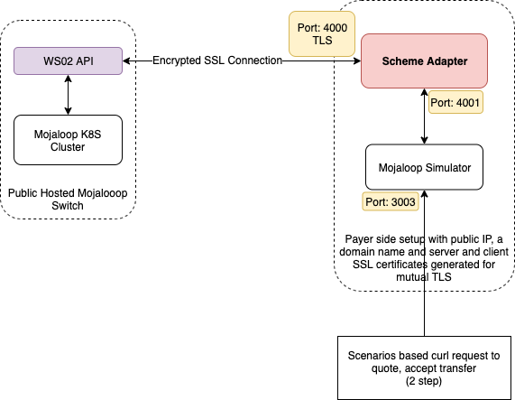

# Visão geral dos SDK cenários de utilização testados
Um scheme adapter é um serviço que faz a ligação entre um switch compatível com Mojaloop API e uma plataforma de backend DFSP que não implementa nativamente o Mojaloop API.

O API entre o adaptador de esquema e o backend DFSP é síncrono HTTP, enquanto a interface entre o adaptador de esquema e o switch é a nativa Mojaloop API.

Este documento apresenta diferentes formas de configuração que um DFSP pode testar utilizando o adaptador de esquema.

# Cenários
Existem vários cenários que testámos e documentámos da seguinte forma.

* [[Adaptador Scheme + Backend simulado DFSP] -> [Adaptador Scheme + Simulador Mojaloop]](./scheme-adapter-to-scheme-adapter/README.md)
* [[Adaptador scheme + Backend simulado DFSP] -> [Cluster K8S local]](./scheme-adapter-and-local-k8s/README.md)
* [[Adaptador Scheme + Simulador Mojaloop] -> [Mojaloop Switch com WSO2 ativado, alojado publicamente]](./scheme-adapter-and-wso2-api-gateway/README.md)

## [Adaptador scheme + Backend simulado DFSP] -> [Adaptador scheme + Simulador Mojaloop]

O adaptador de esquema pode ser utilizado em combinação com os backends simulados já implementados, «Mock DFSP Backend» e «Mojaloop Simulator». Seguem-se os links para os repositórios.

https://github.com/mojaloop/sdk-mock-dfsp-backend.git

https://github.com/mojaloop/mojaloop-simulator.git

A ideia consiste em combinar o adaptador Scheme com o backend simulado «DFSP» de um lado e com o simulador Mojaloop do outro lado. Considere que um dos lados é o DFSP do pagador e o outro lado é o DFSP do beneficiário. Seguindo este exemplo, poderá enviar e receber fundos de um DFSP para outro.

Por favor, [clique aqui](./scheme-adapter-to-scheme-adapter/README.md)] para aceder à documentação.

## [Adaptador scheme + Backend simulado (DFSP)] -> [Cluster K8S local]

Se, então, quisermos incluir um switch entre os DFSPs, podemos simular esse ambiente utilizando um cluster K8S local. Por favor, siga a documentação de onboarding do cluster K8S local aqui (https://mojaloop.io/documentation/deployment-guide/).

Por favor, [clique aqui](./scheme-adapter-and-local-k8s/README.md)] para aceder à documentação.

## [Adaptador Scheme + Simulador Mojaloop] -> [Mojaloop Switch com WSO2 ativado, alojado publicamente]

Caso tenha acesso ao WSO2 Mojaloop API, pode testar isso seguindo a documentação abaixo. Nos dois cenários acima, não utilizámos as funcionalidades de autenticação por token e de encriptação SSL do adaptador de esquema. Vamos utilizar essas funcionalidades nesta secção.

Por favor, [clique aqui](./scheme-adapter-and-wso2-api-gateway/README.md)] para aceder à documentação.

