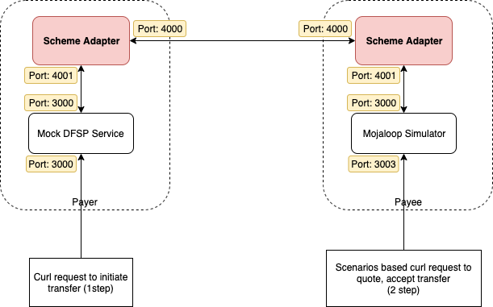

# Testes entre adaptadores scheme

Uma documentação detalhada destinada aos dfsps que pretendam testar a transferência de fundos de um adaptador de esquema para outro, utilizando diretamente os serviços de backend simulado e do simulador Mojaloop.



## Pré-requisito

* Simulador Mojaloop
* DFSP serviço de backend simulado
* O adaptador scheme já está incluído em ambos os scripts do Docker Compose acima referidos

## Configuração e arranque de serviços

A ideia consiste em executar dois scripts do `docker-compose` em paralelo a partir dos dois serviços acima referidos. Para evitar conflitos, é necessário editar os ficheiros `docker-compose.yml` e especificar os nomes dos contentores.

### Mojaloop Serviço de simulação

Por favor, descarregue o repositório do Simulador Mojaloop
```
git clone https://github.com/mojaloop/mojaloop-simulator.git
```
* Edite o ficheiro src/docker-compose.yml e adicione os nomes de todos os contentores. Consulte as seguintes linhas

```
version: '3'
services:
  redis1:
    image: "redis:5.0.4-alpine"
    container_name: redis1
  sim:
    image: "mojaloop-simulator-backend"
    build: ../
    env_file: ./sim-backend.env
    container_name: ml_sim1
    ports:
      - "13000:3000"
      - "3001:3001"
      - "3003:3003"
    depends_on:
      - scheme-adapter
  scheme-adapter:
    image: "mojaloop/sdk-scheme-adapter:latest"
    env_file: ./scheme-adapter.env
    container_name: sa_sim1
    ports:
      - "13500:3000"
      - "14000:4000"
    depends_on:
      - redis1
```

* Edite o ficheiro src/sim-backend.env e altere o nome do contentor do adaptador de scheme nesse ficheiro. Consulte as linhas seguintes.

```
OUTBOUND_ENDPOINT=http://sa_sim1:4001
```

* Edite o ficheiro src/scheme-adapter.env e altere os nomes dos contentores do outro adaptador Scheme e do simulador Mojaloop. Consulte as seguintes linhas

```
DFSP_ID=payeefsp
CACHE_HOST=redis1
PEER_ENDPOINT=sa_sim2:4000
BACKEND_ENDPOINT=ml_sim1:3000
AUTO_ACCEPT_PARTY=true
AUTO_ACCEPT_QUOTES=true
VALIDATE_INBOUND_JWS=false
VALIDATE_INBOUND_PUT_PARTIES_JWS=false
JWS_SIGN=true
JWS_SIGN_PUT_PARTIES=true

```

Em seguida, tente executar o comando seguinte para iniciar os serviços
```
cd src/
docker-compose up -d
```

Já podemos aceder à API de teste do simulador do Mojaloop na porta 3003.

Deve ser adicionado um novo grupo ao simulador utilizando o seguinte comando. Sinta-se à vontade para alterar os detalhes que desejar.
```
curl -X POST "http://localhost:3003/repository/parties" -H "accept: */*" -H "Content-Type: application/json" -d "{\"displayName\":\"Test Payee1\",\"firstName\":\"Test\",\"middleName\":\"\",\"lastName\":\"Payee1\",\"dateOfBirth\":\"1970-01-01\",\"idType\":\"MSISDN\",\"idValue\":\"9876543210\"}"
```

Em seguida, tente executar o comando seguinte para verificar se o novo grupo foi adicionado.
```
curl -X GET "http://localhost:3003/repository/parties" -H "accept: */*"
```

Vamos passar à configuração de outra instância do adaptador scheme com um backend simulado (DFSP).

### DFSP Serviço de backend simulado

O backend de simulação «DFSP» é uma implementação mínima do exemplo «DFSP». De momento, apenas são permitidas funções básicas.

Por favor, descarregue o seguinte repositório
```
git clone https://github.com/mojaloop/sdk-mock-dfsp-backend.git
```

Edite os ficheiros src/docker-compose.yml, src/backend.env e src/scheme-adapter.env e adicione os nomes de todos os contentores. Consulte os ficheiros seguintes.
docker-compose.yml
```
version: '3'
services:
  redis2:
    image: "redis:5.0.4-alpine"
    container_name: redis2
  backend:
    image: "mojaloop/sdk-mock-dfsp-backend"
    env_file: ./backend.env
    container_name: dfsp_mock_backend2
    ports:
      - "23000:3000"
    depends_on:
      - scheme-adapter2

  scheme-adapter2:
    image: "mojaloop/sdk-scheme-adapter:latest"
    env_file: ./scheme-adapter.env
    container_name: sa_sim2
    depends_on:
      - redis2
```
scheme-adapter.env
```
DFSP_ID=payerfsp
CACHE_HOST=redis2
PEER_ENDPOINT=sa_sim1:4000
BACKEND_ENDPOINT=dfsp_mock_backend2:3000
AUTO_ACCEPT_PARTY=true
AUTO_ACCEPT_QUOTES=true
VALIDATE_INBOUND_JWS=false
VALIDATE_INBOUND_PUT_PARTIES_JWS=false
JWS_SIGN=true
JWS_SIGN_PUT_PARTIES=true

```

backend.env
```
OUTBOUND_ENDPOINT=http://sa_sim2:4001
```

Em seguida, tente executar o comando seguinte para iniciar os serviços
```
cd src/
docker-compose up -d
```

## Tente enviar dinheiro
Tente enviar fundos a partir de «payerfsp» (Mock DFSP) para um MSISDN que se encontre em «payeefsp» (Simulador Mojaloop) através do adaptador de esquema.
Execute o seguinte comando «curl» para enviar um comando ao serviço Mock DFSP.
```
curl -X POST \
  http://localhost:23000/send \
  -H 'Content-Type: application/json' \
  -d '{
    "from": {
        "displayName": "John Doe",
        "idType": "MSISDN",
        "idValue": "123456789"
    },
    "to": {
        "idType": "MSISDN",
        "idValue": "9876543210"
    },
    "amountType": "SEND",
    "currency": "USD",
    "amount": "100",
    "transactionType": "TRANSFER",
    "note": "test payment",
    "homeTransactionId": "123ABC"
}'
```

Deve receber uma resposta com o estado atual definido como COMPLETED.
