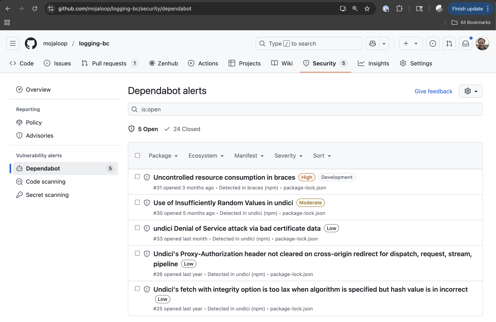
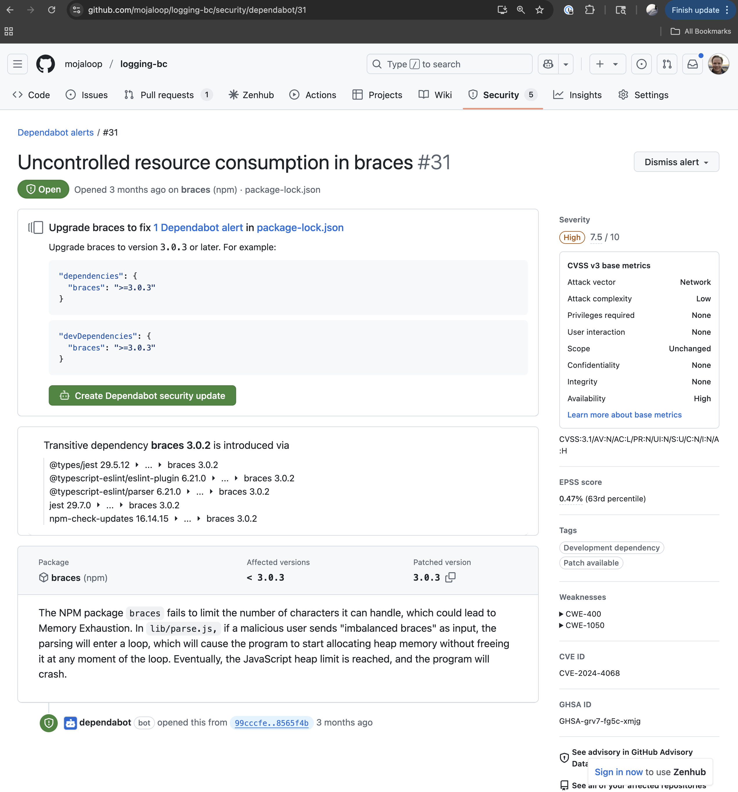
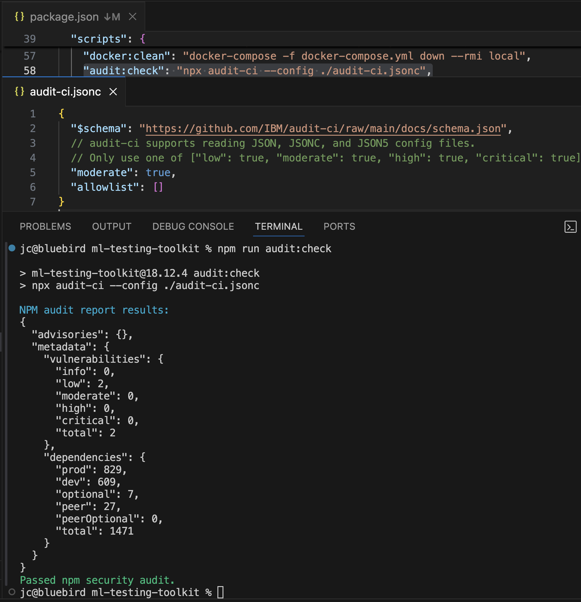
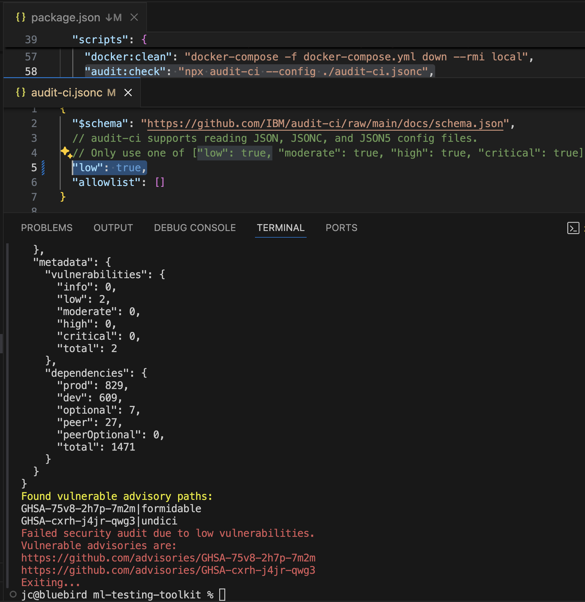
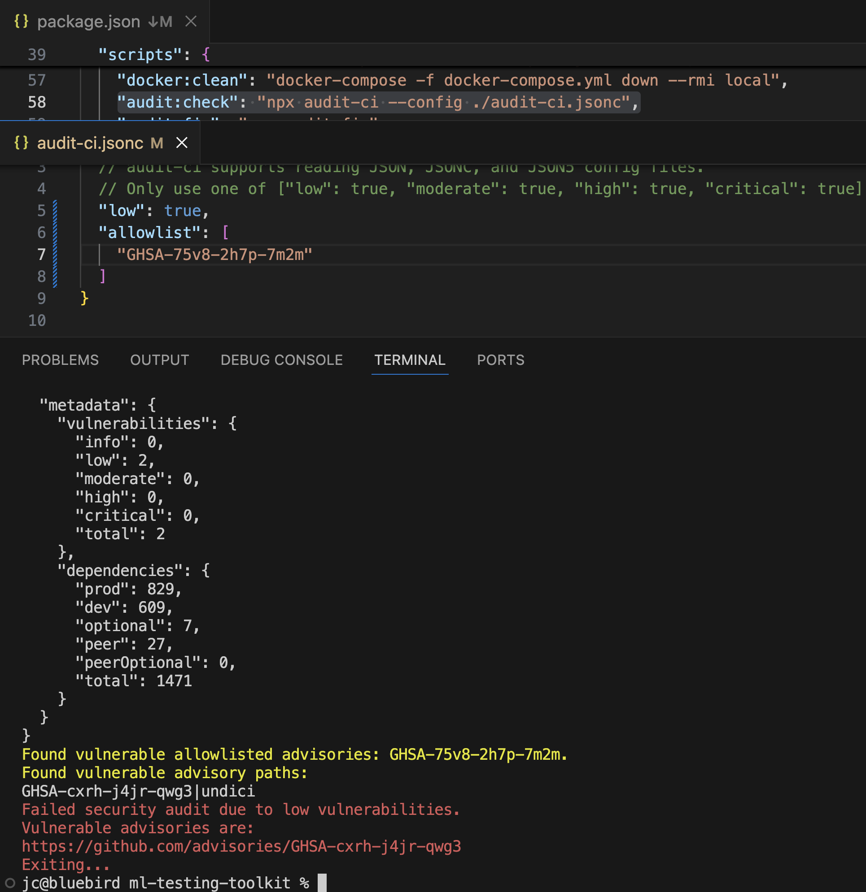
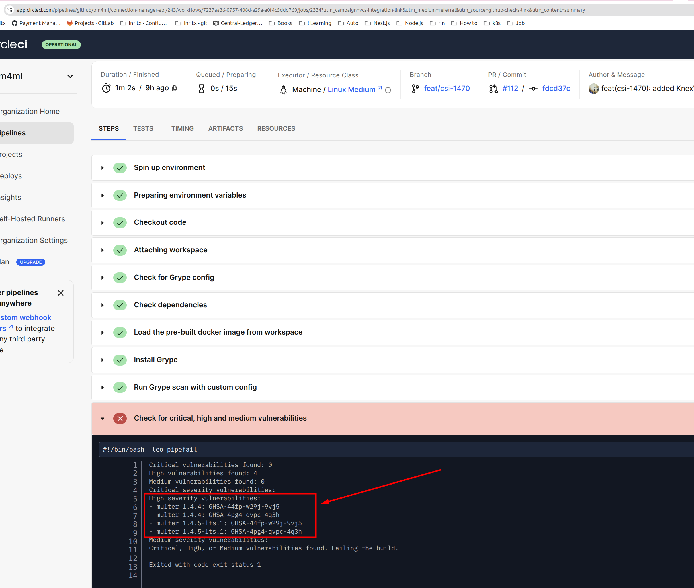
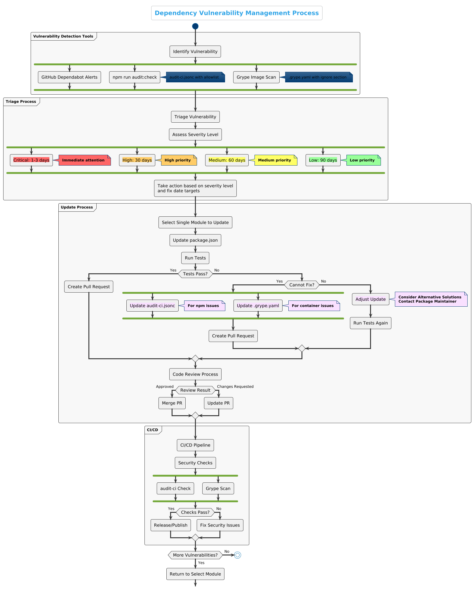

# Mojaloop Guia de Gestão de Vulnerabilidades de Dependências

Este guia descreve o processo de gestão de vulnerabilidades de segurança nas dependências dos repositórios da organização Mojaloop e GitHub.

Este guia centra-se principalmente nas vulnerabilidades relacionadas com dependências. No que diz respeito às vulnerabilidades detetadas no próprio código do Mojaloop (em vez de nas dependências), por favor, envie informações detalhadas por e-mail para security@mojaloop.io e siga a política de Divulgação Coordenada de Vulnerabilidades (CVD).

A política CVD Mojaloop estabelece um processo estruturado para a comunicação, validação e correção de vulnerabilidades de segurança no código Mojaloop. Assegura uma divulgação responsável que equilibra a necessidade de proteger os utilizadores, ao mesmo tempo que fornece informações transparentes sobre questões de segurança. A política inclui prazos claros para a resposta, validação, correção e divulgação pública, permitindo que a equipa de segurança da Mojaloop resolva as vulnerabilidades de forma coordenada, minimizando o risco para os utilizadores e para os adotantes do software. 

## Índice

- [Resumo Executivo](#executive-summary)
- [Visão geral](#overview)
- [Guia de Início Rápido](#quickstart-guide)
- [Guia detalhado](#detailed-guide)
  - [1. Compreender o que é uma vulnerabilidade e onde as encontrar](#1-understanding-what-is-a-vulnerability-and-where-to-find-them)
  - [2. Fluxo de processos para o tratamento de atualizações relativas a vulnerabilidades de dependências](#2-processflow-for-handling-dependency-vulnerability-updates)]
  - [3. Guia prático para as atualizações package.json](#3-practical-guide-to-packagejson-updates)
  - [4. Melhores práticas de revisão de código para PRs de segurança](#4-code-review-best-practices-for-security-prs)
  - [5. Onboarding de programadores e formação em gestão de vulnerabilidades de dependências](#5-developer-onboarding-and-dependency-vulnerability-management-education)
  - [6. Melhoria contínua](#6-continuous-improvement)
  - [7. Conclusão](#7-conclusion)
- [Ferramentas e Recursos](#tools-and-resources)
- [Documentação relacionada](#related-documentation)

## Resumo Executivo

Este guia apresenta uma abordagem estruturada para lidar com vulnerabilidades de segurança nas dependências de Mojaloop repositórios. Aborda a necessidade atual de um processo padronizado que possa ajudar os programadores a compreender os relatórios de vulnerabilidades (nomeadamente GitHub alertas do Dependabot, resultados das análises do npx audit e do grype), a implementar correções adequadas e a priorizar as atualizações de segurança em toda a base de código.

## Visão geral

Mojaloop

## Guia de Início Rápido

Este guia de início rápido apresenta os passos essenciais para a gestão de vulnerabilidades em Mojaloop repositórios, sem necessidade de conhecimentos prévios. Para explicações detalhadas, consulte as secções exaustivas que se seguem.

### 1. Detetar vulnerabilidades

- Execute o `npm run audit:check` para identificar vulnerabilidades em npm pacote
- Verifique se existem GitHub alertas do Dependabot no separador «Segurança» do seu repositório (caso tenha acesso ao separador «Segurança»)
- Utilize o Grype para analisar imagens de contentores; o processo é acionado automaticamente se utilizar o «Mojaloop» orb para o «CircleCI», e o relatório pode ser consultado no «CircleCI» (caso tenha acesso ao «CircleCI»)

### 2. Avaliar e estabelecer prioridades

- **Crítico**: Resolver no prazo de 1 a 3 dias úteis
- **Elevado**: Resolução no prazo de 30 dias
- **Médio**: Resolver no prazo de 60 dias
- **Baixo**: Resolução no prazo de 90 dias

### 3. Processo de correção

1. Tome medidas com base no nível de gravidade e nas metas de data de resolução
2. Selecione um único módulo para atualizar
3. Atualize a dependência vulnerável na versão package.json
4. Execute os testes conforme indicado no ficheiro README do repositório para verificar a funcionalidade
5. Se os testes forem bem-sucedidos, crie um pedido de integração
6. Se os testes falharem e não for possível corrigir o problema:
   - Adicionar à lista de permissões no ficheiro audit-ci.jsonc (para npm pacotes)
   - Adicionar à secção «Ignorar» em .grype.yaml (para vulnerabilidades de contentores)
7. Inclua os detalhes completos da correção da vulnerabilidade no PR

### 4. Modelo de RP

```markdown
## Security Fix: [GHSA-ID or CVE-ID]

### Vulnerability Details
- Severity: [Critical/High/Medium/Low]
- Affected Package: [package-name]
- Vulnerable Versions: [version range]
- Fixed Version: [version number]

### Description
Brief description of the vulnerability and its potential impact.

### Changes
- Updated [package-name] from [old-version] to [new-version]

### Testing
- [X] Unit tests pass
- [X] Integration tests pass
- [X] Manual testing performed
```

### 5. Rever e fundir

- Certifique-se de que a atualização da versão corrige devidamente a vulnerabilidade
- Verifique se as alterações mínimas são package.json
- Confirme se todos os testes foram bem-sucedidos
- Verifique se existem efeitos secundários indesejados
- Fundir após aprovação

## Guia detalhado

As secções seguintes apresentam explicações exaustivas, informações contextuais e procedimentos detalhados para a gestão de vulnerabilidades em repositórios dMojaloop.

## 1. Compreender o que é uma vulnerabilidade e onde as encontrar

Uma vulnerabilidade é identificada por um identificador CVE (Common Vulnerabilities and Exposures), que é um identificador normalizado para vulnerabilidades de segurança conhecidas publicamente.

### Sistemas de identificação de vulnerabilidades: CVE e GHSA

#### CVE (Vulnerabilidades e Exposições Comuns)
Os CVEs são identificadores padronizados para vulnerabilidades de cibersegurança do conhecimento público, geridos pela MITRE Corporation e financiados pelo Departamento de Segurança Interna dos EUA. Cada CVE possui um identificador único no formato CVE-AAAA-NNNNN (ano-número).

#### GHSA (Aviso de Segurança GitHub)
Os identificadores GHSA são identificadores de vulnerabilidades específicos do GitHub utilizados na Base de Dados de Alertas GitHub. Seguem o formato GHSA-XXXX-YYYY-ZZZZ, em que X, Y e Z são caracteres alfanuméricos.

#### Relação entre a CVE e a GHSA
- Um GHSA pode fazer referência a um ou mais CVEs, uma vez que um «GitHub» pode agrupar várias vulnerabilidades relacionadas
- Nem todos os GHSAs têm CVEs correspondentes, especialmente no caso de vulnerabilidades recentemente descobertas
- A GitHub atribui frequentemente um identificador GHSA antes de o MITRE atribuir um CVE
- Ambos os sistemas descrevem as mesmas vulnerabilidades, mas podem conter informações ligeiramente diferentes:
  - Os CVEs constituem a norma do setor utilizada em todas as ferramentas e bases de dados de segurança
  - As GHSAs contêm frequentemente mais informações específicas sobre o ecossistema e podem incluir recomendações de remediação para utilizadores «GitHub»

#### Como os identificadores aparecem nas diferentes ferramentas

- **Alerta do Dependabot GitHub**: Apresentar os identificadores GHSA e CVE (quando for atribuído um CVE)

  
  *Visualização dos alertas do Dependabot em GitHub. Segurança*

  
  *Alerta detalhado do Dependabot*

- **Execução da auditoria npm: verificação**: Os resultados apresentam os identificadores GHSA das vulnerabilidades

  
  *Execução de npm script de auditoria:check*

  
  *Aumentar o nível de gravidade da vulnerabilidade para «baixo»; anteriormente era «moderado»*

  
  *ID da vulnerabilidade incluída na lista de exceções para ser ignorada ao executar a auditoria «npm run audit:check»*

- **Grype Scan**: Apresenta vulnerabilidades com identificadores GHSA

  
  *Foram detetadas CircleCI vulnerabilidades no Grype Scan*

#### Aceder a informações detalhadas sobre vulnerabilidades

Os identificadores GHSA podem ser utilizados como URLs diretas para aceder a informações detalhadas sobre vulnerabilidades. Basta acrescentar o ID GHSA à base de avisos de segurança GitHub URL:

```
https://github.com/[owner]/[repo]/security/advisories/[GHSA-ID]
```

ou utilize a Base de Dados de Avisos GitHubURL genérica:

```
https://github.com/advisories/[GHSA-ID]
```

Por exemplo, é possível aceder a uma vulnerabilidade no pacote «multer» em:
https://github.com/expressjs/multer/security/advisories/GHSA-44fp-w29j-9vj5

Da mesma forma, quando for atribuído um CVE a uma vulnerabilidade, pode aceder ao registo oficial do CVE utilizando o ID do CVE no seguinte formato URL:

```
https://www.cve.org/CVERecord?id=[CVE-ID]
```

No que diz respeito ao mesmo exemplo de vulnerabilidade do Multer, pode encontrar as informações CVE correspondentes em:
https://www.cve.org/CVERecord?id=CVE-2025-47935

#### Fontes de informação sobre vulnerabilidades

**As páginas de Avisos de Segurança GitHub incluem:**
- Descrições detalhadas das vulnerabilidades
- Versões afetadas e corrigidas
- Identificadores CVE (quando atribuídos)
- Pontuações de gravidade (normalmente CVSS)
- Orientações para a correção
- Referências a problemas e commits relacionados

**As páginas de registos CVE incluem:**
- Descrições oficiais das vulnerabilidades
- Referências a recursos relacionados
- Produtos e versões afetados
- Informações padronizadas sobre o nível de gravidade
- Informações sobre a autoria

Ao investigar vulnerabilidades, é frequentemente útil consultar ambas as fontes, uma vez que estas podem conter informações complementares.

Ao trabalhar com vulnerabilidades «Mojaloop», poderá encontrar ambos os tipos de identificadores:
- CVEs em boletins de segurança gerais e em ferramentas como a «npm audit»
- GHSAs em GitHub alertas do Dependabot e em .grype.yaml ficheiros de configuração

GitHub A secção de alertas do Dependabot num repositório GitHub pode ser acedida navegando até ao separador «Segurança» no menu superior e, em seguida, na secção «Alertas de vulnerabilidade», clicando em «Dependabot». Aqui encontrará uma lista de alertas. Por fim, clique num dos alertas para consultar os detalhes. 

Nota: Tenha em atenção que a sua conta GitHub deve ter permissão para aceder ao separador «Segurança». Além disso, o Dependabot deve estar ativado para o repositório em questão. Se precisar de ajuda com estas questões, contacte o administrador Mojaloop GitHub.

### 1.1 Níveis de gravidade das vulnerabilidades

As vulnerabilidades são classificadas de acordo com os seguintes quatro níveis de gravidade:

- **Crítica**: Vulnerabilidades que requerem atenção imediata. Estas incluem, normalmente, a execução remota de código, contornamento de autenticação ou outras falhas graves que podem conduzir ao comprometimento total do sistema.
- **Elevado**: Vulnerabilidades graves que devem ser resolvidas antes do final de um Incremento do Programa (PI), com um prazo-alvo de 30 dias. Estas podem incluir vulnerabilidades de injeção, deserialização insegura ou problemas de cross-site scripting que possam conduzir a uma exposição significativa de dados.
- **Médio**: Vulnerabilidades de risco moderado que devem ser resolvidas no âmbito do atual PI, se possível, com um prazo-alvo de 60 dias. Estas podem incluir a divulgação de informações, a falsificação de pedidos entre sites ou outras vulnerabilidades com fatores atenuantes.
- **Baixa**: Problemas menores que representam um risco mínimo. Estes devem, ainda assim, ser resolvidos, mas com uma prioridade mais baixa, com um prazo-alvo de 90 dias.

**Nota sobre os identificadores CVE**: Quando um relatório de vulnerabilidade não inclui um CVE, isso pode significar:
1. A vulnerabilidade foi descoberta recentemente e ainda não lhe foi atribuído um CVE
2. O problema está especificamente relacionado com a forma como o código é implementado no seu projeto
3. A vulnerabilidade encontra-se numa dependência de desenvolvimento que não afeta os ambientes de produção

A ausência de um CVE não significa que a vulnerabilidade não seja importante — esta deve, mesmo assim, ser avaliada com base na sua gravidade e no seu potencial impacto.

### 1.2 Compreender os intervalos de versões de pacotes/dependências nos alertas do Dependabot

Os intervalos de versões nos alertas do Dependabot definem quais as versões de um pacote/dependência que são afetadas. Repare que, num alerta do Dependabot, o que é referido como «pacote» corresponde a uma dependência na raiz (package.json) do projeto NodeJS. As dependências e os respetivos pacotes seguem o Sistema de Versionamento Semântico. É fundamental compreender estas notações:

- **`<=M.m.p`**: Todas as versões iguais ou anteriores à versão especificada estão vulneráveis.
  - Exemplo: «`<=1.2.3`» significa que todas as versões até à 1.2.3, inclusive, estão vulneráveis.

- **Intervalo utilizando o valor `>M.m.p <M.m.p`**: Define um intervalo entre duas versões em que todas as versões incluídas são vulneráveis.
  - Exemplo: o valor «`>1.0.0 <1.2.0`» significa que todas as versões posteriores à 1.0.0 e anteriores à 1.2.0 estão vulneráveis.

Outros especificadores de versão comuns com os quais se deparará incluem:

- **Caret (`^`)**: Permite alterações que não modifiquem o dígito não nulo mais à esquerda.
  - Exemplo: o valor «`^1.2.3`» permite atualizações para qualquer versão desde a 1.2.3 até à 2.0.0, excluindo esta última.
  - Se o valor for `^0.2.3`, permite atualizações para qualquer versão desde a 0.2.3 até à 0.3.0, excluindo esta última.
  - Se o valor for `^0.0.3`, permite atualizações para qualquer versão desde a 0.0.3 até à 0.0.4, excluindo esta última.

- **Tilde (`~`)**: Permite alterações ao nível do patch, caso seja especificada uma versão secundária.
  - Exemplo: o valor «`~1.2.3`» permite atualizações para qualquer versão desde a 1.2.3 até à 1.3.0, excluindo esta última.

## Fontes de vulnerabilidade

Podem surgir vulnerabilidades através de:
1. Dependências diretas
2. Dependências transitivas
3. Ambientes de execução
4. Componentes de infraestrutura
5. Código personalizado

## Deteção e Avaliação

### Ferramentas de deteção de vulnerabilidades

O Mojaloop utiliza várias ferramentas para detetar vulnerabilidades:

1. ** GitHub Alertas do Dependabot **
   - Deteção automática de vulnerabilidades em GitHub repositórios
   - Fornece informações detalhadas sobre as versões afetadas e as correções disponíveis
   - Disponível no separador «Segurança» de GitHub repositórios
   - **Recursos analisados**: Dependências da aplicação NodeJS declaradas em package.json ficheiros em GitHub repositórios

2. **Auditoria npm através do audit-ci**
   - Executar localmente utilizando o `npm run audit:check`
   - Configurável através do parâmetro «`audit-ci.jsonc`», com uma lista de exceções para problemas conhecidos
   - Integrado em pipelines de CI/CD para impedir o deployment de código vulnerável
   - **Recursos analisados**: Dependências diretas e transitivas do NodeJS em package.json e package-lock.json ficheiros

3. **Digitalização de imagens Grype**
   - Analisador de vulnerabilidades de imagens de contentores
   - Configurável de `.grype.yaml`, com uma secção de exceções para problemas conhecidos
   - Verifica se existem vulnerabilidades nas imagens de contentores e nas suas dependências
   - **Recursos analisados**: Docker imagens de contentores, incluindo imagens de base, pacotes do sistema operativo instalados e dependências de aplicações
   - NOTA: Tenha em atenção que o grype também analisa a imagem Docker, caso o repositório indicado a produza, e que podem ser detetadas vulnerabilidades nessas imagens; nesse caso, tenha em conta que é necessária uma atualização da imagem base no orb Mojaloop CircleCI. 

### Ficheiros de configuração para a gestão de vulnerabilidades

1. **audit-ci.jsonc**
   - Contém uma lista de exceções de vulnerabilidades que podem ser temporariamente ignoradas
   - Utiliza-se quando uma vulnerabilidade não pode ser corrigida de imediato
   - Utiliza os identificadores GHSA para identificar vulnerabilidades a ignorar
   - Deve incluir uma justificação e informações de acompanhamento para cada vulnerabilidade autorizada
   - Exemplo de formato:
     ```json
     {
       "allowlist": [
         {
           "id": "GHSA-XXXX-YYYY-ZZZZ",
           "reason": "No patch available yet, workaround implemented, tracking in issue #123"
         }
       ]
     }
     ```

2. **.grype.yaml**
   - Ficheiro de configuração para a análise de contentores do Grype
   - Contém uma secção «Ignorar» com os IDs de vulnerabilidade da GHSA
   - Utiliza os identificadores GHSA para especificar quais as vulnerabilidades que devem ser ignoradas
   - Utilizado para vulnerabilidades específicas de contentores que não podem ser resolvidas de imediato
   - Exemplo de formato:
     ```yaml
     ignore:
       - vulnerability: GHSA-XXXX-YYYY-ZZZZ
         package:
           name: package-name
           version: 1.2.3
         until: "2023-12-31"
         reason: "Investigating alternative solutions, not exploitable in our context"
     ```

### Digitalização automática
- Análise regular das dependências utilizando a auditoria «npm»
- Análise de imagens de contentores
- Análise de vulnerabilidades nas infraestruturas
- Análise estática de código

### Revisão do manual
- Revisões de código de segurança
- Testes de penetração
- Modelação de ameaças
- Auditorias de conformidade

## 2. ProcessFlow para a gestão de atualizações relacionadas com vulnerabilidades de dependências

O diagrama seguinte ilustra o processo de gestão da vulnerabilidade das dependências para Mojaloop repositórios:



### 2.1 Processo normalizado

1. **Triagem**
   - Analise regularmente os GitHub alertas do Dependabot.
   - Classifique/Analise com base na gravidade (Crítica, Elevada, Média, Baixa).
   - Acompanhe as vulnerabilidades no repositório privado existente do projeto GitHub, dedicado a vulnerabilidades de segurança. O acesso a este repositório é restrito e concedido apenas com base na necessidade de conhecimento. Contacte a Comissão de Segurança Mojaloop caso necessite de acesso.

2. **Processo de atualização**
   - **Passo 1**: Escolha um único módulo (um serviço ou biblioteca do Mojaloop) que tenha uma vulnerabilidade identificada.
   - **Passo 2**: Efetue a atualização necessária das dependências na versão package.json.
   - **Passo 3**: Realize testes de verificação básica para garantir que a funcionalidade não está comprometida. Por favor, siga as instruções detalhadas sobre este assunto no ficheiro README do repositório indicado.
   - **Passo 4**: Se os testes forem bem-sucedidos, avance com a criação de um pedido de integração.
   - **Passo 5**: Crie pedidos de integração para cada módulo com o único correção de segurança.
   - **Passo 6**: Inclua informações detalhadas no PR sobre a vulnerabilidade que está a ser corrigida, incluindo o seu ID CVE e as dependências que estão a ser atualizadas na versão package.json, juntamente com quaisquer detalhes que sejam necessários.

3. **Princípios importantes**
   - **Isolamento**: Trate uma correção de vulnerabilidade de cada vez.
   - **Não agrupar**: Não agrupe várias correções de segurança não relacionadas entre si.
   - **Histórico limpo**: Reorganize os commits para obter um histórico limpo.
   - **Testes exaustivos**: Efetue sempre testes após efetuar alterações, conforme indicado no ficheiro README do repositório em questão.

### 2.2 Framework de definição de prioridades

- **Gravidade crítica**: Requer atenção imediata; deve ser resolvido no prazo de 1 a 3 dias úteis.
- **Gravidade elevada**: Resolver antes do final do Incremento do Programa (PI) atual, com um prazo-alvo de 30 dias.
- **Gravidade média**: Corrigir antes do final do PI atual, se possível; prazo previsto: 60 dias.
- **Baixa gravidade**: Resolver durante os ciclos de manutenção regulares, com um prazo previsto de 90 dias.

### 2.3 Critérios de avaliação da vulnerabilidade

A Mojaloop segue as práticas da OpenSSF e da OWASP na avaliação de vulnerabilidades. As decisões finais relativas à gestão de vulnerabilidades são tomadas pelo Comité de Segurança Mojaloop.

Ao determinar se se deve corrigir ou incluir na lista de permissões/ignorar uma vulnerabilidade:
- Quando existir uma correção para a vulnerabilidade, esta deve ser aplicada.
- Uma vulnerabilidade só deve ser incluída na lista de permissões ou ignorada se a correção comprometer a funcionalidade existente, o que deve ser confirmado quer pela falha de testes automatizados (conforme descrito no ficheiro README do repositório em questão), quer através de testes manuais.
- No que diz respeito às vulnerabilidades «zero-day», o Comité de Segurança Mojaloop fornecerá orientações sobre os procedimentos a seguir, conforme necessário, caso a caso.

## 3. Guia prático para as atualizações «package.json»

### 3.1 Ferramentas recomendadas

- **npm executar audit:check**: Para detetar vulnerabilidades, o script audit:check deverá ajudá-lo a identificar vulnerabilidades e deverá corresponder às listadas no GitHub Dependabot
  ```bash
  npm run audit:check
  ```

- **Executar npm vez o `dep:check` e npm vez o `dep:update`**: Para ajudar a gerir as atualizações de dependências, pode utilizar esta abordagem; tenha em atenção que, ao efetuar alterações em massa, será mais difícil identificar o que provoca falhas na funcionalidade. NOTA: A atualização de dependências requer um guia de gestão específico.

- **.ncurc.yaml**: Para indicar quais as dependências que devem rejeitar a atualização, uma vez que esta poderá comprometer o funcionamento. Utilizado como último recurso.


### 3.2 Processo passo a passo

1. **Identifique o pacote vulnerável**:
   ```bash
   npm audit
   ```

2. **Atualizar um único pacote**:
   ```bash
   # For direct dependencies
   npm update [package-name]
   
   # For fixing specific vulnerabilities
   npm run audit:fix
   
   # For more complex cases with breaking changes
   npm audit fix --force  # Use with caution
   ```

3. **Teste a atualização**:
   ```bash
   npm test
   # Run other project-specific tests
   ```

4. **Envie as alterações e crie um PR**:
   ```bash
   git checkout -b fix/security-vulnerability-[CVE-ID]
   git add package.json package-lock.json
   git commit -m "fix: update [package] to fix [CVE-ID]"
   git push origin fix/security-vulnerability-[CVE-ID]
   ```

### 3.3 Como lidar com casos complexos

Quando o ponto `npm run audit:fix` não resolver o problema:

1. **No caso de dependências para as quais não existem patches disponíveis**:
   - Verifique se a vulnerabilidade é, de facto, explorável no seu caso de uso específico.
   - Considere pacotes alternativos.
   - Contacte o responsável pela manutenção do pacote para comunicar o problema.
   - Documente a vulnerabilidade com uma explicação detalhada da avaliação de riscos.

2. **Quando as correções prejudicam o funcionamento**:
   - Caso os testes falhem após as atualizações das dependências e não exista uma solução imediata:
     - No caso de vulnerabilidades no pacote «npm»: Adicione à lista de permissões em «`audit-ci.jsonc`»
     - No que diz respeito às vulnerabilidades dos contentores: Adicione à secção «ignorar» no ficheiro «`.grype.yaml`»
   - Documente os motivos para a inclusão na lista de permissões ou para a exclusão e inclua:
     - Número de acompanhamento do caso
     - Explicação pormenorizada do risco
     - Data prevista para a resolução
     - Quaisquer controlos de mitigação implementados

3. **Integração CI/CD**:
   - As verificações de segurança estão integradas nos pipelines de CI/CD
   - As vulnerabilidades críticas farão com que o pipeline falhe, a menos que sejam devidamente incluídas na lista de permissões ou ignoradas
   - Todas as vulnerabilidades incluídas na lista de exceções ou ignoradas devem ser revistas regularmente
   - Devem ser realizadas análises regulares para detetar novas vulnerabilidades

### 3.4 Gestão de vulnerabilidades em contentores

Ao trabalhar com Docker contentores:

1. **Configuração do Grype**:
   - O Grype é utilizado para analisar imagens de contentores à procura de vulnerabilidades
   - Para obter orientações detalhadas sobre a configuração do Grype, utilize o Orb Mojaloop CircleCI e consulte a [Mojaloop documentação do Orb de configuração de CI](https://github.com/mojaloop/ci-config-orb-build?tab=readme-ov-file#vulnerability-image-scan-configuration)

2. **Segurança da imagem de base**:
   - Mojaloop serviços utilizam normalmente Node.js imagens Alpine
   - A imagem base atualmente utilizada pode ser encontrada em: [node:22.15.1-alpine3.21](https://hub.docker.com/layers/library/node/22.15.1-alpine3.21/images/sha256-d1068d8b737ffed2b8e9d0e9313177a2e2786c36780c5467ac818232e603ccd0)
   - Esta página apresenta uma lista de todas as vulnerabilidades presentes na imagem base, e a análise da imagem realizada pelo grype também deteta quaisquer vulnerabilidades.

## Estratégia de atualização

Ao abordar as vulnerabilidades:
1. Siga a sequência de atualização do repositório, tal como descrita no [Mojaloop
Guia de Atualização do Repositório](./mojaloop-repository-update-guide.md)
2. Dê prioridade às vulnerabilidades críticas e de gravidade elevada
3. Considere o impacto nos serviços dependentes
4. Realize testes exaustivos em ambientes que não sejam de produção
5. Planeie atualizações coordenadas em todos os serviços afetados

## 4. Melhores práticas de revisão de código para PRs de segurança

1. **PRs específicas**: As PRs devem abordar uma única vulnerabilidade.

2. **Informações obrigatórias nos PR**:
   - ID do CVE ou identificador da vulnerabilidade
   - Nível de gravidade
   - Descrição da vulnerabilidade
   - Descrição da correção
   - Testes realizados
   - Avaliação do impacto potencial

3. **Lista de verificação para revisão**:
   - Verifique se a atualização da versão corrige efetivamente a vulnerabilidade
   - Verifique se há alterações mínimas para package.json
   - Certifique-se de que os testes continuam a ser bem-sucedidos
   - Verifique se os testes de fumo foram realizados de acordo com o ficheiro README e utilize o conjunto de códigos de teste
   - Verifique se existem efeitos secundários indesejados

4. **Modelo de descrição de comunicado de imprensa**:
   ```markdown
   ## Security Fix: [CVE-ID]
   
   ### Vulnerability Details
   - Severity: [Critical/High/Medium/Low]
   - Affected Package: [package-name]
   - Vulnerable Versions: [version range]
   - Fixed Version: [version number]
   
   ### Description
   Brief description of the vulnerability and its potential impact.
   
   ### Changes
   - Updated [package-name] from [old-version] to [new-version]
   
   ### Testing
   - [X] Unit tests pass
   - [X] Integration tests pass
   - [X] Manual testing performed
   - [X] Leverage test code harness on the developer's workstation
   - [X] CI/CD test code harness and/or Golden Path tests
   
   ### Additional Notes
   Any other relevant information.
   ```

## Relatórios e Comunicação

- Centralizar o acompanhamento das vulnerabilidades e controlar o acesso
- Registe todas as questões identificadas
- Acompanhar o estado da remediação
- Comunicar as atualizações às partes interessadas
- Siga as práticas de divulgação responsável

## 5. Onboarding de programadores e formação em gestão de vulnerabilidades de dependências

Utilizar a gestão de vulnerabilidades como ponto de partida para os novos programadores de Mojaloop:

### 5.1 Recursos educativos

- Crie uma secção específica na documentação sobre a gestão de vulnerabilidades
- Inclua exemplos práticos e orientações passo a passo
- Forneça ligações para recursos externos sobre segurança «Node.js»

### 5.2 Processo de orientação

1. **Atribuir vulnerabilidades simples**: Comece por atribuir aos novos programadores correções de vulnerabilidades de baixa prioridade.
2. **Revisões em pares**: Solicitar que programadores experientes revisem os PRs dos recém-chegados.
3. **Responsabilidade progressiva**: Atribua gradualmente questões de segurança cada vez mais complexas.

### 5.3 Atualizações da documentação

- Manter uma base de conhecimento sobre padrões comuns de vulnerabilidades no código-fonte
- Documentar as lições aprendidas com as correções de vulnerabilidades anteriores
- Atualize este guia de gestão de vulnerabilidades de dependências à medida que os processos evoluem

### 5.4 Segurança no desenvolvimento quotidiano

Durante o processo de onboarding dos programadores, este documento sobre a gestão de vulnerabilidades de dependências será partilhado com todos os programadores e o seu cumprimento será assegurado através de revisões de código durante os PRs. Estão atualmente a ser analisadas várias ferramentas de análise de segurança de código aberto para integração em IDE, com vista a melhorar ainda mais o fluxo de trabalho dos programadores.

## Melhores práticas

1. **Prevenção**
   - Atualizações regulares das dependências
   - Práticas de desenvolvimento centradas na segurança
   - Testes de segurança automatizados
   - Orientações para uma programação segura

2. **Resposta**
   - Percursos de escalamento claros
   - Prazos de resposta definidos
   - Revisões periódicas de segurança
   - Monitorização contínua

3. **Documentação**
   - Acompanhamento de vulnerabilidades
   - Procedimentos de reabilitação
   - Relatórios de incidentes de segurança
   - Lições aprendidas

## 6. Melhoria contínua

### 6.1 Revisões periódicas de segurança

- Realizar análises semanais dos novos relatórios de vulnerabilidades
- Acompanhar os indicadores relativos ao tempo de resolução por nível de gravidade
- Comparar o desempenho com os padrões do setor

### 6.2 Oportunidades de automatização

- Explore a adoção do DefectDojo, uma solução de código aberto, para centralizar e automatizar a gestão do ciclo de vida das vulnerabilidades
  - [Comunidade DefectDojo](https://defectdojo.com/community)
  - [DefectDojo GitHub Repositório](https://github.com/DefectDojo/django-DefectDojo)
  - [Projeto OWASP DefectDojo](https://owasp.org/www-project-defectdojo/)
  - [Documentação do DefectDojo](https://docs.defectdojo.com/en/about_defectdojo/about_docs/)
- Implementar hooks de pré-confirmação para a verificação de dependências
- Configure tarefas agendadas para auditorias de segurança regulares

### 6.3 Partilha de conhecimentos

- Criar e manter documentação e formação sobre a gestão de vulnerabilidades
- Criar vídeos explicativos sobre a correção de vulnerabilidades comuns
- Criar um programa de promotores de segurança no seio da comunidade

## 7. Conclusão

Ao implementar esta abordagem estruturada à gestão da vulnerabilidade das dependências, a comunidade Mojaloop pode garantir respostas consistentes, oportunas e eficazes às questões de segurança. Este processo não só melhora a postura de segurança da base de código, como também proporciona uma excelente oportunidade para o onboarding de novos programadores e a promoção da sensibilização para a segurança em toda a comunidade.

A gestão da vulnerabilidade das dependências não se resume apenas à resolução de problemas, mas consiste em desenvolver uma mentalidade de segurança.

## Ferramentas e recursos

- [O que é um CVE (Common Vulnerabilities and Exposures)?](https://www.ibm.com/think/topics/cve)
- [Mojaloop Documentação](https://docs.mojaloop.io/)
- [Node.js Melhores práticas de segurança](https://nodejs.org/en/learn/getting-started/security-best-practices)
- [npm Documentação de auditoria](https://docs.npmjs.com/cli/v10/commands/npm-audit)
- [Especificação de Versões Semânticas](https://semver.org/)
- [npm Calculadora Semver](https://semver.npmjs.com/)
- [GitHub Funcionalidades de segurança](https://docs.github.com/en/code-security)
- [GitHub Guia de início rápido do Dependabot](https://docs.github.com/en/code-security/getting-started/dependabot-quickstart-guide)
- [Mojaloop Configuração do CI - Configuração da análise de imagens para deteção de vulnerabilidades](https://github.com/mojaloop/ci-config-orb-build?tab=readme-ov-file#vulnerability-image-scan-configuration)
- [Comunidade DefectDojo](https://defectdojo.com/community)
- [DefectDojo GitHub Repositório](https://github.com/DefectDojo/django-DefectDojo)
- [Projeto OWASP DefectDojo](https://owasp.org/www-project-defectdojo/)
- [Documentação do DefectDojo](https://docs.defectdojo.com/en/about_defectdojo/about_docs/)
- Auditoria npm
- GitHub Alertas de segurança
- Ferramentas de análise de contentores
- Ferramentas de análise estática
- Sistemas de monitorização de segurança

## Documentação relacionada

- [Guia de Estratégia de Atualização](./upgrade-strategy-guide.md)
- [Mojaloop Guia de atualização do repositório](./mojaloop-repository-update-guide.md)
- [Resolução de problemas de deployment](./deployment-troubleshooting.md)
- [Mojaloop Política de Divulgação Coordenada de Vulnerabilidades](https://docs.mojaloop.io/community/contributing/cvd.html) 
