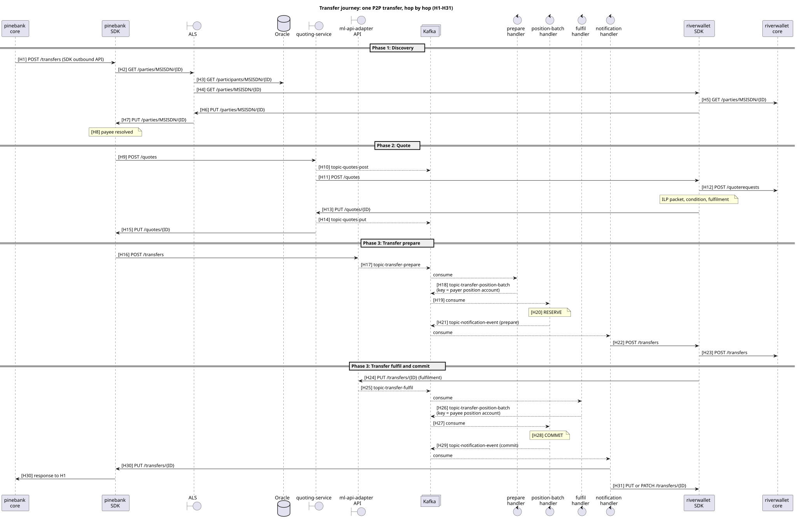

# Transfer Journey

This section follows one FSPIOP P2P transfer through a Mojaloop hub, hop by hop. For every hop it shows the HTTP request (headers and body) or Kafka message, the response, and what each service, handler, Kafka topic, cache and database table does with it.

| Page | Hops | Covers |
|---|---|---|
| [Phase 1 · Discovery](./discovery.md) | H1–H8 | Resolving an MSISDN to the payee DFSP and party |
| [Phase 2 · Quote](./quote.md) | H9–H15 | Agreeing terms; creating the ILP condition and fulfilment |
| [Phase 3 · Transfer prepare](./transfer-prepare.md) | H16–H23 | Validating, recording and reserving funds; forwarding to the payee |
| [Phase 3 · Transfer fulfil and commit](./transfer-fulfil.md) | H24–H31 | Verifying the fulfilment, committing, notifying both sides |
| [Reference](./reference.md) | — | State machine, Kafka topics, notification routing, duplicates, timeouts, security, configuration, metrics, failures, error codes, glossary |

## Scope

This section covers a single-currency, payer-initiated transfer in FSPIOP v2.0 mode. It uses the batch position handler, which is how the Mojaloop Helm charts deploy it. FX, bulk, request-to-pay and inter-scheme proxy transfers share most of this path but add steps that are not covered here.

## Example used throughout

`pinebank` (the payer DFSP) sends USD 50.00 to MSISDN `255700000111`. That number is held by `riverwallet` (the payee DFSP). Both DFSPs run the [SDK scheme adapter](../sdk-scheme-adapter/) (Mojaloop Connector) in front of their core systems.

All identifiers, keys and URLs are illustrative. The same values are used on every page, so you can trace one request through all the hops:

| Value | Sample |
|---|---|
| Payer DFSP | `pinebank` |
| Payee DFSP | `riverwallet` |
| Hub participant name | `Hub` (`HUB_PARTICIPANT.NAME`) |
| Payee identifier | `MSISDN` / `255700000111` |
| `homeTransactionId` (payer core) | `pb-20261015-000123` |
| `transferId` = `transactionId` | `01JBVM16V1SZQX8B0JZ2N4ZDE4` |
| `quoteId` | `01JBVM13SQYP507JB1DYBZVCMF` |
| `condition` | `HpSoVzas3jljddyOns0pxImmOgXR2GlQPAmm66TKLbc` |
| `fulfilment` | `ax8KPpwtT4obflw9Kp8OjXxrWk8-LRwLmo9-bVxLOik` |
| pinebank USD POSITION / SETTLEMENT account (`participantCurrencyId`) | `3` / `4` |
| riverwallet USD POSITION / SETTLEMENT account | `5` / `6` |
| `participantId`: Hub / pinebank / riverwallet | `1` / `2` / `3` |
| `participantPositionId` | Same as the account's `participantCurrencyId` |
| `transferStateChangeId`: `RECEIVED_PREPARE` / `RESERVED` / `RECEIVED_FULFIL` / `COMMITTED` | `101` / `102` / `103` / `104` |
| Open `settlementWindowId` | `12` |

The `condition` and `fulfilment` above are a real pair: `condition = base64url(SHA-256(base64url-decode(fulfilment)))`. ILP packets and JWS signature values are truncated (`…`) in the samples.

## Source basis

The behaviour described here was traced in the following versions:

* ml-api-adapter v16.11.1
* central-ledger v20.2.0
* account-lookup-service v17.16.6
* quoting-service v17.15.0
* central-services-shared v18.39.1
* sdk-scheme-adapter v24.20.0, with its vendored sdk-standard-components

File paths are relative to each repository root. The API shapes follow the FSPIOP v2.0 and SDK scheme adapter v2.1.0 specifications in [api-snippets](https://github.com/mojaloop/api-snippets).

## Reading the SQL

On hops that touch MySQL, each step shows the SQL it runs directly under that step; steps without SQL say "No database access". The SQL was produced by rendering the services' own knex query builders with knex's `mysql2` dialect, using the sample values above, and then formatted for reading. Two things differ from what you would see in the MySQL general log:

* The services send parameterised statements; the samples show the values inlined.
* The SQL is as knex generates it, not as the source code reads. For example, `Db.from('participant').find({})` becomes `SELECT * FROM participant`.

The samples assume the hub defaults: `CACHE.CACHE_ENABLED=false` in central-ledger, quoting-service caching on, and `SIMPLE_ROUTING_MODE=true`. With central-ledger caching off, every participant lookup rebuilds its "cache" from a **full-table read**, so `SELECT * FROM participant` and `SELECT * FROM participantCurrency` appear many times per transfer. Enabling `CACHE.CACHE_ENABLED` replaces those reads with in-memory lookups (TTL `CACHE.EXPIRES_IN_MS`).

## The whole path on one page

Each arrow is a hop, numbered H1 to H31 to match the phase pages. Solid arrows are HTTP; dashed arrows are Kafka.



## FSPIOP headers used in the samples

Every FSPIOP request in this section carries the headers below. The samples on the other pages list them in full on the first hop of each kind. After that they list only the values that change.

| Header | Required | Sample | Notes |
|---|---|---|---|
| `Content-Type` | Yes | `application/vnd.interoperability.transfers+json;version=2.0` | Resource and API version. The hub's header validation rejects unsupported versions with 400. |
| `Accept` | Requests only (not on callbacks) | `application/vnd.interoperability.transfers+json;version=2` | Versions the sender accepts in the callback |
| `Date` | Yes | `Thu, 15 Oct 2026 09:30:00 GMT` | RFC 7231 format; validated at ingress |
| `FSPIOP-Source` | Yes | `pinebank` | The DFSP that authored the message. Checked against participant data and, if enabled, the JWS. |
| `FSPIOP-Destination` | When known | `riverwallet` | Omitted on `GET /parties` when the payee DFSP is not yet known |
| `FSPIOP-Signature` | When JWS is enabled | `{"signature":"…","protectedHeader":"…"}` | Detached JWS over the body and protected headers; see [Reference · Security controls](./reference.md#security-controls-by-hop) |
| `FSPIOP-URI` | With JWS | `/transfers` | Bound into the signature |
| `FSPIOP-HTTP-Method` | With JWS | `POST` | Bound into the signature |
| `traceparent` / `tracestate` | Optional | `00-4bf92f3577b34da6a3ce929d0e0e4736-00f067aa0ba902b7-01` | W3C trace context. The hub adds `timeApiPrepare` / `timeApiFulfil` to `tracestate`. |

FSPIOP is asynchronous. The hub acknowledges a request with `202 Accepted` (for `POST` and `GET`) or `200 OK` (for `PUT` and `PATCH`) and an empty body. The business answer always arrives later, as a separate callback to the endpoint the receiver registered.

## Machinery every hop reuses

Three mechanisms recur at almost every hop. They are described once here.

### Hub HTTP ingress

ALS, the quoting-service API and the ml-api-adapter API are all Hapi servers that use the same plugin chain from central-services-shared:

1. **Header validation** (`src/util/hapi/plugins/headerValidation.js`): checks that `Date` is present and valid, that `Content-Type` and `Accept` carry a supported FSPIOP version, and that the payload is under the size cap. A failure returns HTTP 400 with an FSPIOP error body.
2. **OpenAPI validation** (`openapiBackendValidator.js`): checks the body, path and query against the FSPIOP spec.
3. **Raw payload capture** (`rawPayloadToDataUri.js`): keeps the exact request bytes as a base64 data URI (`request.dataUri`) alongside the parsed body. These are the bytes the sender signed.
4. **Event plugin**: opens a trace span from the inbound W3C trace headers.

A validation failure at ingress is answered synchronously:

**Response:** `400 Bad Request`

Headers:

```json
{
  "Content-Type": "application/json"
}
```

Body:

```json
{
  "errorInformation": {
    "errorCode": "3101",
    "errorDescription": "Malformed syntax - Invalid date header"
  }
}
```

### Hub Kafka handlers

The quoting handler, the central-ledger handlers and the notification handler all follow the same loop (central-services-stream consumer, central-services-shared `Util.Kafka`):

1. Poll a message from the topic (or a batch, for position-batch).
2. Decode the envelope and the base64 payload.
3. Do the stage's work: cache lookups, database reads, a database transaction.
4. Call `Kafka.proceed(…)`. This **commits the consumed offset first**, then produces the next message, with an optional message key. The target topic is chosen by the `topic-{functionality}-{action}` pattern or by an override.

Every internal message uses the same envelope (`StreamingProtocol.createMessage`). This is the message ml-api-adapter produces to `topic-transfer-prepare` at H17:

```json
{
  "id": "01JBVM16V1SZQX8B0JZ2N4ZDE4",
  "from": "pinebank",
  "to": "riverwallet",
  "type": "application/json",
  "content": {
    "uriParams": { "id": "01JBVM16V1SZQX8B0JZ2N4ZDE4" },
    "headers": {
      "content-type": "application/vnd.interoperability.transfers+json;version=2.0",
      "date": "Thu, 15 Oct 2026 09:30:05 GMT",
      "fspiop-source": "pinebank",
      "fspiop-destination": "riverwallet",
      "fspiop-signature": "{\"signature\":\"…\",\"protectedHeader\":\"…\"}",
      "fspiop-uri": "/transfers",
      "fspiop-http-method": "POST",
      "traceparent": "00-4bf92f3577b34da6a3ce929d0e0e4736-00f067aa0ba902b7-01"
    },
    "payload": "data:application/vnd.interoperability.transfers+json;version=2.0;base64,eyJ0cmFuc2Zlcklk…",
    "context": {
      "originalRequestPayload": "data:application/vnd.interoperability.transfers+json;version=2.0;base64,eyJ0cmFuc2Zlcklk…",
      "originalRequestId": "01JBVM16V1SZQX8B0JZ2N4ZDE4"
    }
  },
  "metadata": {
    "correlationId": "01JBVM16V1SZQX8B0JZ2N4ZDE4",
    "event": {
      "id": "6f1c2b9e-3a4d-4e8f-9b0a-1c2d3e4f5a6b",
      "type": "prepare",
      "action": "prepare",
      "createdAt": "2026-10-15T09:30:05.112Z",
      "state": { "status": "success", "code": 0, "description": "action successful" }
    },
    "trace": {
      "traceId": "4bf92f3577b34da6a3ce929d0e0e4736",
      "spanId": "b7ad6b7169203331",
      "tags": { "tracestate": "acmevendor=eyJzcGFuSWQiOiJiN2FkNmI3MTY5MjAzMzMxIiwidGltZUFwaVByZXBhcmUiOiIxNzYwNTIwNjA1MTEyIn0=" }
    }
  }
}
```

Later stages change only `metadata.event` (`type` and `action`) and, where needed, the Kafka message key. The phase pages show just those differences.

The DFSP's original signed bytes travel inside the message, so the hub can forward them unchanged. By default they are carried inline, in both `content.payload` and `context.originalRequestPayload`. With `PAYLOAD_CACHE.enabled=true` and `ORIGINAL_PAYLOAD_STORAGE=redis`, ml-api-adapter stores them in Redis under the request ID instead, and `context` carries only `originalRequestId`.

### Participant and endpoint lookups

Every service needs two facts about a DFSP: whether it exists and is active, and what its callback URL is for this kind of message.

| Service | Participant / account data | Callback URLs |
|---|---|---|
| ALS, ml-api-adapter | central-ledger admin API `GET /participants/{name}`, in-memory cache (ALS default TTL 3 s) | central-ledger admin API `GET /participants/{name}/endpoints`, in-memory cache (default TTL 180 s) |
| quoting-service | Direct SQL on the `central_ledger` schema (`participant` ⨝ `participantCurrency`), in-memory cache (default 60 s) | Direct SQL on `participantEndpoint`, same cache |
| central-ledger handlers | `participant`, `participantCurrency`, `participantLimit` through `*Cached` models. With `CACHE.CACHE_ENABLED=false` (the default), each lookup reloads from MySQL. | — |

The endpoint lookup that ml-api-adapter makes against the central-ledger admin API:

**Request:** `GET /participants/riverwallet/endpoints`

Headers:

```json
{
  "Accept": "application/json"
}
```

**Response:** `200 OK`

Headers:

```json
{
  "Content-Type": "application/json"
}
```

Body:

```json
[
  { "type": "FSPIOP_CALLBACK_URL_TRANSFER_POST", "value": "https://riverwallet.example/fspiop/transfers" },
  { "type": "FSPIOP_CALLBACK_URL_TRANSFER_PUT", "value": "https://riverwallet.example/fspiop/transfers/{{transferId}}" },
  { "type": "FSPIOP_CALLBACK_URL_TRANSFER_ERROR", "value": "https://riverwallet.example/fspiop/transfers/{{transferId}}/error" }
]
```

When ALS or ml-api-adapter misses its cache, the central-ledger admin API serves these lookups from `central_ledger`.

**Database queries** (central-ledger admin API, `CACHE.CACHE_ENABLED=false`):

```sql
-- GET /participants/riverwallet  (domain getByName: participant, then its accounts)
SELECT * FROM participant ORDER BY name ASC;
SELECT * FROM participantCurrency ORDER BY participantCurrencyId ASC;
-- ...plus the enum tables (ledgerAccountType and others), reloaded through enumCached

-- GET /participants/riverwallet/endpoints  (domain getAllEndpoints)
SELECT * FROM participant ORDER BY name ASC;
SELECT participantEndpoint.*, et.name
FROM participantEndpoint
INNER JOIN endpointType AS et ON participantEndpoint.endpointTypeId = et.endpointTypeId
WHERE participantEndpoint.participantId = 3
  AND participantEndpoint.isActive = 1;
```

Endpoint values are URL templates rendered per request. For example, `FSPIOP_CALLBACK_URL_TRANSFER_PUT` becomes `https://riverwallet.example/fspiop/transfers/01JBVM16V1SZQX8B0JZ2N4ZDE4`.

---

> **AI Assistance Disclosure**
> AI tools were used in producing part of this document.
> Tools used: Claude Code (Claude Opus 5.5).
> Scope: drafting and structuring the transfer-journey pages from source-code tracing notes; generating sample headers and bodies.
> All AI-generated content has been reviewed, understood, and validated by the author.
